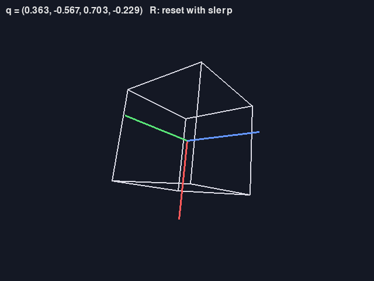
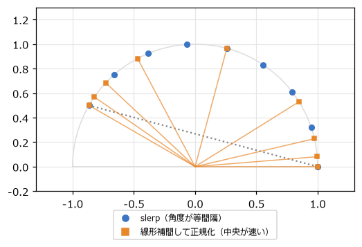

3D の回転とクォータニオン
=========================

2D の回転は角度 1 つで表せた。3D では、回転の軸も選べるので、回転の表し方がずっと難しくなる。この章では、3D のベクトルの基本を確認した後、3D の回転を表す方法としてオイラー角とクォータニオンを比べる。2D のゲームだけを作る場合は、この章は後回しにしてよい。

3D のベクトルと外積
-------------------

3D のベクトル :math:`(x, y, z)` の足し算・引き算・スカラー倍・長さ・正規化・内積は、2D に z 成分を加えるだけで同じように計算できる。内積の意味（前後の判定、視界の判定、射影）もそのまま使える。

3D の\ **外積**\ は、2 つのベクトルの両方に垂直なベクトルを作る演算である。

.. math::

   \mathbf{a} \times \mathbf{b} = (a_y b_z - a_z b_y,\ a_z b_x - a_x b_z,\ a_x b_y - a_y b_x)

外積の長さは :math:`|\mathbf{a}|\,|\mathbf{b}|\sin\theta` で、2 つのベクトルが作る平行四辺形の面積に等しい。第 4 章の 2D の外積は、この z 成分だけを取り出したものである。3D のゲームでは、三角形の 2 辺の外積から、その面の\ **法線**\ （面に垂直な向き）を求める用途がよく使われる。法線は、光の当たり方の計算や、坂道の傾きの判定に使う。

右手系と左手系
~~~~~~~~~~~~~~

3D の座標系には、x 軸・y 軸・z 軸の向きの組み合わせ方で\ **右手系**\ と\ **左手系**\ の 2 種類がある。右手の親指・人差し指・中指をそれぞれ x 軸・y 軸・z 軸に合わせられるのが右手系、左手で合わせられるのが左手系である。外積の結果の向きや、正の回転の向きは、どちらの系かによって見え方が逆になる。

ゲームエンジンによって採用している系が異なる（Unity は左手系、Godot や Blender は右手系）。別のツールからデータを持ち込むときは、z 軸の反転などの変換が必要になることがある。本書の ``cube_demo.py`` は、x 軸が右、y 軸が上、z 軸が画面の奥向きの左手系で描いている。

オイラー角とジンバルロック
--------------------------

3D の回転を表す最も直感的な方法は、3 つの軸の周りの回転角を組み合わせることである。この 3 つの角度の組を\ **オイラー角**\ と呼ぶ。飛行機にたとえて、上下の軸の周りの回転（左右に向きを変える）を\ **ヨー**、左右の軸の周りの回転（機首を上げ下げする）を\ **ピッチ**、前後の軸の周りの回転（機体を傾ける）を\ **ロール**\ と呼ぶ。

オイラー角は人間にとって分かりやすく、エディターで回転を入力する場面や、FPS のカメラ（左右の向きと上下の向きだけを持つ）には向いている。一方で、次のような問題がある。

- **回転を適用する順序で結果が変わる。**\ 前の章で見たように、回転の合成は順序で結果が変わる。どの順で回すかを決めておかないと、同じ 3 つの角度でも違う向きになる。
- **補間がうまくいかない。** 2 つの向きの間を、各角度を別々に補間して動かすと、遠回りをしたり、ふらつくような動きになったりする。
- **ジンバルロックが起きる。**

**ジンバルロック**\ は、ある軸の回転が特定の角度になると、残りの 2 つの軸が同じ向きにそろってしまい、回転の自由度が 1 つ失われる現象である。``quaternion.py`` では、ロール（z 軸）→ ピッチ（x 軸）→ ヨー（y 軸）の順に回すオイラー角を使っている。ピッチを 90° にすると、ヨーとロールが同じ軸の回転になり、次の 3 つの角度の組がすべて同じ向きになる。

.. code-block:: text
   :linenos:
   :caption: quaternion.py の実行結果（一部）

   yaw= 30, pitch=90, roll=  0: x 軸 -> ( 0.866,  0.000, -0.500), y 軸 -> ( 0.500,  0.000,  0.866)
   yaw=  0, pitch=90, roll=-30: x 軸 -> ( 0.866,  0.000, -0.500), y 軸 -> ( 0.500,  0.000,  0.866)
   yaw= 60, pitch=90, roll= 30: x 軸 -> ( 0.866,  0.000, -0.500), y 軸 -> ( 0.500,  0.000,  0.866)

この状態では、ヨーとロールのどちらを変えても同じ向きの回転しかできず、「機首を左右に振る」回転を表せない。角度の値は自由に変えられるのに、向きの変化の自由度が 2 つに減ってしまうのである。

回転軸と回転角
--------------

3D のどんな向きの変化も、「ある軸の周りに、ある角度だけ回す」1 回の回転で表せる（オイラーの回転定理）。この\ **回転軸と回転角**\ による表し方には、順序の問題もジンバルロックも無い。この考え方を、計算しやすい形にしたものがクォータニオンである。

クォータニオン
--------------

**クォータニオン**\ （四元数）は、4 つの数の組 :math:`q = (w, x, y, z)` である。回転を表すときは、回転軸の単位ベクトル :math:`\mathbf{u}` と回転角 :math:`\theta` から、次のように作る。

.. math::

   q = \left(\cos\frac{\theta}{2},\ u_x \sin\frac{\theta}{2},\ u_y \sin\frac{\theta}{2},\ u_z \sin\frac{\theta}{2}\right)

角度が半分になっているのは、後述のベクトルの回転の式でクォータニオンを 2 回掛けるためである。このように作ったクォータニオンは長さが 1 になる。

.. literalinclude:: ../examples/quaternion.py
   :language: python
   :linenos:
   :pyobject: Quat.from_axis_angle
   :caption: examples/quaternion.py の Quat.from_axis_angle メソッド

クォータニオンの数学的な定義（虚数単位を 3 つに拡張した数）を深く理解しなくても、ゲームで使うには次の 3 つの操作を知っていれば十分である。本書では、クォータニオンを「回転を表すデータ」として扱う。

回転の合成
~~~~~~~~~~

2 つのクォータニオンの積 :math:`q_1 q_2` は、「:math:`q_2` で回してから :math:`q_1` で回す」回転を表す。行列と同じく、右から順に適用され、掛ける順序を入れ替えると結果が変わる。積は次のように計算する。

.. literalinclude:: ../examples/quaternion.py
   :language: python
   :linenos:
   :pyobject: Quat.__mul__
   :caption: examples/quaternion.py の Quat.__mul__ メソッド

ベクトルの回転
~~~~~~~~~~~~~~

ベクトル :math:`\mathbf{v}` を、:math:`w = 0` のクォータニオン :math:`(0, \mathbf{v})` とみなし、:math:`q` とその\ **共役** :math:`q^* = (w, -x, -y, -z)` で挟んで掛けると、回転したベクトルが得られる。

.. math::

   (0, \mathbf{v}') = q \, (0, \mathbf{v}) \, q^*

長さ 1 のクォータニオンでは、共役は逆回転を表す。

.. literalinclude:: ../examples/quaternion.py
   :language: python
   :linenos:
   :pyobject: Quat.rotate
   :caption: examples/quaternion.py の Quat.rotate メソッド

正規化
~~~~~~

回転を何度も掛け合わせると、浮動小数点数の誤差で長さが 1 からずれていく。長さがずれると、ベクトルを回したときに拡大縮小も起きてしまう。ときどき正規化（長さで割る）して長さを 1 に戻す。``cube_demo.py`` では毎フレーム正規化している。

``cube_demo.py`` は、立方体の向きを 1 つのクォータニオンで持ち、キー入力に応じて小さな回転を掛け合わせる。どの向きからでも 3 つの軸の周りに自由に回せ、ジンバルロックは起きない（:numref:`fig-screen-cube`）。

.. _fig-screen-cube:

   cube_demo.py の画面。赤・緑・青の線は、立方体のローカルの x 軸・y 軸・z 軸

なお、:math:`q` と :math:`-q` は同じ回転を表す。:math:`-q` は「反対向きの軸の周りに、:math:`360^\circ - \theta` だけ回す」ことに当たり、結果の向きは同じになるからである。この性質は、次の補間で問題になる。

球面線形補間
------------

2 つの向き :math:`a` と :math:`b` の間を滑らかに回転させたい場面は多い。カメラを別の向きへ切り替える、キャラクターを目標の方へゆっくり振り向かせる、2 つのアニメーションをつなぐ、などである。

クォータニオンの 4 つの成分を別々に線形補間してから正規化する方法（nlerp）でも、それらしい回転になる。ただし、:numref:`fig-slerp` のように、補間の途中で回転の速さが一定にならない（中央付近で速くなる）。

.. _fig-slerp:

   球面線形補間（青）と、線形補間して正規化する方法（橙）。2 次元の単位円で示している

**球面線形補間**\ （slerp）は、2 つのクォータニオンを結ぶ「球面上の最短の弧」に沿って、一定の角速度で補間する。2 つのクォータニオンのなす角を :math:`\Omega`\ （:math:`\cos\Omega = a \cdot b`）とすると、次の式になる。

.. math::

   \mathrm{slerp}(a, b, t) = \frac{\sin((1 - t)\Omega)}{\sin\Omega} \, a + \frac{\sin(t\Omega)}{\sin\Omega} \, b

.. literalinclude:: ../examples/quaternion.py
   :language: python
   :linenos:
   :pyobject: slerp
   :caption: examples/quaternion.py の slerp 関数

実装では 2 つの点に注意している。

- **内積が負なら、片方の符号を反転する。** :math:`q` と :math:`-q` は同じ回転なので、内積が負のときは :math:`-b` の方が :math:`a` に近い。反転しないと、360° に近い遠回りの回転になる。
- **2 つがほとんど同じ向きなら、線形補間で代用する。** :math:`\Omega` が 0 に近いと :math:`\sin\Omega` も 0 に近くなり、0 に近い数で割って誤差が大きくなるからである。

``cube_demo.py`` で R キーを押すと、そのときの向きから最初の向きへ、slerp で 1 秒かけて戻る。

ゲームエンジンでの回転の扱い
----------------------------

主要なゲームエンジンは、内部では回転をクォータニオンで持ち、エディターではオイラー角で表示・入力させることが多い。

.. list-table:: ゲームエンジンでの 3D の回転
   :header-rows: 1
   :widths: 20 40 40

   * - エンジン
     - 回転を表すクラス
     - 補間
   * - Unity
     - ``Quaternion``\ （``transform.rotation``）。エディターではオイラー角（``eulerAngles``）
     - ``Quaternion.Slerp``
   * - Godot
     - ``Quaternion``、``Basis``\ （3×3 行列）
     - ``Quaternion.slerp``

エンジンを使う場合は、クォータニオンの式を自分で書くことはまず無い。ただし、「オイラー角の値を少しずつ変えて回すとジンバルロックが起きることがある」「回転の合成は順序で結果が変わる」「補間には slerp を使う」の 3 点を知っていると、思いどおりに回らないときに原因を見つけやすい。
