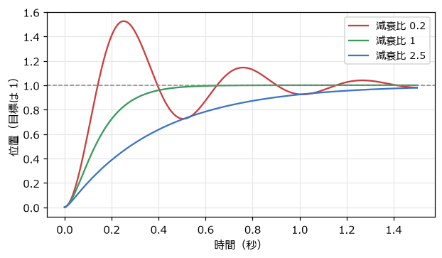
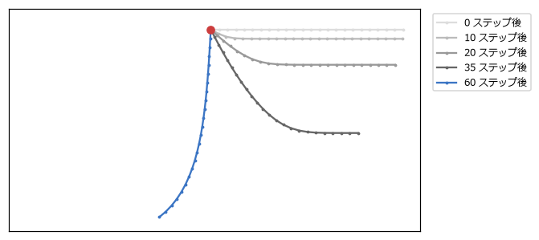
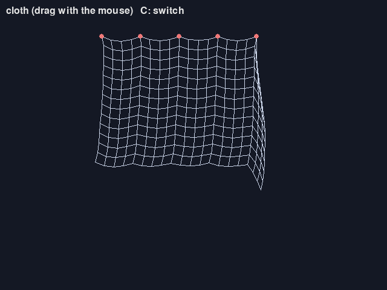

ばね・拘束・粒子
================

この章では、ゲームの演出や表現でよく使う 3 つの物理を扱う。揺れて戻る動きを作るばね、ロープや布を作る拘束、火花や煙を作るパーティクルである。どれも、これまでの章の道具の組み合わせで作れる。

ばねとダンパー
--------------

ばねは、自然な長さからのずれに比例する力で、元に戻ろうとする（**フックの法則**）。ばねだけでは永遠に揺れ続けるので、速度に比例するブレーキの力（**ダンパー**、減衰力）を組み合わせる。目標の位置 :math:`x_0` に向かうばねとダンパーの加速度は、質量 1 あたりで次のようになる。

.. math::

   a = -k\,(x - x_0) - c\,v

:math:`k` を\ **ばね定数**、:math:`c` を\ **減衰係数**\ と呼ぶ。:math:`k` が大きいほど硬く速く揺れ、:math:`c` が大きいほど揺れが早く収まる。

.. literalinclude:: ../examples/spring.py
   :language: python
   :linenos:
   :pyobject: spring_step
   :caption: examples/spring.py の spring_step 関数

固有振動数と減衰比で調整する
~~~~~~~~~~~~~~~~~~~~~~~~~~~~

:math:`k` と :math:`c` を直接調整するのは難しい。第 10 章のジャンプと同じく、人間が感覚的に分かる値から求めるとよい。

- **固有振動数** :math:`f`: 減衰が無いときに 1 秒間に揺れる回数（Hz）。速さの目安になる。
- **減衰比** :math:`\zeta`: 揺れの収まり方。1 未満なら行き過ぎて揺れながら収まり、1 ならちょうど揺れずに最も早く収まり、1 より大きいと揺れずにゆっくり近づく。

角振動数を :math:`\omega = 2\pi f` とすると、次の関係がある。

.. math::

   k = \omega^2, \qquad c = 2\,\zeta\,\omega

.. literalinclude:: ../examples/spring.py
   :language: python
   :linenos:
   :pyobject: spring_coefficients
   :caption: examples/spring.py の spring_coefficients 関数

:numref:`fig-spring-response` は、固有振動数 2 Hz で減衰比だけを変えたときの動きである。減衰比 1 の状態を\ **臨界減衰**\ と呼ぶ。

.. _fig-spring-response:

   減衰比によるばねの動きの違い（固有振動数 2 Hz）

``spring.py`` では、3 つの四角がそれぞれの減衰比でマウスを追いかける。第 8 章の ``damp`` との違いは、速度を持っていることである。``damp`` は目標が急に動くと即座に向きを変えるが、ばねは勢いが残るので、行き過ぎたり、遅れて動き出したりする。

ばねは、ゲームの次のような場面で使われる。

- ボタンを押したときに、ぷるんと揺れて元の大きさに戻る UI
- 着地したときに、キャラクターがつぶれてから元に戻る動き（第 15 章）
- 目標に少し遅れて、勢いよくついてくるカメラ
- 揺れる髪やアクセサリー

ばねが硬い（:math:`k` が大きい）ほど、数値積分は不安定になりやすい。目安として、:math:`\omega\,\Delta t` が 1 より十分小さくなるようにする。固有振動数 2 Hz、60 FPS なら :math:`\omega\,\Delta t \approx 0.21` で問題無い。

拘束とベルレ法
--------------

ロープや鎖は、「隣り合う点の距離が一定」という条件を満たしながら動く。このような条件を\ **拘束**\ と呼ぶ。拘束を、硬いばねで近似することもできるが、ばねを硬くするほど不安定になる。そこで、力を計算する代わりに、条件を満たすように位置を直接動かす方法がよく使われる。

位置ベルレ法
~~~~~~~~~~~~

位置を直接動かす方法と相性が良いのが\ **位置ベルレ法**\ である。各点は速度を持たず、「今の位置」と「1 ステップ前の位置」だけを持つ。速度は 2 つの位置の差から求める。

.. math::

   \mathbf{x}_{\text{次}} = \mathbf{x}_{\text{今}} + (\mathbf{x}_{\text{今}} - \mathbf{x}_{\text{前}}) + \mathbf{a}\,\Delta t^2

.. literalinclude:: ../examples/rope.py
   :language: python
   :linenos:
   :pyobject: verlet_step
   :caption: examples/rope.py の verlet_step 関数

速度を別に持たないので、拘束で位置を動かすと、その分が自動的に速度に反映される。たとえば、拘束によって点を上に動かすと、次のステップでは上向きの速度を持っているように扱われる。

距離拘束
~~~~~~~~

2 つの点の距離を一定に保つ\ **距離拘束**\ は、次のように満たす。今の距離と決められた長さの差を求め、2 つの点を結ぶ線の向きに、差の半分ずつ動かす（固定された点は動かさず、もう一方を全部動かす）。

.. literalinclude:: ../examples/rope.py
   :language: python
   :linenos:
   :pyobject: satisfy
   :caption: examples/rope.py の satisfy 関数

1 つの拘束を満たすと、隣の拘束がずれる。そこで、すべての拘束を順に満たす処理を何回か繰り返す。繰り返すほど伸びにくくなるが、計算は重くなる。``rope.py`` では 12 回繰り返している。この方法は、Thomas Jakobsen が 2001 年に発表した手法として知られ、ゲームのロープや布、ラグドール（力の抜けた人体）の表現に広く使われてきた。

:numref:`fig-rope-frames` は、左端を固定した水平なロープが重力で垂れ下がっていく様子である。

.. _fig-rope-frames:

   左端を固定したロープ（赤い点）が垂れ下がる様子

布とソフトボディー
------------------

点を格子状に並べ、縦と横に隣り合う点を距離拘束で結べば、布になる。``rope.py`` で C キーを押すと、布に切り替わる（:numref:`fig-screen-rope`）。上の辺のいくつかの点を固定しているので、カーテンのように垂れ下がる。マウスでつかんで引っ張ることもできる。

.. _fig-screen-rope:

   rope.py の布

斜めの点どうしも拘束で結ぶと、布がせん断（ひし形につぶれる変形）に抵抗するようになる。さらに、閉じた形の点を拘束で結べば、ぷよぷよした弾力のある物体（**ソフトボディー**）も作れる。

パーティクル
------------

火花、煙、爆発、水しぶき、魔法のエフェクトなどは、たくさんの小さな粒（**パーティクル**）で表現する。1 つ 1 つのパーティクルは、位置・速度・残り寿命などを持つだけの単純な点である。

.. literalinclude:: ../examples/particles.py
   :language: python
   :linenos:
   :pyobject: update_particles
   :caption: examples/particles.py の update_particles 関数

重力と空気抵抗を受けて動かし、寿命が尽きたら消す。空気抵抗には、第 10 章で述べた指数関数的な減衰を使っている。描画では、残り寿命の割合で大きさと明るさを変え、消える直前に目立たなくする。

パーティクルの見た目は、発生のさせ方でほぼ決まる。

- **爆発**: 1 か所から全方向へ、ばらばらの速さで一度に多数出す（``burst`` 関数）。
- **噴水**: 1 か所から上向きに、少し広がりを持たせて毎秒一定の数を出す（``fountain`` 関数）。

1 秒あたり 120 個を出すとき、1 フレームに出す数は 60 FPS なら 2 個、144 FPS なら約 0.83 個になる。端数を次のフレームに持ち越すようにすると、フレームレートによらず 1 秒あたりの数が一定になる（``particles.py`` の ``spawn_debt``）。

パーティクルは数が多くなるので、生成と破棄を繰り返すとメモリーの確保と解放の負担が大きくなる。実際のゲームでは、あらかじめ決まった数のパーティクルを用意しておき、使い終わったものを再利用する\ **オブジェクトプール**\ という方法がよく使われる。
