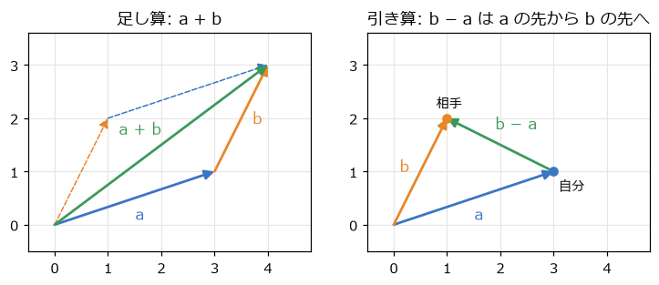
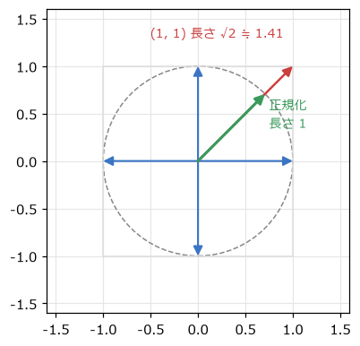
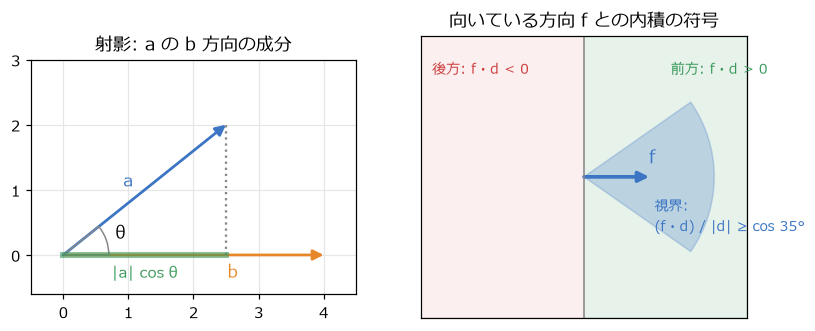
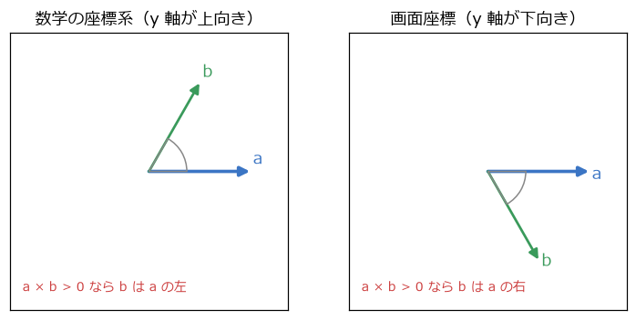
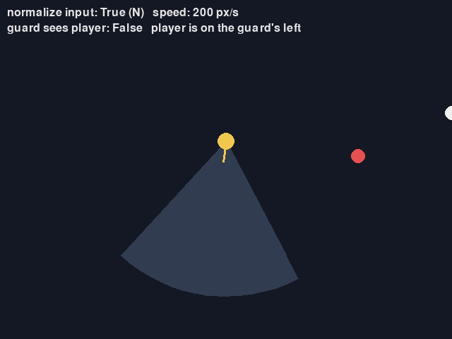
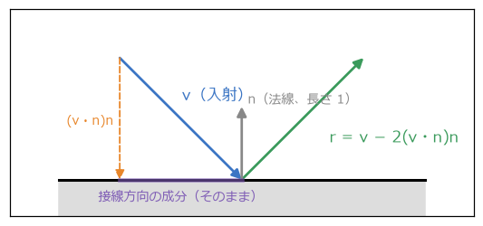

ベクトル
========

ゲームの数学で最もよく使う道具が\ **ベクトル**\ である。位置、移動量、速度、向き、力など、「大きさと向きを持つ量」はすべてベクトルで表せる。この章では、2 次元のベクトルの演算と、それぞれがゲームのどんな場面で役に立つかを見ていく。

ベクトルで位置・変位・速度を表す
--------------------------------

2 次元のベクトルは、2 つの数の組 :math:`\mathbf{v} = (v_x, v_y)` である。ゲームでは、同じ「数の組」を次のような意味で使い分ける。

.. list-table:: ゲームで使うベクトル
   :header-rows: 1
   :widths: 20 50 30

   * - 意味
     - 例
     - 単位
   * - 位置
     - プレイヤーの位置 (120, 360)
     - ピクセル
   * - 変位
     - 1 フレームの移動量、自分から敵へのずれ
     - ピクセル
   * - 速度
     - 右へ毎秒 200、上へ毎秒 50 で動く: (200, −50)
     - ピクセル毎秒
   * - 向き
     - 右向き (1, 0)。長さを 1 にそろえることが多い
     - なし

位置は「原点からの変位」とみなせるので、位置と変位は同じ計算で扱える。一方、向きを表すベクトルは長さが意味を持たないので、長さを 1 にそろえて使う（後述の正規化）。

本書では、ベクトルの仕組みを理解するために、まず自前のクラス ``Vec2`` を作る。:numref:`code-vec2-head` はその冒頭である。``dataclass(frozen=True)`` にしているので、演算は元のベクトルを変更せず、新しいベクトルを返す。

.. _code-vec2-head:

.. literalinclude:: ../examples/vec2.py
   :language: python
   :linenos:
   :start-at: @dataclass(frozen=True)
   :end-before: def __truediv__
   :caption: examples/vec2.py の Vec2 クラス（冒頭）

足し算・引き算とスカラー倍
--------------------------

ベクトルの足し算と引き算は、成分ごとに行う。

.. math::

   \mathbf{a} + \mathbf{b} = (a_x + b_x,\ a_y + b_y), \qquad \mathbf{a} - \mathbf{b} = (a_x - b_x,\ a_y - b_y)

:numref:`fig-vector-add` の左のように、足し算は矢印をつなげることに当たる。「今の位置」に「移動量」を足すと「次の位置」になる。

.. math::

   \mathbf{p}_{\text{次}} = \mathbf{p}_{\text{今}} + \mathbf{v} \, \Delta t

これは第 3 章の移動の式を、x と y をまとめてベクトルで書いたものである。

引き算は、:numref:`fig-vector-add` の右のように「a の先から b の先へ向かう矢印」になる。自分の位置 :math:`\mathbf{a}` から相手の位置 :math:`\mathbf{b}` を見た変位は :math:`\mathbf{b} - \mathbf{a}` である。追尾、照準、距離の計算など、2 つの物の関係を調べるときは、ほとんどの場合この引き算から始まる。

.. _fig-vector-add:

   ベクトルの足し算（左）と引き算（右）

ベクトルに数（**スカラー**）を掛けると、各成分にその数が掛かり、向きはそのままで長さが変わる。負の数を掛けると向きが反転する。

.. math::

   k \, \mathbf{a} = (k a_x,\ k a_y)

長さと正規化
------------

ベクトルの\ **長さ**\ （大きさ）は、三平方の定理で求める。

.. math::

   |\mathbf{a}| = \sqrt{a_x^2 + a_y^2}

2 点 :math:`\mathbf{a}`、:math:`\mathbf{b}` の距離は、引き算したベクトルの長さ :math:`|\mathbf{b} - \mathbf{a}|` である。

距離を比べるだけなら、平方根を取らずに長さの 2 乗どうしを比べればよい。たとえば「距離が 100 以内か」は「長さの 2 乗が 10000 以内か」と同じである。平方根の計算は比較的重いので、たくさんの物について距離を調べるときに役立つ。

長さが 1 のベクトルを\ **単位ベクトル**\ と呼び、ベクトルをその長さで割って単位ベクトルにすることを\ **正規化**\ と呼ぶ。

.. math::

   \hat{\mathbf{a}} = \frac{\mathbf{a}}{|\mathbf{a}|}

.. literalinclude:: ../examples/vec2.py
   :language: python
   :linenos:
   :pyobject: Vec2.normalized
   :caption: examples/vec2.py の Vec2.normalized メソッド

長さ 0 のベクトルには向きが無いので正規化できない。0 で割らないよう、長さが非常に小さいときは特別に扱う。

斜め移動が速くなる問題
~~~~~~~~~~~~~~~~~~~~~~

正規化が必要になる代表的な場面が、キー入力による 8 方向の移動である。右キーで (1, 0)、下キーで (0, 1) の入力ベクトルを作り、速さを掛けて移動させるとする。右と下を同時に押すと入力ベクトルは (1, 1) になり、:numref:`fig-diagonal` のように長さが :math:`\sqrt{2} \approx 1.41` になる。そのため、斜めに移動すると約 1.41 倍速くなってしまう。

.. _fig-diagonal:

   斜めの入力ベクトルは長さが √2 になる

入力ベクトルを正規化してから速さを掛ければ、どの向きにも同じ速さで動く。

.. literalinclude:: ../examples/vectors_demo.py
   :language: python
   :linenos:
   :start-at: direction = read_input(pygame.key.get_pressed())
   :end-at: player += velocity * dt
   :dedent: 8
   :caption: examples/vectors_demo.py の移動の処理

``vectors_demo.py`` では、N キーで正規化の有無を切り替え、画面の上に表示される速さで違いを確かめられる。なお、ゲームパッドのスティックのように入力の大きさが連続的に変わる場合は、正規化すると「少し倒すとゆっくり歩く」ことができなくなる。その場合は、長さが 1 を超えたときだけ 1 に縮める。

一定の速さで目標へ近づく
~~~~~~~~~~~~~~~~~~~~~~~~

追跡者が目標へ一定の速さで近づく処理も、引き算と正規化でできる。

.. literalinclude:: ../examples/vectors_demo.py
   :language: python
   :linenos:
   :pyobject: move_toward
   :caption: examples/vectors_demo.py の move_toward 関数

目標までの距離が 1 フレームの移動量より短いときは、目標の位置に置く。こうしないと、目標を行き過ぎて戻る動きを毎フレーム繰り返し、目標の周りで震えてしまう。

内積
----

2 つのベクトルの\ **内積**\ は、次のように成分の積の和で計算する。

.. math::

   \mathbf{a} \cdot \mathbf{b} = a_x b_x + a_y b_y

内積には、2 つのベクトルのなす角を :math:`\theta` とすると、次の関係がある。

.. math::

   \mathbf{a} \cdot \mathbf{b} = |\mathbf{a}| \, |\mathbf{b}| \cos\theta

成分の掛け算と足し算だけで、角度の情報（:math:`\cos\theta`）が得られるのが内積の便利なところである。ゲームでは主に次の 3 つの使い方をする。

前か後ろかの判定
~~~~~~~~~~~~~~~~

:math:`\cos\theta` は、:math:`\theta` が 90° 未満なら正、90° より大きければ負になる。そのため、向いている方向 :math:`\mathbf{f}` と、相手への変位 :math:`\mathbf{d}` の内積の符号を見れば、相手が前方にいるか後方にいるかが分かる（:numref:`fig-dot-product` の右）。

- :math:`\mathbf{f} \cdot \mathbf{d} > 0`: 前方にいる
- :math:`\mathbf{f} \cdot \mathbf{d} = 0`: 真横にいる
- :math:`\mathbf{f} \cdot \mathbf{d} < 0`: 後方にいる

背後からの攻撃にだけ大きなダメージを与える、といった判定に使える。

視界の判定
~~~~~~~~~~

:math:`\mathbf{f}` を単位ベクトルにし、:math:`\mathbf{d}` も正規化すれば、内積はちょうど :math:`\cos\theta` になる。これを視界の半分の角度の :math:`\cos` と比べれば、扇形の視界に入っているかを判定できる。角度そのものを求める必要は無い。

.. literalinclude:: ../examples/vectors_demo.py
   :language: python
   :linenos:
   :pyobject: is_in_view
   :caption: examples/vectors_demo.py の is_in_view 関数

:math:`\cos` は角度が大きくなるほど小さくなるので、「なす角が 35° 以内」は「:math:`\cos\theta \ge \cos 35^\circ`」と同じ意味になる。``COS_VIEW_HALF_ANGLE`` はあらかじめ計算しておく。

.. _fig-dot-product:

   内積による射影（左）と、前後・視界の判定（右）

射影
~~~~

:math:`\mathbf{b}` が単位ベクトルなら、内積 :math:`\mathbf{a} \cdot \mathbf{b}` は「:math:`\mathbf{a}` のうち :math:`\mathbf{b}` の方向の成分の長さ」になる（:numref:`fig-dot-product` の左）。これに :math:`\mathbf{b}` を掛けたベクトルを、:math:`\mathbf{a}` の :math:`\mathbf{b}` 方向への\ **射影**\ と呼ぶ。:math:`\mathbf{b}` が単位ベクトルでない場合も含めると、次の式になる。

.. math::

   \mathrm{proj}_{\mathbf{b}} \mathbf{a} = \frac{\mathbf{a} \cdot \mathbf{b}}{\mathbf{b} \cdot \mathbf{b}} \, \mathbf{b}

射影は、速度を「壁に垂直な成分」と「壁に沿った成分」に分けるときや、点から直線への最短距離を求めるときに使う。第 11 章と第 12 章で何度も登場する。

2D の外積
---------

3 次元のベクトルには、2 つのベクトルの両方に垂直なベクトルを作る\ **外積**\ という演算がある（第 7 章）。2 次元では、その z 成分にあたる次の値を「2D の外積」と呼んで使う。

.. math::

   \mathbf{a} \times \mathbf{b} = a_x b_y - a_y b_x = |\mathbf{a}| \, |\mathbf{b}| \sin\theta

内積が :math:`\cos\theta` を与えるのに対し、2D の外積は :math:`\sin\theta` を与える。:math:`\sin\theta` の符号は、:math:`\mathbf{b}` が :math:`\mathbf{a}` から見てどちら側にあるかで決まる。つまり、外積の符号で左右を判定できる。

ただし、:numref:`fig-cross-sign` のように、符号と左右の対応は座標系の向きによって逆になる。

.. _fig-cross-sign:

   外積の符号と左右の関係は、y 軸の向きで逆になる

.. list-table:: 2D の外積の符号の意味
   :header-rows: 1
   :widths: 30 35 35

   * - 外積 a × b
     - 数学の座標系（y 軸が上向き）
     - 画面座標（y 軸が下向き）
   * - 正
     - b は a の左（反時計回り側）
     - b は a の右（画面上で時計回り側）
   * - 負
     - b は a の右
     - b は a の左

.. literalinclude:: ../examples/vectors_demo.py
   :language: python
   :linenos:
   :pyobject: side_of
   :caption: examples/vectors_demo.py の side_of 関数

外積の使い道には、左右の判定のほか、旋回する向きの決定（目標が右にいれば右に曲がる）、点が多角形の内側にあるかの判定、三角形の面積の計算（外積の絶対値の半分）などがある。

:numref:`fig-screen-vectors` は ``vectors_demo.py`` の画面である。見張り（黄）の扇形の視界にプレイヤー（白）が入ると、扇形が赤くなる。画面の上には、プレイヤーが見張りの左右どちらにいるかが表示される。

.. _fig-screen-vectors:

   vectors_demo.py の画面

反射ベクトル
------------

ボールや弾が壁で跳ね返るときの向きは、射影を使って求められる。壁に垂直な単位ベクトル :math:`\mathbf{n}`\ （**法線**）を使うと、入ってくる速度 :math:`\mathbf{v}` は、壁に垂直な成分 :math:`(\mathbf{v} \cdot \mathbf{n}) \mathbf{n}` と、壁に沿った成分に分けられる。跳ね返るときは、壁に沿った成分はそのままで、垂直な成分だけが反転する。垂直な成分を 2 回引けば反転するので、反射したベクトル :math:`\mathbf{r}` は次の式になる（:numref:`fig-reflection`）。

.. math::

   \mathbf{r} = \mathbf{v} - 2 (\mathbf{v} \cdot \mathbf{n}) \, \mathbf{n}

.. _fig-reflection:

   反射ベクトル

.. literalinclude:: ../examples/reflect_demo.py
   :language: python
   :linenos:
   :pyobject: reflect
   :caption: examples/reflect_demo.py の reflect 関数

法線 :math:`\mathbf{n}` は長さ 1 でなければならない。また、:math:`\mathbf{n}` を反対向きにしても結果は変わらない（式の中で :math:`\mathbf{n}` が 2 回掛かるため）。``reflect_demo.py`` では、Q キーと E キーで鏡を回しながら、マウスの位置から飛ばした光線の反射を確かめられる。壁に垂直な速度の成分を「反転」ではなく「縮めて反転」すると、跳ね返りの弱いボールになる。これは第 12 章の反発係数につながる。

pygame.Vector2 を使う
---------------------

ここまでの演算は、pygame-ce の ``pygame.Vector2`` にすべて用意されている。仕組みを理解したら、実際のゲームではライブラリーのクラスを使えばよい。本書のサンプルコードも、この章以降は ``pygame.Vector2`` を使う。

.. list-table:: Vec2 と pygame.Vector2 の対応
   :header-rows: 1
   :widths: 35 35 30

   * - 演算
     - 自作の Vec2
     - pygame.Vector2
   * - 長さ
     - ``v.length()``
     - ``v.length()``
   * - 長さの 2 乗
     - ``v.length_squared()``
     - ``v.length_squared()``
   * - 正規化
     - ``v.normalized()``
     - ``v.normalize()``
   * - 内積
     - ``a.dot(b)``
     - ``a.dot(b)``
   * - 2D の外積
     - ``a.cross(b)``
     - ``a.cross(b)``
   * - 射影
     - ``a.project_onto(b)``
     - ``a.project(b)``
   * - 反射
     - ``v.reflect(n)``
     - ``v.reflect(n)``
   * - 回転（第 5 章）
     - ``v.rotated(角度)``
     - ``v.rotate_rad(角度)``、``v.rotate(度)``
   * - 2 点の距離
     - ``(b - a).length()``
     - ``a.distance_to(b)``

注意点として、``pygame.Vector2`` は ``frozen`` ではなく、``v.x = 3`` や ``v += w`` のように中身を書き換えられる。同じベクトルを 2 か所で共有していると、片方の変更がもう片方に伝わってしまう。位置をコピーして保存したいときは ``pygame.Vector2(v)`` で新しいベクトルを作る。また、``pygame.Vector2.normalize`` は長さ 0 のベクトルに対して例外を出すので、呼ぶ前に長さを確かめる。

``test_vec2.py`` では、自作の ``Vec2`` と ``pygame.Vector2`` の結果が一致することを確かめている。
