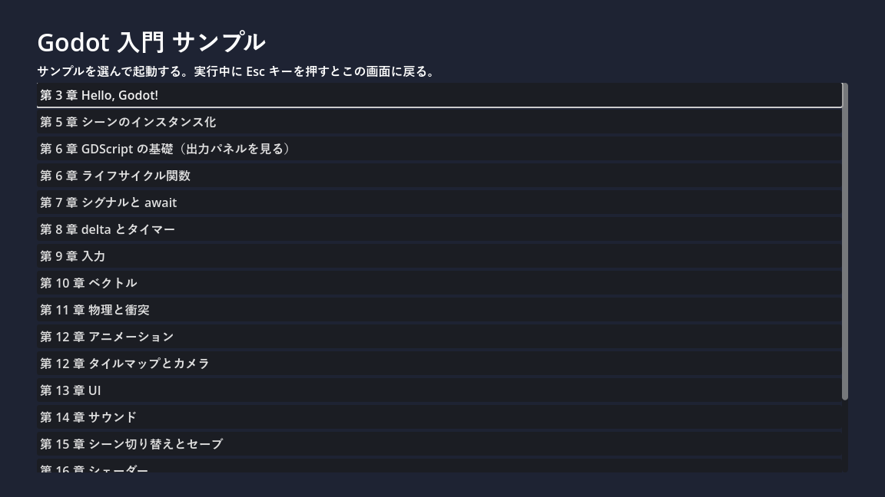

.. _ch01:

=================
第 1 章　はじめに
=================

本章では、本書の目的と対象読者、構成、表記の決まり、サンプルコードの使い方を説明する。

本書の目的
==========

Godot（ゴドー）は、2D と 3D のゲームを作れるオープンソースのゲームエンジンである。軽量で起動が速く、インストール不要の実行ファイル 1 つで動く。ライセンスは MIT ライセンスで、作ったゲームの売上に対する使用料もかからない。

本書の目的は、ゲーム制作が初めての読者が Godot の基本的な考え方を理解し、小さな 2D ゲームを自力で完成させられるようになることである。そのために、次の 3 点を重視する。

* **ゲーム特有の考え方を説明する**：ゲームループ、フレーム、物理演算、座標系など、業務システムの開発ではあまりなじみのない概念を、なぜ必要なのかから説明する。
* **Python の知識を活かす**：Godot の主要なスクリプト言語である GDScript は、Python によく似た文法を持つ。似ている点と違う点を対比しながら説明する。
* **動くサンプルで確かめる**：各章の内容は、そのまま実行できるサンプルプロジェクトで確認できる。

対象読者と前提知識
==================

本書は次のような読者を想定している。

* Python などのプログラミング言語で、関数やクラスを使ったプログラムを書いた経験がある。
* ゲーム制作の経験はない。ゲームエンジンを使ったこともない。
* 高校程度の数学（ベクトル、三角関数）を、聞いたことはある。

ベクトルや三角関数は、必要になった時点で使い方を中心に説明する。数学の深い知識は必要ない。

本書の構成
==========

本書は 4 つの部と付録で構成する。

.. list-table:: 本書の構成
   :header-rows: 1
   :widths: 20 30 50

   * - 部
     - 章
     - 内容
   * - 第 I 部　準備
     - 第 1 章 ～ 第 4 章
     - Godot の概要、環境構築、エディターの画面構成を説明する。
   * - 第 II 部　基本概念
     - 第 5 章 ～ 第 8 章
     - ノードとシーン、GDScript、ゲームループという Godot の中心となる考え方を学ぶ。
   * - 第 III 部　ゲームの構成要素
     - 第 9 章 ～ 第 15 章
     - 入力、座標とベクトル、物理、描画とアニメーション、UI、サウンド、シーン管理とデータ保存を順に学ぶ。
   * - 第 IV 部　実践と発展
     - 第 16 章 ～ 第 21 章
     - シェーダーを学んだあと、それまでの知識を使って 1 本のゲームを完成させる。続いてデバッグ、エクスポート、3D の入り口、次に学ぶべきことを紹介する。
   * - 付録
     - 付録 A ～ 付録 E
     - 用語集、ショートカットキー一覧、トラブルシューティング、参考文献、サンプルファイル一覧

第 II 部までは順番に読むことを勧める。第 III 部の各章は比較的独立しているので、必要な章から読んでもよい。第 17 章のチュートリアルは第 III 部までの内容を前提とする。

動作環境
========

本書の内容は、次の環境で動作を確認している。

.. list-table:: 動作確認環境
   :header-rows: 1
   :widths: 30 70

   * - 項目
     - 内容
   * - OS
     - Windows 11
   * - Godot
     - Godot 4.7.2（標準版。.NET 版ではない）
   * - レンダラー
     - 互換性（Compatibility）。理由は :ref:`ch03` で説明する。

Godot 4 系は、マイナーバージョン（4.6、4.7 など）の間でも機能の追加や名前の変更がある。異なるバージョンを使う場合は、エディターの表示やプロパティ名が本書と異なることがある。Godot 3 系とは互換性がなく、本書の内容はそのままでは使えない。

表記の決まり
============

本書では次のように表記する。

.. list-table:: 表記の決まり
   :header-rows: 1
   :widths: 35 65

   * - 表記
     - 意味
   * - 「インスペクター」
     - エディターの画面上の名前（ドック、メニュー、ボタンなど）。Godot エディターを日本語で表示したときの名前を使い、必要に応じて英語の名前を括弧内に添える。
   * - 「位置（position）」
     - インスペクターに表示されるプロパティの名前。括弧内はスクリプトから参照するときの名前である。
   * - ``move_and_slide()``
     - コード中の識別子、ファイル名、入力する文字列
   * - :kbd:`Ctrl` + :kbd:`S`
     - キーボードのキー。:kbd:`Ctrl` を押しながら :kbd:`S` を押すことを表す。
   * - 「シーン」→「新規シーン」
     - メニューを順にたどる操作

Godot エディターの表示言語は、既定では OS の言語設定に従う。Windows を日本語で使っていれば、エディターも日本語で表示される。英語で表示したい場合の切り替え方は :ref:`ch03` で説明する。

サンプルコード
==============

本書のサンプルは、1 つの Godot プロジェクトにまとめている。次のリンクから zip ファイルをダウンロードできる。

* :download:`サンプルプロジェクト一式（zip ファイル） <../_generated/godot_introduction_examples.zip>`

zip ファイルを展開すると、``godot_introduction_examples`` フォルダーができる。:ref:`ch03` の手順で Godot をインストールしたあと、プロジェクトマネージャーの「インポート」でこのフォルダー内の ``project.godot`` を選ぶと、プロジェクトとして開ける。

プロジェクトを実行（:kbd:`F5`）すると、サンプルの一覧（ランチャー）が表示される。ボタンを押すとそのサンプルが起動し、実行中に :kbd:`Esc` キーを押すと一覧に戻る。

   サンプルの一覧（ランチャー）

サンプルプロジェクトのフォルダー構成は次のとおりである。

.. list-table:: サンプルプロジェクトのフォルダー構成
   :header-rows: 1
   :widths: 30 70

   * - フォルダー・ファイル
     - 内容
   * - ``project.godot``
     - プロジェクトの設定ファイル。入力アクションやオートロードの設定を含む。
   * - ``launcher/``
     - サンプルの一覧を表示するランチャー
   * - ``chapter03/`` ～ ``chapter20/``
     - 各章のサンプル。フォルダー名の数字が章番号に対応する。
   * - ``assets/``
     - 画像と効果音。すべて ``tools/generate_assets.py`` で生成したもので、外部の素材は使っていない。
   * - ``tools/``
     - 素材を生成する Python スクリプト
   * - ``gdlintrc``、``gdformatrc``、``setup.cfg``
     - サンプルコードを検査するツールの設定ファイル（後述）

各ファイルを個別に閲覧・ダウンロードするには、:ref:`examples-list` を使う。

本文中のコードには行番号を付けている。行番号はコードの一部ではないので、入力する必要はない。

サンプルコードの検査
--------------------

サンプルの GDScript は、Godot 公式の GDScript スタイルガイドに沿って書いている。また、次の方法で検査している。

* すべての変数、引数、戻り値に型を指定する。型の指定漏れはエディターが警告する設定にしている（:ref:`ch07` を参照）。
* GDScript の静的解析ツール gdtoolkit（``gdlint`` と ``gdformat``）で、命名規則や書式に違反がないことを確認する。設定は ``gdlintrc`` と ``gdformatrc`` に書いており、1 行の長さの上限は 120 文字とした。
* Python のスクリプト（``tools/generate_assets.py``）は、flake8 と mypy（``strict = True``）で検査する。設定は ``setup.cfg`` に書いている。

gdtoolkit は Python のパッケージとして提供されている。自分で検査する場合は、サンプルプロジェクトのフォルダーで次のコマンドを実行する。

.. code-block:: console
   :linenos:

   pip install "gdtoolkit==4.*" flake8 mypy pillow
   gdlint .
   gdformat --check .
   flake8
   mypy tools
