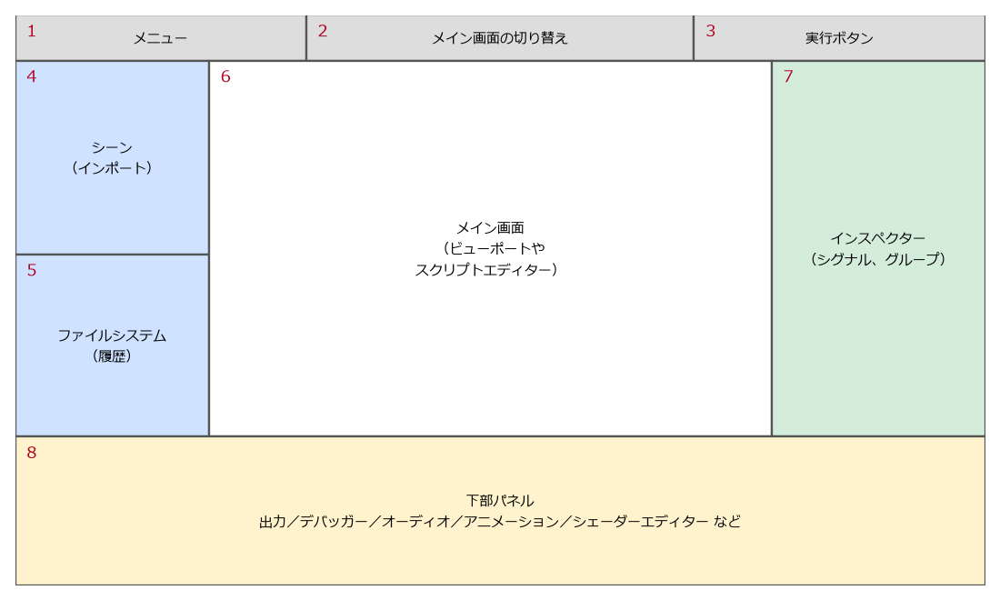

.. _ch04:

=============================
第 4 章　エディターの画面構成
=============================

本章では、Godot エディターの画面を構成する各部分の役割と、よく使う操作を説明する。最初からすべてを覚える必要はない。以降の章を読みながら、必要に応じて参照してほしい。

画面の全体像
============

エディターの画面は、既定では次の図のように配置されている。それぞれの区画を「ドック」と呼ぶ。ドックはドラッグして移動したり、タブとしてまとめたりできる。

   エディターの画面構成（模式図）

.. list-table:: 画面の各部分
   :header-rows: 1
   :widths: 8 27 65

   * - 番号
     - 名前
     - 役割
   * - 1
     - メニュー
     - 「シーン」「プロジェクト」「デバッグ」「エディター」「ヘルプ」のメニュー。シーンの保存、プロジェクト設定、エディター設定などを開く。
   * - 2
     - メイン画面の切り替え
     - 中央のメイン画面に表示する内容を「2D」「3D」「スクリプト」「ゲーム」「AssetLib」から選ぶ。
   * - 3
     - 実行ボタン
     - プロジェクトや現在のシーンを実行・一時停止・停止する。
   * - 4
     - シーンドック
     - 編集中のシーンのノードを木構造で表示する。「インポート」ドックがタブとして並んでいる。
   * - 5
     - ファイルシステムドック
     - プロジェクトのフォルダーの中身を表示する。「履歴」ドックがタブとして並んでいる。
   * - 6
     - メイン画面
     - シーンを視覚的に編集するビューポートや、スクリプトエディターなどを表示する。
   * - 7
     - インスペクタードック
     - 選んだノードやリソースのプロパティを表示・編集する。「シグナル」「グループ」ドックがタブとして並んでいる。
   * - 8
     - 下部パネル
     - 「出力」「デバッガー」「オーディオ」「アニメーション」「シェーダーエディター」などを切り替えて表示する。

シーンドック
============

シーンドックは、編集中のシーンを構成するノードの木構造（シーンツリー）を表示する。ここでノードの追加、削除、名前の変更、親子関係の変更を行う。

.. list-table:: シーンドックのよく使う操作
   :header-rows: 1
   :widths: 40 60

   * - 操作
     - 方法
   * - 子ノードを追加する
     - 親にしたいノードを選んで :kbd:`Ctrl` + :kbd:`A`、またはドック上部の「+」ボタン
   * - 別のシーンを子として追加する（インスタンス化）
     - :kbd:`Ctrl` + :kbd:`Shift` + :kbd:`A`、またはドック上部の鎖の形のボタン。ファイルシステムドックからシーンファイルをドラッグしてもよい。
   * - 名前を変える
     - ノードを選んで :kbd:`F2`、またはダブルクリック
   * - 複製する
     - :kbd:`Ctrl` + :kbd:`D`
   * - 親子関係を変える
     - ノードを別のノードの上へドラッグする。
   * - スクリプトを付ける
     - 右クリックして「スクリプトをアタッチ」
   * - ノードの種類を変える
     - 右クリックして「型を変更...」
   * - 一部をシーンとして切り出す
     - 右クリックして「ブランチをシーンとして保存…」

ノード名の右に表示されるアイコンにも意味がある。巻物の形のアイコンはスクリプトが付いていること、目の形のアイコンは表示・非表示の切り替えを表す。黄色い警告アイコンは、そのノードに設定が足りないことを示す。例えば、物理演算のノードに衝突形状が設定されていない場合に表示される。アイコンにマウスを重ねると、理由が表示される。

ファイルシステムドック
======================

ファイルシステムドックは、プロジェクトのフォルダー（``res://``）の中身を表示する。シーンやスクリプトはダブルクリックで開ける。画像ファイルをビューポートへドラッグすると、その画像を表示するノードが作られる。

.. warning::

   プロジェクト内のファイルを移動したり名前を変えたりするときは、Windows のエクスプローラーではなく、ファイルシステムドックで行う。Godot はシーンなどからの参照を自動で書き換えるが、エクスプローラーで操作すると参照が切れて、シーンを開けなくなることがある。

スクリプトやシェーダーのファイルの横には、``.uid`` という拡張子のファイルが自動で作られる。これは、ファイルを移動しても参照が切れないように、ファイルごとに一意の ID を記録したものである。元のファイルと一緒に保存・移動し、Git などで管理する場合もコミットしておく。

インスペクター
==============

インスペクターは、シーンドックで選んだノードのプロパティを表示し、編集する場所である。プロパティはノードの種類（クラス）ごとにまとめて表示される。例えば ``Sprite2D`` を選ぶと、``Sprite2D`` 固有のプロパティのあとに、継承元の ``Node2D``、``CanvasItem``、``Node`` のプロパティが順に並ぶ。

既定値から変更したプロパティの右には、元に戻すためのボタン（円弧の矢印）が表示される。プロパティ名にマウスを重ねると説明が表示され、右クリックからはスクリプトで使う名前をコピーできる。

インスペクターの右に並ぶ「シグナル」ドックと「グループ」ドックは、それぞれ選んだノードのシグナルとグループを編集する。シグナルは :ref:`ch07`、グループは :ref:`ch05` で説明する。

メイン画面
==========

メイン画面は、画面上部の切り替えボタンで表示内容を変える。

.. list-table:: メイン画面の種類
   :header-rows: 1
   :widths: 20 20 60

   * - 名前
     - ショートカット
     - 内容
   * - 2D
     - :kbd:`Ctrl` + :kbd:`F1`
     - 2D のシーンや UI を編集するビューポート
   * - 3D
     - :kbd:`Ctrl` + :kbd:`F2`
     - 3D のシーンを編集するビューポート
   * - スクリプト
     - :kbd:`Ctrl` + :kbd:`F3`
     - スクリプトエディター。GDScript の編集、組み込みのリファレンスの表示を行う。
   * - ゲーム
     - :kbd:`Ctrl` + :kbd:`F4`
     - 実行中のゲームを表示し、ゲームを止めてノードを選ぶなどの操作を行う。
   * - AssetLib
     - :kbd:`Ctrl` + :kbd:`F5`
     - アセットライブラリ。サンプルやプラグインを検索してダウンロードする。

2D ビューポートの操作
---------------------

2D ビューポートでは、マウスでノードを選んで動かせる。ツールバーのボタンかキーで、操作のモードを切り替える。

.. list-table:: 2D ビューポートの主な操作
   :header-rows: 1
   :widths: 40 60

   * - 操作
     - 方法
   * - 選択モード
     - :kbd:`Q`。ノードを選び、ドラッグで移動もできる。
   * - 移動モード
     - :kbd:`W`
   * - 回転モード
     - :kbd:`E`
   * - 拡大縮小モード
     - :kbd:`R`
   * - 表示を拡大・縮小する
     - マウスホイール
   * - 表示をスクロールする
     - マウスの中ボタンでドラッグする。または :kbd:`Space` を押しながらドラッグする。
   * - 選んだノードを画面の中央に表示する
     - :kbd:`Shift` + :kbd:`F`

ビューポートには、ゲームの画面の範囲を示す枠が表示される。既定の画面の大きさは幅 1152 ピクセル、高さ 648 ピクセルで、枠の左上が座標 (0, 0) である。2D の座標については :ref:`ch10` で説明する。

下部パネル
==========

下部パネルは、タブを押すと開き、もう一度押すと閉じる。よく使うのは次のタブである。

.. list-table:: 下部パネルの主なタブ
   :header-rows: 1
   :widths: 25 75

   * - タブ
     - 内容
   * - 出力
     - ``print()`` の出力やエラーメッセージを表示する。既定では、実行するたびに内容が消去される。
   * - デバッガー
     - エラーの一覧、ブレークポイントでの変数の確認、性能の計測などを行う。詳しくは :ref:`ch18` で説明する。
   * - オーディオ
     - オーディオバス（音量の系統）を編集する。:ref:`ch14` で使う。
   * - アニメーション
     - ``AnimationPlayer`` ノードのアニメーションを編集する。:ref:`ch12` で使う。
   * - シェーダーエディター
     - シェーダーのファイルを編集する。:ref:`ch16` で使う。

プロジェクト設定
================

「プロジェクト」→「プロジェクト設定」を開くと、プロジェクト全体の設定を変更できる。設定内容はプロジェクトのフォルダーの ``project.godot`` に保存される。

.. list-table:: プロジェクト設定の主なタブ
   :header-rows: 1
   :widths: 25 75

   * - タブ
     - 内容
   * - 一般
     - 画面の大きさ、メインシーン、物理演算、レンダリングなど、ほとんどの設定項目
   * - インプットマップ
     - 入力アクション（「ジャンプ」などの操作と、キーやボタンの対応）を定義する。:ref:`ch09` で使う。
   * - ローカライズ
     - 多言語対応のための翻訳ファイルを登録する。
   * - グローバル
     - オートロード（どのシーンからも使えるノード）などを登録する。:ref:`ch15` で使う。
   * - プラグイン
     - エディターのプラグインを有効・無効にする。

「一般」タブには、既定では主な項目だけが表示される。右上の「高度な設定」をオンにすると、すべての項目が表示される。上部の検索欄に設定名の一部を入力すると、項目を絞り込める。

プロジェクトのパス
==================

Godot では、ファイルの場所を次の 2 種類の特別なパスで表す。

.. list-table:: Godot のパス
   :header-rows: 1
   :widths: 15 40 45

   * - パス
     - 意味
     - 用途
   * - ``res://``
     - プロジェクトのフォルダー
     - シーン、スクリプト、画像などのゲームの素材。エクスポートしたゲームでは読み取り専用になる。
   * - ``user://``
     - ユーザーごとのデータ保存用フォルダー。Windows では ``%APPDATA%\Godot\app_userdata\プロジェクト名`` になる。
     - セーブデータ、設定ファイルなど、ゲームの実行中に書き込むファイル

区切り文字は Windows でも ``/`` を使う。ゲームの実行中にファイルを書き込む場合は、必ず ``user://`` を使う。詳しくは :ref:`ch15` で説明する。

ヘルプを使う
============

Godot のエディターには、全クラスのリファレンス（クラスリファレンス）が組み込まれている。インターネットに接続していなくても読める。

* :kbd:`F1` を押すと「ヘルプを検索」ダイアログが開き、クラス名やメソッド名で検索できる。
* スクリプトエディターで、クラス名やメソッド名を :kbd:`Ctrl` キーを押しながらクリックすると、その説明が開く。
* インスペクターのプロパティ名を右クリックすると、そのプロパティのドキュメントを開くメニューがある。

クラスリファレンスの説明文は英語の部分も多いが、メソッドの引数や戻り値の型が正確に書かれているので、困ったときはまずここを確認する習慣をつけるとよい。
