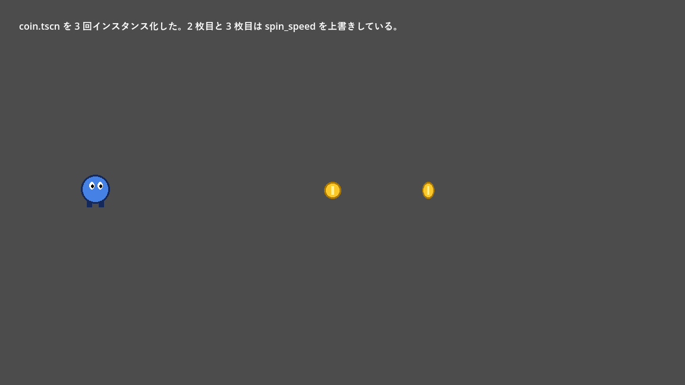

.. _ch05:

=======================
第 5 章　ノードとシーン
=======================

Godot でゲームを作るときに最も重要な考え方が、ノードとシーンである。本章では、ノードとシーンとは何か、どのように組み合わせてゲームを作るのかを説明する。

ノード
======

ノード（node）は、ゲームを組み立てる最小の部品である。ノードには多くの種類があり、それぞれが 1 つの役割を持つ。

.. list-table:: よく使うノードの例
   :header-rows: 1
   :widths: 30 70

   * - ノード
     - 役割
   * - ``Node2D``
     - 2D 空間での位置、回転、拡大率を持つ。2D の物体の基本となるノード
   * - ``Sprite2D``
     - 画像（テクスチャ）を表示する。
   * - ``CollisionShape2D``
     - 衝突判定に使う形状（円や長方形など）を表す。
   * - ``CharacterBody2D``
     - プレイヤーのように、スクリプトで動かす物理的な物体
   * - ``Area2D``
     - ほかの物体が入ってきたことを検出する領域
   * - ``Label``
     - 文字列を表示する UI 部品
   * - ``Timer``
     - 一定時間ごとに通知を出すタイマー
   * - ``AudioStreamPlayer``
     - 音を再生する。
   * - ``Camera2D``
     - 画面に映す範囲を決めるカメラ

ノードの種類は、オブジェクト指向プログラミングのクラスに対応している。実際に、エディターで追加するノードはエンジンに定義されたクラスのインスタンスであり、スクリプトからは同じ名前のクラスとして扱える。クラスは継承関係にあり、例えば ``Sprite2D`` は ``Node2D`` を継承しているので、``Node2D`` が持つ位置や回転のプロパティを ``Sprite2D`` も持つ。

.. graphviz::
   :caption: 主なノードのクラスの継承関係（一部）

   digraph classes {
     rankdir=LR;
     node [shape=box, style="rounded,filled", fillcolor="#f2f2f2", fontsize=11];
     edge [dir=back];
     "Node" -> "CanvasItem";
     "Node" -> "Node3D";
     "Node" -> "Timer";
     "Node" -> "AudioStreamPlayer";
     "CanvasItem" -> "Node2D";
     "CanvasItem" -> "Control";
     "Node2D" -> "Sprite2D";
     "Node2D" -> "Camera2D";
     "Node2D" -> "CollisionShape2D";
     "Node2D" -> "CollisionObject2D";
     "CollisionObject2D" -> "Area2D";
     "CollisionObject2D" -> "PhysicsBody2D";
     "PhysicsBody2D" -> "CharacterBody2D";
     "PhysicsBody2D" -> "RigidBody2D";
     "PhysicsBody2D" -> "StaticBody2D";
     "Control" -> "Label";
     "Control" -> "BaseButton";
     "BaseButton" -> "Button";
     "Node" [fillcolor="#cfe2ff"];
     "CanvasItem" [fillcolor="#e8f0fe"];
     "Node2D" [fillcolor="#d4edda"];
     "Control" [fillcolor="#fff3cd"];
   }

図の矢印は「継承元」を指す。2D の物体は ``Node2D`` の系統、UI の部品は ``Control`` の系統、3D の物体は ``Node3D`` の系統に属する。``Node2D`` と ``Control`` はどちらも画面に描画されるもので、共通の祖先として ``CanvasItem`` を持つ。

ノードの木構造
==============

ノードは親子関係を持ち、木構造を作る。子ノードの位置や回転は、親ノードからの相対値で表される。そのため、親ノードを動かすと子ノードも一緒に動く。例えば、プレイヤーのノードの子として画像のノードと衝突形状のノードを置けば、プレイヤーを動かすだけで、見た目と当たり判定がそろって移動する。

.. graphviz::
   :caption: プレイヤーを表すノードの木構造の例

   digraph player {
     node [shape=box, style="rounded,filled", fillcolor="#e8f0fe", fontsize=11];
     player [label="Player\n（CharacterBody2D）"];
     sprite [label="Sprite2D\n見た目"];
     shape [label="CollisionShape2D\n当たり判定"];
     camera [label="Camera2D\nプレイヤーを追うカメラ"];
     player -> sprite;
     player -> shape;
     player -> camera;
   }

1 つのノードは 1 つの役割しか持たない。複雑な物体は、単純なノードを組み合わせて表現する。これが Godot の基本的な設計方針である。

シーン
======

ノードの木構造をファイルに保存したものをシーン（scene）と呼ぶ。シーンファイルの拡張子は ``.tscn`` である。:ref:`ch03` で作った ``hello.tscn`` もシーンである。

Godot のシーンは、ゲームの「1 画面」や「1 ステージ」だけを指す言葉ではない。プレイヤー、敵、コイン、弾、UI の部品など、再利用したいまとまりは何でもシーンにする。シーンは、別のシーンの中に部品として何個でも配置できる。これをシーンのインスタンス化と呼ぶ。

.. list-table:: シーンとオブジェクト指向プログラミングの対応
   :header-rows: 1
   :widths: 40 60

   * - Godot
     - オブジェクト指向プログラミング
   * - シーン（``.tscn`` ファイル）
     - クラスの定義
   * - シーンのインスタンス
     - クラスのインスタンス（オブジェクト）
   * - インスタンスごとにプロパティの値を変える
     - コンストラクターに異なる引数を渡す
   * - シーンの中に別のシーンを配置する
     - 別のクラスのインスタンスをフィールドに持つ（コンポジション）

Unity を知っている読者向けに補足すると、Godot のシーンは Unity のシーンとプレハブの両方の役割を兼ねている。

例：コインのシーンを再利用する
------------------------------

サンプルの ``chapter05`` フォルダーには、回転するコインのシーン ``coin.tscn`` と、それを 3 個配置したステージのシーン ``level.tscn`` がある。

.. graphviz::
   :caption: coin.tscn と level.tscn のノードの構成

   digraph coin {
     compound=true;
     node [shape=box, style="rounded,filled", fillcolor="#e8f0fe", fontsize=11];
     subgraph cluster_coin {
       label="coin.tscn"; fontsize=11; style=rounded; color="#888888";
       coin [label="Coin\n（Area2D）\ncoin.gd"];
       csprite [label="Sprite2D"];
       cshape [label="CollisionShape2D"];
       coin -> csprite;
       coin -> cshape;
     }
     subgraph cluster_level {
       label="level.tscn"; fontsize=11; style=rounded; color="#888888";
       level [label="Level\n（Node2D）"];
       lplayer [label="Player\n（Sprite2D）"];
       coins [label="Coins\n（Node2D）"];
       c1 [label="Coin1", fillcolor="#fff3cd"];
       c2 [label="Coin2\nspin_speed = 6.0", fillcolor="#fff3cd"];
       c3 [label="Coin3\nspin_speed = 1.5", fillcolor="#fff3cd"];
       level -> lplayer;
       level -> coins;
       coins -> c1;
       coins -> c2;
       coins -> c3;
     }
     c1 -> coin [style=dashed, label="インスタンス", lhead=cluster_coin, constraint=false];
   }

コインのスクリプトは次のとおりである。

.. literalinclude:: ../../examples/chapter05/coin.gd
   :tab-width: 4
   :language: gdscript
   :linenos:
   :caption: chapter05/coin.gd

5 行目の ``@export`` を付けた変数は、インスペクターに表示され、エディターから値を変更できる。``level.tscn`` では、3 枚のコインのうち 2 枚の ``spin_speed`` をインスペクターで上書きしている。元の ``coin.tscn`` を編集すると、上書きしていないプロパティの変更は 3 枚すべてに反映される。

   level.tscn の実行結果

シーンを作る手順
----------------

``coin.tscn`` は次の手順で作る。

#. 「シーン」→「新規シーン」を選び、シーンドックの「その他のノード」から ``Area2D`` を選んでルートノードにする。名前を ``Coin`` に変える。
#. ``Coin`` の子として ``Sprite2D`` を追加し、インスペクターの「テクスチャ」（texture）に ``assets/coin.png`` をドラッグする。
#. ``Coin`` の子として ``CollisionShape2D`` を追加し、「シェイプ」（shape）で「新規 CircleShape2D」を選ぶ。ビューポートに表示される円の大きさを、画像に合わせて調整する。
#. ``coin.tscn`` という名前で保存し、``Coin`` にスクリプトをアタッチする。

``level.tscn`` では、ファイルシステムドックから ``coin.tscn`` をビューポートへドラッグして配置する。

シーンファイルの中身
--------------------

``.tscn`` ファイルはテキスト形式なので、Git などで差分を確認できる。``coin.tscn`` の中身は次のとおりである。普段はエディターで編集するので、直接書き換える必要はない。

.. literalinclude:: ../../examples/chapter05/coin.tscn
   :tab-width: 4
   :language: ini
   :linenos:
   :caption: chapter05/coin.tscn

``[ext_resource]`` は外部ファイル（スクリプトや画像）の参照、``[sub_resource]`` はシーンの中で定義したリソース（ここでは円の形状）、``[node]`` はノードとそのプロパティ、``[connection]`` は後述するシグナルの接続を表す。既定値から変更したプロパティだけが記録される。

実行中のシーンツリー
====================

ゲームを実行すると、Godot はシーンツリー（``SceneTree``）を作り、その中でノードを動かす。シーンツリーの根は ``root`` という名前のウィンドウ（``Window``）で、その子として現在のシーンが配置される。:ref:`ch15` で説明するオートロードのノードも、``root`` の子に置かれる。

.. graphviz::
   :caption: 実行中のシーンツリーの例（サンプルプロジェクトで level.tscn を実行した場合）

   digraph runtime {
     node [shape=box, style="rounded,filled", fillcolor="#e8f0fe", fontsize=11];
     root [label="root\n（Window）", fillcolor="#cfe2ff"];
     nav [label="ExampleNavigator\n（オートロード）", fillcolor="#f2f2f2"];
     gs [label="GameState\n（オートロード）", fillcolor="#f2f2f2"];
     level [label="Level\n（現在のシーン）", fillcolor="#d4edda"];
     player [label="Player"];
     coins [label="Coins"];
     root -> nav;
     root -> gs;
     root -> level;
     level -> player;
     level -> coins;
   }

ノードがシーンツリーに追加されると、Godot はそのノードの決まった関数（``_ready()`` や ``_process()`` など）を、決まったタイミングで呼び出す。これらの関数については :ref:`ch06` で説明する。

スクリプトからノードを操作する
==============================

ノードを取得する
----------------

スクリプトから別のノードを使うには、まずそのノードを取得する。

.. list-table:: ノードの取得方法
   :header-rows: 1
   :widths: 35 65

   * - 書き方
     - 意味
   * - ``$Sprite2D``
     - 子ノード ``Sprite2D`` を取得する。``get_node("Sprite2D")`` の省略形
   * - ``$Coins/Coin1``
     - 子の子など、パスで指定したノードを取得する。
   * - ``%HealthBar``
     - シーン固有名を付けたノードを、階層に関係なく取得する（後述）。
   * - ``get_parent()``
     - 親ノードを取得する。
   * - ``get_children()``
     - 子ノードの配列を取得する。

パスで指定する方法は、ノードの階層を変えると動かなくなる。UI のように階層が深くなりやすいシーンでは、シーン固有名を使うとよい。シーンドックでノードを右クリックし、「固有名でアクセス」を選ぶと、ノード名の横に ``%`` が表示され、スクリプトから ``%ノード名`` で取得できるようになる。

ノードを生成・削除する
----------------------

ゲームの実行中に敵や弾を出現させるには、シーンを読み込んでインスタンスを作り、シーンツリーに追加する。

.. code-block:: gdscript
   :linenos:
   :caption: シーンのインスタンスを作って追加する例

   const COIN_SCENE: PackedScene = preload("res://chapter05/coin.tscn")

   func spawn_coin(at: Vector2) -> void:
       var coin := COIN_SCENE.instantiate() as Node2D
       coin.position = at
       add_child(coin)

``preload()`` は、スクリプトを読み込む時点でシーンファイルを読み込む。``instantiate()`` でノードの木構造を作り、``add_child()`` で自分の子として追加すると、画面に表示されて動き始める。

ノードを削除するには ``queue_free()`` を呼ぶ。削除は現在のフレームの処理が終わってから行われるので、同じフレームの中で削除したノードに触れても安全である。子ノードは親と一緒に削除される。

.. note::

   Python のオブジェクトと異なり、ノードは参照がなくなっても自動では解放されない。シーンツリーから外しただけのノードはメモリーに残り続ける。不要になったノードは必ず ``queue_free()`` で削除する。一方、画像やシーンファイルなどのリソース（``Resource``）は参照カウントで管理されており、使われなくなると自動で解放される。

グループ
========

グループは、ノードに付けるタグのようなものである。1 つのノードは複数のグループに所属できる。グループを使うと、「すべての敵」や「すべてのコイン」をまとめて扱える。

ノードをグループに追加するには、ノードを選んで「グループ」ドックでグループ名を追加するか、スクリプトで ``add_to_group("enemies")`` を呼ぶ。

.. list-table:: グループに関する主なメソッド
   :header-rows: 1
   :widths: 45 55

   * - メソッド
     - 内容
   * - ``node.is_in_group("coins")``
     - ノードがグループに属しているかを調べる。
   * - ``get_tree().get_nodes_in_group("coins")``
     - グループに属するノードの配列を返す。
   * - ``get_tree().call_group("rocks", "queue_free")``
     - グループに属するすべてのノードのメソッドを呼ぶ。

``coin.gd`` の ``_on_body_entered()`` では、触れた物体が ``player`` グループに属しているかを確かめてからコインを消している。こうすると、プレイヤー以外の物体（例えば敵）が触れてもコインは消えない。

シーンを設計するときの考え方
============================

Godot でシーンを設計するときは、次の方針が役に立つ。

* **小さなシーンを組み合わせる**：プレイヤー、敵、UI などをそれぞれ独立したシーンにし、ステージのシーンでそれらを組み合わせる。それぞれのシーンを単独で実行してテストできるようにしておくと、開発が楽になる。
* **継承よりも合成**：機能を追加するときは、スクリプトの継承を深くするよりも、機能を持つ子ノードを追加することを考える。例えば体力の管理を ``Health`` ノードとして独立させれば、プレイヤーにも敵にも使い回せる（:ref:`ch07` で実例を示す）。
* **呼び出しは下へ、通知は上へ**：親は子のメソッドを直接呼んでよい。子が親に何かを伝えたいときは、親を直接操作せず、シグナル（:ref:`ch07`）を発行して親に受け取ってもらう。こうすると、子のシーンが親の構造に依存しなくなり、再利用しやすくなる。
