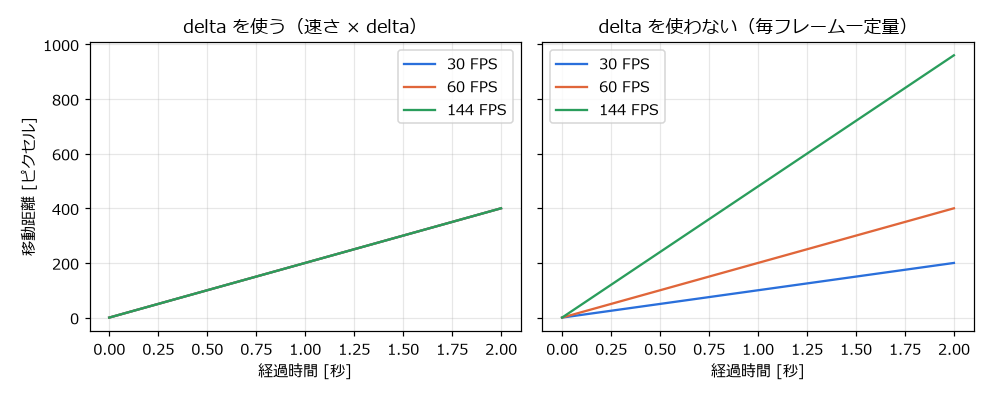
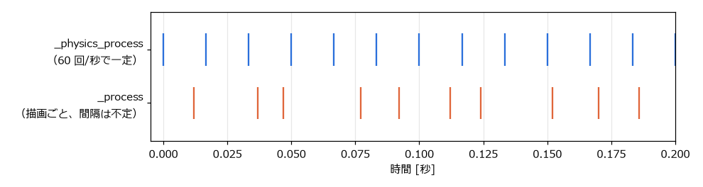

.. _ch08:

===========================
第 8 章　ゲームループと時間
===========================

ゲームのプログラムは、一般的な業務アプリケーションとは動き方が大きく異なる。本章では、ゲームの心臓部であるゲームループと、時間の扱い方を説明する。サンプルは ``chapter08`` フォルダーにある。

ゲームループ
============

業務アプリケーションや Web サーバーは、ユーザーの操作やリクエストが来るまで待ち、来たら処理をする（イベント駆動）。何も起きなければ、プログラムは何もしない。

一方、ゲームは、プレイヤーが何も操作しなくても、敵が動き、時間が進み、画面が更新され続ける。そのため、ゲームのプログラムは次の処理を高速に繰り返している。この繰り返しをゲームループ（game loop）と呼ぶ。

.. graphviz::
   :caption: ゲームループの基本形

   digraph loop {
     rankdir=LR;
     node [shape=box, style="rounded,filled", fillcolor="#e8f0fe", fontsize=11];
     input [label="入力を読み取る"];
     update [label="ゲームの状態を更新する\n（移動、衝突判定など）"];
     draw [label="画面を描画する"];
     input -> update -> draw;
     draw -> input [label="次のフレーム", fontsize=10];
   }

この 1 回分の繰り返しをフレーム（frame）と呼び、1 秒間に何フレーム処理したかをフレームレート（FPS、frames per second）と呼ぶ。一般的なゲームは 60 FPS 前後で動く。つまり、1 フレームの処理を約 16.7 ミリ秒以内に終える必要がある。

Godot を使う場合、ゲームループそのものはエンジンが実行する。開発者は、ループの中で呼ばれる関数（``_process()`` や ``_physics_process()``）に、1 フレーム分の処理を書く。

_process() と delta
===================

``_process(delta)`` は、毎フレーム、画面を描画する前に呼ばれる。引数 ``delta`` は、前のフレームから経過した時間（秒）である。60 FPS で動いていれば約 0.0167 になる。

フレームレートは一定ではない。PC の性能、画面のリフレッシュレート（60 Hz、144 Hz など）、その時点の処理の重さによって変わる。そのため、物体を動かすときは「1 フレームあたりの移動量」ではなく「1 秒あたりの移動量（速さ）」を決め、それに ``delta`` を掛ける。

.. code-block:: gdscript
   :linenos:

   const SPEED: float = 200.0  # 1 秒あたり 200 ピクセル

   func _process(delta: float) -> void:
       position.x += SPEED * delta  # 正しい：フレームレートによらず 1 秒で 200 ピクセル進む
       # position.x += 3.0          # 誤り：フレームレートが高いほど速く進む

次の図は、30 FPS、60 FPS、144 FPS の環境で 2 秒間動かしたときの移動距離を比べたものである。``delta`` を使うと、どの環境でも同じ距離だけ進む。使わない場合は、フレームレートに比例して移動距離が変わってしまう。

   delta を使う場合と使わない場合の移動距離

サンプルの ``delta_demo.tscn`` は、この違いを実際に確かめるものである。上下キーで最大フレームレートを 30、60、144 FPS に切り替えると、``delta`` を使わない赤い四角形だけ速さが変わる。

.. literalinclude:: ../../examples/chapter08/delta_demo.gd
   :tab-width: 4
   :language: gdscript
   :linenos:
   :caption: chapter08/delta_demo.gd

``Engine.max_fps`` は、フレームレートの上限を設定するプロパティである。0 は上限なしを表す。``_draw()`` は ``Node2D`` などで図形を描画する関数で、``queue_redraw()`` を呼ぶと次のフレームで呼び直される。

_physics_process()
==================

``_physics_process(delta)`` は、物理演算の更新のたびに呼ばれる。描画のフレームとは独立して、一定の間隔で呼ばれるのが特徴である。間隔はプロジェクト設定の「物理」→「一般」にある「1 秒あたりの物理ティック数」（physics/common/physics_ticks_per_second）で決まり、既定値は 60 である。そのため ``delta`` は常に約 0.0167 になる。

   _physics_process() と _process() が呼ばれるタイミングの例

描画が遅れて前回から 2 回分以上の時間が経った場合、Godot は次の描画の前に ``_physics_process()`` を複数回呼んで遅れを取り戻す。:ref:`ch06` の ``lifecycle.tscn`` の出力で、``_physics_process`` が続けて表示されていたのはこのためである。逆に描画が速い場合は、``_physics_process()`` が呼ばれないフレームもある。

2 つの関数は、次のように使い分ける。

.. list-table:: _process() と _physics_process() の使い分け
   :header-rows: 1
   :widths: 30 70

   * - 関数
     - 向いている処理
   * - ``_physics_process()``
     - 物理演算に関わる処理。``CharacterBody2D`` の移動（``move_and_slide()``）、``RigidBody2D`` に力を加える処理など。一定間隔で呼ばれるので、結果が安定する。
   * - ``_process()``
     - それ以外の処理。物理演算を使わない移動、アニメーション、UI の更新、カメラの追従など。描画のたびに呼ばれるので、動きがなめらかになる。

一定の間隔で更新する方法を固定タイムステップと呼ぶ。物理演算の結果は時間の刻み幅によって変わるため、刻み幅を一定にしておかないと、同じ操作をしてもフレームレートによってジャンプの高さが変わる、といった問題が起きる。

垂直同期と最大 FPS
==================

Godot は既定で垂直同期（V-Sync）が有効になっている。垂直同期は、画面のリフレッシュに合わせて描画する仕組みで、画面のちらつき（ティアリング）を防ぐ。垂直同期が有効な場合、フレームレートはモニターのリフレッシュレート（60 Hz のモニターなら 60 FPS）を上限とする。

垂直同期の設定は、プロジェクト設定の「表示」→「ウィンドウ」にある「垂直同期」→「垂直同期モード」（display/window/vsync/vsync_mode）で変更できる。フレームレートの上限は「アプリ」→「実行」の「最大FPS」（application/run/max_fps）で設定する。どちらの設定でも、``delta`` を正しく使っていれば、ゲームの速さは変わらない。

時間を扱うノードと関数
======================

一定時間ごとの処理や、一定時間後の処理には、次の方法がある。

.. list-table:: 時間を扱う方法
   :header-rows: 1
   :widths: 35 65

   * - 方法
     - 用途
   * - ``Timer`` ノード
     - 一定時間ごとに ``timeout`` シグナルを発行する。インスペクターで「待機時間」（wait_time）、「単発」（one_shot）、「自動スタート」（autostart）を設定する。``start()``、``stop()`` で制御する。
   * - ``get_tree().create_timer(秒)``
     - 1 回だけ使うタイマーを作る。``await`` と組み合わせて「○秒待つ」処理に使う（:ref:`ch07`）。
   * - ``delta`` の積算
     - ``_process()`` で ``delta`` を足していき、経過時間を自分で数える。
   * - ``Time.get_ticks_msec()``
     - ゲームの起動からの経過時間をミリ秒で返す。処理時間の計測などに使う。

``delta_demo.tscn`` の ``TickTimer`` は、「待機時間」を 0.5 秒、「自動スタート」をオンにした ``Timer`` ノードである。0.5 秒ごとに ``timeout`` シグナルを発行し、``_on_tick_timer_timeout()`` で回数を数えている。

一時停止
========

``get_tree().paused = true`` とすると、ゲームが一時停止する。一時停止中は、ほとんどのノードの ``_process()``、``_physics_process()``、入力の処理が止まり、物理演算やタイマーも止まる。

一時停止中も動かしたいノード（ポーズメニューなど）は、インスペクターの「プロセス」→「モード」（process_mode）で動作を設定する。

.. list-table:: 処理モード（process_mode）の種類
   :header-rows: 1
   :widths: 30 70

   * - モード
     - 動作
   * - Inherit（継承）
     - 親ノードと同じ。既定値。ルートノードでは Pausable と同じになる。
   * - Pausable
     - 一時停止中は止まる。
   * - When Paused
     - 一時停止中だけ動く。
   * - Always
     - 一時停止中も常に動く。
   * - Disabled（無効）
     - 常に止まっている。

既定値は「継承」なので、親ノードの設定を変えると、その子ノードもまとめて同じ動作になる。:ref:`ch17` のチュートリアルでは、スコアなどを表示する HUD を Always にして、一時停止の切り替えを受け付けている。
