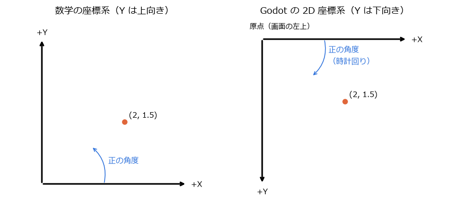
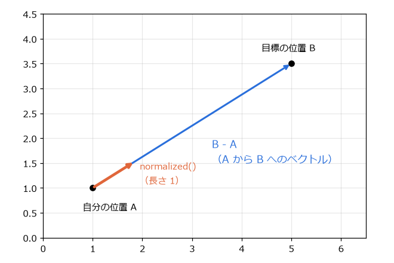
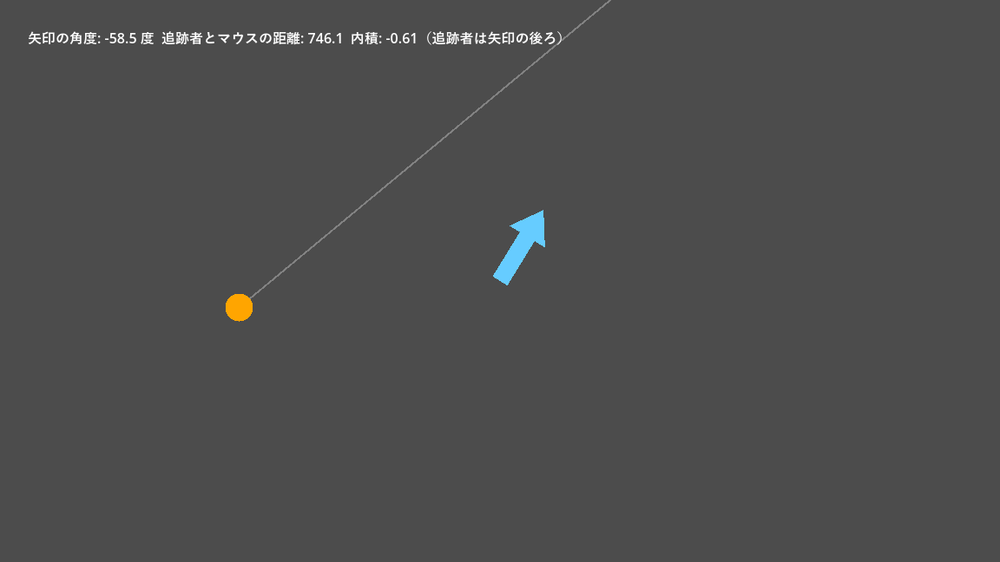

.. _ch10:

=============================
第 10 章　2D の座標とベクトル
=============================

ゲームでは、物体の位置、移動の向き、速さを常に計算している。これらを扱う道具がベクトルである。本章では、Godot の 2D 座標系と、ゲームでよく使うベクトルの計算を説明する。サンプルは ``chapter10`` フォルダーにある。

2D の座標系
===========

Godot の 2D の座標は、ピクセルを単位とする。座標系は、数学で習う座標系と次の点が異なる。

* 原点 (0, 0) は、画面の左上にある（カメラを使わない場合）。
* X 軸は右向きが正である（数学と同じ）。
* **Y 軸は下向きが正である**\ （数学と逆）。
* 回転の角度は、画面上で\ **時計回り**\ が正になる。角度の単位はラジアンである。

   数学の座標系と Godot の 2D 座標系

Y 軸が下向きなのは、画面の左上から右下へ順に描画するコンピューターの画面の慣習に合わせているためである。そのため、ジャンプのように上へ動かすときは Y を減らし、重力で落とすときは Y を増やす。:ref:`ch11` のプレイヤーのジャンプの初速が負の値になっているのはこのためである。

角度はラジアンで扱う。360 度が :math:`2\pi` ラジアン（約 6.28）に相当する。度とラジアンの変換には、``deg_to_rad()`` と ``rad_to_deg()`` を使う。定数 ``PI`` は :math:`\pi`、``TAU`` は :math:`2\pi` である。

Vector2
=======

2D の位置や速度は ``Vector2`` 型で表す。``Vector2(3, 4)`` は、X 成分が 3、Y 成分が 4 のベクトルである。``position`` や ``velocity`` などのプロパティも ``Vector2`` である。

``Vector2`` には、よく使う向きを表す定数がある。

.. list-table:: Vector2 の定数
   :header-rows: 1
   :widths: 30 30 40

   * - 定数
     - 値
     - 画面上の向き
   * - ``Vector2.ZERO``
     - (0, 0)
     - なし
   * - ``Vector2.RIGHT``
     - (1, 0)
     - 右
   * - ``Vector2.LEFT``
     - (-1, 0)
     - 左
   * - ``Vector2.UP``
     - (0, -1)
     - 上
   * - ``Vector2.DOWN``
     - (0, 1)
     - 下

ベクトルの基本的な計算
======================

足し算と掛け算
--------------

ベクトルどうしの足し算は、成分ごとの足し算である。位置に移動量を足すと、新しい位置になる。ベクトルに数（スカラー）を掛けると、向きを変えずに長さだけが変わる。

.. math::

   (x_1, y_1) + (x_2, y_2) = (x_1 + x_2,\ y_1 + y_2), \qquad k(x, y) = (kx,\ ky)

「速度 × 経過時間 = 移動量」なので、``position += velocity * delta`` と書けば、1 フレーム分だけ物体が動く。

長さと正規化
------------

ベクトル :math:`\mathbf{v} = (x, y)` の長さ（大きさ）は、三平方の定理で求める。``length()`` で取得できる。

.. math::

   |\mathbf{v}| = \sqrt{x^2 + y^2}

ベクトルを自分の長さで割ると、向きが同じで長さが 1 のベクトル（単位ベクトル）になる。これを正規化と呼び、``normalized()`` で求める。

.. math::

   \hat{\mathbf{v}} = \frac{\mathbf{v}}{|\mathbf{v}|}

単位ベクトルは「向き」だけを表す。これに速さを掛けると、決まった速さで決まった向きへ進む速度になる。

2 点の差
--------

点 A から点 B へ向かうベクトルは、B - A で求める。その長さが 2 点間の距離、正規化したものが A から B への向きである。

   A から B へのベクトルと、その正規化

.. code-block:: gdscript
   :linenos:
   :caption: 目標に向かって一定の速さで進む

   var to_target := target_position - position   # 自分から目標へのベクトル
   var distance := to_target.length()             # 目標までの距離
   var direction := to_target.normalized()        # 目標への向き（長さ 1）
   position += direction * SPEED * delta          # 目標へ向かって進む

``direction_to()`` と ``distance_to()`` を使うと、同じ計算を 1 回の呼び出しで書ける。

.. list-table:: Vector2 のよく使うメソッド
   :header-rows: 1
   :widths: 35 65

   * - メソッド
     - 内容
   * - ``length()``
     - 長さ
   * - ``normalized()``
     - 長さを 1 にしたベクトル。長さ 0 のベクトルでは (0, 0) を返す。
   * - ``distance_to(b)``
     - 点 b までの距離
   * - ``direction_to(b)``
     - 点 b への向き（長さ 1）
   * - ``angle()``
     - X 軸の正の向きからの角度（ラジアン）
   * - ``rotated(angle)``
     - 指定した角度だけ回転したベクトル
   * - ``dot(b)``
     - ベクトル b との内積（後述）
   * - ``lerp(b, t)``
     - ベクトル b との間を割合 t で補間した値
   * - ``move_toward(b, delta)``
     - b に向かって最大 delta だけ近づけた値。行き過ぎない。
   * - ``limit_length(max)``
     - 長さが max を超えないように縮めたベクトル

角度と回転
----------

角度 :math:`\theta` の向きを表す単位ベクトルは :math:`(\cos\theta, \sin\theta)` である。GDScript では ``Vector2.RIGHT.rotated(theta)`` または ``Vector2.from_angle(theta)`` で求められる。逆に、ベクトルの向きを角度にするには ``angle()`` を使う。

ノードを特定の点に向けるには、``look_at(点)`` を使う。``look_at()`` は、ノードの X 軸の正の向き（右向き）が目標を指すように回転させる。そのため、向きのある画像は、右向きに描いておくと扱いやすい。

内積
----

2 つのベクトルの内積は、次の式で定義される。:math:`\theta` は 2 つのベクトルのなす角である。

.. math::

   \mathbf{a} \cdot \mathbf{b} = a_x b_x + a_y b_y = |\mathbf{a}||\mathbf{b}|\cos\theta

両方が単位ベクトルなら、内積は :math:`\cos\theta` になる。同じ向きなら 1、直角なら 0、反対向きなら -1 である。この性質を使うと、「敵がプレイヤーの前方にいるか（内積が正）」「視野の範囲内か（内積がある値より大きいか）」を、角度を計算せずに判定できる。

サンプル
========

``vector_demo.tscn`` は、ここまでの計算を目で確かめるサンプルである。画面中央の矢印はマウスの方向を向き、オレンジの円（追跡者）はマウスに向かって一定の速さで進む。

.. literalinclude:: ../../examples/chapter10/vector_demo.gd
   :tab-width: 4
   :language: gdscript
   :linenos:
   :caption: chapter10/vector_demo.gd

   vector_demo.tscn の実行結果

画面上部には、矢印の角度、追跡者とマウスの距離、矢印の正面の向きと「矢印から追跡者への向き」の内積が表示される。マウスを動かして矢印の向きを変えると、追跡者が矢印の前にいるときは内積が正、後ろにいるときは負になることを確かめられる。

ローカル座標とグローバル座標
============================

:ref:`ch05` で説明したように、子ノードの位置は親ノードからの相対値で表される。ノードの ``position`` は親から見た座標（ローカル座標）で、``global_position`` はゲームの世界の原点から見た座標（グローバル座標）である。

.. list-table:: 座標に関するプロパティとメソッド
   :header-rows: 1
   :widths: 35 65

   * - 名前
     - 内容
   * - ``position``
     - 親ノードから見た位置
   * - ``global_position``
     - ゲームの世界での位置
   * - ``rotation``、``global_rotation``
     - 親ノードから見た回転、世界での回転（ラジアン）
   * - ``scale``
     - 拡大率。``Vector2(2, 2)`` で 2 倍
   * - ``to_global(点)``
     - このノードのローカル座標の点を、グローバル座標に変換する。
   * - ``to_local(点)``
     - グローバル座標の点を、このノードのローカル座標に変換する。

位置、回転、拡大率をまとめたものをトランスフォーム（transform）と呼び、2D では ``Transform2D`` 型で表す。``Transform2D`` は、ノードの X 軸と Y 軸の向き（回転と拡大率を含む）と、原点の位置を持つ。親子関係があるノードのグローバルなトランスフォームは、親から順にトランスフォームを掛け合わせて求める。通常は ``global_position`` などのプロパティを使えば足り、``Transform2D`` を直接計算する必要はあまりない。

異なる親を持つノードどうしの位置を比べるときは、必ずグローバル座標を使う。例えば、敵とプレイヤーの距離を求めるなら ``enemy.global_position.distance_to(player.global_position)`` と書く。
