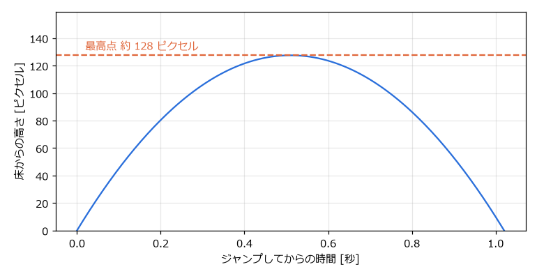
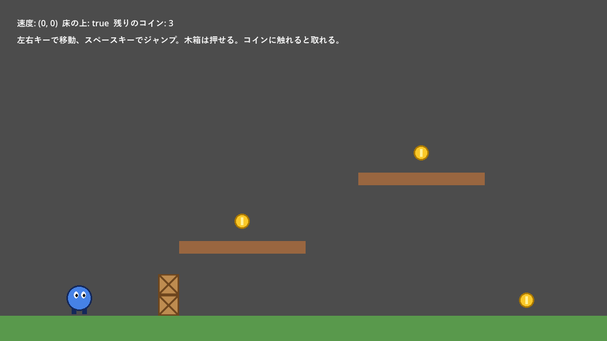

.. _ch11:

=========================
第 11 章　2D の物理と衝突
=========================

キャラクターが床の上を歩く、壁にぶつかって止まる、アイテムに触れると取れる。こうした処理には、物体どうしの衝突判定が必要になる。本章では、Godot の 2D 物理演算の仕組みと、物体の種類ごとの使い分けを説明する。サンプルは ``chapter11`` フォルダーにある。

物理ボディの種類
================

Godot では、衝突判定に参加する物体をノードの種類で区別する。2D では次のノードを使う。

.. list-table:: 2D の物理に関わるノード
   :header-rows: 1
   :widths: 25 45 30

   * - ノード
     - 動き方
     - 使用例
   * - ``StaticBody2D``
     - 動かない。ほかの物体がぶつかると止められる。
     - 床、壁、地形
   * - ``CharacterBody2D``
     - スクリプトで速度を決めて動かす。ぶつかったら止まったり滑ったりする。
     - プレイヤー、敵キャラクター
   * - ``RigidBody2D``
     - 物理演算（重力、衝突の反発、摩擦）に従って動く。スクリプトでは力を加えて動かす。
     - 木箱、ボール、転がる岩
   * - ``AnimatableBody2D``
     - アニメーションやスクリプトで動かす。上に乗った物体を一緒に運ぶ。
     - 動く床、エレベーター
   * - ``Area2D``
     - 物体を止めない。ほかの物体が入ったこと、出たことを検出する。
     - アイテム、ダメージを受ける範囲、ゴール地点

``StaticBody2D``、``CharacterBody2D``、``RigidBody2D``、``AnimatableBody2D`` をまとめて物理ボディ（physics body）と呼ぶ。物理ボディどうしはぶつかると互いにすり抜けない。``Area2D`` は「領域」であり、すり抜けるが、重なったことを知らせる。

衝突形状
========

物理ボディと ``Area2D`` は、それだけでは形を持たない。子ノードとして ``CollisionShape2D`` を追加し、その「シェイプ」（shape）に形状のリソースを設定して、当たり判定の形を決める。

.. list-table:: よく使う形状
   :header-rows: 1
   :widths: 35 65

   * - 形状
     - 用途
   * - ``RectangleShape2D``
     - 長方形。床、壁、箱
   * - ``CircleShape2D``
     - 円。ボール、コイン、弾
   * - ``CapsuleShape2D``
     - カプセル（長方形の両端が半円）。角に引っかかりにくいので、人型のキャラクターによく使う。
   * - ``SegmentShape2D``
     - 線分
   * - ``ConvexPolygonShape2D``
     - 凸多角形

多角形の形状を描きたい場合は、``CollisionShape2D`` の代わりに ``CollisionPolygon2D`` を使い、ビューポート上で頂点をクリックして形を作ることもできる。

当たり判定の形は、見た目の画像と完全に一致させる必要はない。むしろ、画像より少し小さめにしておくと、プレイヤーが「当たっていないのに当たった」と感じる理不尽さを減らせる。

.. warning::

   物理ボディや衝突形状のノードの「スケール」（scale）を変えて大きさを調整してはいけない。特に縦と横で異なる拡大率にすると、衝突判定が正しく動かないことがある。大きさは、形状のリソースの「サイズ」（size）や「半径」（radius）で調整する。

実行中に衝突形状を確認するには、エディターの「デバッグ」メニューで「コリジョン形状を表示」をオンにしてから実行する。当たり判定が画面に重ねて表示される。

CharacterBody2D でキャラクターを動かす
======================================

``CharacterBody2D`` は、プレイヤーのように思いどおりに動かしたい物体に使う。``velocity`` プロパティに速度を設定し、``move_and_slide()`` を呼ぶと、その速度で移動する。途中で壁や床にぶつかると、ぶつかった面に沿って滑るように動く。

サンプルの ``chapter11/player.tscn`` は、横スクロールアクションの基本的なプレイヤーである。

.. literalinclude:: ../../examples/chapter11/player.gd
   :tab-width: 4
   :language: gdscript
   :linenos:
   :caption: chapter11/player.gd

``_physics_process()`` の中で、次の順に処理している。

#. 床の上にいなければ（``is_on_floor()`` が ``false`` なら）、重力によって下向きの速度を増やす。
#. 床の上でジャンプのアクションが押されたら、上向き（Y がマイナス）の速度を与える。
#. 左右の入力に応じて、横向きの速度を決める。
#. ``move_and_slide()`` で移動する。
#. ぶつかった ``RigidBody2D``\ （木箱）があれば、押す。

``is_on_floor()`` は、直前の ``move_and_slide()`` で床に接していたかを返す。どの面を床とみなすかは「上方方向」（up_direction）プロパティで決まり、既定では画面の上向き（``Vector2.UP``）である。同様に、``is_on_wall()``、``is_on_ceiling()`` で壁や天井との接触を判定できる。

``move_and_slide()`` は ``delta`` を引数に取らない。速度に経過時間を掛ける計算は、``move_and_slide()`` の内部で行われる。一方、重力で速度を変える計算（加速度 × 時間）は自分で ``delta`` を掛ける必要がある。

ジャンプの高さ
--------------

重力加速度を :math:`g`、ジャンプの初速を :math:`v_0` とすると、ジャンプしてから :math:`t` 秒後の高さ :math:`h` は、等加速度運動の式で表される。

.. math::

   h(t) = v_0 t - \frac{1}{2} g t^2

最高点の高さは :math:`h_{\max} = \dfrac{v_0^2}{2g}` である。サンプルでは :math:`g = 980`、:math:`v_0 = 500` なので、最高点は約 128 ピクセルになる。実際の計算はフレームごとに少しずつ行われるので、この値よりわずかに低くなる。

   ジャンプしてからの高さの変化（g = 980、v0 = 500 の場合）

高く跳ばせたい場合は初速を大きくし、ふわっとした動きにしたい場合は重力を小さくする。重力の既定値は、プロジェクト設定の「物理」→「2D」にある「デフォルト重力」（physics/2d/default_gravity）で 980 ピクセル/秒² に設定されている。

衝突の情報を調べる
------------------

``move_and_slide()`` の後で ``get_slide_collision_count()`` と ``get_slide_collision(i)`` を使うと、移動中にぶつかった相手と、ぶつかった面の向き（法線）を取得できる。``player.gd`` の ``_push_rigid_bodies()`` では、ぶつかった相手が ``RigidBody2D`` なら、法線と反対向きに力を加えて押している。

RigidBody2D
===========

``RigidBody2D`` は、物理演算に任せて動かす物体である。重力で落ち、ほかの物体にぶつかると跳ね返ったり転がったりする。インスペクターで「質量」（mass）、重力の効き具合（gravity_scale）、摩擦と反発の強さ（「物理マテリアルのオーバーライド」）などを設定できる。

``RigidBody2D`` の ``position`` を毎フレーム書き換えると、物理演算と矛盾して不自然な動きになる。動かしたい場合は、力を加える。

.. list-table:: RigidBody2D に力を加えるメソッド
   :header-rows: 1
   :widths: 40 60

   * - メソッド
     - 内容
   * - ``apply_central_impulse(impulse)``
     - 瞬間的な力（撃力）を加える。ジャンプ、爆発で吹き飛ぶなど
   * - ``apply_central_force(force)``
     - 継続的な力を加える。毎フレーム呼んで、エンジンの推進力などを表す。
   * - ``apply_torque_impulse(torque)``
     - 回転させる瞬間的な力を加える。

Area2D
======

``Area2D`` は、ほかの物体が領域に入ったり出たりしたことを、シグナルで知らせる。

.. list-table:: Area2D の主なシグナル
   :header-rows: 1
   :widths: 40 60

   * - シグナル
     - 発行されるタイミング
   * - ``body_entered(body)``
     - 物理ボディが領域に入ったとき
   * - ``body_exited(body)``
     - 物理ボディが領域から出たとき
   * - ``area_entered(area)``
     - ほかの ``Area2D`` が領域に入ったとき
   * - ``area_exited(area)``
     - ほかの ``Area2D`` が領域から出たとき

:ref:`ch05` のコインは ``Area2D`` で、``body_entered`` シグナルで触れた物体を受け取り、それがプレイヤーなら自分を削除していた。今どの物体が領域内にあるかは、``get_overlapping_bodies()`` で取得することもできる。

コリジョンレイヤーとマスク
==========================

ゲームには、「プレイヤーはコインに触れるが、敵はコインに触れない」「敵の弾は敵自身には当たらない」といった決まりがある。これを実現するのが、コリジョンレイヤー（collision layer）とコリジョンマスク（collision mask）である。

* **レイヤー**：自分がどのグループに属するか
* **マスク**：どのグループの相手を検出するか

物体 A のマスクに物体 B のレイヤーが含まれていれば、A は B を検出する。レイヤーは 1 ～ 32 の番号で、インスペクターの「コリジョン」の項目で、番号のマスを押して選ぶ。番号には、プロジェクト設定の「レイヤー名」→「2D物理」で名前を付けられる。

サンプルプロジェクトでは、次のように名前を付けて使っている。

.. list-table:: サンプルプロジェクトのコリジョンレイヤー
   :header-rows: 1
   :widths: 15 20 65

   * - 番号
     - 名前
     - 属する物体
   * - 1
     - world
     - 床、壁、地形、木箱
   * - 2
     - player
     - プレイヤー
   * - 3
     - enemy
     - 敵、障害物（:ref:`ch17` の岩）
   * - 4
     - item
     - コイン

.. list-table:: サンプルの物体のレイヤーとマスク
   :header-rows: 1
   :widths: 30 25 45

   * - 物体
     - レイヤー
     - マスク（検出する相手）
   * - プレイヤー（``chapter11/player.tscn``）
     - 2（player）
     - 1（world）
   * - 木箱（``RigidBody2D``）
     - 1（world）
     - 1（world）、2（player）
   * - コイン（``chapter05/coin.tscn``）
     - 4（item）
     - 2（player）

プレイヤーのマスクは world だけなので、プレイヤーは床や木箱にはぶつかるが、コインにはぶつからずに通り抜ける。一方、コインのマスクは player なので、コインはプレイヤーが入ってきたことを検出できる。

シーンファイルやスクリプトでは、レイヤーは各番号を 1 ビットとする整数で表される。番号 :math:`n` のビットの値は :math:`2^{n-1}` で、``coin.tscn`` の ``collision_layer = 8`` は番号 4 を表す。スクリプトで設定する場合は、``set_collision_mask_value(4, true)`` のように番号で指定するメソッドを使うと分かりやすい。

サンプル
========

``platformer.tscn`` は、ここまでの内容をまとめたサンプルである。プレイヤーを左右に動かしてジャンプし、木箱を押し、コインを集められる。

.. graphviz::
   :caption: platformer.tscn のノードの構成

   digraph platformer {
     rankdir=LR;
     node [shape=box, style="rounded,filled", fillcolor="#e8f0fe", fontsize=11];
     root [label="Platformer\n（Node2D）"];
     floor [label="Floor、Platform1、Platform2、\nWallLeft、WallRight\n（StaticBody2D）", fillcolor="#f2f2f2"];
     player [label="Player\n（player.tscn のインスタンス）", fillcolor="#cfe2ff"];
     box [label="Box1、Box2\n（RigidBody2D）", fillcolor="#fff3cd"];
     coins [label="Coins\n（Node2D）"];
     coin [label="Coin1 ～ Coin3\n（coin.tscn のインスタンス）", fillcolor="#d4edda"];
     info [label="Info、Help\n（Label）"];
     root -> floor;
     root -> player;
     root -> box;
     root -> coins;
     coins -> coin;
     root -> info;
   }

   platformer.tscn の実行結果

床や台は、``StaticBody2D`` の子として ``CollisionShape2D``\ （当たり判定）と ``ColorRect``\ （見た目の長方形）を置いている。コインは :ref:`ch05` の ``coin.tscn`` をそのままインスタンス化し、``coins`` グループに追加している。画面上部の表示は、親の ``platformer.gd`` が毎フレーム更新している。

.. literalinclude:: ../../examples/chapter11/platformer.gd
   :tab-width: 4
   :language: gdscript
   :linenos:
   :caption: chapter11/platformer.gd
