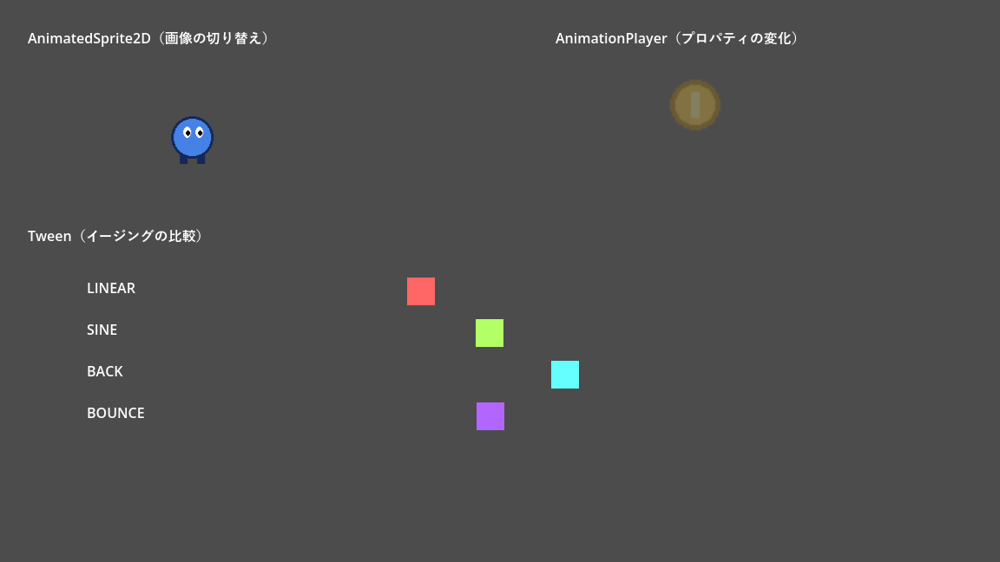
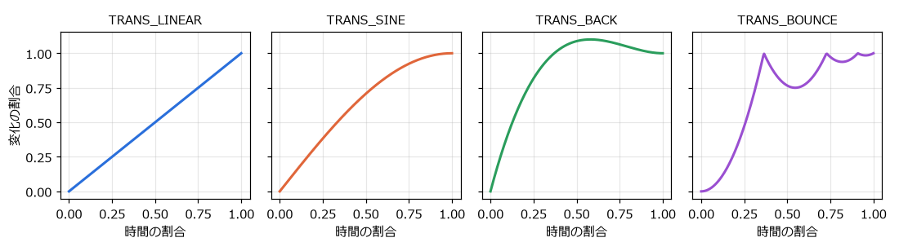
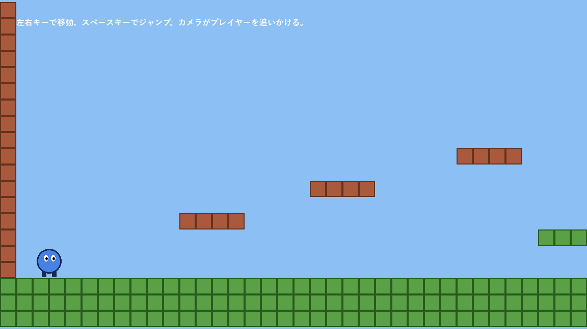

.. _ch12:

==============================
第 12 章　描画とアニメーション
==============================

本章では、画像の表示、描画の順番、3 種類のアニメーションの方法、タイルマップによるステージ作り、カメラの使い方を説明する。サンプルは ``chapter12`` フォルダーにある。

画像を表示する
==============

画像の表示には ``Sprite2D`` を使う。「テクスチャ」（texture）に画像ファイルを設定すると、ノードの位置を中心に画像が表示される。

.. list-table:: Sprite2D のよく使うプロパティ
   :header-rows: 1
   :widths: 35 65

   * - プロパティ
     - 内容
   * - テクスチャ（texture）
     - 表示する画像
   * - 中央（centered）、オフセット（offset）
     - 画像のどこをノードの位置に合わせるか
   * - 水平反転（flip_h）、垂直反転（flip_v）
     - 画像を左右・上下に反転する。キャラクターの向きを変えるときに使う。
   * - 横フレーム数（hframes）、縦フレーム数（vframes）、フレーム（frame）
     - 1 枚の画像に複数のコマを並べた画像（スプライトシート）を分割し、表示するコマを選ぶ。
   * - 変調（modulate）
     - 色を掛け合わせる。半透明にしたり、赤く点滅させたりできる。``CanvasItem`` のプロパティなので、子ノードにも影響する。

画像ファイルは、プロジェクトのフォルダーに置くと自動でインポートされる。インポートの設定は、ファイルシステムドックで画像を選び、「インポート」ドックで変更する。

.. tip::

   ドット絵（ピクセルアート）を拡大して表示すると、既定の設定ではぼやけてしまう。プロジェクト設定の「レンダリング」→「テクスチャ」にある「キャンバスのテクスチャ」→「デフォルトのテクスチャフィルタ」を「近傍」（Nearest）にすると、拡大してもドットがくっきり表示される。

描画の順番
==========

2D のノードは、シーンツリーの上から順に描画される。後から描画されたものが手前に表示されるので、シーンドックで下にあるノードほど手前になる。子ノードは親ノードより手前に描画される。

この順番を変えるには、次の方法がある。

* **Z インデックス**\ （z_index）：値が大きいノードほど手前に描画される。シーンツリーの順番より優先される。
* **Y ソート**\ （y_sort_enabled）：親ノードで有効にすると、子ノードを Y 座標の順に描画する。見下ろし型のゲームで、画面の下にいるキャラクターを手前に表示したいときに使う。
* **CanvasLayer**：ノードを別の描画レイヤーに分ける。「レイヤー」（layer）の値が大きいほど手前に描画される。``CanvasLayer`` の子はカメラの影響を受けないので、スコアなどの HUD や、固定の背景に使う。

アニメーションの 3 つの方法
===========================

Godot には、動きを付ける方法が主に 3 つある。

.. list-table:: アニメーションの方法の比較
   :header-rows: 1
   :widths: 22 39 39

   * - 方法
     - 仕組み
     - 向いている用途
   * - ``AnimatedSprite2D``
     - 複数の画像を順に切り替える（パラパラ漫画）。
     - キャラクターの歩行、待機などのコマ送りのアニメーション
   * - ``AnimationPlayer``
     - 任意のプロパティの値を、時間軸上のキーフレームで変化させる。エディターで編集する。
     - 決まった動きの演出、複数のノードを連動させる動き、カットシーン
   * - ``Tween``
     - プロパティの値を、開始値から終了値まで補間する。スクリプトで作る。
     - UI の出入り、ダメージを受けたときの揺れなど、その場で決まる動き

サンプルの ``animation_demo.tscn`` では、3 つの方法を並べて表示している。

   animation_demo.tscn の実行結果

AnimatedSprite2D
----------------

``AnimatedSprite2D`` は、``SpriteFrames`` というリソースに登録した画像を、順に切り替えて表示する。

#. シーンに ``AnimatedSprite2D`` を追加し、インスペクターの ``sprite_frames`` プロパティで「新規 SpriteFrames」を選ぶ。
#. 作られた ``SpriteFrames`` をクリックすると、下部パネルに ``SpriteFrames`` のエディターが開く。
#. 左側のアニメーションの一覧で名前（例：``walk``）を付け、右側にコマの画像をドラッグして並べる。再生速度（FPS）とループの有無も設定する。

サンプルでは、足の位置が異なる 4 枚の画像（``assets/player_walk_0.png`` ～ ``player_walk_3.png``）を 1 秒あたり 8 コマで切り替えている。

.. literalinclude:: ../../examples/chapter12/walker.gd
   :tab-width: 4
   :language: gdscript
   :linenos:
   :caption: chapter12/walker.gd

``play("walk")`` でアニメーションを再生し、進む向きに合わせて ``flip_h`` で画像を反転している。アニメーションの再生が終わると ``animation_finished`` シグナルが発行される（ループしない場合）。

AnimationPlayer
---------------

``AnimationPlayer`` は、ノードのプロパティを時間とともに変化させるアニメーションを作る。位置、回転、色、表示・非表示など、インスペクターに表示されるほとんどのプロパティを対象にできる。決まった時刻に関数を呼ぶこともできる。

#. シーンに ``AnimationPlayer`` を追加する。下部パネルに「アニメーション」エディターが開く。
#. 「アニメーション」ボタンから「新規」を選び、アニメーションの名前（例：``float``）を付ける。長さとループの有無を設定する。
#. 動かしたいノードを選ぶ。インスペクターのプロパティの右に鍵の形のアイコンが表示されるので、それを押すと、現在の時刻にその値のキーフレームが追加される。
#. 時刻を進めてプロパティの値を変え、もう一度鍵のアイコンを押す。キーフレームの間の値は自動で補間される。

サンプルの ``FloatingCoin`` では、2 秒のループするアニメーションで、コインの位置（上下に浮く）と ``modulate``\ （薄くなる）を同時に変化させている。「読み込み後、自動再生」を設定したので、シーンが始まると自動で再生される。スクリプトからは ``$AnimationPlayer.play("float")`` で再生できる。

キャラクターの状態（待機、歩行、ジャンプなど）に応じてアニメーションを切り替える処理が複雑になってきたら、``AnimationTree`` ノードで状態遷移（ステートマシン）として管理する方法もある。

Tween
-----

``Tween`` は、プロパティの値を開始値から終了値まで、指定した時間をかけて変化させる。スクリプトで作るので、実行時に決まる値（クリックした位置へ移動するなど）にも使える。

.. code-block:: gdscript
   :linenos:
   :caption: Tween の基本的な使い方

   var tween := create_tween()
   # 0.5 秒かけて x 座標を 400 にする
   tween.tween_property($Box, "position:x", 400.0, 0.5)
   # 続けて、0.3 秒かけて透明にする
   tween.tween_property($Box, "modulate:a", 0.0, 0.3)
   # 最後にノードを削除する
   tween.tween_callback($Box.queue_free)

``create_tween()`` で ``Tween`` を作り、``tween_property()`` で変化させるプロパティを追加する。``"position:x"`` のように ``:`` で区切ると、プロパティの成分だけを対象にできる。追加した処理は順番に実行される。同時に実行したい場合は、``tween.parallel()`` の後に追加するか、``set_parallel()`` を使う。

``Tween`` は、作ったノードに結び付いている。ノードが削除されると、``Tween`` も止まる。

変化の仕方（イージング）は、``set_trans()`` と ``set_ease()`` で指定する。

   主なイージングの変化の仕方（EASE_OUT の場合）

``TRANS_LINEAR`` は一定の速さで変化する。``TRANS_SINE`` は滑らかに減速する。``TRANS_BACK`` は目標を少し行き過ぎてから戻る。``TRANS_BOUNCE`` は目標で何度か跳ねる。``set_ease()`` には、ゆっくり始まる ``EASE_IN``、ゆっくり終わる ``EASE_OUT``、両方の ``EASE_IN_OUT`` などを指定する。

.. literalinclude:: ../../examples/chapter12/tween_lane.gd
   :tab-width: 4
   :language: gdscript
   :linenos:
   :caption: chapter12/tween_lane.gd

``set_loops()`` を引数なしで呼ぶと、``Tween`` が無限に繰り返される。``tween_interval()`` は、指定した秒数だけ待つ処理を追加する。

タイルマップ
============

ステージの地形は、小さな正方形の画像（タイル）を格子状に並べて作ることが多い。Godot では ``TileMapLayer`` ノードを使う。

.. note::

   Godot 4.2 までは ``TileMap`` ノードを使っていたが、4.3 で ``TileMapLayer`` に置き換えられた。古い解説記事を参考にする場合は注意する。複数の層（地面、装飾など）が必要な場合は、``TileMapLayer`` ノードを複数並べる。

タイルセット
------------

``TileMapLayer`` で使うタイルの種類は、``TileSet`` リソースで定義する。

#. ``TileMapLayer`` を追加し、インスペクターの「タイルセット」（tile_set）で「新規 TileSet」を選ぶ。作られた ``TileSet`` の「タイルサイズ」（tile_size）でタイルの大きさを設定する。
#. 下部パネルの「TileSet」エディターを開き、タイルを並べた画像（アトラス）をドラッグする。画像がタイルの大きさで分割される。
#. 当たり判定が必要な場合は、``TileSet`` のインスペクターで「物理レイヤー」を追加し、「TileSet」エディターで各タイルに衝突形状を描く。

サンプルの ``chapter12/tileset.tres`` は、32 × 32 ピクセルの地面とレンガの 2 種類のタイルを定義し、どちらにも四角い衝突形状を付けたタイルセットである。

タイルを配置する
----------------

通常は、``TileMapLayer`` を選んで下部パネルの「TileMap」エディターを開き、タイルを選んでビューポート上を塗るようにして配置する。

スクリプトから ``set_cell(座標, ソースID, アトラス座標)`` で配置することもできる。サンプルでは、文字で書いた配置図からタイルを並べている。

.. literalinclude:: ../../examples/chapter12/tilemap_demo.gd
   :tab-width: 4
   :language: gdscript
   :linenos:
   :caption: chapter12/tilemap_demo.gd

``set_cell()`` の第 1 引数はタイル単位の座標（``Vector2i``）、第 2 引数はタイルセット内の画像（ソース）の番号、第 3 引数はその画像の中でのタイルの位置である。``get_used_rect()`` は、タイルが置かれている範囲をタイル単位で返す。

   tilemap_demo.tscn の実行結果

カメラ
======

画面より広いステージでは、``Camera2D`` を使って画面に映す範囲を動かす。``Camera2D`` を追いかけたいノード（プレイヤー）の子にすると、プレイヤーが常に画面の中央に映る。

.. list-table:: Camera2D のよく使うプロパティ
   :header-rows: 1
   :widths: 40 60

   * - プロパティ
     - 内容
   * - ズーム（zoom）
     - 表示の拡大率。``Vector2(2, 2)`` で 2 倍に拡大して映す。
   * - 制限値（limit_left、limit_top、limit_right、limit_bottom）
     - カメラが映す範囲の限界。ステージの外が映らないようにする。
   * - position_smoothing_enabled
     - 有効にすると、カメラが目標を滑らかに追いかける。
   * - オフセット（offset）
     - カメラの位置をずらす。画面を揺らす演出に使える。

``tilemap_demo.gd`` では、タイルが置かれた範囲からカメラの限界を計算して設定している。1 つのシーンに ``Camera2D`` が複数ある場合は、``make_current()`` を呼んだカメラが使われる。

パーティクル
============

爆発の火花、煙、雨のように、多数の小さな粒を使う効果には、パーティクル（particle）を使う。``GPUParticles2D`` は GPU で計算するので大量の粒を扱える。``CPUParticles2D`` は CPU で計算し、古い環境でも確実に動く。どちらも、粒の数、寿命、初速、重力、色の変化などをインスペクターで設定する。本書では詳しく扱わないが、:ref:`ch17` のゲームに爆発の効果を追加するなどして試してみるとよい。
