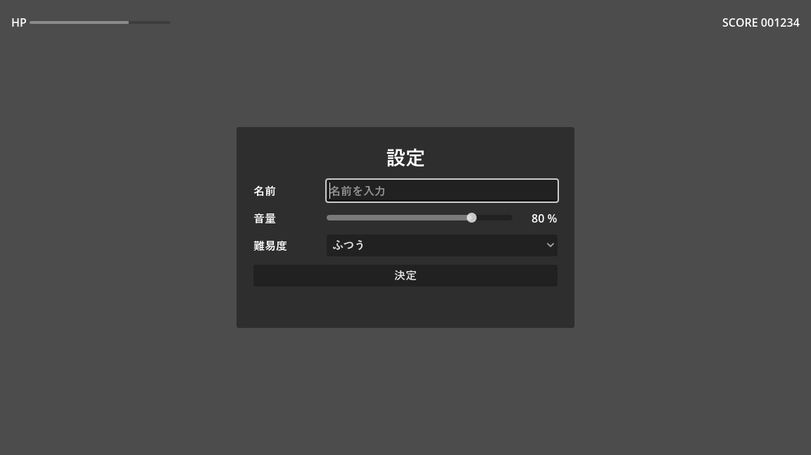

.. _ch13:

============
第 13 章　UI
============

本章では、ボタン、ラベル、スライダーなどの UI（ユーザーインターフェース）を作る方法を説明する。Godot の UI は ``Control`` を継承したノードで作る。エディター自体もこの仕組みで作られているので、ゲームのメニュー画面から道具アプリケーションまで、さまざまな画面を作れる。サンプルは ``chapter13`` フォルダーにある。

Control ノード
==============

UI の部品は ``Control`` を継承したノードである。``Node2D`` の系統のノードが位置、回転、拡大率で配置されるのに対し、``Control`` の系統のノードは「長方形の領域」を持ち、親の領域に対する相対的な位置と大きさで配置される。

.. list-table:: よく使う Control ノード
   :header-rows: 1
   :widths: 30 70

   * - ノード
     - 内容
   * - ``Label``
     - 文字列を表示する。
   * - ``RichTextLabel``
     - 色や太字などの書式付きの文字列を、BBCode という記法で表示する。
   * - ``Button``
     - 押せるボタン。``pressed`` シグナルを発行する。
   * - ``CheckBox``、``CheckButton``
     - オン・オフを切り替える。``toggled`` シグナルを発行する。
   * - ``OptionButton``
     - ドロップダウンで項目を選ぶ。``item_selected`` シグナルを発行する。
   * - ``LineEdit``
     - 1 行の文字列を入力する。``text_submitted`` シグナルを発行する。
   * - ``HSlider``、``VSlider``
     - スライダーで数値を選ぶ。``value_changed`` シグナルを発行する。
   * - ``ProgressBar``
     - 進み具合や体力をバーで表示する。
   * - ``TextureRect``
     - 画像を表示する。
   * - ``ColorRect``
     - 単色の長方形を表示する。背景などに使う。
   * - ``Panel``、``PanelContainer``
     - 枠付きの背景を表示する。

レイアウト
==========

``Control`` の配置は、アンカー（anchor）とオフセット（offset）で決まる。

* **アンカー**：親の領域のどこを基準にするか。0.0 が親の左端（上端）、1.0 が右端（下端）を表す。上下左右の 4 辺それぞれに設定する。
* **オフセット**：アンカーの位置からのずれ（ピクセル）

例えば、アンカーを左右とも 1.0、上下とも 0.0 にすると、親の右上を基準に配置される。親（ウィンドウ）の大きさが変わっても、右上にくっついたままになる。

アンカーとオフセットを直接設定する代わりに、ビューポートのツールバーにある「アンカーのプリセット」から「左上」「中央」「Rect全面」などを選ぶのが簡単である。「Rect全面」（Full Rect）は親の領域いっぱいに広げる設定で、背景や画面全体の UI のルートによく使う。

コンテナー
----------

UI の部品を 1 つずつ手で配置するのは大変で、画面の大きさが変わったときにも崩れやすい。そこで、子ノードを自動で並べるコンテナー（container）を使う。コンテナーの子になった ``Control`` は、位置と大きさをコンテナーが決める。

.. list-table:: よく使うコンテナー
   :header-rows: 1
   :widths: 35 65

   * - コンテナー
     - 子ノードの並べ方
   * - ``VBoxContainer``、``HBoxContainer``
     - 縦、または横に 1 列に並べる。
   * - ``GridContainer``
     - 指定した列数の格子状に並べる。
   * - ``MarginContainer``
     - 周囲に余白を付ける。
   * - ``CenterContainer``
     - 子を中央に配置する。
   * - ``PanelContainer``
     - 背景の枠を表示し、その中に子を配置する。
   * - ``ScrollContainer``
     - 子が収まらない場合にスクロールできるようにする。

コンテナーの中で各部品がどれだけの幅を取るかは、部品のインスペクターの「Container Sizing」（size_flags_horizontal、size_flags_vertical）で決める。「塗りつぶし」（Fill）は割り当てられた幅いっぱいに広がる。「拡大」（Expand）を付けると、余った幅を取り合って広がる。例えば、``HBoxContainer`` の中でラベルの幅は固定し、入力欄だけを残りの幅いっぱいに広げたい場合は、入力欄に「拡大」を付ける。

最小の大きさは ``custom_minimum_size`` で指定する。コンテナーは、子の最小の大きさより小さくはしない。

サンプル
========

``ui_demo.tscn`` は、設定画面を模したサンプルである。画面上部に HP のバーとスコアを表示し、中央のパネルで名前、音量、難易度を入力して「決定」を押すと、入力内容が表示される。

   ui_demo.tscn の実行結果

.. graphviz::
   :caption: ui_demo.tscn のノードの構成（中央のパネル部分）

   digraph ui {
     rankdir=LR;
     node [shape=box, style="rounded,filled", fillcolor="#e8f0fe", fontsize=10];
     center [label="Center\n（CenterContainer）\nRect全面"];
     panel [label="Panel\n（PanelContainer）"];
     margin [label="Margin\n（MarginContainer）"];
     vbox [label="VBox\n（VBoxContainer）"];
     title [label="Title（Label）"];
     name_row [label="NameRow（HBoxContainer）\nLabel ＋ NameEdit（LineEdit）"];
     vol_row [label="VolumeRow（HBoxContainer）\nLabel ＋ VolumeSlider ＋ VolumeLabel"];
     dif_row [label="DifficultyRow（HBoxContainer）\nLabel ＋ DifficultyOption"];
     apply [label="ApplyButton（Button）"];
     result [label="ResultLabel（Label）"];
     center -> panel -> margin -> vbox;
     vbox -> title;
     vbox -> name_row;
     vbox -> vol_row;
     vbox -> dif_row;
     vbox -> apply;
     vbox -> result;
   }

``CenterContainer`` を画面全体に広げ、その中に ``PanelContainer`` を置くことで、パネルが常に画面の中央に表示される。パネルの中は ``VBoxContainer`` で縦に並べ、各行は ``HBoxContainer`` でラベルと入力欄を横に並べている。入力欄（``NameEdit`` など）には「拡大」を付けて、残りの幅を使うようにしている。

画面上部の ``TopBar`` は ``HBoxContainer`` で、アンカーのプリセットを「上伸長」（Top Wide、上端に沿って左右いっぱいに広げる）にしている。HP のバーとスコアの間に、「拡大」を付けた空の ``Control`` を置くことで、スコアを右端に寄せている。

.. literalinclude:: ../../examples/chapter13/ui_demo.gd
   :tab-width: 4
   :language: gdscript
   :linenos:
   :caption: chapter13/ui_demo.gd

``%NameEdit`` などは、シーン固有名（:ref:`ch05`）で取得している。UI のシーンは階層が深くなりやすいので、シーン固有名を使うと、レイアウトを変えてもスクリプトを直さずに済む。

フォーカスとキーボード操作
==========================

ボタンなどの部品は、キーボードやゲームパッドでも操作できる。操作の対象になっている部品を「フォーカスがある」と言い、:kbd:`Tab` キーや方向キーでフォーカスを移動し、:kbd:`Enter` キーで押せる。この操作には ``ui_accept``、``ui_up`` などの組み込みのアクションが使われる。

ゲームパッドで遊ぶゲームでは、画面を開いたときに ``grab_focus()`` で最初の部品にフォーカスを当てておく必要がある。そうしないと、マウスを使わない限り操作を始められない。``ui_demo.gd`` の 18 行目では、名前の入力欄にフォーカスを当てている。

マウスのクリックを通すかどうか
==============================

``Control`` は、マウスのクリックを受け取ると、それより奥にある部品やゲームの世界にクリックを渡さない。そのため、画面全体を覆う半透明の ``ColorRect`` などを置くと、その下のボタンが押せなくなる。

この動作は「マウス」→「フィルター」（mouse_filter）で変更できる。

.. list-table:: マウスのフィルターの種類
   :header-rows: 1
   :widths: 25 75

   * - 値
     - 動作
   * - Stop
     - クリックを受け取り、奥には渡さない。ボタンなどの既定値
   * - Pass
     - クリックを受け取り、親にも渡す。
   * - Ignore
     - クリックを受け取らない。奥の部品にそのまま渡す。

背景や装飾だけの ``ColorRect`` や ``Label`` は、Ignore にしておくとよい。本書のサンプルでも、画面全体を覆う背景や画面効果の ``ColorRect`` は Ignore にしている。

テーマ
======

UI の色、フォント、余白などの見た目は、テーマ（``Theme`` リソース）で決まる。個別の部品の見た目だけを変えるには、インスペクターの「テーマのオーバーライド」を使う。サンプルでは、タイトルの文字を大きくするために「テーマのオーバーライド」→「フォントサイズ」を設定している。

UI 全体の見た目をそろえたい場合は、``Theme`` リソースを作って、UI のルートノードの「テーマ」（theme）に設定する。子ノードは親のテーマを引き継ぐ。プロジェクト全体の既定のテーマは、プロジェクト設定の「GUI」→「テーマ」で設定できる。

.. warning::

   Godot の既定のフォントには日本語の文字が含まれていない。Windows のエディターで日本語が表示されるのは、足りない文字を OS のフォントで補う機能（システムフォントのフォールバック）が働いているためである。Web 向けに書き出した場合など、OS のフォントを使えない環境では日本語が表示されないことがある。日本語を使うゲームを配布する場合は、日本語のフォントファイル（ライセンスを確認したもの）をプロジェクトに入れ、プロジェクト設定の「GUI」→「テーマ」→「カスタムフォント」に設定しておく。

画面の大きさへの対応
====================

ゲームのウィンドウの大きさが変わったとき、画面の内容をどう表示するかは、プロジェクト設定の「表示」→「ウィンドウ」にある「ストレッチ」の「モード」（display/window/stretch/mode）で決める。

.. list-table:: ストレッチのモード
   :header-rows: 1
   :widths: 25 75

   * - モード
     - 動作
   * - disabled
     - 拡大縮小しない。ウィンドウを大きくすると、見える範囲が広がる。既定値
   * - canvas_items
     - 基準の大きさ（既定では 1152 × 648）で作った画面を、ウィンドウの大きさに合わせて拡大縮小する。文字や図形は拡大後の解像度で描画されるので、くっきり表示される。
   * - viewport
     - 基準の大きさで描画した結果の画像を拡大する。ドット絵のゲームで、ドットの大きさをそろえたい場合に使う。

本書のサンプルプロジェクトでは canvas_items にしている。縦横比が異なるウィンドウでの表示方法は、同じ場所の「アスペクト」で設定する。
