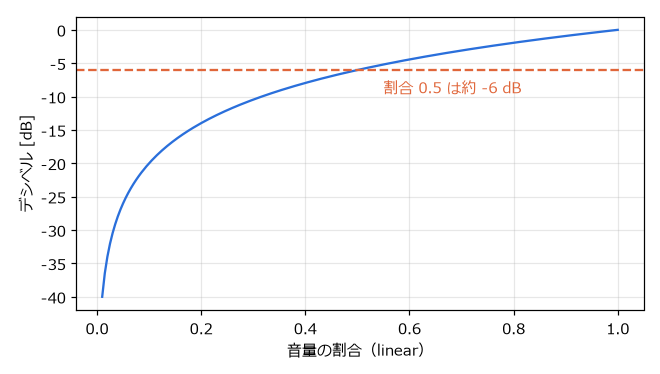
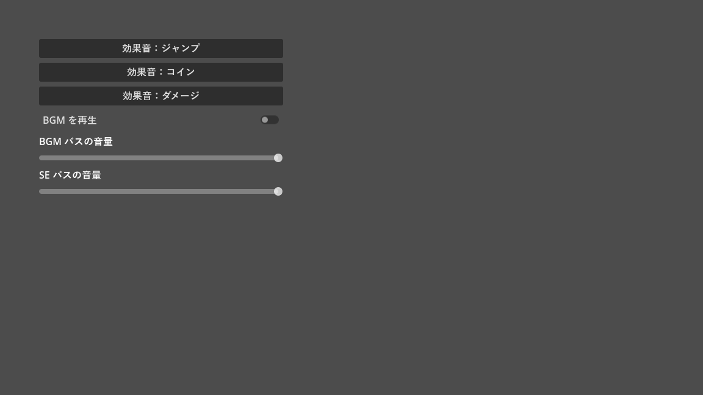

.. _ch14:

==================
第 14 章　サウンド
==================

効果音と BGM は、ゲームの手応えと雰囲気を大きく左右する。本章では、音を再生するノード、音量をまとめて管理するオーディオバス、音量の単位であるデシベルについて説明する。サンプルは ``chapter14`` フォルダーにある。

音声ファイルの形式
==================

Godot は、次の形式の音声ファイルをインポートできる。

.. list-table:: 対応する音声ファイルの形式
   :header-rows: 1
   :widths: 20 80

   * - 形式
     - 特徴と用途
   * - WAV
     - 圧縮しない形式。再生の負荷が小さく、遅延も少ない。短い効果音に向く。
   * - Ogg Vorbis
     - 圧縮した形式。ファイルが小さい。BGM や長い音声に向く。
   * - MP3
     - 圧縮した形式。Ogg Vorbis と同様に BGM などに使える。

BGM を繰り返し再生（ループ）するかどうかは、音声ファイルのインポート設定で決める。ファイルシステムドックでファイルを選び、「インポート」ドックで WAV なら「Loop Mode」、Ogg Vorbis と MP3 なら「ループ」を設定して、「再インポート」を押す。

本書のサンプルの音声は、``tools/generate_assets.py`` で作った WAV ファイルで、ループしない設定で読み込んでいる。そのため、BGM は再生が終わったときに発行される ``finished`` シグナルで、最初から再生し直している。

音を再生するノード
==================

音を再生するには、次のノードを使う。「ストリーム」（stream）に音声ファイルを設定し、``play()`` で再生する。

.. list-table:: 音を再生するノード
   :header-rows: 1
   :widths: 30 70

   * - ノード
     - 特徴
   * - ``AudioStreamPlayer``
     - 位置を持たない。どこで鳴っても同じ音量で聞こえる。BGM や UI の効果音に使う。
   * - ``AudioStreamPlayer2D``
     - 2D 空間の位置を持つ。画面の中心（カメラ）からの距離に応じて音量が下がり、左右の位置に応じて聞こえる方向が変わる。
   * - ``AudioStreamPlayer3D``
     - 3D 空間の位置を持つ。

.. list-table:: AudioStreamPlayer のよく使うプロパティ
   :header-rows: 1
   :widths: 35 65

   * - プロパティ
     - 内容
   * - ストリーム（stream）
     - 再生する音声
   * - ボリューム dB（volume_db）
     - 音量。単位はデシベル（後述）
   * - ピッチスケール（pitch_scale）
     - 再生速度と音の高さ。2.0 で 1 オクターブ高く、速くなる。
   * - 自動再生（autoplay）
     - シーンの開始時に自動で再生する。
   * - バス（bus）
     - 出力先のオーディオバス（後述）
   * - max_polyphony
     - 同時に重ねて再生できる数。既定値は 1 で、再生中に ``play()`` を呼ぶと最初から鳴り直す。

効果音を素早く連続して鳴らすと、``max_polyphony`` が 1 のままでは前の音が途切れる。重ねて鳴らしたい場合は、この値を大きくする。同じ効果音を毎回少しずつ変えたい場合は、``pitch_scale`` を ``randf_range(0.9, 1.1)`` のようにランダムにすると、単調さを抑えられる。

オーディオバス
==============

オーディオバス（audio bus）は、音の通り道である。各プレイヤーの音はいずれかのバスに送られ、バスで音量の調整やエフェクトの処理を受けてから、最終的に ``Master`` バスに集められて出力される。

.. graphviz::
   :caption: サンプルプロジェクトのオーディオバスの構成

   digraph buses {
     rankdir=LR;
     node [shape=box, style="rounded,filled", fontsize=11];
     bgm_player [label="BGMPlayer\n（AudioStreamPlayer）", fillcolor="#f2f2f2"];
     se_player [label="SEPlayer\n（AudioStreamPlayer）", fillcolor="#f2f2f2"];
     bgm [label="BGM バス", fillcolor="#cfe2ff"];
     se [label="SE バス", fillcolor="#cfe2ff"];
     master [label="Master バス", fillcolor="#d4edda"];
     out [label="スピーカー", shape=ellipse, fillcolor="#ffffff"];
     bgm_player -> bgm;
     se_player -> se;
     bgm -> master;
     se -> master;
     master -> out;
   }

BGM と効果音を別のバスに分けておくと、設定画面で「BGM の音量」と「効果音の音量」を別々に変えられる。バスは、下部パネルの「オーディオ」で「バスを追加」を押して作る。バスにはリバーブ（残響）やコンプレッサーなどのエフェクトも追加できる。バスの構成はプロジェクトのフォルダーの ``default_bus_layout.tres`` に保存される。

デシベル
========

Godot の音量は、デシベル（dB）で表す。0 dB が元の音量で、マイナスにすると小さくなる。デシベルと、元の音量に対する割合（振幅の比）の関係は次の式で表される。

.. math::

   \text{dB} = 20 \log_{10}(\text{割合})

割合が 0.5（半分）のとき約 -6 dB、0.1 のとき -20 dB になる。割合が 0 に近づくと、デシベルはマイナス無限大に向かう。

   音量の割合とデシベルの関係

設定画面のスライダーは 0 ～ 1 の割合で扱うほうが分かりやすいので、``linear_to_db()`` で割合をデシベルに変換してから設定する。逆の変換は ``db_to_linear()`` で行う。なお、プレイヤーの ``volume_linear`` プロパティや、``AudioServer.set_bus_volume_linear()`` を使うと、割合のまま設定することもできる。

サンプル
========

``audio_demo.tscn`` は、3 種類の効果音のボタン、BGM の再生・停止の切り替え、バスごとの音量のスライダーを並べたサンプルである。

.. literalinclude:: ../../examples/chapter14/audio_demo.gd
   :tab-width: 4
   :language: gdscript
   :linenos:
   :caption: chapter14/audio_demo.gd

9 行目から 11 行目では、3 つのボタンの ``pressed`` シグナルを同じ ``_play_se()`` に接続し、鳴らす音声を ``bind()`` で渡している（:ref:`ch07`）。音量のスライダーも同様に、``bind()`` でバスの名前を渡している。シグナルの引数（スライダーの値）が先に渡され、``bind()`` で追加した引数はその後ろに渡される。

``_set_bus_volume()`` では、``AudioServer.get_bus_index()`` でバスの名前から番号を求め、``set_bus_volume_db()`` で音量を設定している。割合が 0 のときは ``linear_to_db()`` がマイナス無限大を返すので、念のためバスをミュートしている。

   audio_demo.tscn の実行結果
