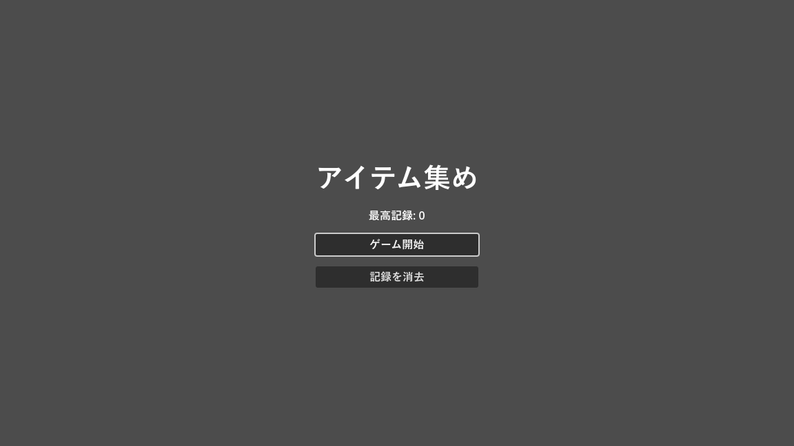

.. _ch15:

============================
第 15 章　シーン管理とデータ
============================

ゲームは、タイトル画面、ステージ、リザルト画面など、複数の画面で構成される。本章では、シーンを切り替える方法、シーンをまたいでデータを保持する方法、データを定義するリソースの作り方、セーブデータを保存する方法を説明する。サンプルは ``chapter15`` フォルダーにある。

シーンを切り替える
==================

実行中のシーンを別のシーンに切り替えるには、``SceneTree`` の次のメソッドを使う。

.. list-table:: シーンを切り替えるメソッド
   :header-rows: 1
   :widths: 45 55

   * - メソッド
     - 内容
   * - ``get_tree().change_scene_to_file(パス)``
     - シーンファイルのパスを指定して切り替える。
   * - ``get_tree().change_scene_to_packed(シーン)``
     - ``preload()`` などで読み込んだ ``PackedScene`` に切り替える。
   * - ``get_tree().reload_current_scene()``
     - 現在のシーンを最初からやり直す。リトライに使う。

シーンを切り替えると、それまでのシーンのノードはすべて削除される。そのため、スコアのようにシーンをまたいで残したい値は、シーンの外に置く必要がある。

オートロード
============

オートロード（autoload）は、ゲームの起動時に自動で作られ、シーンを切り替えても削除されないノードである。:ref:`ch05` で見たように、シーンツリーの ``root`` の直下に、現在のシーンと並んで置かれる。登録した名前で、どのスクリプトからもアクセスできる。他の言語でいうシングルトンやグローバル変数に近い。

オートロードは、次の手順で登録する。

#. 登録したいスクリプト（またはシーン）を作る。サンプルでは ``chapter15/game_state.gd`` である。
#. 「プロジェクト」→「プロジェクト設定」の「グローバル」タブを開き、「自動読み込み」を選ぶ。
#. 「パス」にスクリプトを指定し、「ノード名」に ``GameState`` と入力して「追加」を押す。「グローバル変数」が有効になっていることを確認する。

これで、どのスクリプトからも ``GameState.score`` のように使えるようになる。

.. literalinclude:: ../../examples/chapter15/game_state.gd
   :tab-width: 4
   :language: gdscript
   :linenos:
   :caption: chapter15/game_state.gd

``score`` にはセッター（:ref:`ch07`）を定義しており、値が変わるたびに ``score_changed`` シグナルを発行する。画面にスコアを表示するノードは、このシグナルに接続しておけば、スコアが変わったときだけ表示を更新できる。

オートロードは便利だが、何でも入れるとどこからでも変更できる値が増え、不具合の原因を追いにくくなる。シーンをまたいで本当に必要な値（スコア、設定、進行状況など）や、共通の機能（効果音の再生、画面の切り替えの演出など）に絞って使うとよい。

独自のリソースでデータを定義する
================================

アイテムの名前と得点、敵の体力と攻撃力のようなデータは、スクリプトに直接書くより、データとして分けて管理すると調整しやすい。Godot では、``Resource`` を継承したクラスを作り、そのインスタンスを ``.tres`` ファイルとして保存する方法がよく使われる。

.. literalinclude:: ../../examples/chapter15/item_data.gd
   :tab-width: 4
   :language: gdscript
   :linenos:
   :caption: chapter15/item_data.gd

このクラスのリソースは、次の手順で作る。

#. ファイルシステムドックで保存先のフォルダーを右クリックし、「新規リソース...」を選ぶ。
#. 一覧から ``ItemData`` を選んで作成し、``apple.tres`` などの名前で保存する。
#. 保存したファイルを選ぶと、インスペクターに ``@export`` を付けた変数が表示されるので、値を入力する。

作られた ``.tres`` ファイルはテキスト形式である。

.. literalinclude:: ../../examples/chapter15/items/apple.tres
   :tab-width: 4
   :language: ini
   :linenos:
   :caption: chapter15/items/apple.tres

リソースは、``@export var items: Array[ItemData]`` のような変数に設定して使う。ゲームの調整をする人は、スクリプトを開かずにインスペクターだけで値を変えられる。

.. note::

   同じリソースファイルを複数の場所で読み込むと、同じインスタンスが共有される。実行中にリソースの値を書き換えると、そのリソースを使うすべての場所に影響する。インスタンスごとに値を変えたい場合は、``duplicate()`` で複製してから変更する。

データを保存する
================

セーブデータや設定のように、ゲームを終了しても残したいデータはファイルに保存する。保存先には ``user://`` を使う（:ref:`ch04`）。``res://`` はエクスポートしたゲームでは書き込めない。

``user://`` の実際の場所は、エディターの「プロジェクト」→「ユーザーデータフォルダーを開く」で確認できる。Windows では ``%APPDATA%\Godot\app_userdata\プロジェクト名`` である。

保存の方法には、主に次の 3 つがある。

.. list-table:: データを保存する方法
   :header-rows: 1
   :widths: 22 39 39

   * - 方法
     - 特徴
     - 向いている用途
   * - ``ConfigFile``
     - INI ファイルに似た「セクション」「キー」「値」の形式で保存する。``Vector2`` や ``Color`` などの Godot の型もそのまま保存できる。
     - 設定、簡単なセーブデータ
   * - JSON
     - ``JSON.stringify()`` で文字列に変換し、``FileAccess`` で書き込む。ほかのプログラムでも読める。
     - ほかのツールと連携するデータ、Web との通信
   * - ``ResourceSaver``
     - リソースをそのまま ``.tres`` や ``.res`` として保存する。
     - 複雑なデータ構造。ただし後述の注意がある。

ConfigFile
----------

``game_state.gd`` の ``save_game()`` と ``load_game()`` では、最高記録を ``ConfigFile`` で保存・読み込みしている。保存されるファイルの中身は次のようになる。

.. code-block:: ini
   :linenos:

   [record]

   high_score=10

``get_value()`` の第 3 引数は、値がない場合の既定値である。初回起動時のようにファイルがない場合も、``load()`` の戻り値を確認すれば安全に処理できる。

JSON
----

JSON で保存する場合は、``FileAccess`` でファイルを開いて文字列を書き込む。ステージのスクリプトでは、最後のプレイの結果を JSON で保存している。

.. literalinclude:: ../../examples/chapter15/stage.gd
   :tab-width: 4
   :language: gdscript
   :linenos:
   :caption: chapter15/stage.gd

``FileAccess.open()`` は、開けなかった場合に ``null`` を返す。``FileAccess`` のインスタンスは、使い終わって参照がなくなると自動で閉じられる。明示的に閉じる場合は ``close()`` を呼ぶ。

JSON を読み込むときは ``JSON.parse_string()`` を使う。JSON の数値は、整数であっても ``float`` として読み込まれる点に注意する。``{"score": 10}`` を読み込むと ``10.0`` になるので、整数として使う場合は ``int()`` で変換する。

.. warning::

   ``.tres`` などのリソースファイルには、スクリプトを埋め込むことができる。インターネットから入手したセーブデータなど、信頼できないリソースファイルを ``load()`` で読み込むと、意図しないコードが実行される危険がある。プレイヤー間で共有される可能性があるデータは、``ConfigFile`` や JSON で保存するほうが安全である。

サンプル
========

サンプルの ``title.tscn`` と ``stage.tscn`` は、ここまでの内容を組み合わせた小さなゲームである。タイトル画面で「ゲーム開始」を押すとステージに切り替わり、10 秒間アイテムのボタンを押して得点を集める。時間切れになると、最高記録を ``ConfigFile`` で、今回の結果を JSON で保存して、タイトル画面に戻る。

.. graphviz::
   :caption: サンプルのシーンとデータの流れ

   digraph flow {
     rankdir=LR;
     node [shape=box, style="rounded,filled", fontsize=11];
     title [label="title.tscn\n（タイトル画面）", fillcolor="#e8f0fe"];
     stage [label="stage.tscn\n（ステージ）", fillcolor="#e8f0fe"];
     gs [label="GameState\n（オートロード）\nscore、high_score", fillcolor="#fff3cd"];
     items [label="apple.tres\ngem.tres\n（ItemData）", fillcolor="#d4edda"];
     cfg [label="user://chapter15_save.cfg\n（ConfigFile）", shape=note, fillcolor="#f2f2f2"];
     json [label="user://chapter15_last_result.json\n（JSON）", shape=note, fillcolor="#f2f2f2"];
     title -> stage [label="ゲーム開始"];
     stage -> title [label="時間切れ"];
     title -> gs [style=dashed];
     stage -> gs [style=dashed];
     items -> stage [label="@export"];
     gs -> cfg [label="save_game()"];
     stage -> json [label="_save_result()"];
   }

``stage.gd`` の ``items`` 変数には、インスペクターで ``apple.tres`` と ``gem.tres`` を設定している。``_ready()`` では、アイテムごとにボタンを作り、名前、得点、色をリソースから設定している。新しいアイテムを追加したいときは、``.tres`` ファイルを作って ``items`` に加えるだけでよく、スクリプトを変更する必要はない。

   title.tscn の実行結果
