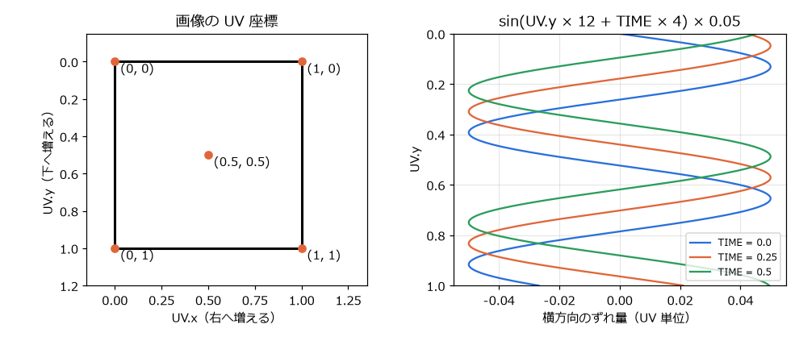
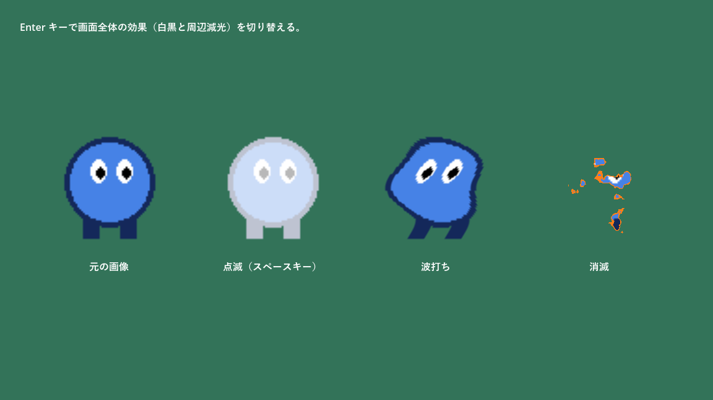
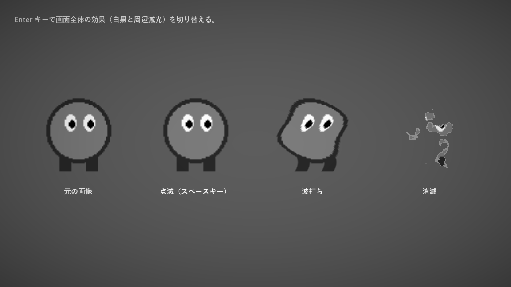

.. _ch16:

========================
第 16 章　シェーダー入門
========================

被弾したキャラクターを白く光らせる、旗を波打たせる、敵が燃え尽きるように消える、画面全体を白黒にする。こうした見た目の効果は、シェーダーを使うと少ない手間で実現できる。本章では、シェーダーの考え方と Godot のシェーダー言語の基本を、4 つの例で説明する。サンプルは ``chapter16`` フォルダーにある。

シェーダーとは
==============

シェーダー（shader）は、GPU（グラフィックス処理装置）の上で動く小さなプログラムである。画面に描画する物体の頂点ごと、またはピクセルごとに実行され、その位置や色を決める。

CPU で動く GDScript は、命令を 1 つずつ順番に処理する。一方、GPU は同じ処理を大量のデータに対して同時に実行するのが得意である。シェーダーは「1 つのピクセルの色を決める処理」として書き、GPU がそれを画面の全ピクセルに対して並列に実行する。

.. list-table:: GDScript とシェーダーの違い
   :header-rows: 1
   :widths: 25 37 38

   * - 項目
     - GDScript
     - シェーダー
   * - 実行する場所
     - CPU
     - GPU
   * - 書く処理の単位
     - ゲーム全体の処理の流れ
     - 1 つの頂点、または 1 つのピクセルの処理
   * - 得意なこと
     - ゲームのルール、状態の管理
     - 見た目の効果、大量の要素の一括処理
   * - ほかの要素との情報のやり取り
     - 自由にできる
     - ほぼできない。隣のピクセルの計算結果は使えない。

例えば、画像の色を白に近づける処理を GDScript でピクセルごとに行うと、画像が大きいほど時間がかかる。シェーダーなら、GPU が全ピクセルを同時に処理するので、毎フレーム実行しても負荷はほとんど問題にならない。

Godot のシェーダー言語
======================

Godot のシェーダーは、GLSL（OpenGL のシェーダー言語）を簡略化した、Godot 独自のシェーダー言語で書く。ファイルの拡張子は ``.gdshader`` である。Godot は、このコードを使っているレンダラー（Vulkan、OpenGL など）に合わせて変換する。

シェーダーの種類
----------------

ファイルの先頭の ``shader_type`` で、シェーダーの種類を指定する。

.. list-table:: シェーダーの種類
   :header-rows: 1
   :widths: 25 75

   * - 種類
     - 対象
   * - ``canvas_item``
     - 2D のノードと UI（``CanvasItem`` を継承したノード）。本章で扱う。
   * - ``spatial``
     - 3D の物体
   * - ``particles``
     - GPU パーティクルの粒の動き
   * - ``sky``
     - 3D の空
   * - ``fog``
     - 3D のボリュームフォグ

処理関数
--------

シェーダーには、決まった名前の関数（処理関数）を書く。``canvas_item`` のシェーダーでは、次の関数を使う。

.. list-table:: canvas_item シェーダーの処理関数
   :header-rows: 1
   :widths: 25 75

   * - 関数
     - 内容
   * - ``vertex()``
     - 頂点ごとに実行される。頂点の位置を変えて、形を変形させる。
   * - ``fragment()``
     - ピクセルごとに実行される。そのピクセルの色を決める。
   * - ``light()``
     - ピクセルとライトの組み合わせごとに実行される。2D のライトの当たり方を変える。

本章の例は、すべて ``fragment()`` だけを使う。

型と組み込み変数
----------------

シェーダー言語の主な型は次のとおりである。``vec4`` の各成分は ``.x``、``.y``、``.z``、``.w`` のほか、色として ``.r``、``.g``、``.b``、``.a`` でも参照できる。``COLOR.rgb`` のように複数の成分をまとめて取り出すこともできる（スウィズル）。

.. list-table:: シェーダー言語の主な型
   :header-rows: 1
   :widths: 25 75

   * - 型
     - 内容
   * - ``float``、``int``、``bool``
     - 浮動小数点数、整数、真偽値
   * - ``vec2``、``vec3``、``vec4``
     - 2 ～ 4 個の ``float`` の組。座標や色に使う。
   * - ``mat2``、``mat3``、``mat4``
     - 行列
   * - ``sampler2D``
     - テクスチャ（画像）

``fragment()`` の中では、次の組み込み変数を使える。

.. list-table:: canvas_item シェーダーの fragment() で使う主な組み込み変数
   :header-rows: 1
   :widths: 25 75

   * - 変数
     - 内容
   * - ``UV``
     - テクスチャ上の座標。画像の左上が (0, 0)、右下が (1, 1) である。
   * - ``TEXTURE``
     - ノードに設定されたテクスチャ
   * - ``COLOR``
     - 入力としては、テクスチャの色に頂点の色（``modulate`` など）を掛けた値。出力として、このピクセルの最終的な色を代入する。
   * - ``TIME``
     - ゲームの開始からの経過秒数。時間とともに変化する効果に使う。
   * - ``SCREEN_UV``
     - 画面上の座標。画面の左上が (0, 0)、右下が (1, 1) である。
   * - ``TEXTURE_PIXEL_SIZE``
     - テクスチャの 1 ピクセルの大きさ（UV 単位）

.. warning::

   シェーダー言語は型に厳しい。``float`` の変数に整数の ``1`` を代入するとエラーになるので、``1.0`` のように小数点を付けて書く。GDScript の感覚で書くと間違えやすい。

シェーダーを適用する手順
========================

2D のノードにシェーダーを適用する手順は次のとおりである。

#. シェーダーを適用したいノード（``Sprite2D`` など）を選ぶ。
#. インスペクターの「CanvasItem」→「マテリアル」→「マテリアル」で「新規 ShaderMaterial」を選ぶ。
#. 作られた ``ShaderMaterial`` をクリックして開き、「シェーダー」で「新規 Shader」を選ぶ。保存先を聞かれたら、``.gdshader`` ファイルとして保存する。
#. ``Shader`` をクリックすると、下部パネルの「シェーダーエディター」が開くので、コードを書く。
#. コードの中で ``uniform`` として宣言した値は、``ShaderMaterial`` のインスペクターの「Shader Parameters」に表示され、エディターから変更できる。

``ShaderMaterial`` はシェーダーと、そのパラメーター（uniform の値）の組を保持するリソースである。同じシェーダーを使い、パラメーターだけが異なるマテリアルを複数作れる。

例 1：点滅（白く光らせる）
==========================

最初の例は、画像を指定した色で塗りつぶすシェーダーである。被弾したときにキャラクターを一瞬白く光らせる演出に使う。

.. literalinclude:: ../../examples/chapter16/flash.gdshader
   :tab-width: 4
   :language: glsl
   :linenos:
   :caption: chapter16/flash.gdshader

``uniform`` は、シェーダーの外（エディターやスクリプト）から値を設定できる変数である。GDScript の ``@export`` に近い。``: source_color`` や ``: hint_range(0.0, 1.0)`` はヒントと呼ばれ、インスペクターでの入力方法を指定する。``source_color`` を付けた ``vec4`` はカラーピッカーで入力でき、色空間の変換も正しく行われる。

``fragment()`` では、``mix(a, b, t)`` で元の色と ``flash_color`` を ``flash_amount`` の割合で混ぜている。``mix()`` は :math:`a(1 - t) + bt` を計算する関数で、GDScript の ``lerp()`` に相当する。透明度（``COLOR.a``）は変えないので、画像の透明な部分は透明のままになる。

スクリプトから uniform を変更する
---------------------------------

uniform の値は、GDScript から ``ShaderMaterial`` の ``set_shader_parameter()`` で変更できる。``Tween`` の ``tween_method()`` と組み合わせると、値を時間とともに変化させられる。

.. literalinclude:: ../../examples/chapter16/shader_demo.gd
   :tab-width: 4
   :language: gdscript
   :linenos:
   :caption: chapter16/shader_demo.gd

``_flash()`` では、``flash_amount`` を 0.3 秒かけて 1.0 から 0.0 に変化させている。``tween_method()`` は、``tween_property()`` と異なり、途中の値を引数にして指定した関数を毎フレーム呼ぶ。プロパティではない値（ここでは uniform）を変化させたいときに使う。

.. note::

   ``ShaderMaterial`` もリソースなので、同じマテリアルを複数のノードで使うと共有される（:ref:`ch15`）。1 体の敵を光らせたつもりが、同じマテリアルを使う敵が全員光ってしまう、ということが起こる。ノードごとに別の値にしたい場合は、マテリアルのインスペクターで「リソース」→「シーン固有」（resource_local_to_scene）をオンにする。シーンのインスタンスごとに、マテリアルが複製されるようになる。

例 2：波打ち
============

2 つ目の例は、画像を横方向に波打たせるシェーダーである。テクスチャを読み取る座標をずらすことで、画像を変形させる。

.. literalinclude:: ../../examples/chapter16/wave.gdshader
   :tab-width: 4
   :language: glsl
   :linenos:
   :caption: chapter16/wave.gdshader

``texture(TEXTURE, uv)`` は、テクスチャの ``uv`` の位置の色を読み取る関数である。通常は ``UV`` の位置を読むので画像がそのまま表示されるが、この例では ``uv.x`` を少しずらした位置を読んでいる。ずらす量は ``UV.y``\ （画像の上下の位置）と ``TIME`` で決まるので、行ごとにずれ方が違い、時間とともに変化する。

   UV 座標（左）と、波打ちシェーダーのずらし量（右）

右の図は、横軸がずらす量、縦軸が ``UV.y`` である。``TIME`` が増えると波の形が下へ流れていく。

例 3：消滅
==========

3 つ目の例は、ノイズ画像を使って、画像が燃え尽きるように消えていくシェーダーである。

.. literalinclude:: ../../examples/chapter16/dissolve.gdshader
   :tab-width: 4
   :language: glsl
   :linenos:
   :caption: chapter16/dissolve.gdshader

``noise_texture`` には、白と黒がまだらに分布したノイズ画像を設定する。サンプルでは、Godot の ``NoiseTexture2D`` リソース（``FastNoiseLite`` で生成するノイズ）を使っている。インスペクターの uniform の欄で「新規 NoiseTexture2D」を選び、その「ノイズ」で「新規 FastNoiseLite」を選べば作れる。

ピクセルごとにノイズの値（0.0 ～ 1.0）を読み、それが ``progress`` より小さければ ``discard`` でそのピクセルを描画しない。``progress`` を 0.0 から 1.0 へ増やすと、ノイズの値が小さい部分から順に消えていく。消える境目のすぐ手前の部分は ``edge_color`` で塗り、燃えているように見せている。

``shader_demo.gd`` では、``tween_method()`` で ``progress`` を 2 秒かけて 0.0 から 1.0 まで変化させ、また戻す動きを繰り返している。

   shader_demo.tscn の実行結果（左から元の画像、点滅、波打ち、消滅）

例 4：画面全体の効果
====================

最後の例は、画面全体を白黒にし、周辺を暗くする（周辺減光、ビネット）シェーダーである。個々の画像ではなく、すでに描画された画面の内容を加工する。

.. literalinclude:: ../../examples/chapter16/screen_effect.gdshader
   :tab-width: 4
   :language: glsl
   :linenos:
   :caption: chapter16/screen_effect.gdshader

``hint_screen_texture`` を付けた ``sampler2D`` の uniform は、このノードより奥に描画済みの画面の内容になる。``SCREEN_UV`` で現在のピクセルの画面上の位置を読み取り、色を加工して ``COLOR`` に代入している。

白黒にする処理では、赤、緑、青に人の目の感度に応じた重みを付けて足し合わせ、明るさ（輝度）を求めている。

.. math::

   Y = 0.299R + 0.587G + 0.114B

周辺減光では、画面の中心 (0.5, 0.5) からの距離の 2 乗に比例して暗くしている。

このシェーダーは、画面全体を覆う ``ColorRect`` に設定して使う。サンプルでは、``CanvasLayer`` の子に「Rect全面」の ``ColorRect`` を置き、マウスのフィルターを Ignore にしている（:ref:`ch13`）。``CanvasLayer`` に置くことで、カメラが動いても常に画面全体を覆い、ほかのノードより手前に描画される。:kbd:`Enter` キーで表示・非表示を切り替えられる。

   画面全体の効果を有効にしたところ

ビジュアルシェーダー
====================

Godot には、コードを書く代わりに、ノードを線でつないでシェーダーを作るビジュアルシェーダー（``VisualShader``）もある。「新規 Shader」の代わりに「新規 VisualShader」を選ぶと、ノードを並べて編集する画面になる。処理の流れが目で見えるので、試行錯誤しながら効果を作るのに向く。作れる効果はコードのシェーダーと同じである。

シェーダーを書くときの注意
==========================

* **ピクセル数だけ実行される**：``fragment()`` は描画するピクセルの数だけ実行される。画面全体を覆うシェーダーでは、1 フレームに数十万回から数百万回実行されるので、重いループなどは避ける。
* **初回の表示で一瞬止まることがある**：シェーダーは、初めて使われるときに GPU 用にコンパイルされる。ゲームの途中で初めて登場する効果は、その瞬間にわずかな引っかかりが出ることがある。
* **デバッグが難しい**：シェーダーには ``print()`` がない。途中の値を確かめたいときは、その値を ``COLOR`` に出力して色として確認する。

シェーダーの考え方は、Godot に限らず、ほかのゲームエンジンや Web の WebGL でも共通である。``TIME`` や ``UV`` を使って色を計算する練習を重ねると、表現の幅が大きく広がる。参考になる資料は付録 D にまとめた。
