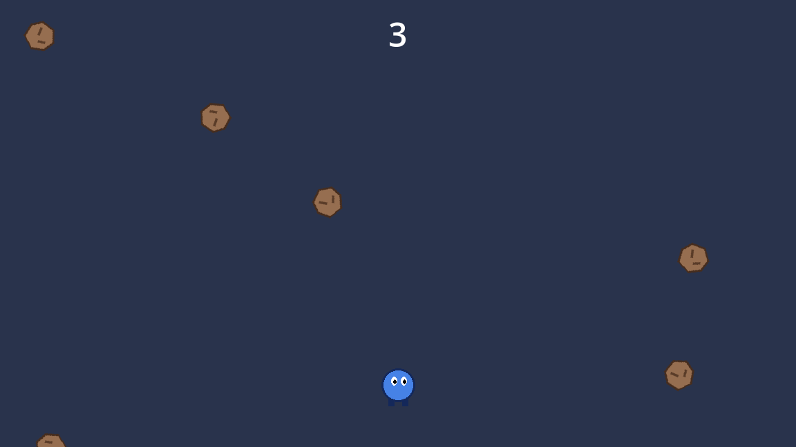
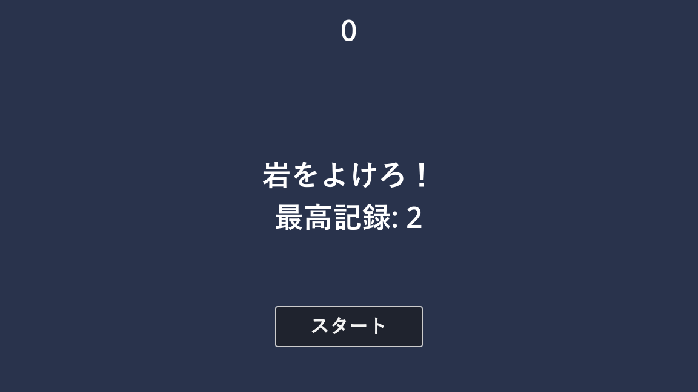

.. _ch17:

============================================
第 17 章　チュートリアル：岩よけゲームを作る
============================================

本章では、ここまでに学んだ内容を組み合わせて、1 本の小さなゲームを完成させる。題材は、空から落ちてくる岩をよけ続ける「岩よけゲーム」である。完成したものは、サンプルの ``chapter17`` フォルダーにある。

完成形
======

   岩よけゲームのプレイ画面

ゲームの仕様は次のとおりである。

* 「スタート」ボタンを押すと、2 秒後にゲームが始まる。
* プレイヤーは上下左右に動ける。画面の外には出られない。
* 岩が画面の上からランダムな位置に落ちてくる。時間がたつほど、岩の数が増え、落下速度も上がる。
* 1 秒生き延びるごとに 1 点もらえる。
* 岩に当たると、プレイヤーが白く光って消え、ゲームオーバーになる。最高記録を更新した場合は保存する。
* ゲーム中に :kbd:`P` キーを押すと、一時停止する。
* BGM と効果音を鳴らす。

本章で使う主な知識と、説明した章の対応は次のとおりである。

.. list-table:: 本章で使う知識
   :header-rows: 1
   :widths: 50 50

   * - 知識
     - 説明した章
   * - シーンのインスタンス化、グループ
     - :ref:`ch05`
   * - シグナル、``await``
     - :ref:`ch07`
   * - ``Timer`` ノード、一時停止と処理モード
     - :ref:`ch08`
   * - 入力アクション
     - :ref:`ch09`
   * - ``Area2D`` による衝突の検出、コリジョンレイヤー
     - :ref:`ch11`
   * - ``Tween``
     - :ref:`ch12`
   * - ``CanvasLayer`` による HUD、アンカー
     - :ref:`ch12`、:ref:`ch13`
   * - ``AudioStreamPlayer``、オーディオバス
     - :ref:`ch14`
   * - ``ConfigFile`` による保存
     - :ref:`ch15`
   * - 点滅のシェーダー
     - :ref:`ch16`

ゲームの構成
============

ゲームは 4 つのシーンで構成する。

.. list-table:: 岩よけゲームのシーン
   :header-rows: 1
   :widths: 25 75

   * - シーン
     - 役割
   * - ``player.tscn``
     - プレイヤー。入力に応じて動き、岩に当たったら ``hit`` シグナルを発行する。
   * - ``rock.tscn``
     - 落ちてくる岩。まっすぐ落ちて、画面の外に出たら自分を削除する。
   * - ``hud.tscn``
     - スコア、メッセージ、スタートボタンなどの表示。ボタンが押されたら ``start_game`` シグナルを発行する。
   * - ``main.tscn``
     - ゲーム全体。ほかのシーンを組み合わせ、岩の生成、スコアの計算、ゲームオーバーの処理を行う。

.. graphviz::
   :caption: main.tscn のノードの構成

   digraph main {
     rankdir=LR;
     node [shape=box, style="rounded,filled", fillcolor="#e8f0fe", fontsize=11];
     main [label="Main（Node）\nmain.gd", fillcolor="#cfe2ff"];
     bg [label="Background\n（ColorRect）"];
     player [label="Player\n（player.tscn）", fillcolor="#d4edda"];
     start [label="StartPosition\n（Marker2D）"];
     rt [label="RockTimer\n（Timer）"];
     st [label="ScoreTimer\n（Timer）"];
     stt [label="StartTimer\n（Timer）"];
     hud [label="HUD\n（hud.tscn）", fillcolor="#d4edda"];
     music [label="Music\n（AudioStreamPlayer）"];
     hit [label="HitSound\n（AudioStreamPlayer）"];
     rocks [label="Rock × 多数\n（rock.tscn、実行中に生成）", fillcolor="#fff3cd", style="rounded,filled,dashed"];
     main -> bg;
     main -> player;
     main -> start;
     main -> rt;
     main -> st;
     main -> stt;
     main -> hud;
     main -> music;
     main -> hit;
     main -> rocks [style=dashed];
   }

シーンどうしは、:ref:`ch05` で説明した「呼び出しは下へ、通知は上へ」の方針でつなぐ。``Main`` は子の ``Player`` や ``HUD`` のメソッドを直接呼ぶ。``Player`` と ``HUD`` は ``Main`` のことを知らず、シグナルで出来事を知らせるだけである。

準備
====

新しいプロジェクトで作る場合は、次の準備をする。サンプルプロジェクトで作業する場合は、すでに設定済みである。

#. サンプルプロジェクトの ``assets`` フォルダーから、``player.png``、``rock.png``、``bgm.wav``、``hit.wav`` をプロジェクトにコピーする。``chapter16/flash.gdshader`` もコピーする。
#. 「プロジェクト設定」の「インプットマップ」で、``move_left``、``move_right``、``move_up``、``move_down``、``pause`` のアクションを作り、キーを割り当てる（:ref:`ch09`）。
#. 「プロジェクト設定」の「レイヤー名」→「2D物理」で、レイヤー 2 に ``player``、レイヤー 3 に ``enemy`` と名前を付ける（:ref:`ch11`）。
#. 下部パネルの「オーディオ」で、``BGM`` と ``SE`` のバスを追加する（:ref:`ch14`）。

画面の大きさは既定の 1152 × 648 のまま使う。

手順 1：プレイヤーを作る
========================

シーンを作る
------------

「シーン」→「新規シーン」で、次の構成のシーンを作り、``player.tscn`` として保存する。

.. list-table:: player.tscn のノード
   :header-rows: 1
   :widths: 30 25 45

   * - ノード名
     - 種類
     - 設定
   * - ``Player``
     - ``Area2D``
     - コリジョンのレイヤーは 2（player）だけ、マスクは 3（enemy）だけにする。
   * - ``Sprite2D``
     - ``Sprite2D``
     - テクスチャに ``player.png`` を設定する。マテリアルに「新規 ShaderMaterial」を作り、シェーダーに ``flash.gdshader`` を設定する。
   * - ``CollisionShape2D``
     - ``CollisionShape2D``
     - シェイプに「新規 CircleShape2D」を作り、半径を 20 にする。位置を (0, 2) にする。

プレイヤーは岩にぶつかって止まる必要はなく、重なったことが分かればよい。そこで、物理ボディではなく ``Area2D`` を使う。当たり判定の円は、画像（直径 48 ピクセルの円）より小さめにしている。

スクリプトを書く
----------------

``Player`` に ``player.gd`` をアタッチし、次のように書く。

.. literalinclude:: ../../examples/chapter17/player.gd
   :tab-width: 4
   :language: gdscript
   :linenos:
   :caption: chapter17/player.gd

* ``_ready()``：ゲームが始まるまでは、非表示にして ``_process()`` も止めておく。``set_process(false)`` で ``_process()`` の呼び出しを止められる。
* ``_process()``：:ref:`ch09` と同じく ``get_vector()`` で移動する。``clamp()`` で、位置を画面の端から ``MARGIN`` だけ内側の範囲に制限している。
* ``start()``：``Main`` から呼ばれ、指定した位置でプレイヤーを表示して動けるようにする。
* ``_on_area_entered()``：岩（``Area2D``）が重なったときに呼ばれる。``hit`` シグナルを発行し、白く光ってから消える演出を ``Tween`` で行う。

最後に、「シグナル」ドックで ``Player`` 自身の ``area_entered`` シグナルを ``_on_area_entered()`` に接続する。

``_on_area_entered()`` の 42 行目では、当たり判定を ``set_deferred()`` で無効にしている。衝突のシグナルは物理演算の処理の最中に呼ばれるため、その場で衝突形状を変更するとエラーになる。``set_deferred()`` は、現在の処理が終わった後にプロパティを変更する。当たり判定を無効にしておかないと、消える演出の途中で別の岩に触れたときに、``hit`` が再び発行されてしまう。

手順 2：岩を作る
================

次の構成のシーンを作り、``rock.tscn`` として保存する。

.. list-table:: rock.tscn のノード
   :header-rows: 1
   :widths: 30 30 40

   * - ノード名
     - 種類
     - 設定
   * - ``Rock``
     - ``Area2D``
     - コリジョンのレイヤーは 3（enemy）だけ、マスクはすべてオフにする。``rocks`` グループに追加する。
   * - ``Sprite2D``
     - ``Sprite2D``
     - テクスチャに ``rock.png`` を設定する。
   * - ``CollisionShape2D``
     - ``CollisionShape2D``
     - シェイプに「新規 CircleShape2D」を作り、半径を 18 にする。
   * - ``VisibleOnScreenNotifier2D``
     - ``VisibleOnScreenNotifier2D``
     - 「四角形」（rect）を、岩の画像を囲む (-24, -24, 48, 48) にする。

岩のマスクをすべてオフにしているのは、岩の側から何かを検出する必要がないからである。プレイヤーの側のマスクに enemy が入っているので、プレイヤーは岩を検出できる。

``VisibleOnScreenNotifier2D`` は、指定した四角形が画面に入ったときと出たときにシグナルを発行するノードである。

.. literalinclude:: ../../examples/chapter17/rock.gd
   :tab-width: 4
   :language: gdscript
   :linenos:
   :caption: chapter17/rock.gd

``speed`` は ``Main`` が岩を作るときに設定する。``_ready()`` では回転の速さをランダムに決め、``screen_exited`` シグナルを ``queue_free`` に直接接続している。画面の下に出た岩は自動で削除されるので、岩が増え続けてメモリーを使い切ることはない。岩は画面の上の外側に生成されるが、``screen_exited`` は一度画面に入ってから出たときに発行されるので、生成された直後に削除されることはない。

手順 3：HUD を作る
==================

スコアやメッセージを表示する HUD（heads-up display）を作る。カメラの影響を受けず、常にゲーム画面の手前に表示されるよう、ルートを ``CanvasLayer`` にする。

.. list-table:: hud.tscn のノード
   :header-rows: 1
   :widths: 25 20 55

   * - ノード名
     - 種類
     - 設定
   * - ``HUD``
     - ``CanvasLayer``
     - 「プロセス」→「モード」を Always にする（一時停止中も動かすため）。
   * - ``ScoreLabel``
     - ``Label``
     - アンカーのプリセットを「上伸長」にする。文字を中央揃えにし、フォントサイズを 48 にする。
   * - ``Message``
     - ``Label``
     - アンカーのプリセットを「中央水平伸長」にする。文字を上下左右とも中央揃えにし、フォントサイズを 48 にする。
   * - ``StartButton``
     - ``Button``
     - アンカーのプリセットを「中央下」にし、少し上へずらす。テキストを「スタート」にする。
   * - ``PauseLabel``
     - ``Label``
     - アンカーのプリセットを「Rect全面」にし、テキストを「一時停止中」にする。

.. literalinclude:: ../../examples/chapter17/hud.gd
   :tab-width: 4
   :language: gdscript
   :linenos:
   :caption: chapter17/hud.gd

``show_game_over()`` では、「ゲームオーバー」などのメッセージを表示してから ``await`` で 2 秒待ち、タイトルの表示に戻している（:ref:`ch07`）。

一時停止は ``HUD`` が受け持つ。``get_tree().paused`` を ``true`` にすると、処理モードが「継承」のノードはすべて止まる。``HUD`` は処理モードを Always にしているので、一時停止中も ``_unhandled_input()`` が呼ばれ、もう一度 :kbd:`P` キーを押すと再開できる。ゲームオーバーの後などに一時停止できないよう、``can_pause`` が ``true`` のときだけ受け付けている。

手順 4：メインシーンを作る
==========================

最後に、すべてを組み合わせるメインシーンを作る。

.. list-table:: main.tscn のノード
   :header-rows: 1
   :widths: 25 25 50

   * - ノード名
     - 種類
     - 設定
   * - ``Main``
     - ``Node``
     -
   * - ``Background``
     - ``ColorRect``
     - アンカーのプリセットを「Rect全面」にし、色を濃い紺色にする。マウスのフィルターを Ignore にする。
   * - ``Player``
     - ``player.tscn`` のインスタンス
     -
   * - ``StartPosition``
     - ``Marker2D``
     - 位置を (576, 560) にする。プレイヤーの開始位置の目印である。
   * - ``RockTimer``
     - ``Timer``
     - 待機時間を 0.6 にする。
   * - ``ScoreTimer``
     - ``Timer``
     - 待機時間は既定の 1 のままにする。
   * - ``StartTimer``
     - ``Timer``
     - 待機時間を 2、単発をオンにする。
   * - ``HUD``
     - ``hud.tscn`` のインスタンス
     -
   * - ``Music``
     - ``AudioStreamPlayer``
     - ストリームに ``bgm.wav``、バスに ``BGM`` を設定する。
   * - ``HitSound``
     - ``AudioStreamPlayer``
     - ストリームに ``hit.wav``、バスに ``SE`` を設定する。

``Main`` に ``main.gd`` をアタッチし、次のように書く。

.. literalinclude:: ../../examples/chapter17/main.gd
   :tab-width: 4
   :language: gdscript
   :linenos:
   :caption: chapter17/main.gd

スクリプトを保存したら、``Main`` を選び、インスペクターに表示された ``Rock Scene``\ （rock_scene）に ``rock.tscn`` をドラッグして設定する。

``main.gd`` の主な処理は次のとおりである。

* **4 行目～ 6 行目**：``player.gd`` などを ``preload()`` で読み込み、型の名前として使っている。``class_name`` を付けずに済むので、プロジェクト全体のクラス名を増やさずに、型の付いた変数を宣言できる。
* **_ready()**：シグナルを接続し、タイトルを表示する。
* **new_game()**：スコアを 0 に戻し、前のゲームの岩を ``rocks`` グループを使ってまとめて削除し（:ref:`ch05`）、プレイヤーを開始位置に置く。``StartTimer`` を開始し、2 秒後に ``_on_start_timer_timeout()`` で岩の生成とスコアの計算を始める。
* **_on_rock_timer_timeout()**：``rock_scene`` から岩のインスタンスを作り、画面の上の外側のランダムな位置に置いて、``Main`` の子として追加する。落下速度は、スコアが高いほど速くする。
* **_on_score_timer_timeout()**：1 秒ごとにスコアを増やす。岩を出す間隔を少しずつ短くして、難しくしていく。
* **game_over()**：プレイヤーの ``hit`` シグナルで呼ばれる。タイマーと BGM を止め、最高記録を更新していれば ``ConfigFile`` で保存する。

.. graphviz::
   :caption: 1 回のゲームの処理の流れ

   digraph flow {
     node [shape=box, style="rounded,filled", fillcolor="#e8f0fe", fontsize=10];
     edge [fontsize=9];
     title [label="HUD.show_title()\nタイトル表示"];
     newgame [label="Main.new_game()\nプレイヤーを配置"];
     wait [label="StartTimer（2 秒）"];
     play [label="プレイ中\nRockTimer：岩を生成\nScoreTimer：スコア加算", fillcolor="#d4edda"];
     over [label="Main.game_over()\n記録の保存"];
     result [label="HUD.show_game_over()\n2 秒待つ"];
     title -> newgame [label="start_game シグナル"];
     newgame -> wait;
     wait -> play [label="timeout"];
     play -> over [label="Player の hit シグナル"];
     over -> result;
     result -> title;
   }

手順 5：動かしてみる
====================

``main.tscn`` を開いて :kbd:`F6` を押すか、メインシーンに設定して :kbd:`F5` を押す。最初に次のようなタイトルの表示になる。

   岩よけゲームのタイトルの表示

「スタート」を押してゲームを始め、次の点を確認する。

* 「スタート」を押すと「用意...」と表示され、2 秒後に岩が落ち始める。
* プレイヤーが画面の外に出ない。
* スコアが 1 秒ごとに増え、時間がたつと岩が増える。
* 岩に当たると白く光って消え、効果音が鳴る。2 秒後に「スタート」ボタンが再び表示される。
* :kbd:`P` キーで一時停止と再開ができる。
* ゲームを終了して起動し直しても、最高記録が残っている。

うまく動かない場合は、付録 C のトラブルシューティングと、:ref:`ch18` のデバッグの方法を参考にする。特に、コリジョンのレイヤーとマスクの設定、シグナルの接続、``rock_scene`` の設定を確認するとよい。

改良のアイデア
==============

完成したゲームを改造して、さらに理解を深めよう。

* 岩に当たったときに、``CPUParticles2D`` で破片が飛び散る効果を追加する（:ref:`ch12`）。
* ``Camera2D`` を追加し、岩に当たったときに画面を揺らす（:ref:`ch12`）。
* 岩の大きさや速さに種類を作り、:ref:`ch15` の独自のリソースでデータとして定義する。
* 一定時間ごとに出現するアイテムを取ると、しばらく無敵になるようにする。
* 上位 5 件の記録を JSON で保存し、ランキングとして表示する（:ref:`ch15`）。
* :ref:`ch19` の手順でエクスポートし、友人に遊んでもらう。
