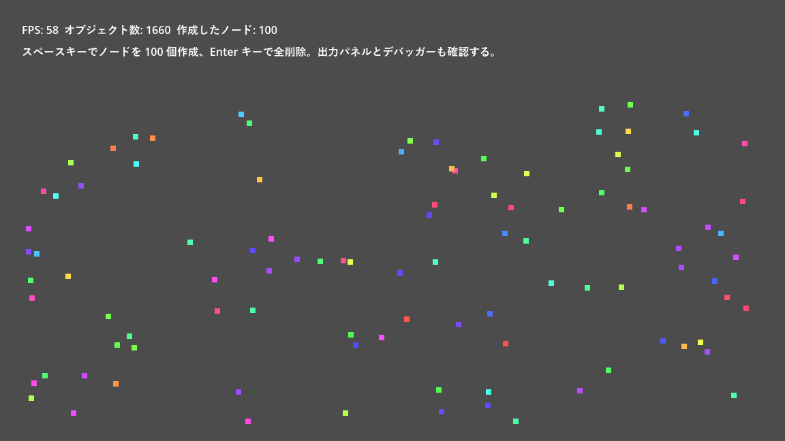

.. _ch18:

==========================
第 18 章　デバッグと最適化
==========================

ゲームを作っていると、思ったとおりに動かない場面に必ず出会う。本章では、Godot に用意されているデバッグの道具と、よく見るエラーの読み方、性能を測って改善する方法を説明する。サンプルは ``chapter18`` フォルダーにある。

出力によるデバッグ
==================

最も手軽なデバッグの方法は、変数の値などを出力して確かめることである。出力は、エディター下部の「出力」パネルに表示される。

.. list-table:: 出力に使う関数
   :header-rows: 1
   :widths: 30 70

   * - 関数
     - 内容
   * - ``print()``
     - 引数を連結して出力する。
   * - ``prints()``
     - 引数を空白で区切って出力する。
   * - ``print_rich()``
     - ``[color=red]`` などの BBCode で色や太字を付けて出力する。
   * - ``print_debug()``
     - 呼び出し元のファイル名、行番号、関数名と一緒に出力する。
   * - ``push_warning()``
     - 警告として出力する。デバッガーの「エラー」タブにも表示される。
   * - ``push_error()``
     - エラーとして出力する。デバッガーの「エラー」タブにも表示される。実行は止まらない。

``push_warning()`` と ``push_error()`` は、呼び出したときのスタックトレース（どの関数からどの関数が呼ばれたか）も記録する。「起きてはいけない状況」を検出したときに使うと、原因を追いやすい。

``assert(条件, メッセージ)`` は、条件が ``false`` のときに実行を止める。エディターから実行している（デバッグ版）ときだけ有効で、エクスポートしたゲーム（リリース版）では無視される。前提条件の確認に使う。

.. literalinclude:: ../../examples/chapter18/debug_demo.gd
   :tab-width: 4
   :language: gdscript
   :linenos:
   :caption: chapter18/debug_demo.gd

``debug_demo.tscn`` を実行すると、``_ready()`` の各種の出力が「出力」パネルに表示される。``push_error()`` の出力はエラーとして赤く表示されるが、これはサンプルとして意図的に出しているものである。

ブレークポイントとステップ実行
==============================

ブレークポイントを使うと、スクリプトの特定の行で実行を一時停止し、その時点の変数の値を確かめられる。

#. スクリプトエディターで、止めたい行の行番号の左をクリックするか、:kbd:`F9` を押す。赤い丸が表示される。
#. ゲームを実行する。その行に到達すると実行が止まり、下部パネルの「デバッガー」が開く。
#. 「スタックトレース」タブの左側に呼び出しの履歴（スタックフレーム）、右側にその時点の変数の値が表示される。
#. 次のキーで実行を進める。

.. list-table:: ステップ実行の操作
   :header-rows: 1
   :widths: 30 25 45

   * - 操作
     - キー
     - 内容
   * - ステップオーバー
     - :kbd:`F10`
     - 次の行へ進む。関数の呼び出しは 1 行として実行する。
   * - ステップイン
     - :kbd:`F11`
     - 次の行へ進む。関数の呼び出しでは、その関数の中に入る。
   * - 続行
     - :kbd:`F12`
     - 次のブレークポイントまで実行を続ける。

スクリプトの中に ``breakpoint`` と書いても、その行で止まる。条件を満たしたときだけ止めたい場合は、``if`` 文の中に ``breakpoint`` を書くとよい。

実行中のシーンツリーを見る
==========================

ゲームの実行中に、シーンドックの上部に「リモート」と「ローカル」の切り替えが表示される。「リモート」を選ぶと、実行中のゲームのシーンツリーが表示される。ノードを選ぶと、インスペクターでその時点のプロパティの値を確認でき、値を書き換えるとゲームに即座に反映される。

実行時に生成したノード（:ref:`ch17` の岩など）が正しく追加・削除されているかを確かめるのに便利である。また、「ゲーム」画面のツールバーでノードの選択モードを使うと、ゲーム画面上の物体をクリックして、対応するノードをリモートのシーンツリーで選べる。

「デバッグ」メニューの「コリジョン形状を表示」をオンにすると、実行中のゲームに当たり判定の形が重ねて表示される。衝突に関する不具合を調べるときに役立つ。

よく見るエラー
==============

実行中にエラーが起きると、エディターから実行している場合はゲームが止まり、スクリプトエディターでエラーの行が示される。エラーの内容は「デバッガー」の「エラー」タブと「出力」パネルに表示される。初心者がよく出会うエラーを、Godot 4.7.2 で実際に表示されるメッセージとともにまとめる。

.. list-table:: よく見るエラーと原因
   :header-rows: 1
   :widths: 45 55

   * - メッセージ
     - 主な原因
   * - ``Node not found: "Missing" (relative to "/root/...")``
     - ``$Missing`` や ``get_node()`` で指定したノードがない。ノード名やパスの綴りの誤り、ノードの階層の変更、シーン固有名の設定忘れなど
   * - ``Invalid assignment of property or key 'text' with value of type 'String' on a base object of type 'Nil'.``
     - ``null`` の変数のプロパティに代入しようとした。ノードの取得に失敗している、``@onready`` を付け忘れて初期化前に使っている、などが多い。
   * - ``Invalid access to property or key 'xxx' on a base object of type 'Nil'.``
     - ``null`` の変数のプロパティを読もうとした。原因は上と同じ
   * - ``Invalid call. Nonexistent function 'queue_free' in base 'Nil'.``
     - ``null`` の変数のメソッドを呼ぼうとした。すでに削除されたノードを使っている場合にも起きる。
   * - ``Out of bounds get index '5' (on base: 'Array')``
     - 配列の範囲外の要素を参照した。

エラーの下には、「GDScript backtrace」としてエラーが起きるまでの関数の呼び出しの履歴が表示される。上が最も新しい呼び出しである。エラーの行だけでなく、その関数をどこから呼んだかも確認すると、原因に早くたどり着ける。

削除されたかもしれないノードを使う前には、``is_instance_valid(node)`` で有効かどうかを確認できる。

性能を測る
==========

ゲームの動きが重いと感じたら、推測で直す前に、まず測定して原因を突き止める。

モニター
--------

「デバッガー」の「モニター」タブでは、実行中のゲームの状態をグラフで確認できる。

.. list-table:: よく見るモニターの項目
   :header-rows: 1
   :widths: 35 65

   * - 項目
     - 内容
   * - Time → FPS
     - 1 秒あたりのフレーム数
   * - Time → Process
     - 1 フレームの ``_process()`` などの処理にかかった時間
   * - Time → Physics Process
     - 1 回の物理演算の処理にかかった時間
   * - Object → Objects
     - 存在するオブジェクトの数
   * - Object → Nodes
     - 存在するノードの数
   * - Object → Orphan Nodes
     - シーンツリーに属していないノードの数。増え続ける場合は、``queue_free()`` し忘れたノードが残っている（メモリーリーク）。

``debug_demo.tscn`` では、:kbd:`Space` キーでノードを 100 個作り、:kbd:`Enter` キーでまとめて削除できる。モニターでオブジェクト数やノード数が増減する様子を確かめてほしい。また、``Performance.add_custom_monitor()`` で、独自の値（ここでは作成したノードの数）をモニターに追加している。追加した値は、モニターの一覧の ``sample`` の項目に表示される。

   debug_demo.tscn の実行結果（ノードを 100 個作ったところ）

プロファイラー
--------------

「デバッガー」の「プロファイラー」タブで「開始」を押すと、関数ごとの処理時間を計測できる。フレームごとに、どの関数にどれだけ時間がかかったかが一覧とグラフで表示される。処理時間の大きい関数から順に改善を検討する。

「ビジュアルプロファイラー」タブでは、描画の処理（CPU と GPU）の時間の内訳を確認できる。

最適化の基本
============

2D の小さなゲームであれば、普通に作って性能が問題になることは少ない。問題が起きた場合は、次の点を確認するとよい。

* **毎フレームの無駄な処理を減らす**：``_process()`` の中で毎回 ``get_node()`` でノードを探したり、``find_child()`` で木構造を検索したりしない。``@onready`` の変数に保存しておく。何もすることがない間は ``set_process(false)`` で処理を止める。
* **ノードの生成と削除を減らす**：弾のように大量に出たり消えたりする物体は、毎回 ``instantiate()`` と ``queue_free()`` を繰り返すと負荷がかかる。使い終わったノードを非表示にして取っておき、再利用する方法（オブジェクトプール）がある。
* **衝突判定の組み合わせを減らす**：コリジョンレイヤーとマスクを適切に設定し、判定が不要な組み合わせを除く（:ref:`ch11`）。
* **画面外の処理を止める**：``VisibleOnScreenEnabler2D`` を使うと、画面外にあるノードの処理を自動で止められる。
* **型を指定する**：GDScript は、型を指定したほうが速く実行される（:ref:`ch06`）。
* **見た目の処理は GPU に任せる**：ピクセル単位の色の加工は、シェーダーで行う（:ref:`ch16`）。

最適化は、測定、改善、再測定の繰り返しである。改善の前後で必ず数値を比べ、効果がなかった変更は元に戻す。
