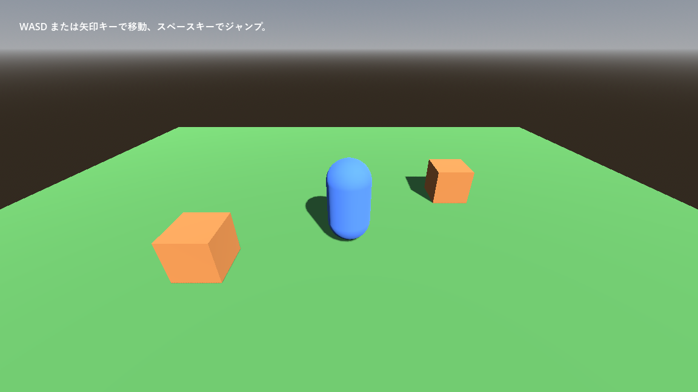

.. _ch20:

=======================
第 20 章　3D への入り口
=======================

本書はここまで 2D を扱ってきたが、ノードとシーン、スクリプト、シグナル、入力、物理といった考え方は 3D でもそのまま使える。本章では、2D との違いを中心に、3D のゲームを作るための最初の一歩を紹介する。サンプルは ``chapter20`` フォルダーにある。

2D と 3D の違い
===============

.. list-table:: 2D と 3D の主な違い
   :header-rows: 1
   :widths: 22 39 39

   * - 項目
     - 2D
     - 3D
   * - 基本のノード
     - ``Node2D``
     - ``Node3D``
   * - 位置の型
     - ``Vector2``
     - ``Vector3``
   * - 単位
     - ピクセル
     - メートル（慣習）
   * - 上方向
     - Y がマイナス（下向きが正）
     - **Y がプラス**\ （上向きが正）
   * - 前方向
     - 決まりはない
     - Z がマイナスの向きが「前」。カメラや ``look_at()`` は -Z の方向を向く。
   * - 回転
     - 1 つの角度（``rotation``）
     - 3 つの軸のまわりの回転（``rotation`` は ``Vector3``）
   * - 画面に映すもの
     - カメラがなくても表示される。
     - ``Camera3D`` が必要
   * - 見え方を決めるもの
     - 画像そのものの色
     - 形状（メッシュ）、材質（マテリアル）、ライト、環境

2D と違って Y 軸が上向きである点に注意する。重力は Y のマイナス方向にかかり、ジャンプでは Y を増やす。

3D のシーンを構成する要素
=========================

3D のシーンには、少なくとも次の要素が必要である。

.. list-table:: 3D のシーンの基本要素
   :header-rows: 1
   :widths: 30 70

   * - ノード、リソース
     - 役割
   * - ``MeshInstance3D``
     - 3D の形（メッシュ）を表示する。``BoxMesh``、``SphereMesh``、``CapsuleMesh``、``PlaneMesh`` などの基本図形を設定するか、3D モデルのファイルから読み込んだメッシュを使う。
   * - ``StandardMaterial3D``
     - 物体の表面の質感を決める。「アルベド」（albedo、基本色）、「メタリック」（metallic、金属らしさ）、「ラフネス」（roughness、表面の粗さ）などを設定する。
   * - ``DirectionalLight3D``
     - 太陽のように、一定の向きから全体を照らすライト。「シャドウ」→「有効」（shadow_enabled）をオンにすると影を落とす。ほかに、電球のような ``OmniLight3D``、スポットライトの ``SpotLight3D`` がある。
   * - ``WorldEnvironment``
     - 空の色、周囲からの光（環境光）、色調の補正など、シーン全体の環境を ``Environment`` リソースで設定する。
   * - ``Camera3D``
     - シーンを映すカメラ

エディターの「3D」画面には、プレビュー用の太陽と空が仮に表示されるので、ライトや ``WorldEnvironment`` がなくても物体が見える。しかし、実行したゲームには反映されないので、実際のシーンには自分で配置する。

3D ビューポートの操作
---------------------

.. list-table:: 3D ビューポートの主な操作
   :header-rows: 1
   :widths: 45 55

   * - 操作
     - 方法
   * - 視点を回転する
     - マウスの中ボタンでドラッグする。
   * - 視点を平行移動する
     - :kbd:`Shift` を押しながら中ボタンでドラッグする。
   * - 拡大・縮小する
     - マウスホイール
   * - 飛び回るように移動する
     - マウスの右ボタンを押したまま、:kbd:`W`、:kbd:`A`、:kbd:`S`、:kbd:`D` キーで移動する。
   * - 選んだノードを中央に表示する
     - :kbd:`F`

サンプル
========

``world_3d.tscn`` は、床と 2 つの箱がある空間を、カプセル形のプレイヤーが歩き回るサンプルである。

   world_3d.tscn の実行結果

.. graphviz::
   :caption: world_3d.tscn のノードの構成

   digraph world3d {
     rankdir=LR;
     node [shape=box, style="rounded,filled", fillcolor="#e8f0fe", fontsize=11];
     root [label="World3D\n（Node3D）"];
     env [label="WorldEnvironment\n空と環境光"];
     sun [label="Sun\n（DirectionalLight3D）"];
     floor [label="Floor、Block1、Block2\n（StaticBody3D）"];
     floor_c [label="MeshInstance3D\nCollisionShape3D"];
     player [label="Player\n（CharacterBody3D）", fillcolor="#cfe2ff"];
     player_c [label="MeshInstance3D\nCollisionShape3D"];
     cam [label="Camera3D", fillcolor="#d4edda"];
     root -> env;
     root -> sun;
     root -> floor;
     floor -> floor_c;
     root -> player;
     player -> player_c;
     player -> cam;
   }

3D の物理も、2D とほぼ同じ構成である。``StaticBody3D``、``CharacterBody3D``、``RigidBody3D``、``Area3D`` があり、子に ``CollisionShape3D`` を置いて形を決める。床や箱は、``StaticBody3D`` の子に見た目の ``MeshInstance3D`` と当たり判定の ``CollisionShape3D`` を置いている。カメラはプレイヤーの子にして、斜め後ろ上から見下ろす位置に置いた。

プレイヤーのスクリプトは、:ref:`ch11` の 2D 版とほとんど同じである。

.. literalinclude:: ../../examples/chapter20/player_3d.gd
   :tab-width: 4
   :language: gdscript
   :linenos:
   :caption: chapter20/player_3d.gd

2D 版との違いは次の点だけである。

* 速度が ``Vector3`` である。
* 重力で Y を減らし、ジャンプで Y を増やす（Y が上向きのため）。
* 入力の ``Vector2`` の (x, y) を、水平面の (x, z) に割り当てている。``move_up`` は画面の奥（-Z）、``move_down`` は手前（+Z）に進む。
* 重力は、プロジェクト設定の「物理」→「3D」にある「デフォルト重力」を使う。既定値は 9.8 メートル/秒² である。

3D モデルを読み込む
===================

3D モデルは、Blender などの 3D モデリングツールで作り、ファイルとしてプロジェクトに置く。Godot は次の形式を読み込める。

.. list-table:: 主な 3D モデルの形式
   :header-rows: 1
   :widths: 25 75

   * - 形式
     - 特徴
   * - glTF 2.0（``.gltf``、``.glb``）
     - 推奨される形式。メッシュ、マテリアル、アニメーションをまとめて扱える。
   * - Blender（``.blend``）
     - Blender がインストールされていれば、``.blend`` ファイルを直接置いて読み込める（内部で glTF に変換される）。
   * - FBX（``.fbx``）
     - 多くのツールが対応する形式
   * - OBJ（``.obj``）
     - 形状だけの単純な形式

読み込んだモデルはシーンとして扱われ、ファイルシステムドックからシーンにドラッグして配置できる。

3D で知っておきたいこと
=======================

* **レンダラー**：本書のサンプルは互換性レンダラーを使っている。3D で高品質な表現（大域照明、ボリュームフォグなど）を使いたい場合は、Forward+ レンダラーに切り替える（:ref:`ch03`）。
* **物理エンジン**：3D の物理エンジンは、プロジェクト設定の「物理」→「3D」にある「物理エンジン」（physics/3d/physics_engine）で、Godot 独自のものと Jolt Physics を選べる。
* **回転**：3D の回転は、``rotate_y()`` のように軸を指定して回す方法や、``look_at()`` で目標の方向を向かせる方法を使うと扱いやすい。``rotation`` の 3 つの値を直接操作すると、回転の順番の影響で思わぬ向きになることがある。
* **素材の準備**：3D のゲームは、2D よりも素材（モデル、テクスチャ、アニメーション）を用意する負担が大きい。最初は基本図形のメッシュだけで遊びの部分を作り、面白さを確かめてから素材を作り込むとよい。
