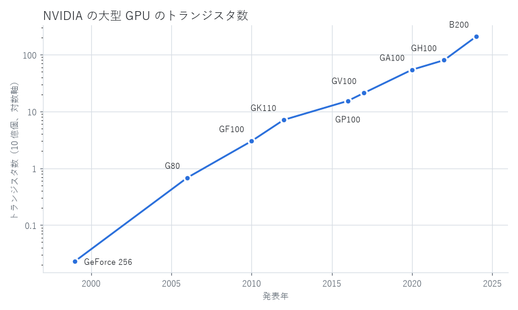
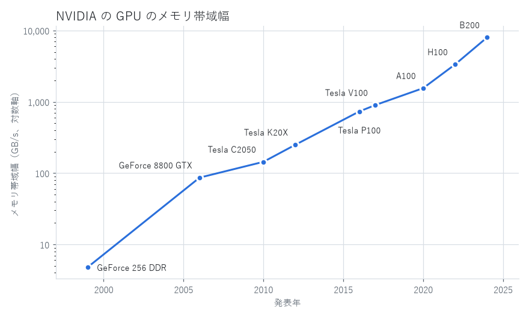

.. _trends:

技術トレンドの横断的考察
========================

これまでの章では、GPU の歴史を時代ごとにたどってきた。本章では視点を変え、性能、メモリ、製造技術、消費電力、ソフトウェアという観点から、四半世紀にわたる GPU の変化を横断的に整理する。

トランジスタ数の推移
--------------------

:numref:`fig-transistors` に、NVIDIA の各世代の最大規模の GPU のトランジスタ数の推移を示す。縦軸は対数目盛りである。

.. _fig-transistors:

   NVIDIA の大型 GPU のトランジスタ数の推移（NVIDIA の公表値などを基に作成）

各製品の値を\ :numref:`table-transistors` に示す。

.. _table-transistors:

.. list-table:: NVIDIA の大型 GPU の製造プロセスとトランジスタ数
   :header-rows: 1
   :widths: 15 25 25 35

   * - 年
     - GPU
     - 製造プロセス
     - トランジスタ数
   * - 1999 年
     - GeForce 256
     - 220 nm
     - 約 2,300 万個
   * - 2006 年
     - G80
     - 90 nm
     - 約 6.8 億個
   * - 2010 年
     - GF100
     - 40 nm
     - 約 30 億個
   * - 2012 年
     - GK110
     - 28 nm
     - 約 71 億個
   * - 2016 年
     - GP100
     - 16 nm
     - 約 153 億個
   * - 2017 年
     - GV100
     - 12 nm
     - 約 211 億個
   * - 2020 年
     - GA100
     - 7 nm
     - 約 542 億個
   * - 2022 年
     - GH100
     - 4N（5 nm 世代）
     - 約 800 億個
   * - 2024 年
     - B200
     - 4NP（5 nm 世代）
     - 約 2,080 億個（2 ダイの合計）

1999 年から 2024 年までの 25 年間で、トランジスタ数は約 9,000 倍に増えた。ある量が :math:`\Delta t` 年の間に :math:`r` 倍になったとき、その量が 2 倍になるのにかかる平均の期間（倍増期間）:math:`T` は次の式で求められる。

.. math::

   T = \frac{\Delta t}{\log_2 r}

トランジスタ数の場合、:math:`\Delta t = 25`、:math:`r \approx 9{,}000` であるから、:math:`T \approx 25 / 13.1 \approx 1.9` 年となる。これは、半導体の集積度が約 2 年で 2 倍になるというムーアの法則とおおむね一致する。

ただし、2020 年代に入ると、製造プロセスの微細化による集積度の向上は鈍化している。GV100、GA100、GH100 のダイ面積はいずれも 800 mm² を超え、露光装置で一度に製造できるチップの最大面積（レチクルサイズ、約 858 mm²）に近づいた。そのため B200 では、2 つのダイを 1 つのパッケージに統合することでトランジスタ数を増やしている。

メモリ帯域幅の推移
------------------

:numref:`fig-bandwidth` に、NVIDIA の GPU のメモリ帯域幅の推移を示す。2010 年以降はデータセンター向けの製品の値である。

.. _fig-bandwidth:

   NVIDIA の GPU のメモリ帯域幅の推移（NVIDIA の公表値などを基に作成）

1999 年の GeForce 256 DDR の 4.8 GB/s から、2024 年の B200 の 8 TB/s まで、メモリ帯域幅は約 1,700 倍に増えた。先の式で倍増期間を求めると、:math:`T \approx 25 / 10.7 \approx 2.3` 年となり、トランジスタ数の増加よりも遅い。

一方、演算性能は、トランジスタ数の増加に加えて、Tensor コアのような専用回路の導入や低精度の数値形式の採用によって、メモリ帯域幅よりもはるかに速く向上した。「:ref:`basics`」で述べたルーフラインモデルの境界、すなわちピーク性能とメモリ帯域幅の比を比べると、その差は明らかである。2006 年の GeForce 8800 GTX は単精度で 4 FLOP/B であったのに対し、2022 年の H100（SXM 版）は Tensor コアによる FP16 の演算で約 989 TFLOPS、メモリ帯域幅が 3.35 TB/s であり、その比は約 295 FLOP/B に達する。

つまり、現在の GPU で演算性能を使い切るには、メモリから読み込んだ 1 バイトのデータに対して数百回の演算を行う必要がある。そうでない処理は、メモリ帯域幅によって性能が制約される。LLM の推論がメモリ帯域幅に制約されやすいのはこのためであり、GPU メーカーが HBM の採用と高速化に力を注ぐ理由もここにある。

メモリ規格の変遷
----------------

GPU のメモリは、帯域幅への要求に応えるために次々と新しい規格が採用されてきた。:numref:`table-memory` に主な規格を示す。

.. _table-memory:

.. list-table:: GPU で用いられた主なメモリ規格
   :header-rows: 1
   :widths: 15 20 65

   * - 規格
     - GPU での初採用
     - 特徴
   * - DDR SDRAM
     - 1999 年
     - クロックの立ち上がりと立ち下がりの両方でデータを転送する。GeForce 256 DDR で採用された。
   * - GDDR3
     - 2004 年頃
     - グラフィックス用に最適化された DDR 系のメモリ。2000 年代半ばの GPU で広く使われた。
   * - GDDR5
     - 2008 年
     - Radeon HD 4870 で初めて採用された。2010 年代前半まで長く主流であった。
   * - GDDR5X、GDDR6
     - 2016 年、2018 年
     - GDDR5 の高速化版。GDDR6 は Turing 世代以降で採用された。
   * - GDDR6X、GDDR7
     - 2020 年、2025 年
     - 1 回の転送で複数ビットを送る多値信号（GDDR6X は PAM4、GDDR7 は PAM3）を採用した。
   * - HBM、HBM2
     - 2015 年、2016 年
     - DRAM を積層し GPU と同じパッケージに実装する。Radeon R9 Fury X、P100 で採用された。
   * - HBM3、HBM3e
     - 2022 年、2023 年
     - H100、H200 などで採用された。データセンター向け GPU の標準となった。
   * - HBM4
     - 2026 年
     - インタフェースのバス幅を HBM3e までの 1024 ビットから 2048 ビットに倍増した。

GDDR 系のメモリは、GPU とは別のチップとしてプリント基板上に実装する。安価で容量の拡張も容易であるが、基板上の配線を高速の信号が通るため、帯域幅を上げるほど消費電力と設計の難しさが増す。HBM は、「:ref:`deep_learning`」で述べたように、積層した DRAM を GPU のすぐそばに置き、インターポーザ上の数千本の配線で接続することで、低いクロックでも広い帯域幅を得る。ただし、製造に高度なパッケージング技術が必要で、コストが高い。このため現在は、グラフィックス向けの GPU では GDDR 系、データセンター向けの GPU では HBM という使い分けが定着している。

製造技術とチップレット
----------------------

GPU の性能向上は、長らく半導体の微細化に支えられてきた。微細化によってトランジスタが小さくなれば、同じ面積により多くの演算器を載せられる。また 2000 年代半ばまでは、微細化によってトランジスタ 1 個あたりの消費電力も下がっていた（デナード則）。

しかし 2000 年代半ば以降、微細化しても消費電力が十分に下がらなくなり、チップ全体の消費電力が性能向上の主な制約となった。CPU がクロック周波数の向上からマルチコア化に舵を切ったのと同じ理由で、GPU でも電力効率の向上が設計の最優先課題となった。さらに 2020 年代には、微細化そのものの進展も鈍化し、製造コストも上昇している。

この状況に対する答えの 1 つが\ :term:`チップレット`\ である。チップレットは、1 つの大きなチップを作る代わりに、複数の小さなチップ（チップレット）を製造し、高度なパッケージング技術で 1 つのパッケージに統合する手法である。次のような利点がある。

* 小さなチップは製造時の欠陥の影響を受けにくく、歩留まりが高い。
* レチクルサイズの制限を超える規模の GPU を構成できる。
* 機能ごとに適した製造プロセスを使い分けられる。たとえば、演算部には最先端のプロセスを、入出力部には成熟した安価なプロセスを使う。

AMD は、MI250X（2 ダイ）、RDNA 3（演算部とキャッシュ・メモリ制御部を分離）、MI300 シリーズ（複数の演算ダイと入出力ダイを積層）でチップレットを積極的に採用してきた。Intel の Ponte Vecchio や NVIDIA の B200 も、複数のダイで構成される。チップ同士を高い帯域幅で接続するパッケージング技術（TSMC の CoWoS など）は、GPU の性能を左右する重要な技術となり、その生産能力が AI 向け GPU の供給量を制約する要因にもなった。

消費電力の増大
--------------

電力効率は世代ごとに向上しているものの、それ以上に性能への要求が高まったため、GPU 1 基あたりの消費電力は増え続けている。データセンター向けの GPU の最大消費電力は、V100（SXM2 版）の 300 W から、A100（SXM 版）の 400 W、H100（SXM 版）の 700 W を経て、B200 では約 1,000 W に達した。

1 基で 1 kW 級の電力を消費する GPU を高密度に並べると、空気による冷却では熱を逃がしきれない。このため、最新のデータセンター向けシステムでは、冷却液を GPU の近くまで循環させる液冷が標準的になりつつある。データセンターの設計は、GPU の電力と冷却を中心に考えられるようになった。

ソフトウェアエコシステム
------------------------

GPU の歴史を振り返ると、ハードウェアの性能だけでなく、ソフトウェアの充実度が競争の行方を大きく左右してきたことが分かる。

NVIDIA は、2006 年の CUDA の発表以来、ハードウェアの世代を超えて同じプログラミングモデルを維持し、コンパイラ、ライブラリ、開発ツール、学習資料に継続的に投資してきた。深層学習のフレームワークが CUDA を前提に構築されたことで、NVIDIA の GPU を使うことが最も手間の少ない選択肢となり、それがさらにソフトウェアの蓄積を呼ぶという循環が生まれた。

これに対し、CUDA 以外の選択肢を広げる取り組みも続いている。

.. list-table:: CUDA 以外の主なプログラミング環境
   :header-rows: 1
   :widths: 25 20 55

   * - 名称
     - 主な推進者
     - 概要
   * - OpenCL
     - Khronos Group
     - ベンダーに依存しない並列計算の標準規格（2008 年）。
   * - ROCm / HIP
     - AMD
     - AMD の GPU 向けのソフトウェア基盤（2016 年）。HIP は CUDA に近い文法を持つ。
   * - oneAPI / SYCL
     - Intel ほか
     - C++ の標準的な文法で様々なプロセッサ向けのプログラムを記述する。SYCL は Khronos Group の規格。
   * - Triton
     - OpenAI
     - Python に似た言語で GPU のカーネルを記述し、コンパイラが最適化する（2021 年）。PyTorch のコンパイラ機能でも利用されている。

近年は、深層学習フレームワークやコンパイラがハードウェアの違いを吸収し、利用者が特定の GPU 向けのプログラムを直接書く機会は減りつつある。こうした抽象化の進展が、GPU 市場の競争環境にどのような影響を与えるかは、今後の注目点の 1 つである。

横断的考察のまとめ
------------------

本章で見た変化をまとめると、次のようになる。

* トランジスタ数はおおむねムーアの法則に沿って増えてきたが、微細化の鈍化により、チップレットや複数ダイの統合が規模拡大の手段となっている。
* 演算性能はメモリ帯域幅よりも速く向上しており、メモリ技術とデータの移動の削減が性能の鍵となっている。
* 消費電力の増大により、GPU の設計はチップ単体からパッケージ、冷却を含むシステム全体の設計へと広がった。
* ソフトウェアエコシステムは、ハードウェアの性能と同等以上に競争力を左右する。
