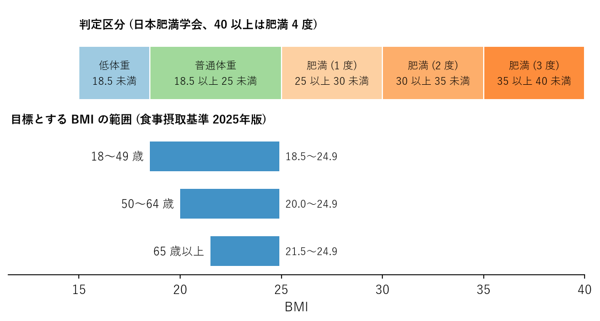

健康の基礎知識
==============

この章では、以降の章を読むうえで土台となる考え方と用語を整理する。

健康とは何か
------------

世界保健機関（WHO）は、WHO 憲章の前文で健康を次のように定義している。

   健康とは、病気でないとか、弱っていないということではなく、肉体的にも、精神的にも、そして社会的にも、すべてが満たされた状態にあることをいう。（日本WHO協会訳）

この定義が示すように、健康は「病気がないこと」だけを意味しない。体の状態に加えて、心の安定や、家族・職場・地域とのつながりも健康の一部である。本書が食事・運動・睡眠に加えて心の健康を扱うのはこのためである。

平均寿命と健康寿命
------------------

平均寿命は、0 歳の人があと何年生きられるかを示す期待値である。これに対し、健康寿命は「健康上の問題で日常生活が制限されることなく生活できる期間」を指す。

厚生労働省によると、2022 年の日本人の平均寿命と健康寿命は次のとおりである。

.. list-table:: 平均寿命と健康寿命（2022 年）
   :header-rows: 1
   :widths: 20 25 25 30

   * - 性別
     - 平均寿命
     - 健康寿命
     - 差（日常生活に制限のある期間）
   * - 男性
     - 81.05 歳
     - 72.57 歳
     - 約 8.5 年
   * - 女性
     - 87.09 歳
     - 75.45 歳
     - 約 11.6 年

平均寿命と健康寿命の差は、介護や支援を必要とする期間にほぼ相当する。健康日本21（第三次）は、この差を縮めながら健康寿命を延ばすことを最上位の目標に掲げている。健康寿命を延ばすには、病気になってから治すだけでなく、病気になりにくい生活習慣を若いうちから身に付けることが重要である。

生活習慣病
----------

生活習慣病とは、食事、運動、休養、喫煙、飲酒などの生活習慣が発症や進行に深く関わる病気の総称である。代表的なものを次の表に示す。

.. list-table:: 主な生活習慣病
   :header-rows: 1
   :widths: 25 75

   * - 病気
     - 概要
   * - 肥満症
     - 肥満に起因する健康障害があり、減量が必要な状態。ほかの生活習慣病の土台になりやすい。
   * - 高血圧
     - 血圧が高い状態が続き、血管に負担がかかる。脳卒中や心臓病の最大の危険因子の一つである。
   * - 2 型糖尿病
     - 血液中のブドウ糖（血糖）が慢性的に高い状態。進行すると目、腎臓、神経などに合併症が起こる。
   * - 脂質異常症
     - 血液中の LDL コレステロールや中性脂肪が多い、または HDL コレステロールが少ない状態。動脈硬化を進める。
   * - 動脈硬化性疾患
     - 動脈硬化によって起こる脳梗塞や心筋梗塞など。上記の病気が重なるほど起こりやすくなる。
   * - がん
     - 喫煙、飲酒、食事、運動不足、肥満などが発症のリスクに関わる種類が多い。

生活習慣病の多くは、初期には自覚症状がほとんどない。そのため、症状が出てから気付いたときには進行していることが少なくない。生活習慣と生活習慣病、健康寿命の関係を次の図に示す。

.. graphviz::
   :caption: 生活習慣・生活習慣病・健康寿命の関係
   :name: fig-lifestyle-disease

   digraph lifestyle {
     rankdir=LR;
     node [shape=box, style="rounded,filled", fontsize=11];
     edge [color="#666666"];

     subgraph cluster_habit {
       label="生活習慣"; style="rounded"; color="#9ecae1"; fontsize=12;
       diet [label="偏った食事\n食べすぎ・塩分過多", fillcolor="#deebf7"];
       inactive [label="運動不足\n座りすぎ", fillcolor="#deebf7"];
       sleep [label="睡眠不足\n休養不足", fillcolor="#deebf7"];
       smoke [label="喫煙\n過度な飲酒", fillcolor="#deebf7"];
     }

     subgraph cluster_risk {
       label="危険因子"; style="rounded"; color="#fdae6b"; fontsize=12;
       obesity [label="内臓脂肪型肥満", fillcolor="#fee6ce"];
       bp [label="高血圧", fillcolor="#fee6ce"];
       glucose [label="高血糖", fillcolor="#fee6ce"];
       lipid [label="脂質異常", fillcolor="#fee6ce"];
     }

     athero [label="動脈硬化", fillcolor="#fdd0a2"];
     disease [label="脳卒中・心臓病\n腎不全・がんなど", fillcolor="#fc9272"];
     life [label="健康寿命の短縮\n生活の質の低下", fillcolor="#de2d26", fontcolor="white"];

     diet -> obesity; inactive -> obesity; sleep -> obesity;
     diet -> bp; smoke -> bp;
     obesity -> glucose; obesity -> lipid; obesity -> bp;
     bp -> athero; glucose -> athero; lipid -> athero; smoke -> athero;
     athero -> disease; smoke -> disease;
     disease -> life;
   }

メタボリックシンドローム
^^^^^^^^^^^^^^^^^^^^^^^^

内臓脂肪型肥満に、高血圧・高血糖・脂質異常のうち 2 つ以上が重なった状態をメタボリックシンドローム（内臓脂肪症候群）という。一つひとつの異常は軽くても、重なることで動脈硬化が進みやすくなる。日本の診断基準を次の表に示す。

.. list-table:: メタボリックシンドロームの診断基準
   :header-rows: 1
   :widths: 30 70

   * - 項目
     - 基準
   * - 必須項目（腹囲）
     - 男性 85 cm 以上、女性 90 cm 以上
   * - 脂質
     - 中性脂肪 150 mg/dL 以上、HDL コレステロール 40 mg/dL 未満のいずれかまたは両方
   * - 血圧
     - 収縮期（最高）血圧 130 mmHg 以上、拡張期（最低）血圧 85 mmHg 以上のいずれかまたは両方
   * - 血糖
     - 空腹時血糖 110 mg/dL 以上

腹囲の基準を満たし、かつ脂質・血圧・血糖のうち 2 つ以上に該当する場合にメタボリックシンドロームと判定される。40〜74 歳の人が対象の特定健康診査（特定健診）は、この考え方に基づいて行われる。

体格の目安：BMI
---------------

体格の目安として広く使われるのが BMI（Body Mass Index、体格指数）である。体重と身長から次の式で求める。

.. math::

   \text{BMI} = \frac{\text{体重 [kg]}}{\left( \text{身長 [m]} \right)^2}

たとえば、身長 170 cm（1.70 m）、体重 65 kg の人の BMI は次のようになる。

.. math::

   \text{BMI} = \frac{65}{1.70^2} = \frac{65}{2.89} \approx 22.5

日本肥満学会は、BMI 18.5 未満を低体重、18.5 以上 25 未満を普通体重、25 以上を肥満と判定している。統計的に最も病気になりにくいとされる BMI 22 に相当する体重を標準体重と呼び、次の式で求める。

.. math::

   \text{標準体重 [kg]} = 22 \times \left( \text{身長 [m]} \right)^2

身長 170 cm の人の標準体重は約 63.6 kg である。

一方、日本人の食事摂取基準（2025年版）は、年齢区分ごとに「目標とする BMI の範囲」を示している。高齢になるほど下限が高いのは、やせによる筋力低下や低栄養を防ぐためである。判定区分と目標とする範囲を次の図に示す。

   BMI の判定区分と目標とする BMI の範囲

BMI は身長と体重だけで計算できる手軽な指標だが、筋肉と脂肪を区別できないという限界がある。筋肉量が多い人は BMI が高めに出るし、BMI が普通の範囲でも内臓脂肪が多い人（いわゆる隠れ肥満）もいる。BMI に加えて腹囲や健康診断の結果も合わせて確認するとよい。

エネルギー収支の考え方
----------------------

体重の増減は、食事から摂るエネルギー（摂取エネルギー）と、体が使うエネルギー（消費エネルギー）の差、すなわちエネルギー収支で決まる。

* 摂取エネルギーが消費エネルギーを上回る状態が続くと、余ったエネルギーが主に体脂肪として蓄えられ、体重が増える。
* 消費エネルギーが摂取エネルギーを上回る状態が続くと、蓄えた体脂肪などが使われ、体重が減る。

消費エネルギーは、大きく次の 3 つに分けられる。

.. list-table:: 消費エネルギーの内訳（目安）
   :header-rows: 1
   :widths: 25 15 60

   * - 種類
     - 割合
     - 内容
   * - 基礎代謝
     - 約 60 %
     - 呼吸、体温の維持、心臓の拍動など、安静にしていても生命維持のために使われるエネルギー
   * - 身体活動
     - 約 30 %
     - 運動に加えて、通勤、家事、仕事などの日常の動作で使われるエネルギー
   * - 食事誘発性熱産生
     - 約 10 %
     - 食べ物を消化・吸収する際に使われるエネルギー

割合は身体活動の量によって大きく変わる。基礎代謝は筋肉量が多いほど大きく、加齢とともに低下する傾向がある。若い頃と同じ量を食べていても中年以降に体重が増えやすいのは、基礎代謝と身体活動量の両方が減ることが一因である。

体脂肪 1 kg を減らすには、約 7,000 kcal のエネルギー不足が必要とされる。1 か月で 1 kg 減らす場合、1 日あたり約 230 kcal の不足を作ればよい計算になる。これは、ご飯を茶わん軽く 1 杯（約 150 g）減らす程度の量である。急激な減量は筋肉量の低下や体調不良を招きやすいため、食事の見直し（第 3 章）と身体活動の増加（第 4 章）を組み合わせ、少しずつ進めるのが望ましい。
