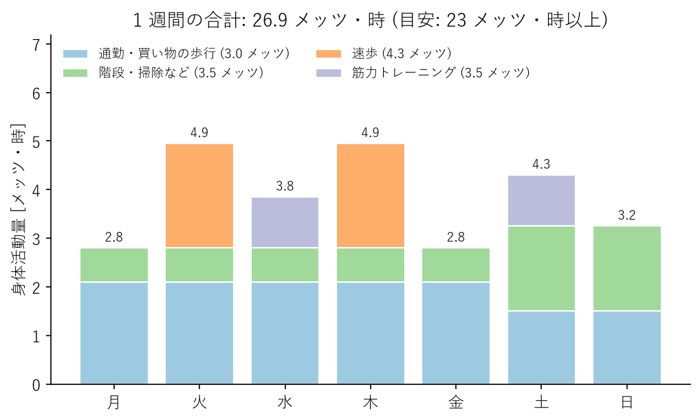

運動・身体活動
==============

体を動かすことは、生活習慣病の予防だけでなく、気分の改善や睡眠の質の向上にも役立つ。この章では、どのような活動をどの程度行えばよいかを、厚生労働省の「健康づくりのための身体活動・運動ガイド2023」（以下、身体活動・運動ガイド）を中心に説明する。

身体活動・運動・生活活動
------------------------

身体活動とは、安静にしている状態よりも多くのエネルギーを消費する、骨格筋の収縮を伴うすべての活動を指す。身体活動は、次の 2 つに分けられる。

* **生活活動**：通勤や買い物での歩行、階段の上り下り、掃除や洗濯などの家事、仕事上の作業など、日常生活の中で行う活動
* **運動**：ウォーキング、ジョギング、水泳、筋力トレーニングなど、健康や体力の維持・向上を目的として、計画的・意図的に行う活動

運動の時間を確保するのが難しい人でも、生活活動を増やすことで身体活動量を増やせる。たとえば、エレベーターの代わりに階段を使う、一駅分歩く、近所への移動を自転車にするといった工夫である。

身体活動の強さと量の表し方
--------------------------

メッツ
^^^^^^

身体活動の強さは、メッツ（METs）という単位で表す。メッツは、座って安静にしている状態を 1 として、その何倍のエネルギーを消費するかを示す。3 メッツ以上が中強度、6 メッツ以上が高強度とされる。主な活動のメッツ値の目安を次の表に示す。

.. list-table:: 主な活動のメッツ値（目安）
   :header-rows: 1
   :widths: 15 45 40

   * - メッツ
     - 生活活動
     - 運動
   * - 2.0〜2.9
     - 料理、洗濯、ゆっくりした歩行
     - ストレッチ、ヨガ
   * - 3.0〜3.9
     - 普通の速さの歩行、掃除機かけ、子どもと遊ぶ
     - 軽い筋力トレーニング、ボウリング、バレーボール
   * - 4.0〜5.9
     - 速歩、自転車に乗る、階段をゆっくり上る
     - ラジオ体操第一、卓球、ゴルフ（歩いて回る）、水中ウォーキング
   * - 6.0 以上
     - 重い荷物を運ぶ、階段を速く上る
     - ジョギング、水泳、テニス（シングルス）、サッカー

メッツ・時
^^^^^^^^^^

身体活動の量は、強さ（メッツ）に実施時間（時間）を掛けたメッツ・時という単位で表す。

.. math::

   \text{身体活動量 [メッツ・時]} = \text{強さ [メッツ]} \times \text{時間 [時間]}

たとえば、普通の速さの歩行（3 メッツ）を 1 時間行うと 3 メッツ・時、速歩（4.3 メッツ）を 30 分行うと約 2.2 メッツ・時になる。

身体活動によるおおよその消費エネルギーは、次の式で求められる。

.. math::

   \text{消費エネルギー [kcal]} \approx 1.05 \times \text{身体活動量 [メッツ・時]} \times \text{体重 [kg]}

体重 60 kg の人が 3 メッツの歩行を 1 時間行うと、約 189 kcal を消費する。この値には安静時の消費分も含まれる。

推奨される身体活動量
--------------------

身体活動・運動ガイドは、成人に対して次のような目安を示している。

.. list-table:: 成人に推奨される身体活動（身体活動・運動ガイド2023）
   :header-rows: 1
   :widths: 25 75

   * - 区分
     - 推奨事項
   * - 身体活動全体
     - 歩行またはそれと同等以上の強度（3 メッツ以上）の身体活動を 1 日 60 分以上行う。1 日約 8,000 歩以上に相当し、週 23 メッツ・時以上が目安である。
   * - 運動
     - 息が弾み汗をかく程度以上（3 メッツ以上）の運動を週 60 分以上行う。週 4 メッツ・時以上が目安である。
   * - 筋力トレーニング
     - 上記の運動の一部として、週 2〜3 日行う。
   * - 座位行動
     - 座りっぱなしの時間が長くなりすぎないように注意する。立位困難な人も、じっとしている時間が長くなりすぎないよう、少しでも体を動かす。

これらは「最低限ここまで」という基準ではなく、現在の活動量から少しでも増やすことを目指すための目安である。身体活動・運動ガイドは「今より少しでも多く体を動かす」ことを基本的な考え方としている。たとえば、今より 1 日 10 分多く体を動かすことは、歩数にして約 1,000 歩の増加に相当する。

WHO も、成人に対して中強度の有酸素性身体活動を週 150〜300 分、または高強度の有酸素性身体活動を週 75〜150 分行い、さらに筋力を強化する活動を週 2 日以上行うことを推奨している。

1 週間の身体活動量の例を次の図に示す。特別な運動をしない日でも、通勤や家事などの生活活動が身体活動量の多くを占めていることが分かる。

   1 週間の身体活動量の例

有酸素運動
----------

有酸素運動は、ウォーキング、ジョギング、サイクリング、水泳など、一定のリズムで比較的長く続けられる運動である。心肺機能を高め、血圧、血糖、血中脂質の改善に役立つ。

運動の強さは、「ややきつい」と感じる程度、または会話はできるが歌うのは難しい程度を目安にするとよい。運動習慣のない人は、まず普段の歩行を少し速くする、歩く時間を 10 分延ばすといったところから始める。

まとまった時間が取れない場合は、10 分程度の活動を 1 日に何回かに分けて行ってもよい。

筋力トレーニング
----------------

筋力トレーニングは、筋肉量と筋力を維持・向上させ、基礎代謝の低下を防ぐ。骨を丈夫にする効果や、血糖値の改善効果も期待できる。

特別な器具がなくても、自分の体重を利用した運動で十分な効果が得られる。主な例を次の表に示す。

.. list-table:: 自宅でできる筋力トレーニングの例
   :header-rows: 1
   :widths: 22 28 50

   * - 種目
     - 主に鍛える部位
     - 方法とポイント
   * - スクワット
     - 太もも、お尻
     - 足を肩幅に開き、椅子に腰掛けるようにお尻を後ろに引いて膝を曲げ、元に戻る。膝がつま先より大きく前に出ないようにする。
   * - 腕立て伏せ
     - 胸、腕、肩
     - 難しい場合は、膝をついて行うか、壁や机に手をついて行う。
   * - かかと上げ
     - ふくらはぎ
     - 椅子の背などにつかまって立ち、かかとをゆっくり上げ下げする。
   * - プランク
     - 腹部、背中
     - うつ伏せで肘とつま先で体を支え、頭からかかとまでを一直線に保つ。まずは 20〜30 秒を目標にする。

回数は、1 種目あたり 10〜15 回を 1 セットとし、慣れてきたら 2〜3 セットに増やす。同じ部位を毎日鍛えるより、48〜72 時間程度の休養をはさむほうが効果的である。動作中は息を止めず、自然に呼吸を続ける。息を止めて力むと血圧が急に上がるため、特に高血圧の人は注意が必要である。

座りすぎを防ぐ
--------------

運動習慣がある人でも、1 日の大半を座って過ごしていると、健康へのリスクが高まることが分かってきている。日本人は座っている時間が長い傾向にあり、身体活動・運動ガイドでも座りすぎへの注意を呼びかけている。

デスクワークの人は、次のような工夫で座っている時間を区切るとよい。

* 30 分〜1 時間に 1 回は立ち上がり、数分間体を動かす。
* 電話や打ち合わせの一部を立って行う。
* 飲み物を取りに行く、離れた場所のトイレを使うなど、歩く機会を意識して作る。
* テレビを見ている時間は、コマーシャルの間に立ち上がって体を動かす。

安全に運動するために
--------------------

運動中のけがや体調不良を防ぐため、次の点に注意する。

* **準備運動と整理運動を行う**：運動の前には軽い体操や歩行で体を温め、関節を動かしておく。運動の後はゆっくりとした歩行やストレッチで徐々に体を落ち着かせる。
* **少しずつ強度を上げる**：運動に慣れていない人がいきなり強い運動をすると、けがや心臓への負担につながる。数週間かけて段階的に時間や強度を増やす。
* **体調が悪いときは休む**：発熱、睡眠不足、二日酔いのときや、胸の痛み、強い息切れ、めまいを感じたときは運動を中止する。
* **水分を補給する**：運動の前、運動中、運動後にこまめに水分を摂る。
* **環境に注意する**：暑い時期は熱中症を防ぐため、気温の高い時間帯を避け、涼しい時間帯や屋内で運動する。

持病がある人や、長く運動から遠ざかっていた中年以降の人は、本格的な運動を始める前に医師に相談するとよい。

高齢期の身体活動
----------------

身体活動・運動ガイドは、高齢者に対して、3 メッツ以上の身体活動を 1 日 40 分以上（約 6,000 歩以上、週 15 メッツ・時以上）行うことを推奨している。さらに、筋力・バランス・柔軟性などを組み合わせた多要素な運動を週 3 日以上、筋力トレーニングを週 2〜3 日行うことを勧めている。

高齢期には、転倒や骨折、フレイルを防ぐことが大切になる。中年期のうちから筋力トレーニングの習慣を身に付けておくと、高齢期の生活の質を保ちやすい。
