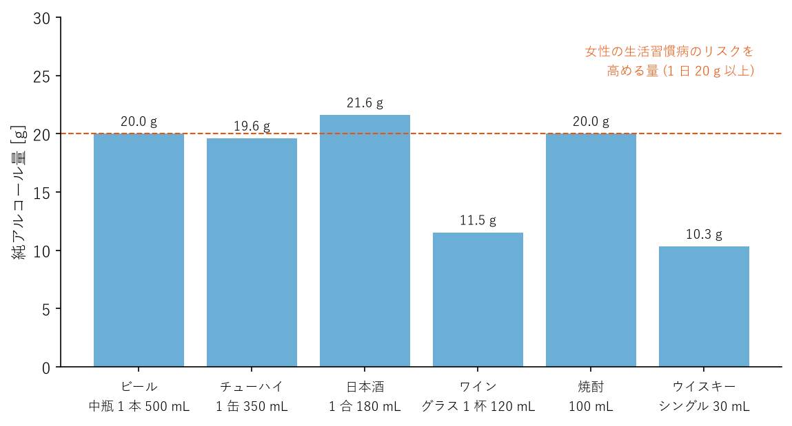

嗜好品と生活上のリスク
======================

酒、たばこ、コーヒーなどの嗜好品は、生活に楽しみやくつろぎをもたらす一方で、摂り方によっては健康を大きく損なう。この章では、飲酒、喫煙、カフェインについて、健康への影響と付き合い方を説明する。

飲酒
----

飲酒による健康への影響
^^^^^^^^^^^^^^^^^^^^^^

アルコールの摂りすぎは、肝臓病、膵炎、高血圧、脳卒中、がん（口腔、咽頭、食道、肝臓、大腸、乳房など）など、多くの病気のリスクを高める。依存症や、うつ病などの心の不調、事故やけがの原因にもなる。

かつては「少量の飲酒は健康に良い」とする説が広く知られていた。しかし近年の研究では、病気の種類によってはごく少量の飲酒でもリスクが高まることが分かってきており、飲酒量はできるだけ少ないほうがよいと考えられるようになっている。飲まない人が、健康のためにわざわざ飲酒を始める必要はない。

厚生労働省は、2024 年に「健康に配慮した飲酒に関するガイドライン」を公表し、飲酒による健康への影響や、飲酒量の把握の仕方などを示している。

純アルコール量で考える
^^^^^^^^^^^^^^^^^^^^^^

飲酒量は、酒の種類や杯数ではなく、含まれるアルコールの重さ（純アルコール量）で考えることが大切である。純アルコール量は次の式で求められる。

.. math::

   \text{純アルコール量 [g]} = \text{飲む量 [mL]} \times \frac{\text{アルコール度数} \ [\%]}{100} \times 0.8

最後の 0.8 は、アルコールの比重である。たとえば、アルコール度数 5 % のビールを 500 mL 飲んだ場合、純アルコール量は次のようになる。

.. math::

   500 \times \frac{5}{100} \times 0.8 = 20 \text{ [g]}

主な酒類の純アルコール量の目安を次の図に示す。最近では、純アルコール量を容器に表示している商品も増えている。

   主な酒類の純アルコール量の目安

リスクを高める飲酒量
^^^^^^^^^^^^^^^^^^^^

健康日本21（第三次）は、1 日あたりの平均純アルコール摂取量が男性で 40 g 以上、女性で 20 g 以上の飲酒を「生活習慣病のリスクを高める飲酒」としている。男性の 40 g はビール中瓶 2 本、日本酒 2 合程度、女性の 20 g はビール中瓶 1 本、日本酒 1 合程度にあたる。ただし、これは「この量までなら安全」という意味ではなく、この量より少なくても病気によってはリスクが高まることに注意が必要である。

また、短時間に大量に飲むこと（一時多量飲酒）は、急性アルコール中毒や事故、けがの危険を高める。健康に配慮した飲酒に関するガイドラインでは、1 回の飲酒で純アルコール量 60 g 以上を摂る飲み方を避けるよう求めている。

次のような人は、アルコールの影響を特に受けやすい。

* **女性**：一般に男性より体内の水分量が少なく、同じ量を飲んでも血中アルコール濃度が高くなりやすい。
* **高齢者**：体内の水分量が減り、アルコールを分解する能力も低下するため、酔いやすくなる。転倒の危険も高まる。
* **アルコールを分解しにくい体質の人**：少量の飲酒で顔が赤くなる、動悸がするといった反応が出る人は、アルコールの分解途中でできるアセトアルデヒドを分解する力が弱い体質である。この体質の人が飲酒を続けると、食道がんなどのリスクが特に高くなる。

なお、20 歳未満の人の飲酒は法律で禁止されている。妊娠中や授乳中の人も飲酒してはならない。

上手な付き合い方
^^^^^^^^^^^^^^^^

飲酒する場合は、次のような工夫で量を減らすとよい。

* 自分の飲酒量を純アルコール量で把握し、記録する。
* 飲む前に、その日に飲む量を決めておく。
* 飲酒しない日を設ける。
* 食事と一緒に、ゆっくり飲む。空腹で飲むと、アルコールの吸収が速くなる。
* 水や炭酸水などの酒以外の飲み物を合間に飲む。
* アルコール度数の低い酒や、ノンアルコール飲料を選ぶ。
* 眠るための寝酒はしない（第 5 章を参照）。

飲酒量を減らそうとしても減らせない、飲酒が原因で仕事や家庭に問題が生じているといった場合は、アルコール依存症の可能性がある。医療機関や精神保健福祉センターに相談してほしい。

喫煙
----

喫煙による健康への影響
^^^^^^^^^^^^^^^^^^^^^^

たばこの煙には、ニコチン、タール、一酸化炭素をはじめ、多くの有害物質が含まれ、その中には発がん性のある物質も数多くある。喫煙は、肺がんをはじめとする多くのがん、心筋梗塞や脳卒中、慢性閉塞性肺疾患（COPD）、2 型糖尿病、歯周病など、さまざまな病気の原因になる。日本では、喫煙が原因で年間 10 万人以上が亡くなっていると推計されている。

たばこをやめられないのは、意志が弱いからではなく、ニコチンへの依存が原因である。ニコチンは強い依存性を持ち、吸わずにいるとイライラや集中力の低下などの離脱症状が現れる。

受動喫煙
^^^^^^^^

たばこを吸わない人も、周囲の人のたばこの煙を吸うこと（受動喫煙）によって健康被害を受ける。受動喫煙は、肺がん、虚血性心疾患、脳卒中、乳幼児突然死症候群などのリスクを高める。日本では、受動喫煙が原因で年間約 1 万 5 千人が亡くなっていると推計されている。

2020 年 4 月に全面施行された改正健康増進法により、多くの人が利用する施設や飲食店などの屋内は、原則として禁煙になった。家庭や車の中など、法律の対象とならない場所でも、子どもや家族を受動喫煙から守る配慮が求められる。

加熱式たばこ
^^^^^^^^^^^^

加熱式たばこは、紙巻きたばこに比べて煙が少ないことから、害が少ないと考えられがちである。しかし、加熱式たばこの煙（エアロゾル）にもニコチンや有害物質が含まれており、長期的な健康への影響はまだ十分に分かっていない。紙巻きたばこから加熱式たばこへの切り替えは、禁煙の代わりにはならない。改正健康増進法でも、加熱式たばこは規制の対象である。

禁煙の効果と方法
^^^^^^^^^^^^^^^^

禁煙は、何歳で始めても健康上の効果がある。禁煙後、早い段階で血圧や脈拍が安定し、時間がたつにつれて心臓病や脳卒中、がんのリスクが低下していく。禁煙が早いほど、効果は大きい。

自力での禁煙が難しい場合は、医療機関の禁煙外来を利用するとよい。禁煙補助薬を使うことで、離脱症状を和らげながら禁煙に取り組める。禁煙外来の治療は、一定の条件を満たせば健康保険が適用される。薬局で購入できるニコチンガムやニコチンパッチもある。

禁煙を成功させるためには、次のような工夫も役立つ。

* 禁煙を始める日を決め、周囲に宣言する。
* たばこ、ライター、灰皿を処分する。
* 吸いたくなる場面（食後、飲酒時、休憩時など）を把握し、その場面での代わりの行動（歯を磨く、水を飲む、深呼吸する、散歩するなど）を決めておく。
* 吸いたい気持ちは数分でおさまることが多いことを知っておく。
* 一度失敗しても、あきらめずに再挑戦する。禁煙は何度かの挑戦を経て成功することも多い。

カフェイン
----------

カフェインは、コーヒー、紅茶、緑茶、エナジードリンクなどに含まれる成分である。眠気を覚まし、集中力を高める作用がある一方で、摂りすぎるとめまい、心拍数の増加、興奮、不安、不眠、下痢、吐き気などを引き起こすことがある。

日本では、カフェインの 1 日の摂取許容量は定められていない。欧州食品安全機関（EFSA）は、健康な成人であれば 1 日 400 mg まで、1 回あたり 200 mg までであれば健康上の懸念はないとしている。妊娠中・授乳中の人は 1 日 200 mg までとしている。主な飲み物のカフェイン含有量の目安を次の表に示す。

.. list-table:: 主な飲み物のカフェイン含有量（目安）
   :header-rows: 1
   :widths: 30 25 45

   * - 飲み物
     - 100 mL あたり
     - 1 杯あたりの目安
   * - コーヒー（ドリップ）
     - 約 60 mg
     - マグカップ 1 杯（200 mL）で約 120 mg
   * - 紅茶
     - 約 30 mg
     - カップ 1 杯（150 mL）で約 45 mg
   * - せん茶
     - 約 20 mg
     - 湯のみ 1 杯（150 mL）で約 30 mg
   * - 玉露
     - 約 160 mg
     - 小さな湯のみ 1 杯（60 mL）で約 96 mg
   * - エナジードリンク
     - 製品により大きく異なる
     - 1 本で 100 mg を超える製品もある

カフェインの覚醒作用は数時間続くため、睡眠への影響を避けるには、午後の早い時間以降は控えるとよい（第 5 章を参照）。エナジードリンクとコーヒーを組み合わせたり、短時間に何本も飲んだりすると、知らないうちに摂取量が多くなる。製品の表示でカフェインの量を確認する習慣を付けるとよい。
