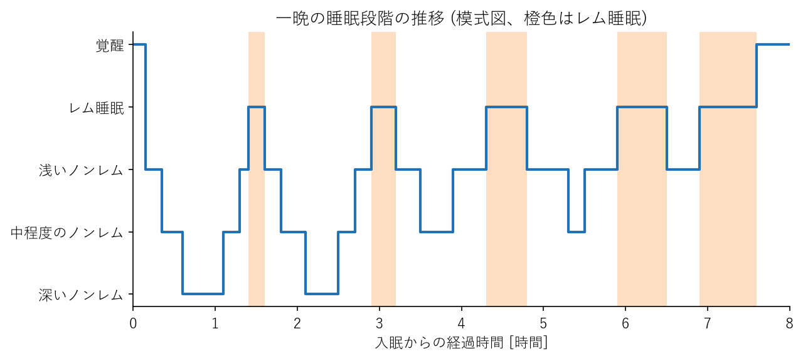
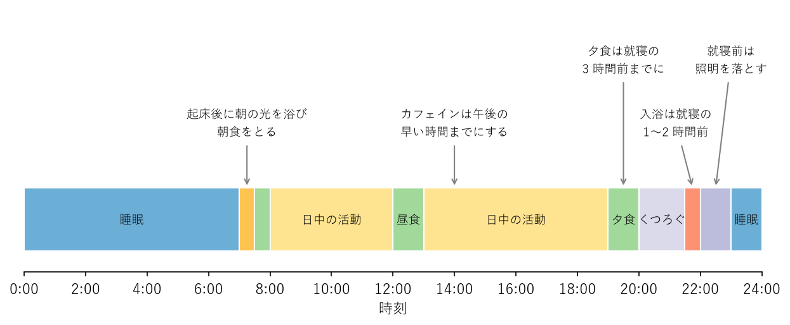

睡眠
====

睡眠は、心身の疲労を回復させ、日中の活動を支える土台である。睡眠が不足したり質が悪かったりすると、日中の眠気や集中力の低下だけでなく、肥満、高血圧、糖尿病、うつ病などのリスクも高まる。この章では、睡眠のしくみと、良い睡眠をとるための工夫を、厚生労働省の「健康づくりのための睡眠ガイド2023」（以下、睡眠ガイド）を中心に説明する。

睡眠の役割
----------

睡眠には、主に次のような役割がある。

* **脳と体の休息・回復**：日中に使った脳と体を休ませ、疲労を回復させる。
* **記憶の整理と定着**：日中に学んだことや経験したことを整理し、記憶として定着させる。
* **ホルモンの分泌と代謝の調整**：成長ホルモンなどの分泌や、食欲・血糖に関わるホルモンの働きを整える。
* **免疫機能の維持**：感染症に対する抵抗力を保つ。
* **心の安定**：感情を安定させ、ストレスへの耐性を保つ。

睡眠時間が短い状態が続くと、食欲を高めるホルモンが増え、食欲を抑えるホルモンが減るため、太りやすくなることが知られている。睡眠は、食事や運動と並ぶ健康づくりの柱である。

睡眠のしくみ
------------

体内時計と概日リズム
^^^^^^^^^^^^^^^^^^^^

人の体には体内時計があり、体温、ホルモンの分泌、血圧などをおよそ 24 時間の周期で変動させている。この周期的な変動を概日リズム（サーカディアンリズム）という。

体内時計の周期は 24 時間よりわずかに長い人が多く、そのままでは毎日少しずつ後ろにずれていく。このずれを毎朝リセットする最も強い合図が、朝の光である。朝に強い光を浴びると体内時計がリセットされ、その十数時間後に、眠気を促すホルモンであるメラトニンが分泌され始めて自然な眠気が訪れる。

反対に、夜遅くに明るい光、特にスマートフォンやパソコンの画面などから出る光を浴びると、メラトニンの分泌が抑えられ、体内時計が後ろにずれて寝付きにくくなる。朝食や日中の活動も、体内時計を整える合図として働く。

ノンレム睡眠とレム睡眠
^^^^^^^^^^^^^^^^^^^^^^

睡眠は、性質の異なるノンレム睡眠とレム睡眠からなる。

.. list-table:: ノンレム睡眠とレム睡眠
   :header-rows: 1
   :widths: 20 40 40

   * - 項目
     - ノンレム睡眠
     - レム睡眠
   * - 特徴
     - 脳の活動が低下した状態。眠りの深さによって浅い段階から深い段階まである。
     - 体は休んでいるが、脳は活発に活動している状態。眼球が素早く動く。
   * - 主な役割
     - 脳と体の休息。深いノンレム睡眠中に成長ホルモンが多く分泌される。
     - 記憶の整理や感情の調整に関わると考えられている。夢の多くはこの時期に見る。
   * - 一晩の中での傾向
     - 深いノンレム睡眠は眠りの前半に多い。
     - 明け方に近づくほど長くなる。

一晩の睡眠では、ノンレム睡眠とレム睡眠がおよそ 90 分の周期で 4〜5 回繰り返される。次の図はその推移を模式的に示したものである。寝付いてから最初の数時間に深いノンレム睡眠がまとまって現れるため、眠り始めの睡眠の質が特に重要である。

   一晩の睡眠段階の推移（模式図）

周期の長さには個人差があり、同じ人でも夜によって変わる。「90 分の倍数で起きるとすっきり目覚められる」という説は広く知られているが、周期が一定ではないため、厳密に当てはまるわけではない。

どれくらい眠ればよいか
----------------------

必要な睡眠時間には個人差があり、年齢とともに短くなる傾向がある。睡眠ガイドは、年代ごとに次のような目安を示している。

.. list-table:: 年代別の睡眠時間の目安（睡眠ガイド2023）
   :header-rows: 1
   :widths: 25 75

   * - 年代
     - 目安
   * - 小学生
     - 9〜12 時間
   * - 中学生・高校生
     - 8〜10 時間
   * - 成人
     - 6 時間以上を目安として、必要な睡眠時間を確保する。
   * - 高齢者
     - 長い時間寝床で過ごしすぎないよう、寝床にいる時間を 8 時間以内にする。

成人の場合、6 時間以上を目安としつつ、自分に必要な睡眠時間を見極めることが大切である。日中に強い眠気を感じず、すっきり活動できていれば、睡眠時間はおおむね足りていると考えられる。

休日に平日より 2 時間以上長く寝ている場合は、平日の睡眠が不足している可能性が高い。休日の寝だめは、睡眠不足を一時的に補えても、起床時刻が遅れることで体内時計が乱れる原因になる。これを社会的時差ぼけ（ソーシャル・ジェットラグ）と呼ぶ。休日も平日との起床時刻の差を 2 時間以内に抑えるとよい。

なお、睡眠ガイドは、睡眠時間（量）だけでなく、睡眠で休養が取れているという感覚（睡眠休養感、質）も重視している。睡眠時間が十分でも、朝に休まった感じがしない状態が続く場合は、睡眠の質に問題がある可能性がある。

良い睡眠のための工夫
--------------------

良い睡眠のための生活習慣や環境を整えることを、睡眠衛生という。主なポイントを場面ごとに整理する。

朝と日中
^^^^^^^^

* 毎朝、決まった時刻に起きる。就寝時刻より起床時刻をそろえるほうが、体内時計を整えやすい。
* 起床後はカーテンを開け、日光を浴びる。曇りの日でも屋外の光は室内の照明より十分に明るい。
* 朝食をとる。
* 日中に体を動かす。適度な運動は寝付きを良くし、深いノンレム睡眠を増やす。ただし、就寝直前の激しい運動は寝付きを悪くするため避ける。
* 昼寝をする場合は、午後 3 時より前に 20〜30 分以内にとどめる。長い昼寝や夕方の昼寝は、夜の睡眠を妨げる。

夕方から就寝前
^^^^^^^^^^^^^^

* カフェインを含む飲み物（コーヒー、紅茶、緑茶、エナジードリンクなど）は、午後の早い時間までにとどめ、夕方以降は控える。カフェインの覚醒作用は数時間続く（第 7 章を参照）。
* 夕食は就寝の 3 時間前までに済ませる。
* 寝酒をしない。アルコールは寝付きを良くするように感じられるが、睡眠の後半を浅くし、夜中に目が覚める原因になる（第 7 章を参照）。
* 喫煙をしない。ニコチンには覚醒作用がある。
* 入浴は就寝の 1〜2 時間前に、38〜40 ℃ 程度のぬるめのお湯で済ませる。入浴で一時的に上がった体温が下がっていく過程で、眠気が訪れやすくなる。
* 就寝前の 1 時間程度は照明を暗めにし、スマートフォンやパソコンの使用を控える。

1 日の過ごし方の例を次の図に示す。

   体内時計を整える 1 日の過ごし方の例（7 時起床、23 時就寝の場合）

寝室の環境
^^^^^^^^^^

* 寝室は暗くする。小さな明かりが気になる場合は、遮光カーテンやアイマスクを使う。
* 静かな環境を保つ。騒音が気になる場合は、耳栓を使うのもよい。
* 季節に合わせて、エアコンや寝具で暑すぎず寒すぎない温度・湿度に調整する。
* 寝床は眠るための場所と決め、寝床で仕事をしたり、スマートフォンを長時間見たりしない。

眠れないときは
^^^^^^^^^^^^^^

寝床に入っても眠れないときに、無理に眠ろうとすると、かえって緊張して目がさえてしまう。眠れないまま長く寝床にいると、「寝床＝眠れない場所」という結び付きができ、不眠が続く原因になる。

寝床に入って 20 分程度たっても眠れない場合は、いったん寝床を出て、暗めの照明の下で静かに過ごし、眠気を感じてから再び寝床に入るとよい。

睡眠不足と健康への影響
----------------------

慢性的な睡眠不足は、次のような健康上の問題につながる。

* 日中の眠気、集中力や判断力の低下による仕事のミスや事故の増加
* 肥満、高血圧、2 型糖尿病、心臓病などのリスクの上昇
* うつ病などの心の不調のリスクの上昇
* 免疫機能の低下

睡眠不足は少しずつ蓄積し、本人が自覚しないまま心身の働きを低下させる。この蓄積した睡眠不足を睡眠負債と呼ぶことがある。

受診を考えるべき症状
--------------------

次のような状態が続く場合は、睡眠に関わる病気の可能性がある。かかりつけ医や睡眠の専門医に相談してほしい。

.. list-table:: 受診を考えるべき主な症状
   :header-rows: 1
   :widths: 45 55

   * - 症状
     - 考えられる主な病気
   * - 寝付けない、夜中に何度も目が覚める、朝早く目が覚めるといった状態が 1 か月以上続き、日中の生活に支障がある
     - 不眠症、うつ病など
   * - 大きないびきや睡眠中の呼吸の停止を指摘される。十分に寝ても日中に強い眠気がある
     - 睡眠時無呼吸症候群
   * - 夕方から夜にかけて脚にむずむずした不快感があり、脚を動かさずにいられない
     - むずむず脚症候群（レストレスレッグス症候群）
   * - 夜になっても眠くならず、朝起きられない状態が続き、通学や仕事に支障がある
     - 概日リズム睡眠・覚醒障害

特に睡眠時無呼吸症候群は、肥満の人や中年以降の男性に多く、放置すると高血圧や心臓病、脳卒中のリスクを高める。日中の居眠りによる交通事故の原因にもなるため、早めに受診することが大切である。

市販の睡眠改善薬や、自己判断での睡眠薬の使用は、根本的な解決にならないことがある。睡眠の悩みが続くときは、まず生活習慣を見直したうえで、医師に相談するとよい。
