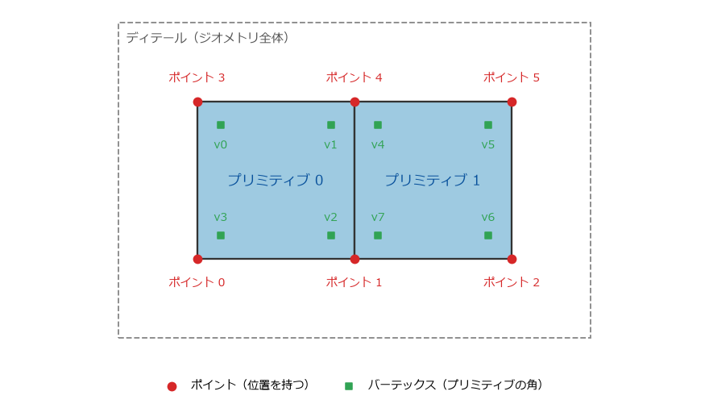

ジオメトリとアトリビュート
==========================

Houdini のジオメトリは、ポイント、バーテックス、プリミティブ、ディテールの 4 種類の要素でできている。それぞれの要素に、アトリビュートと呼ばれる名前付きのデータを持たせられる。アトリビュートは Houdini の中心的な仕組みであり、多くのノードがアトリビュートを読んで動作を変え、アトリビュートを書いて結果を伝える。

ジオメトリの 4 種類の要素
-------------------------

.. _fig-mesh-elements:

   2 枚の四角形からなるジオメトリの要素。ポイントが 6 個、プリミティブが 2 個、バーテックスが 8 個ある。

.. list-table:: ジオメトリの要素
   :header-rows: 1
   :widths: 20 80

   * - 要素
     - 説明
   * - ポイント（point）
     - 空間の中の位置。位置は ``P`` という名前のアトリビュートとして持つ。
   * - プリミティブ（primitive）
     - ポイントをつないで作る形状の単位。ポリゴン、曲線、球などがある。
   * - バーテックス（vertex）
     - プリミティブの角。プリミティブがどのポイントを使うかを表す。
   * - ディテール（detail）
     - ジオメトリ全体。ジオメトリに 1 つだけある。

ポイントとバーテックスの違いは分かりにくい。:numref:`fig-mesh-elements` では、ポイント 1 とポイント 4 を 2 枚のプリミティブが共有している。ポイント 1 を使うバーテックスは、プリミティブ 0 の v2 と、プリミティブ 1 の v7 の 2 個である。ポイントは「位置」であり、バーテックスは「プリミティブがそのポイントを使っていること」を表す。

このように分けておくと、共有している 1 つの点に、面ごとに違うデータを持たせられる。例えば、立方体の角では 3 つの面が 1 つのポイントを共有するが、面の向きはそれぞれ違う。角をくっきりと見せたいときは、法線をバーテックスに持たせて、面ごとに違う向きにする。テクスチャの継ぎ目でも、1 つのポイントに面ごとに違う UV 座標を持たせるために、UV をバーテックスに持たせる。

要素には 0 から始まる番号が付いている。ポイント番号、プリミティブ番号などと呼ぶ。番号は、上流のノードの変更で点の数が変わると変わる。

アトリビュート
--------------

アトリビュート（attribute）は、要素ごとに持たせる名前付きのデータである。ジオメトリは、要素の種類ごとに 1 枚の表になっていて、行が要素、列がアトリビュートだと考えると分かりやすい。例えばポイントの表には、``P``\ （位置）や ``Cd``\ （色）の列がある。

アトリビュートには型がある。

.. list-table:: アトリビュートの主な型
   :header-rows: 1
   :widths: 25 75

   * - 型
     - 例
   * - 浮動小数点数（float）
     - ``pscale``\ （大きさの倍率）
   * - 整数（integer）
     - ``id``\ （要素を追跡するための番号）
   * - ベクトル（3 個の浮動小数点数）
     - ``P``\ （位置）、``N``\ （法線）、``Cd``\ （色）
   * - 4 個の浮動小数点数
     - ``orient``\ （向きを表す四元数）
   * - 文字列（string）
     - ``name``\ （名前）
   * - 辞書、配列、行列
     - 用途に応じて使う。

同じ名前のアトリビュートが複数の種類の要素にある場合は、バーテックス、ポイント、プリミティブ、ディテールの順に優先される。例えば、ポイントとプリミティブの両方に ``Cd`` があると、ポイントの ``Cd`` が使われる。

よく使うアトリビュート
^^^^^^^^^^^^^^^^^^^^^^

いくつかのアトリビュートは、名前と意味が決まっていて、多くのノードやレンダラーがその名前で読み書きする。

.. list-table:: よく使うアトリビュート
   :header-rows: 1
   :widths: 15 20 65

   * - 名前
     - 型
     - 意味
   * - ``P``
     - ベクトル
     - ポイントの位置。
   * - ``N``
     - ベクトル
     - 法線。
   * - ``Cd``
     - ベクトル
     - 色（R、G、B を 0 から 1 で表す）。ビューポートでもこの色で表示される。
   * - ``Alpha``
     - 浮動小数点数
     - 不透明度。
   * - ``uv``
     - ベクトル
     - UV 座標。1 番目と 2 番目の成分を使う。
   * - ``v``
     - ベクトル
     - 速度。シミュレーションやモーションブラーで使う。
   * - ``pscale``
     - 浮動小数点数
     - 大きさの倍率。Copy to Points ノードのコピーの大きさなどに使う。
   * - ``scale``
     - ベクトル
     - 軸ごとの大きさの倍率。
   * - ``orient``
     - 4 個の浮動小数点数
     - 向き（四元数）。
   * - ``id``
     - 整数
     - 要素を追跡するための番号。要素の番号が変わっても変わらない。
   * - ``name``
     - 文字列
     - プリミティブなどの名前。

名前の大文字と小文字は区別される。``Cd`` を ``cd`` と書くと、別のアトリビュートになる。

ジオメトリスプレッドシートで確かめる
------------------------------------

アトリビュートの値は、Geometry Spreadsheet で確かめられる。ペインに Geometry Spreadsheet のタブを追加し、ネットワークエディターでノードを選ぶと、そのノードの出力が表として表示される。ポイント、バーテックス、プリミティブ、ディテールのどの表を表示するかは、Geometry Spreadsheet の中のボタンで切り替える。

作例: 起伏のある地形に色を付ける
--------------------------------

アトリビュートを作って使う例として、平らなグリッドに起伏を付け、高さに応じて色を付ける。ネットワークは :numref:`fig-terrain-network` のとおりである。サンプルコードの ``build_attributes.py`` でも同じネットワークを作れる。

.. graphviz::
   :caption: 地形のネットワーク
   :name: fig-terrain-network

   digraph terrain {
     node [shape=box, style="rounded,filled", fillcolor="#d4e8f7", fontsize=11];
     grid [label="grid（Grid）"];
     normal [label="normal（Normal）\nN を作る"];
     bumps [label="bumps（Attribute Noise）\nP を N の向きに動かす"];
     renormal [label="recompute_normal（Normal）\nN を作り直す"];
     height [label="height（Attribute Create）\nheight を作る"];
     color [label="color_by_height（Color）\nCd を作る"];
     random [label="random_pscale（Attribute Randomize）\npscale を作る"];
     group [label="peak_group（Group Expression）\npeak グループを作る"];
     out [label="OUT（Null）", fillcolor="#fff3b0"];
     grid -> normal -> bumps -> renormal -> height -> color -> random -> group -> out;
   }

``/obj`` に Geometry ノード ``terrain`` を作り、その中で次のノードを順につなぐ。

#. **Grid**\ （``grid``）: :guilabel:`Rows` と :guilabel:`Columns` を ``50`` にする。10 m 四方の平らな面に、2500 個のポイントができる。
#. **Normal**\ （``normal``）: :guilabel:`Add Normals to` を :guilabel:`Points` にする。全てのポイントに、真上を向いた法線 ``N`` ができる。
#. **Attribute Noise**\ （``bumps``）: ノイズ（滑らかに変化する乱数）でアトリビュートの値を変えるノードである。次のパラメーターを設定する。

   * :guilabel:`Attribute Names`: 既定の ``Cd`` を ``P`` に変える。アトリビュートの型は、既定の :guilabel:`Vector` のままにする。
   * :guilabel:`Noise Along Vector`: オン。:guilabel:`Vector Attribute` は ``N`` のままにする。ノイズが ``N`` の向き、つまり真上にだけ加わる。
   * :guilabel:`Amplitude`: ``1.5``\ （ノイズの大きさ）
   * :guilabel:`Element Size`: ``3``\ （起伏の間隔）

#. **Normal**\ （``recompute_normal``）: :guilabel:`Add Normals to` を :guilabel:`Points` にする。起伏に合わせて法線を計算し直す。
#. **Attribute Create**\ （``height``）: :guilabel:`Name` を ``height`` にし、:guilabel:`Value` の 1 番目の欄に ``$TY`` と入力する。``$TY`` は、処理中のポイントの y 座標を表す変数（ローカル変数）である。各ポイントの高さが、浮動小数点数のポイントアトリビュート ``height`` に入る。
#. **Color**\ （``color_by_height``）: 次のパラメーターを設定する。

   * :guilabel:`Color Type`: :guilabel:`Ramp from Attribute`
   * :guilabel:`Attribute`: ``height``
   * :guilabel:`Range`: ``0``、``1.5``

   :guilabel:`Attribute Ramp` の左端の色を緑、右端の色を白にすると、低い所が緑、高い所が白になる。

#. **Attribute Randomize**\ （``random_pscale``）: :guilabel:`Attribute Name` を ``pscale``、:guilabel:`Dimensions` を ``1`` にする。:guilabel:`Min Value` を ``0.05``、:guilabel:`Max Value` を ``0.15`` にすると、各ポイントに 0.05 から 0.15 のランダムな値が入る。``pscale`` は、例えばこの地形のポイントに木をコピーするときの、木の大きさとして使える。
#. **Group Expression**\ （``peak_group``）: :guilabel:`Group Type` を :guilabel:`Points`、:guilabel:`Group Name` を ``peak`` にし、:guilabel:`VEXpression` に ``@height >= 1.0`` と入力する。``height`` が 1.0 以上のポイントが ``peak`` グループに入る。
#. **Null**\ （``OUT``）: Display フラグを立てる。

``OUT`` を選んで Geometry Spreadsheet を見ると、ポイントの表に ``P``、``N``、``Cd``、``height``、``pscale`` の列が並んでいる。それぞれの列を、どのノードが作ったかを確かめてほしい。

.. note::

   Color ノードの :guilabel:`Attribute` に ``P`` のようなベクトルを指定すると、x、y、z の成分がそれぞれ独立にランプで色に変換される。高さだけで色を決めたかったため、ここでは y 座標を浮動小数点数のアトリビュート ``height`` にコピーしてから使った。

グループ
--------

グループ（group）は、要素に付ける名前付きの集合である。ポイント、プリミティブ、バーテックス、エッジのグループがある。1 つの要素が複数のグループに入ってもよい。

多くの SOP は :guilabel:`Group` というパラメーターを持っていて、そこにグループ名を書くと、そのグループの要素だけを処理する。例えば、Transform ノードの :guilabel:`Group` に ``peak`` と書くと、``peak`` グループのポイントだけが動く。

:guilabel:`Group` には、グループ名のほかに次のようなパターンも書ける。名前を付けたグループを作らずに、その場で対象を選べる。

.. list-table:: Group パラメーターのパターンの例
   :header-rows: 1
   :widths: 30 70

   * - パターン
     - 意味
   * - ``0-10``
     - 番号が 0 から 10 の要素
   * - ``0-100:2``
     - 番号が 0 から 100 の要素を 1 つおきに
   * - ``!peak``
     - ``peak`` グループ以外の要素
   * - ``@P.y>0``
     - ``P`` の y 成分が 0 より大きい要素
   * - ``@ptnum<100``
     - ポイント番号が 100 未満のポイント

:doc:`nodes` で述べたように、要素の番号は上流の変更で変わる。番号で指定するより、アトリビュートの値やグループで指定する方が、変更に強いネットワークになる。

ローカル変数とアトリビュート
----------------------------

作例で使った ``$TY`` は、ノードが要素を 1 つずつ処理するときに、処理中の要素の値を表す変数である。このような変数をローカル変数と呼ぶ。ローカル変数は古くからある仕組みで、使えるノードと使えないノードがある。

現在の Houdini では、要素ごとの計算には VEX を使うのが一般的である。VEX では、``$TY`` の代わりに ``@P.y`` と書く。作例の Group Expression ノードの ``@height >= 1.0`` も VEX の式である。VEX は :doc:`vex` で説明する。
