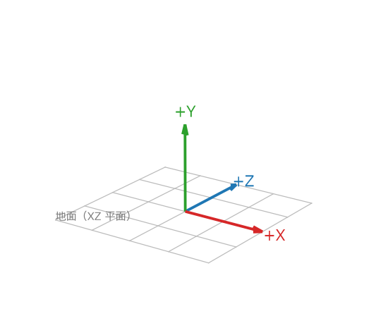
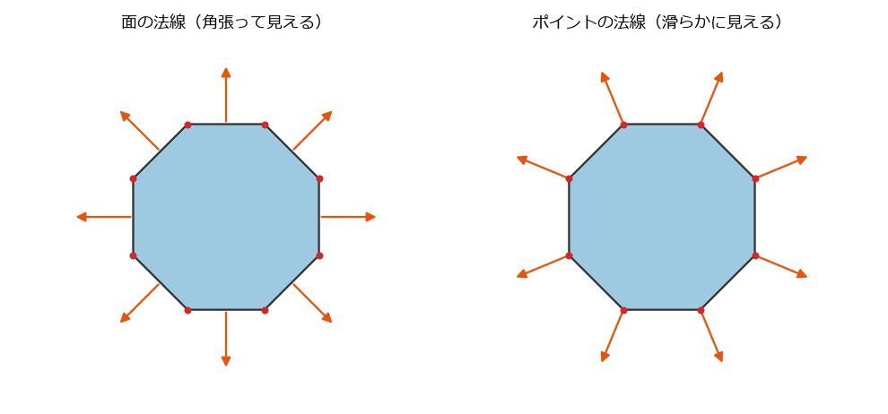
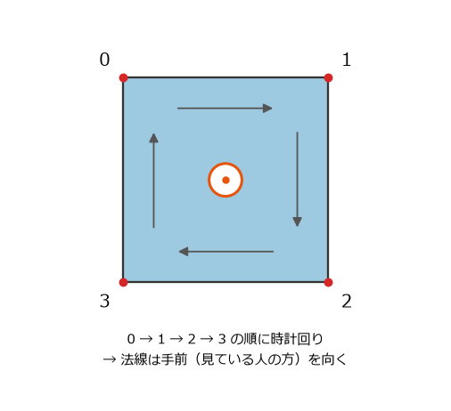
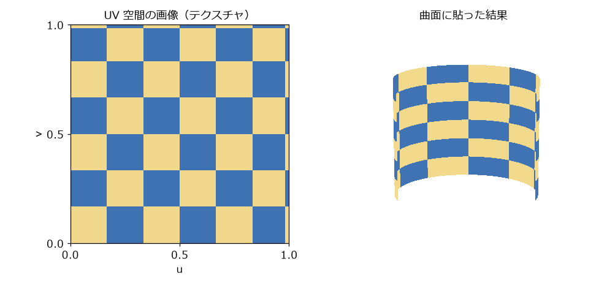
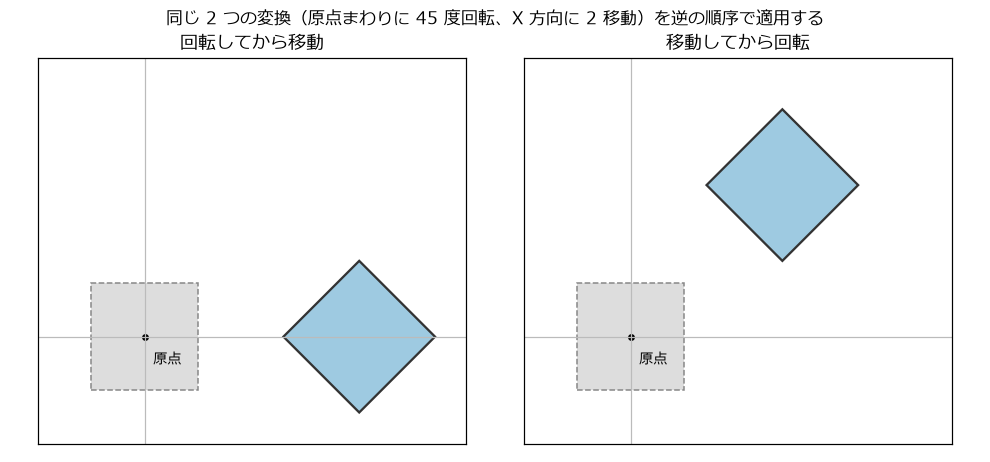

3DCG の基礎知識
===============

この章では、Houdini を使うのに必要な 3DCG の基礎知識をまとめる。3DCG の経験がある読者は読み飛ばしてよい。

画像ができるまでの流れ
----------------------

3DCG で 1 枚の画像を作るには、次の作業を行う。

.. graphviz::
   :caption: 3DCG で画像を作るまでの流れ
   :name: fig-cg-flow

   digraph flow {
     rankdir=LR;
     node [shape=box, style="rounded,filled", fillcolor="#d4e8f7", fontsize=11];
     m [label="モデリング\n（形を作る）"];
     t [label="マテリアル\n（質感を決める）"];
     l [label="ライトとカメラ\n（照明と視点を置く）"];
     r [label="レンダリング\n（画像を計算する）", fillcolor="#fff3b0"];
     m -> t -> l -> r;
   }

* **モデリング**: 物の形（ジオメトリ）を作る。:doc:`modeling` と :doc:`procedural` で扱う。
* **マテリアル**: 物の色、つや、透明度などの質感を決める。
* **ライトとカメラ**: 光源を置き、どこからどの範囲を写すかを決める。
* **レンダリング**: 光が物に当たって反射する様子を計算し、カメラから見た画像を作る。マテリアル、ライト、カメラ、レンダリングは :doc:`rendering` で扱う。

動きのある映像を作るときは、これに加えて、形や位置を時間とともに変える（アニメーション、:doc:`expressions`）、物理法則に従って動かす（シミュレーション、:doc:`simulation`）といった作業がある。

座標系
------

3DCG では、空間の中の位置を 3 つの数値 (x, y, z) で表す。Houdini の座標系は、Y 軸が上を向く右手系である。右手の親指を X 軸、人差し指を Y 軸に向けると、中指が Z 軸の向きになる。地面は XZ 平面である。

   Houdini の座標系。X 軸を赤、Y 軸を緑、Z 軸を青で表す（Houdini のビューポートと同じ色）。

長さの単位は、既定ではメートルである。1.0 は 1 m を表す。

ポリゴンメッシュ
----------------

3DCG の形状の多くは、ポリゴン（多角形）を貼り合わせた面で表す。これをポリゴンメッシュと呼ぶ。曲面も、細かいポリゴンを並べて近似する。

ポリゴンメッシュは、次の要素でできている。

* **点**: 空間の中の位置。Houdini ではポイント（point）と呼ぶ。
* **辺**: 2 つの点を結ぶ線分。エッジ（edge）と呼ぶ。
* **面**: 3 つ以上の点を順に結んで囲んだ多角形。ポリゴン（polygon）またはフェース（face）と呼ぶ。

隣り合う面は、点と辺を共有する。共有しているので、点を 1 つ動かすと、その点を使う全ての面の形が変わる。面には三角形と四角形がよく使われる。モデリングでは形を整えやすい四角形が好まれ、レンダリングの前に三角形に分割されることも多い。

Houdini では、ポリゴンのように形状を構成する単位をプリミティブ（primitive）と呼ぶ。ポリゴンのほかに、曲線、NURBS 曲面、球などの数式で表す形状、ボリューム（煙などの濃度を格子状に持つデータ）などのプリミティブがある。ポイントとプリミティブの関係は、:doc:`attributes` で詳しく説明する。

法線
----

法線（normal）は、面がどちらを向いているかを表す、長さ 1 のベクトルである。レンダリングでは、光の向きと法線の向きから面の明るさを計算する。

法線は、面ごとに持たせることも、点ごとに持たせることもできる（:numref:`fig-normals`）。面ごとの法線では、隣り合う面の明るさが急に変わるので角張って見える。点ごとの法線を周りの面の法線の平均にすると、明るさが滑らかに変わるので、少ない面でも滑らかな曲面に見える。

.. _fig-normals:

   面の法線（左）とポイントの法線（右）。円柱を真上から見た断面で、矢印が法線を表す。

面の法線の向き、つまり面の表と裏は、面を作る点の並び順で決まる。Houdini では、面を表から見たときに点が時計回りに並ぶ（:numref:`fig-winding`）。Python でポリゴンを作るときは、この順序に注意する（:doc:`python`）。

.. _fig-winding:

   点の並び順と面の表裏の関係（Houdini の場合）

UV 座標
-------

形状の表面に画像を貼り付けることを、テクスチャマッピングと呼ぶ。貼り付ける画像をテクスチャと呼ぶ。3 次元の面のどこに画像のどこを対応させるかは、点ごとに持たせた 2 次元の座標 (u, v) で決める。これを UV 座標と呼ぶ。u が画像の横方向、v が縦方向を表し、画像全体が 0 から 1 の範囲に対応する。

   UV 座標によるテクスチャマッピング。左の画像の (u, v) を、右の曲面の各点に対応させている。

変換
----

形状を移動（translate）、回転（rotate）、拡大縮小（scale）する操作を、まとめて変換（transform）と呼ぶ。変換は、ある点 (x, y, z) を別の点に移す計算であり、内部では 4 x 4 の行列で表される。

複数の変換を組み合わせるときは、適用する順序で結果が変わる（:numref:`fig-transform-order`）。回転は原点（または指定した中心）のまわりに行われるので、先に移動すると、移動した後の位置が原点のまわりに回ってしまう。Houdini の Transform ノードは、既定で拡大縮小、回転、移動の順に適用する（:guilabel:`Transform Order` パラメーターの :guilabel:`Scale Rot Trans`）。

.. _fig-transform-order:

   変換の順序による違い。点線は変換する前の四角形を表す。

マテリアル、ライト、カメラ
--------------------------

マテリアル（material）は、物の表面の性質を表す。代表的な項目は、基本の色（base color）、表面の粗さ（roughness）、金属かどうか（metalness）である。粗さが小さいと鏡のようにはっきりと映り込み、大きいとぼやけた反射になる。

ライト（light）は光源である。太陽光のように平行な光、電球のように 1 点から広がる光、空全体から降り注ぐ光（ドームライト）などがある。

カメラ（camera）は、シーンを写す視点である。位置と向きのほかに、レンズの焦点距離（画角）を持つ。焦点距離が短いほど広い範囲が写る。

レンダリング
------------

レンダリング（rendering）は、シーンの情報から画像を計算する処理である。Houdini に付属するレンダラー Karma は、カメラから光線（レイ）を飛ばし、物に当たって反射する光をたどって色を求める。この方法をレイトレーシング（ray tracing）と呼ぶ。現実の光に近い計算をするため、影、映り込み、間接光（他の物に反射してから届く光）が自然に表現される。

光線の本数を増やすと、画像のざらつき（ノイズ）が減る代わりに、計算に時間がかかる。作業中は少ない本数で素早く確認し、最終的な画像だけ本数を増やすのが一般的である。

なお、Houdini のビューポートの表示は、レンダリングとは別の簡易な方法で描かれている。見た目の確認には十分だが、最終的な画像の見た目とは異なる。
