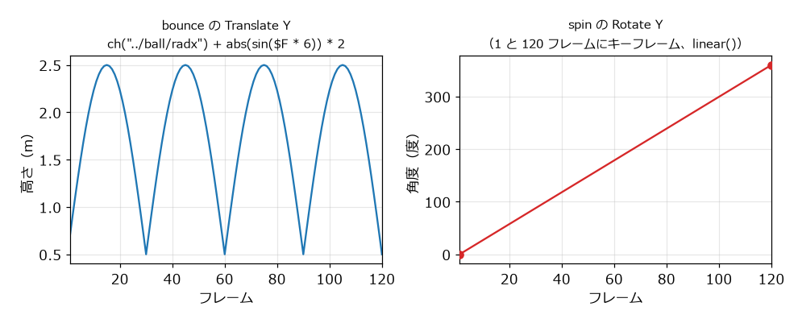

パラメーターとエクスプレッション
================================

:doc:`modeling` の最後で、関係のある値を別々に入力すると、変更のたびに複数の場所を直す必要があることを見た。この章では、パラメーターの値を式で計算するエクスプレッションと、時間とともに値を変えるキーフレームアニメーションを説明する。

パラメーターの名前
------------------

パラメーターには、画面に表示されるラベルと、内部名がある。例えば Transform ノードの :guilabel:`Translate` は、内部名が ``t`` で、3 つの成分の内部名が ``tx``、``ty``、``tz`` である。``t`` のように複数の成分をまとめたものをパラメーターのタプルと呼ぶ。式やスクリプトからパラメーターを参照するときは、内部名を使う。内部名は、パラメーターのラベルにマウスを重ねると表示される。

エクスプレッション
------------------

数値のパラメーターには、数値の代わりに式（エクスプレッション）を入力できる。式は、パラメーターの値が必要になるたびに計算される。

Houdini のパラメーターの式は、既定では Hscript という Houdini 独自の式言語で書く。パラメーターのラベルの上で RMB をクリックし、:menuselection:`Expression --> Change language to Python` を選ぶと、そのパラメーターの式を Python で書ける。

Hscript の式では、次のような関数と変数を使える。

.. list-table:: Hscript の式でよく使う関数と変数
   :header-rows: 1
   :widths: 30 70

   * - 関数、変数
     - 意味
   * - ``ch("パス")``
     - 他のパラメーターの値。パスは、ノードのパスとパラメーターの内部名を ``/`` でつないだもの。
   * - ``$F``
     - 現在のフレーム番号。
   * - ``$T``
     - 現在の時刻（秒）。フレーム番号から ``($F - 1) / $FPS`` で求めた値である。
   * - ``$FPS``
     - 1 秒あたりのフレーム数。既定では 24 である。
   * - ``$HIP``
     - hip ファイルを保存したディレクトリ。
   * - ``$OS``
     - そのノードの名前。
   * - ``sin()``、``cos()``
     - 三角関数。角度は度（degree）で指定する。
   * - ``abs()``、``min()``、``max()``、``floor()``
     - 絶対値、最小値、最大値、切り捨て。
   * - ``rand()``
     - 0 から 1 の乱数。同じ引数には同じ値を返す。
   * - ``fit(値, 元の最小, 元の最大, 新しい最小, 新しい最大)``
     - 値をある範囲から別の範囲に換算する。

.. warning::

   Hscript の ``sin()`` と ``cos()`` は角度を度で受け取るが、VEX と Python（``math.sin()``）はラジアンで受け取る。言語を切り替えたときに間違えやすい。

チャンネル参照
--------------

``ch()`` 関数で他のパラメーターを参照することを、チャンネル参照と呼ぶ。パスは、式を書いたノードからの相対パスで書くのが普通である。例えば、``/obj/table/leg`` のパラメーターから、同じネットワークにある ``top`` の :guilabel:`Size` の X を参照するには、``ch("../top/sizex")`` と書く。``..`` は、式を書いたノードの 1 つ上の階層（ここでは ``/obj/table``）を表す。同じノードのパラメーターは、``ch("sizex")`` のようにパラメーター名だけで参照できる。

式を手で入力する代わりに、次の操作でも参照を作れる。

#. 参照したいパラメーターのラベルの上で RMB をクリックし、:guilabel:`Copy Parameter` を選ぶ。
#. 参照を書き込みたいパラメーターのラベルの上で RMB をクリックし、:guilabel:`Paste Relative References` を選ぶ。

:doc:`modeling` の机に当てはめると、例えば次のように書き換えられる。天板の幅を変えると、脚の位置も自動的に変わるようになる。

.. list-table:: 机のパラメーターを参照で書き換える例
   :header-rows: 1
   :widths: 40 60

   * - パラメーター
     - 式
   * - ``leg_positions`` の :guilabel:`Size` の 1 番目
     - ``ch("../top/sizex") - 0.16``
   * - ``leg_positions`` の :guilabel:`Size` の 2 番目
     - ``ch("../top/sizez") - 0.16``
   * - ``lift_top`` の :guilabel:`Translate` の Y
     - ``ch("../leg/sizey") + ch("../top/sizey") / 2``

さらに、机の高さや脚の位置の 0.08 のような値も参照で結び付けたくなる。そのような値をまとめて置く場所として、:doc:`hda` で説明するデジタルアセットのパラメーターが使える。

作例: 弾むボール
----------------

エクスプレッションとキーフレームの例として、弾みながら回るボールを作る。ネットワークは :numref:`fig-expressions-network` のとおりである。サンプルコードの ``build_expressions.py`` でも同じネットワークを作れる。

.. graphviz::
   :caption: 弾むボールのネットワーク
   :name: fig-expressions-network

   digraph expressions {
     node [shape=box, style="rounded,filled", fillcolor="#d4e8f7", fontsize=11];
     ball [label="ball（Sphere）"];
     bounce [label="bounce（Transform）\nTranslate Y に式"];
     floor [label="floor（Grid）\nSize に式"];
     merge [label="merge（Merge）"];
     spin [label="spin（Transform）\nRotate Y にキーフレーム"];
     out [label="OUT（Null）", fillcolor="#fff3b0"];
     ball -> bounce -> merge; floor -> merge; merge -> spin -> out;
   }

``/obj`` に Geometry ノード ``expressions`` を作り、その中で次のように作る。

#. **Sphere**\ （``ball``）: :guilabel:`Primitive Type` を :guilabel:`Polygon Mesh` にし、:guilabel:`Radius` を ``0.5``、``0.5``、``0.5`` にする。
#. **Transform**\ （``bounce``）: ``ball`` をつなぎ、:guilabel:`Translate` の Y に次の式を入力する。

   .. code-block:: none
      :linenos:

      ch("../ball/radx") + abs(sin($F * 6)) * 2

   ``sin($F * 6)`` は、30 フレームで 180 度進む。その絶対値をとると、30 フレームごとに 0 に戻る山の形になる（:numref:`fig-bounce`）。最初の項 ``ch("../ball/radx")`` はボールの半径で、ボールが床に接する高さを 0 の代わりに半径にするために足している。

#. **Grid**\ （``floor``）: :guilabel:`Size` の 1 番目に ``ch("../ball/radx") * 8``、2 番目に ``ch("sizex")`` と入力する。床の一辺がボールの半径の 8 倍になり、正方形になる。
#. **Merge**\ （``merge``）: ``bounce`` と ``floor`` をつなぐ。
#. **Transform**\ （``spin``）: ``merge`` をつなぐ。:guilabel:`Translate` の X を ``1`` にし、:guilabel:`Rotate` の Y にキーフレームを打つ（次節）。
#. **Null**\ （``OUT``）: Display フラグを立てる。

プレイバーの再生ボタンを押すと、ボールが弾む。``ball`` の :guilabel:`Radius` を変えると、ボールが床に接する高さと床の大きさが自動的に変わる。

.. _fig-bounce:

   ボールの高さ（左）と回転角（右）。横軸はフレーム番号である。

キーフレームアニメーション
--------------------------

キーフレーム（keyframe）は、あるフレームでのパラメーターの値を指定したものである。キーフレームとキーフレームの間のフレームの値は、自動的に補間される。

``spin`` の :guilabel:`Rotate` の Y に、1 フレーム目で 0 度、120 フレーム目で 360 度のキーフレームを打つ。

#. プレイバーで 1 フレーム目に移動する。
#. :guilabel:`Rotate` の Y が ``0`` であることを確かめ、:guilabel:`Rotate` のラベルの上で :kbd:`Alt` + LMB をクリックする。キーフレームが打たれ、入力欄の色が変わる。
#. 120 フレーム目に移動し、:guilabel:`Rotate` の Y に ``360`` を入力して、同じ操作でキーフレームを打つ。

既定の補間は、動き始めと止まる直前が緩やかになる曲線（``bezier()``）である。一定の速さで回したい場合は、補間を直線（``linear()``）にする。補間の種類は、Animation Editor（:menuselection:`Windows --> Animation Editor`）で変えられる。サンプルコードの ``build_expressions.py`` は、キーフレームを ``linear()`` で作っている（:numref:`fig-bounce` の右）。

プレイバーの範囲は、既定で 1 フレームから 240 フレームまで、1 秒あたり 24 フレームである。

式と VEX と Python の使い分け
-----------------------------

Houdini では、値を計算する方法として、パラメーターの式（Hscript、Python）、VEX、Python のスクリプトを使える。それぞれの向き不向きは次のとおりである。

.. list-table:: 式と VEX と Python の使い分け
   :header-rows: 1
   :widths: 25 75

   * - 方法
     - 向いている用途
   * - パラメーターの式
     - パラメーターどうしの関係、時間による変化など、パラメーター 1 個の値を決める短い計算。
   * - VEX（:doc:`vex`）
     - ポイントやプリミティブごとの計算。大量の要素を高速に処理できる。
   * - Python（:doc:`python`）
     - ノードの作成や接続、ファイルの操作など、ネットワークそのものを扱う処理。
