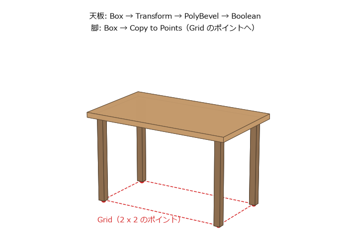

はじめてのモデリング
====================

この章では、:numref:`fig-table` の机を作りながら、SOP の基本的なノードの使い方を覚える。天板は箱の角を丸め、配線用の穴を開ける。脚は 1 本だけ作り、4 か所にコピーする。

.. _fig-table:

   この章で作る机（寸法から描いた完成形のイメージ）

完成したネットワークは :numref:`fig-table-network` のようになる。同じネットワークは、サンプルコードの ``build_table.py`` でも作れる（:doc:`intro` の「サンプルコードの使い方」を参照）。

.. graphviz::
   :caption: 机のネットワーク
   :name: fig-table-network

   digraph table {
     node [shape=box, style="rounded,filled", fillcolor="#d4e8f7", fontsize=11];
     top [label="top\n（Box）"];
     lift [label="lift_top\n（Transform）"];
     bevel [label="bevel_top\n（PolyBevel）"];
     hole [label="hole\n（Tube）"];
     cut [label="cut_hole\n（Boolean）"];
     leg [label="leg\n（Box）"];
     pos [label="leg_positions\n（Grid）"];
     copy [label="copy_legs\n（Copy to Points）"];
     merge [label="merge\n（Merge）"];
     out [label="OUT\n（Null）", fillcolor="#fff3b0"];
     top -> lift -> bevel -> cut;
     hole -> cut;
     leg -> copy; pos -> copy;
     cut -> merge; copy -> merge;
     merge -> out;
   }

机の寸法は次のとおりとする。

.. list-table:: 机の寸法
   :header-rows: 1
   :widths: 40 60

   * - 部分
     - 寸法（m）
   * - 天板
     - 幅 1.2、厚さ 0.04、奥行き 0.7
   * - 机の高さ（床から天板の上面まで）
     - 0.72
   * - 脚
     - 断面 0.05 x 0.05、長さ 0.68（= 0.72 - 0.04）
   * - 脚の位置
     - 天板の端から脚の中心まで 0.08
   * - 配線用の穴
     - 半径 0.03

Geometry ノードを作る
---------------------

#. ネットワークエディターが ``/obj`` を表示していることを確かめる。別の場所を表示しているときは、:kbd:`U` を何度か押して戻る。
#. :kbd:`Tab` を押して ``geometry`` と入力し、:guilabel:`Geometry` を選んで配置する。
#. ノードの名前を ``table`` に変える。
#. ノードをダブルクリックして中に入る。中はまだ空である。

以降の操作は、全て ``table`` の中で行う。

天板を作る
----------

#. Box ノードを作り、名前を ``top`` にする。:guilabel:`Size` を ``1.2``、``0.04``、``0.7`` にする。この時点では、天板は原点を中心に置かれている。
#. Transform ノードを作り、名前を ``lift_top`` にする。``top`` の出力を ``lift_top`` の入力につなぐ。:guilabel:`Translate` の Y を ``0.7`` にする。天板の中心の高さは、脚の長さ 0.68 に天板の厚さの半分 0.02 を足した 0.7 である。
#. PolyBevel ノードを作り、名前を ``bevel_top`` にする。``lift_top`` の出力をつなぐ。:guilabel:`Distance` を ``0.005`` にすると、天板の全ての辺が 5 mm だけ丸く削られる。

Tab メニューで作ったノードは、選んでいたノードの下に自動的につながることがある。つながっていない場合や、違うノードにつながった場合は、ワイヤーをつなぎ直す。新しいノードを作るたびに、そのノードに Display フラグを移して結果を確かめるとよい。

配線用の穴を開ける
------------------

Boolean ノードは、2 つの形状の和、差、積を計算する。ここでは、天板から円柱を引いて穴を開ける。

#. Tube ノードを作り、名前を ``hole`` にする。次のパラメーターを設定する。

   * :guilabel:`Primitive Type`: :guilabel:`Polygon`
   * :guilabel:`End Caps`: オン（円柱の上下にふたをする）
   * :guilabel:`Radius`: ``0.03``、``0.03``
   * :guilabel:`Height`: ``0.2``
   * :guilabel:`Columns`: ``24``\ （円周の分割数）
   * :guilabel:`Center`: ``0.45``、``0.68``、``-0.25``\ （天板の右奥。天板を上下に貫く高さ）

#. Boolean ノードを作り、名前を ``cut_hole`` にする。1 番目（左）の入力に ``bevel_top`` を、2 番目（右）の入力に ``hole`` をつなぐ。
#. :guilabel:`Operation` を :guilabel:`Subtract` にする。1 番目の入力から 2 番目の入力を引いた形が出力される。

Boolean ノードは、どちらの入力も閉じた（穴の無い）形状であることを前提にしている。円柱の :guilabel:`End Caps` をオンにしたのはこのためである。

脚を作る
--------

脚は 1 本だけ作り、Copy to Points ノードで 4 か所にコピーする。コピーする先は、Grid ノードで作る 4 個のポイントである。

#. Box ノードを作り、名前を ``leg`` にする。:guilabel:`Size` を ``0.05``、``0.68``、``0.05`` にする。:guilabel:`Center` の Y を ``0.34`` にして、脚の下端が床（y = 0）に来るようにする。
#. Grid ノードを作り、名前を ``leg_positions`` にする。次のパラメーターを設定する。

   * :guilabel:`Orientation`: :guilabel:`ZX Plane`\ （地面に平行な面）
   * :guilabel:`Size`: ``1.04``、``0.54``\ （天板の幅と奥行きから、両端の 0.08 ずつを引いた値）
   * :guilabel:`Rows`: ``2``、:guilabel:`Columns`: ``2``

   行と列が 2 ずつなので、グリッドの四隅の 4 個のポイントができる。

#. Copy to Points ノードを作り、名前を ``copy_legs`` にする。1 番目の入力に ``leg`` を、2 番目の入力に ``leg_positions`` をつなぐ。1 番目の入力の形状が、2 番目の入力の各ポイントにコピーされる。
#. :guilabel:`Transform Using Implicit Target Point Normals If No Point N Attribute` をオフにする。

最後の手順は重要である。Copy to Points ノードは、コピー先のポイントに法線（``N`` アトリビュート）が無い場合、そのポイントを含む面の向きを法線とみなし、コピーの Z 軸をその向きに合わせる。グリッドの面は上を向いているので、この設定がオンのままだと、脚が 90 度倒れて床に寝てしまう。コピーの向きを決めるアトリビュートについては、:doc:`procedural` で詳しく説明する。

まとめる
--------

#. Merge ノードを作り、名前を ``merge`` にする。``cut_hole`` と ``copy_legs`` をつなぐ。Merge ノードは、入力された全ての形状を 1 つにまとめる。
#. Null ノードを作り、名前を ``OUT`` にする。``merge`` の出力をつなぎ、Display フラグを立てる。

これで机ができた。ネットワークエディターでノードの上で MMB を押し続けると、そのノードの出力に含まれるポイントとプリミティブの数を確かめられる。``OUT`` の出力は、ポイントが 104 個、プリミティブが 74 個になる。

パラメーターを変えてみる
------------------------

プロシージャルな作り方の利点を確かめるため、作った後で寸法を変えてみる。

* ``bevel_top`` の :guilabel:`Distance` を ``0.015`` にすると、天板の角の丸みが大きくなる。下流の ``cut_hole`` 以降は自動的にやり直される。
* ``bevel_top`` の Bypass フラグを立てると、角を丸める前の形に戻る。フラグを戻すと、また丸くなる。
* ``hole`` の :guilabel:`Center` の X を変えると、穴の位置が動く。

一方、``top`` の :guilabel:`Size` で天板の幅を変えると、天板だけが大きくなり、脚の位置はそのままになる。脚の位置を決めているのは ``leg_positions`` の :guilabel:`Size` であり、天板の幅とは独立した値だからである。机の高さを変える場合も、``lift_top``、``leg``、``hole`` の 3 か所を書き換える必要がある。

このように、関係のある値を別々に入力すると、変更のたびに複数の場所を直すことになる。プログラムで言えば、同じ定数をあちこちに直接書いている状態である。この問題は、パラメーターから別のパラメーターを参照するエクスプレッションで解決できる（:doc:`expressions`）。

その他のよく使う SOP
--------------------

この章で使わなかったものも含め、モデリングでよく使う SOP を挙げる。各ノードの詳しい使い方は、ノードのヘルプで確認できる。

.. list-table:: モデリングでよく使う SOP
   :header-rows: 1
   :widths: 25 75

   * - ノード
     - 機能
   * - Box、Sphere、Tube、Grid、Torus、Circle、Line
     - 基本的な形状を作る。
   * - Transform
     - 移動、回転、拡大縮小する。
   * - PolyExtrude
     - 面を押し出す。面を内側に縮める（インセット）こともできる。:doc:`procedural` で使う。
   * - PolyBevel
     - 辺や角を丸める、または面取りする。
   * - Boolean
     - 2 つの形状の和、差、積を計算する。
   * - Merge
     - 複数の形状を 1 つにまとめる。
   * - Copy to Points
     - 形状を、別の形状の各ポイントにコピーする。
   * - Subdivide
     - 面を細かく分割して滑らかにする。
   * - Mirror
     - 形状を鏡に映したように反転してコピーする。
   * - Fuse
     - 近くにあるポイントを 1 つにまとめる。
   * - Blast
     - 指定した要素（ポイントやプリミティブ）を削除する。
   * - Sweep
     - 曲線に沿って断面の形を掃引し、パイプのような形状を作る。
   * - Scatter
     - 面の上にランダムにポイントを散らばらせる。
   * - Object Merge
     - 別の Geometry ノードの中のノードの出力を取り込む。
   * - File
     - ファイルからジオメトリを読み込む。
