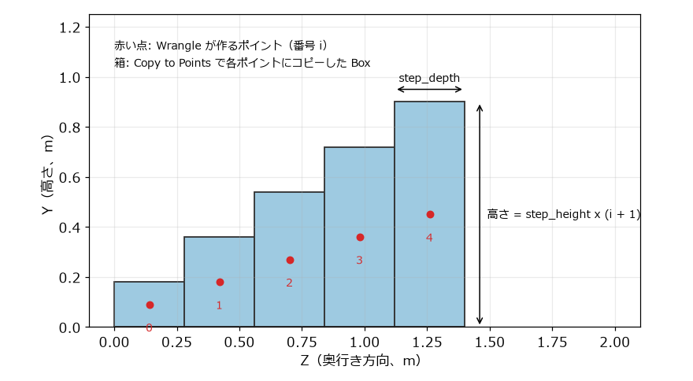
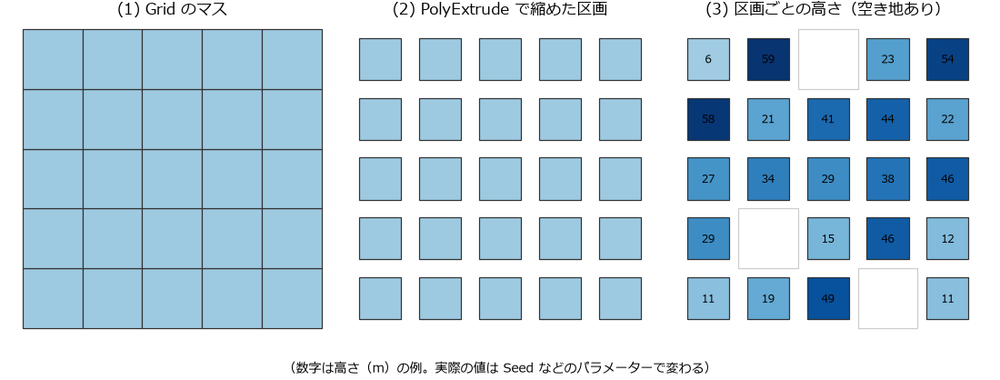

プロシージャルモデリングの実践
==============================

この章では、ここまでに学んだノード、アトリビュート、VEX を組み合わせて、パラメーターを変えるだけで形が変わるモデルを 2 つ作る。1 つ目は段数や寸法を変えられる階段、2 つ目は乱数で高さの決まる建物群である。

設計の考え方
------------

プロシージャルなモデルを作るときは、次の順に考えるとよい。

#. **何をパラメーターにするか決める。** 使う人が変えたい値（段数、寸法、乱数の種など）を挙げる。
#. **ポイントで配置を表す。** 部品を置く位置をポイントとして作り、部品ごとに変えたい値（大きさ、向き、色など）をアトリビュートとしてポイントに持たせる。
#. **部品をポイントにコピーする。** Copy to Points ノードが、ポイントのアトリビュートを読んで部品の大きさや向きを変える。

配置を決める処理と、部品の形を作る処理を分けておくと、部品だけを差し替えたり、配置のルールだけを変えたりしやすい。

Copy to Points が使うアトリビュート
-----------------------------------

Copy to Points ノードは、コピー先のポイントの次のアトリビュートを読んで、コピーごとの変換を決める。

.. list-table:: Copy to Points が読む主なアトリビュート
   :header-rows: 1
   :widths: 20 25 55

   * - アトリビュート
     - 型
     - 意味
   * - ``P``
     - ベクトル
     - コピーの位置
   * - ``pscale``
     - 浮動小数点数
     - 全ての軸に共通の拡大率
   * - ``scale``
     - ベクトル
     - 軸ごとの拡大率（``pscale`` があれば掛け合わされる）
   * - ``N``
     - ベクトル
     - コピーの +Z 軸の向き（``orient`` が無い場合）
   * - ``up``
     - ベクトル
     - コピーの +Y 軸の向き（``orient`` が無い場合）
   * - ``orient``
     - 4 個の浮動小数点数
     - コピーの向き（四元数）。あれば ``N`` と ``up`` より優先される。

これ以外のポイントのアトリビュート（例えば ``Cd``）をコピーした形状に引き継ぐかどうかは、:guilabel:`Attributes from Target` で指定する。:guilabel:`Reset Attributes from Target` のボタンを押すと、標準的な設定（変換に使うもの以外の全てのアトリビュートを引き継ぐ）が入る。

:doc:`modeling` で脚が倒れてしまったのは、``N`` が無いときに面の向きが ``N`` の代わりに使われたためである。

作例 1: 階段
------------

段数、1 段の高さ、奥行き、幅を変えられる階段を作る（:numref:`fig-stairs`）。

.. _fig-stairs:

   階段を横から見た図（5 段の場合）

i 段目（i は 0 から数える）を、高さ ``step_height x (i + 1)``、奥行き ``step_depth`` の箱で表す。箱の中心は、高さの半分の位置にある。そこで、各段の箱の中心にポイントを 1 個ずつ作り、箱の大きさを ``scale`` アトリビュートとして持たせる。1 辺が 1 の箱を Copy to Points で各ポイントにコピーすると、``scale`` の大きさに拡大された箱が並ぶ。

ネットワークは :numref:`fig-stairs-network` のとおりである。サンプルコードの ``build_stairs.py`` でも同じネットワークを作れる。

.. graphviz::
   :caption: 階段のネットワーク
   :name: fig-stairs-network

   digraph stairs {
     node [shape=box, style="rounded,filled", fillcolor="#d4e8f7", fontsize=11];
     points [label="step_points（Attribute Wrangle）\nポイントと scale を作る"];
     box [label="unit_box（Box）\n1 辺 1 の箱"];
     copy [label="copy_steps（Copy to Points）"];
     out [label="OUT（Null）", fillcolor="#fff3b0"];
     box -> copy; points -> copy; copy -> out;
   }

``/obj`` に Geometry ノード ``stairs`` を作り、その中で次のように作る。

#. Attribute Wrangle ノードを作り、名前を ``step_points`` にする。入力には何もつながない。:guilabel:`Run Over` を :guilabel:`Detail (only once)` にし、:guilabel:`VEXpression` に次のコードを入力する。

   .. literalinclude:: ../examples/vex/stairs_points.vex
      :language: vex
      :linenos:

#. :guilabel:`VEXpression` の右にある、スペアパラメーターを作るボタンを押す。:guilabel:`Step Count`、:guilabel:`Step Height`、:guilabel:`Step Depth`、:guilabel:`Width` の 4 個のパラメーターができる。初期値は 0 なので、それぞれ ``10``、``0.18``、``0.28``、``1`` にする。
#. Box ノードを作り、名前を ``unit_box`` にする。パラメーターは既定のまま（1 辺 1 の立方体）にする。
#. Copy to Points ノードを作り、名前を ``copy_steps`` にする。1 番目の入力に ``unit_box``、2 番目の入力に ``step_points`` をつなぐ。
#. Null ノード ``OUT`` をつなぎ、Display フラグを立てる。

``step_points`` を選んで Geometry Spreadsheet を見ると、10 個のポイントに ``P`` と ``scale`` があることを確かめられる。VEX のコードで ``setpointattrib`` に渡した ``set(width, h, run)`` が、それぞれのポイントの ``scale`` になっている。

``step_points`` のパラメーターを変えると、階段全体が作り直される。例えば :guilabel:`Step Count` を ``20`` にすると、20 段の階段になる。階段の全体の高さは ``step_height x step_count`` で、既定の値では 1.8 m になる。

作例 2: 建物群
--------------

次に、グリッドのマスを区画とみなし、区画ごとに乱数で高さを決めて建物を建てる。空き地もランダムに作る。完成すると、100 m 四方に高さの異なる建物が並んだ街のような形状になる。

:numref:`fig-city-lots` は、区画を作って高さを決めるまでの流れを上から見た図である。

.. _fig-city-lots:

   区画を作り、高さを決めるまでの流れ（5 x 5 のマスの場合の模式図）

ネットワークは :numref:`fig-city-network` のとおりである。サンプルコードの ``build_city.py`` でも同じネットワークを作れる。

.. graphviz::
   :caption: 建物群のネットワーク
   :name: fig-city-network

   digraph city {
     node [shape=box, style="rounded,filled", fillcolor="#d4e8f7", fontsize=11];
     ground [label="ground（Grid）"];
     lots [label="make_lots（PolyExtrude）\nマスを縮めて区画にする"];
     attrs [label="lot_attributes（Attribute Wrangle）\nheight を決め、空き地を消す"];
     begin [label="foreach_begin（Block Begin）", fillcolor="#e7d4f0"];
     extrude [label="extrude_building（PolyExtrude）\n区画を height まで押し出す", fillcolor="#e7d4f0"];
     end [label="foreach_end（Block End）", fillcolor="#e7d4f0"];
     color [label="building_color（Attribute Wrangle）\n高さで色を付ける"];
     merge [label="merge（Merge）"];
     out [label="OUT（Null）", fillcolor="#fff3b0"];
     ground -> lots -> attrs -> begin -> extrude -> end -> color -> merge;
     ground -> merge;
     merge -> out;
   }

区画を作る
^^^^^^^^^^

#. ``/obj`` に Geometry ノード ``city`` を作り、その中に Grid ノード ``ground`` を作る。:guilabel:`Size` を ``100``、``100``、:guilabel:`Rows` と :guilabel:`Columns` を ``11`` にする。10 x 10 の 100 個のマス（プリミティブ）ができる。
#. PolyExtrude ノード ``make_lots`` をつなぎ、次のパラメーターを設定する。

   * :guilabel:`Divide Into`: :guilabel:`Individual Elements`\ （マスごとに別々に処理する）
   * :guilabel:`Inset`: ``1.5``
   * :guilabel:`Output Side`: オフ

   PolyExtrude ノードは面を押し出すノードだが、:guilabel:`Distance` が 0 のまま :guilabel:`Inset` を設定すると、面を内側に縮めるだけになる。:guilabel:`Output Side` をオフにして側面を作らないようにすると、マスの間に 3 m の隙間（道路）がある区画ができる。グリッドのマスは隣とポイントを共有しているが、:guilabel:`Individual Elements` で縮めた区画は、それぞれ独立したポイントを持つ。

#. Attribute Wrangle ノード ``lot_attributes`` をつなぐ。:guilabel:`Run Over` を :guilabel:`Primitives` にし、:guilabel:`VEXpression` に次のコードを入力する。スペアパラメーターのボタンを押し、:guilabel:`Seed` を ``0``、:guilabel:`Empty Ratio` を ``0.2``、:guilabel:`Min Height` を ``6``、:guilabel:`Max Height` を ``60`` にする。

   .. literalinclude:: ../examples/vex/lot_attributes.vex
      :language: vex
      :linenos:

   ``rand(@primnum + seed)`` は、区画の番号と種から決まる 0 から 1 の乱数である。この値が :guilabel:`Empty Ratio` より小さい区画（全体の約 2 割）は ``removeprim`` で消して空き地にする。残った区画には、別の乱数を 6 から 60 に換算した値を ``height`` として持たせる。:guilabel:`Seed` を変えると、空き地と高さの組み合わせが変わる。

For-Each ループで区画を 1 個ずつ押し出す
^^^^^^^^^^^^^^^^^^^^^^^^^^^^^^^^^^^^^^^^

区画ごとに ``height`` の分だけ押し出したい。PolyExtrude ノードの :guilabel:`Distance` は 1 個の値なので、区画を 1 個ずつ取り出して押し出し、最後にまとめる。この繰り返しには For-Each ループを使う。

For-Each ループは、Block Begin ノードと Block End ノードの組で作る。2 つのノードの間に置いたノードが、入力の要素（ピース）ごとに繰り返し実行される。プログラムの ``for piece in pieces:`` に相当する。

#. :kbd:`Tab` メニューで :guilabel:`For-Each Primitive` を選ぶ。Block Begin ノードと Block End ノードが、``foreach_begin1``、``foreach_end1`` のような名前で 1 組作られる。名前をそれぞれ ``foreach_begin``、``foreach_end`` に変え、``foreach_begin`` の入力に ``lot_attributes`` をつなぐ。
#. Block Begin ノードと Block End ノードの間に PolyExtrude ノード ``extrude_building`` を挿入する。:guilabel:`Distance` と :guilabel:`Divisions` に次の式を入力する。

   .. code-block:: none
      :linenos:

      prim(opinputpath(".", 0), 0, "height", 0)
      max(1, floor(prim(opinputpath(".", 0), 0, "height", 0) / 3))

   1 行目が :guilabel:`Distance`、2 行目が :guilabel:`Divisions` の式である。``opinputpath(".", 0)`` は、このノードの 1 番目の入力につながっているノードのパスを返す。``prim(パス, 0, "height", 0)`` は、そのノードの出力のプリミティブ 0 番の ``height`` を読む。ループの中では、入力には処理中の区画 1 個だけが入っているので、プリミティブ 0 番がその区画である。:guilabel:`Divisions` は側面の分割数で、側面がおよそ 3 m ごとに分割されて、建物の階のように見える。

#. ``foreach_end`` に Display フラグを立てて、全ての区画が押し出されたことを確かめる。

For-Each Primitive で作った Block End ノードは、:guilabel:`Iteration Method` が :guilabel:`By Pieces or Points`、:guilabel:`Gather Method` が :guilabel:`Merge Each Iteration`、:guilabel:`Piece Elements` が :guilabel:`Primitives` に設定されている。つまり、プリミティブを 1 個ずつ取り出して処理し、全ての結果をまとめて出力する。

色を付けて仕上げる
^^^^^^^^^^^^^^^^^^

#. Attribute Wrangle ノード ``building_color`` をループの後ろにつなぐ。:guilabel:`Run Over` は :guilabel:`Points` のままにして、次のコードを入力する。スペアパラメーターの :guilabel:`Max Height` を ``60`` にする。

   .. literalinclude:: ../examples/vex/building_color.vex
      :language: vex
      :linenos:

#. Merge ノード ``merge`` を作り、``ground`` と ``building_color`` をつなぐ。地面のグリッドに建物を重ねる。
#. Null ノード ``OUT`` をつなぎ、Display フラグを立てる。

``lot_attributes`` の :guilabel:`Seed`、:guilabel:`Empty Ratio`、:guilabel:`Max Height` を変えて、街の形が変わることを確かめてほしい。

ループを使わない方法
^^^^^^^^^^^^^^^^^^^^

For-Each ループは分かりやすいが、要素を 1 個ずつ処理するため、要素が多いと遅くなる。多くのノードは、要素ごとに値を変える仕組みをアトリビュートで用意している。

PolyExtrude ノードの場合、:guilabel:`Local Control` タブで :guilabel:`Distance Scale` をオンにすると、プリミティブの ``zscale`` アトリビュートの値を :guilabel:`Distance` に掛けた距離だけ押し出す。``lot_attributes`` のコードで ``f@zscale = f@height;`` とし、PolyExtrude の :guilabel:`Distance` を ``1`` にすれば、ループを使わずに同じ高さの建物を作れる。

ループを使う前に、ノードのヘルプでアトリビュートによる制御ができないかを調べるとよい。Python のループを NumPy の配列の計算に置き換えるのと同じ考え方である。
