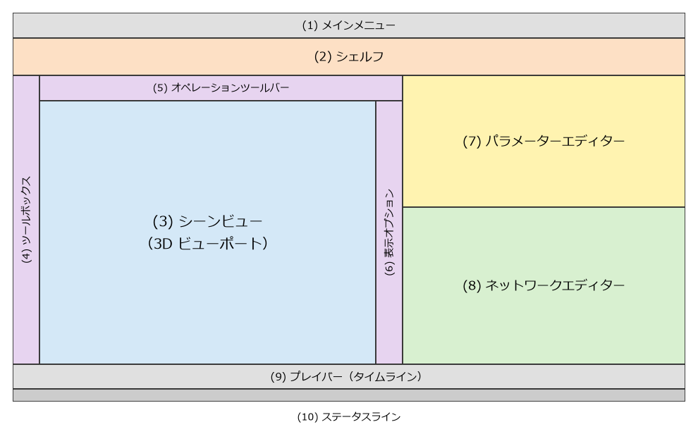

画面と基本操作
==============

この章では、Houdini の画面の構成と、ビューポート、ネットワークエディター、パラメーターエディターの基本的な操作を説明する。

起動
----

Houdini は、Houdini Launcher（Houdini のインストールとライセンスの管理を行うプログラム）から、またはインストール時に作られるショートカットから起動する。Apprentice のライセンスは、Houdini Launcher で SideFX 社のアカウントにログインして取得する。ライセンスの取得とインストールの手順は、SideFX 社のウェブサイトで案内されている。

画面の構成
----------

起動すると、:numref:`fig-ui-layout` のような構成の画面が表示される。

.. _fig-ui-layout:

   Houdini のメインウィンドウの構成（模式図）

.. list-table:: 画面の各部の役割
   :header-rows: 1
   :widths: 30 70

   * - 名前
     - 役割
   * - (1) メインメニュー
     - ファイルの保存や読み込み、ウィンドウの表示などのメニュー。
   * - (2) シェルフ
     - よく使う機能を呼び出すボタン（シェルフツール）を並べた棚。ツールを押すと、必要なノードが自動的に作られる。
   * - (3) シーンビュー
     - 3 次元のシーンを表示する領域。ビューポートとも呼ぶ。
   * - (4) ツールボックス
     - 選択、移動、回転、拡大縮小などのツール。
   * - (5) オペレーションツールバー
     - 選択中のノードの主なパラメーターを表示する。
   * - (6) 表示オプション
     - ビューポートの表示方法（点の番号、法線など）を切り替えるボタン。
   * - (7) パラメーターエディター
     - 選択中のノードのパラメーターを表示し、編集する。
   * - (8) ネットワークエディター
     - ノードのネットワークを表示し、編集する。
   * - (9) プレイバー
     - アニメーションの再生と、現在のフレームの変更を行う。
   * - (10) ステータスライン
     - 処理の状況やメッセージを表示する。

画面を区切った各領域をペイン（pane）と呼ぶ。1 つのペインには複数のタブを持たせることができ、タブを切り替えて別の種類の表示に変えられる。ペインのタブの右端にある :guilabel:`+` のボタンから、新しいタブを追加できる。本資料では、次の 2 種類のタブを追加して使う。

* **Geometry Spreadsheet**: ノードの出力するジオメトリの中身（点の位置やアトリビュートの値）を表の形で表示する。:doc:`attributes` で使う。
* **Python Shell**: Python の対話型のシェル。:menuselection:`Windows --> Python Shell` で別のウィンドウとして開くこともできる。:doc:`python` で使う。

Houdini では、作業の多くをネットワークエディターとパラメーターエディターで行う。シェルフツールは、ノードを作る手間を省くための補助と考えるとよい。

ビューポートの操作
------------------

ビューポートで視点を動かすには、:kbd:`Space` キーを押したままマウスをドラッグする。:kbd:`Space` の代わりに :kbd:`Alt` を押してもよい。

.. list-table:: ビューポートの視点の操作
   :header-rows: 1
   :widths: 35 65

   * - 操作
     - 結果
   * - :kbd:`Space` + LMB でドラッグ
     - 視点を回転する（タンブル）。
   * - :kbd:`Space` + MMB でドラッグ
     - 視点を平行移動する（トラック）。
   * - :kbd:`Space` + RMB でドラッグ、またはマウスホイール
     - 視点を前後に移動する（ドリー）。
   * - :kbd:`Space` + :kbd:`H`
     - シーン全体が見えるように視点を戻す。
   * - :kbd:`Space` + :kbd:`G`
     - 選択している物が見えるように視点を移す。

形状を選んで移動する操作もビューポートでできるが、本資料では、パラメーターに数値を入力して形状を作る。数値で作る方が、後から変更しやすく、手順を正確に再現できるためである。

ネットワークエディターの操作
----------------------------

ネットワークエディターは、ノードを作り、つなぐための領域である。

.. list-table:: ネットワークエディターの主な操作
   :header-rows: 1
   :widths: 35 65

   * - 操作
     - 結果
   * - :kbd:`Tab`
     - ノードを作るメニュー（Tab メニュー）を開く。ノードの名前の一部を入力すると絞り込める。
   * - MMB でドラッグ
     - 表示を平行移動する。
   * - マウスホイール
     - 表示を拡大、縮小する。
   * - :kbd:`H`
     - 全てのノードが見えるようにする。
   * - :kbd:`G`
     - 選択しているノードが見えるようにする。
   * - ノードをダブルクリック、または選択して :kbd:`Enter` か :kbd:`I`
     - ノードの中のネットワークに入る。
   * - :kbd:`U`
     - 1 つ上の階層のネットワークに戻る。
   * - ノードの出力から別のノードの入力へドラッグ
     - ワイヤーでつなぐ。
   * - :kbd:`Y` を押しながらワイヤーを横切るようにドラッグ
     - ワイヤーを切る。
   * - ノードの上で MMB を押し続ける
     - ノードの情報（要素の数、アトリビュート、エラーなど）を表示する。

ノードの上側の突起が入力（input）、下側の突起が出力（output）である。データは上から下へ流れる。ノードの両端にある色の付いた部分はフラグである。フラグについては :doc:`nodes` で説明する。

パラメーターエディターの操作
----------------------------

ネットワークエディターでノードを選ぶと、パラメーターエディターにそのノードのパラメーターが表示される。

* 値を変えるには、入力欄に数値を入力して :kbd:`Enter` を押す。数値の入力欄では、数式（例えば ``1.2 / 2``）や、他のパラメーターを参照する式も使える（:doc:`expressions`）。
* 入力欄の上で MMB を押してドラッグすると、値を連続的に変えられる。
* パラメーターのラベルの上で :kbd:`Ctrl` + MMB をクリックすると、値が既定値に戻る。
* パラメーターのラベルにマウスを重ねると、内部名（Python や VEX から参照するときの名前）を含む説明が表示される。例えば Box ノードの :guilabel:`Size` の内部名は ``size`` で、その 3 つの成分の内部名は ``sizex``、``sizey``、``sizez`` である。
* パラメーターのラベルの上で RMB をクリックすると、パラメーターの値のコピー、参照の貼り付け、キーフレームの設定などのメニューが開く。

ファイルの保存
--------------

作業したシーンは、:menuselection:`File --> Save`\ （:kbd:`Ctrl+S`）で保存する。Houdini のシーンファイルを hip ファイルと呼ぶ。Apprentice で保存すると、非商用の形式（拡張子 ``.hipnc``）になる。

hip ファイルを保存したディレクトリは、``$HIP`` という変数で参照できる。例えば、シミュレーションの結果やレンダリングの画像を ``$HIP/render/table.jpg`` のように hip ファイルからの相対的な場所に書き出すと、hip ファイルとその出力をまとめて別の場所に移せる。

hip ファイルには、ノードのネットワークとパラメーターが保存される。ネットワークから計算できる形状そのものは、基本的には保存されない。開いたときに、ネットワークから計算し直される。

ヘルプの引き方
--------------

Houdini には、詳しいヘルプが付属している。

* パラメーターエディターの右上にある :guilabel:`?` のボタンを押すと、選択中のノードのヘルプが開く。ノードの機能と全てのパラメーターの説明が載っている。
* :menuselection:`Help` メニューから、ヘルプ全体の目次を開ける。VEX の関数や Python（HOM）のリファレンスもヘルプに含まれている。

同じ内容は SideFX 社のウェブサイトでも公開されている（:doc:`references`）。ウェブサイトのヘルプは最新のバージョンの内容なので、使っているバージョンと異なる場合がある。
