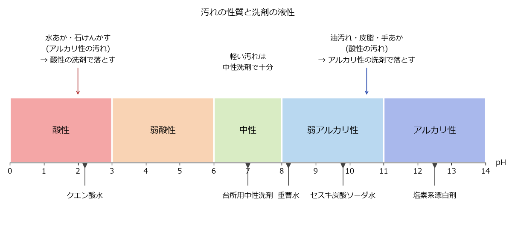

掃除の基本
==========

本章では、汚れの種類と性質、洗剤の選び方、掃除の順番、道具の使い方を説明する。汚れの性質に合った洗剤を選べば、力を入れなくても汚れが落ちる。

汚れの種類と性質
----------------

家庭の汚れは、性質によって次のように分けられる。

.. list-table:: 家庭の主な汚れ
   :header-rows: 1
   :widths: 20 25 55

   * - 汚れ
     - 性質
     - 主な場所
   * - 油汚れ
     - 酸性
     - コンロ周り、換気扇、電子レンジの中。時間がたつと固まってべたつく。
   * - 皮脂汚れ・手あか
     - 酸性
     - ドアノブ、照明のスイッチ、床、浴室の壁、衣類の襟
   * - :term:`水あか`
     - アルカリ性
     - 蛇口、鏡、シンク。水道水に含まれるミネラルが残って白く固まったもの。
   * - :term:`石けんかす`
     - アルカリ性
     - 浴室の床や壁、洗面器。石けんと水道水のミネラルが結び付いたもの。
   * - カビ
     - 生物
     - 浴室のゴムパッキンや目地、窓のサッシ。湿気が多く、汚れが残っている場所に生える。
   * - ほこり
     - 乾いた汚れ
     - 床、家具の上、家電の裏。綿ぼこりや髪の毛、砂など。
   * - 尿石
     - アルカリ性
     - 便器の内側のふち。尿の成分が固まったもの。

洗剤の液性
----------

洗剤は、\ :term:`液性`\ （酸性・中性・アルカリ性の度合い）によって、得意な汚れが異なる。液性は pH という数値で表し、pH 7 が中性、それより小さいと酸性、大きいとアルカリ性である。家庭用の洗剤は、法律（家庭用品品質表示法）に基づいて、液性を次の 5 つに区分して表示している。

.. list-table:: 洗剤の液性の区分
   :header-rows: 1
   :widths: 25 25 50

   * - 液性
     - pH の範囲
     - 主な製品の例
   * - 酸性
     - 3.0 未満
     - トイレ用洗剤（酸性タイプ）
   * - 弱酸性
     - 3.0 以上 6.0 未満
     - 一部の浴室用洗剤
   * - 中性
     - 6.0 以上 8.0 以下
     - 台所用中性洗剤、浴室用中性洗剤、住居用洗剤
   * - 弱アルカリ性
     - 8.0 を超え 11.0 以下
     - 一部の住居用洗剤、粉末の洗濯用洗剤
   * - アルカリ性
     - 11.0 を超える
     - 換気扇用・レンジ周り用の強力な洗剤、塩素系漂白剤

汚れを落とす基本は、汚れと反対の性質の洗剤を使うことである（:numref:`fig-ph-cleaners`）。酸性の汚れ（油汚れ・皮脂汚れ）はアルカリ性の洗剤で、アルカリ性の汚れ（水あか・石けんかす）は酸性の洗剤で落としやすくなる。日常の軽い汚れは、素材を傷めにくい中性洗剤で十分である。

   汚れの性質と洗剤の液性（pH の値はおおよその目安）

洗剤のほかに、次のような身近な素材も掃除に使える。いずれも洗浄力は市販の専用洗剤より穏やかである。

:term:`重曹`\ （炭酸水素ナトリウム）
   弱アルカリ性。粉のまま、または水に溶かして、軽い油汚れや鍋の焦げ付きに使う。粒子が細かく、クレンザーのように研磨剤としても使える。

:term:`セスキ炭酸ソーダ`
   重曹よりアルカリ性が強く、水に溶けやすい。水に溶かしてスプレーにすると、皮脂汚れや手あかの拭き掃除に向く。

:term:`クエン酸`
   酸性。水に溶かして、水あかや石けんかす、トイレのアンモニア臭に使う。

アルカリ性の洗剤や重曹・セスキ炭酸ソーダは、アルミや銅、無垢材、畳などを変色させることがある。酸性の洗剤やクエン酸は、大理石やセメント、鉄を傷めることがある。初めて使う場所では、目立たない所で試してから使う。

「まぜるな危険」と安全な使い方
------------------------------

塩素系の洗剤・漂白剤と、酸性タイプの洗剤が混ざると、有毒な塩素ガスが発生する。塩素ガスを吸い込むと、のどや目を傷め、命に関わることもある。このため、該当する製品には「まぜるな危険」と大きく表示されている。

次の点を必ず守る。

* 塩素系の製品と酸性タイプの製品は、同時に使わない。続けて使う場合は、先に使った洗剤を水で十分に洗い流してから使う。
* 塩素系の製品と、クエン酸や酢を一緒に使わない。クエン酸や酢も酸性である。
* 塩素系の製品を使うときは、窓を開けるか換気扇を回して換気する。
* ゴム手袋を着け、液が目に入らないよう注意する。必要に応じて眼鏡やマスクも着ける。
* 洗剤を別の容器に移し替えない。中身が分からなくなり、誤飲や誤った混合の原因になる。

洗剤が目に入ったときは、こすらずにすぐ流水で十分に洗い、医師の診察を受ける。誤って飲んだときや、気分が悪くなったときも医療機関に相談する。

掃除の基本の順番
----------------

掃除は次の順番で行うと、二度手間にならない。

上から下へ
   ほこりは上から下に落ちる。棚の上や照明を先に掃除し、床は最後に掃除する。

奥から手前へ
   部屋の奥から出入り口に向かって掃除すると、掃除した所を踏まずに済む。

乾いた掃除から湿った掃除へ
   先にほこりを取ってから水拭きをする。ほこりが残ったまま水拭きをすると、ほこりが泥のようになって広がる。

汚れの軽い所から重い所へ
   同じ布やスポンジを使う場合は、きれいな所から汚れた所の順に進めると、汚れを広げにくい。

床掃除の場合、窓を開けて換気し、棚の上などのほこりを落としてから、掃除機またはフローリングワイパーで床のほこりを取り、最後に必要に応じて水拭きをする。掃除機を使う場合は、朝起きてすぐや帰宅直後など、ほこりが床に落ちて舞っていないときに行うと効率がよい。

道具の使い方
------------

掃除機
   ヘッドをゆっくり動かすと、ごみをしっかり吸い取れる。速く動かすと吸い残しが出やすい。ごみがたまったら早めに捨て、フィルターも定期的に手入れする。

フローリングワイパー
   乾いたシートは床のほこりや髪の毛を取るのに、ぬれたシートは素足の皮脂汚れや食べこぼしを取るのに使う。

スポンジ
   硬い面は、傷が付いてもよい場所だけに使う。浴槽や樹脂製の洗面ボウルなど傷付きやすい素材には、柔らかい面を使う。

マイクロファイバークロス
   水でぬらして固く絞ると、洗剤を使わなくても軽い汚れが落ちる。乾いたまま使うと、鏡や蛇口を磨ける。

汚れをためないこつ
------------------

汚れは、付いた直後なら水や湯で拭くだけで落ちることが多い。時間がたつと、油は固まり、水あかは層になり、カビは根を張って落ちにくくなる。次のような「ついで掃除」を習慣にすると、まとめて行う掃除が楽になる。

* 料理の後、コンロ周りが温かいうちに拭く。
* 入浴後、浴室の壁や床の水気を切り、換気する。
* 歯みがきの後、洗面ボウルをさっと洗う。
* トイレを使ったついでに、便器のふちを拭く。
