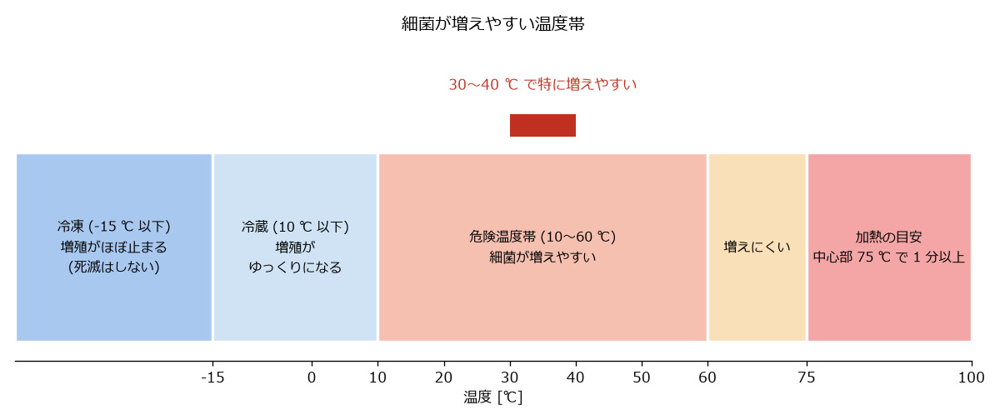

食品衛生と台所の安全
====================

本章では、家庭での食中毒を防ぐ方法と、台所での火災・やけど・けがを防ぐ方法を説明する。食中毒は飲食店だけでなく家庭でも起こる。一人暮らしでは、体調を崩したときに頼れる人が近くにいないこともあるので、予防が特に大切である。

食中毒予防の三原則
------------------

食中毒の多くは、細菌やウイルスが付いた食品を食べることで起こる。細菌による食中毒は、次の 3 つの原則で予防できる（:numref:`fig-three-principles`）。

.. graphviz::
   :caption: 食中毒予防の三原則
   :name: fig-three-principles
   :align: center

   digraph principles {
       rankdir=TB;
       node [shape=box, style="rounded,filled", fontsize=12];
       edge [color="#666666"];

       root [label="食中毒予防の三原則", fillcolor="#ffe8b0"];
       a [label="つけない\n手洗い・器具の洗浄\n生肉と他の食品を分ける", fillcolor="#dceefa"];
       b [label="増やさない\nすぐに冷蔵・冷凍する\n常温に放置しない", fillcolor="#e3f2d0"];
       c [label="やっつける\n中心部までしっかり加熱する\n器具を消毒する", fillcolor="#f6dde8"];

       root -> a;
       root -> b;
       root -> c;
   }

つけない
   手や調理器具を清潔にし、食品に細菌を付けない。生の肉や魚に付いている細菌を、他の食品に移さない。

増やさない
   細菌の多くは、温度と時間の条件がそろうと増える。食品を低温で保存し、常温に放置しない。

やっつける
   ほとんどの細菌やウイルスは加熱すると死ぬ。食品を中心部まで十分に加熱する。調理器具は洗った後に熱湯や漂白剤で消毒する。

ノロウイルスのように食品の中では増えないものもあるが、ウイルスは少量でも感染するため、「つけない」と「やっつける」が特に大切である。

手洗い
------

手洗いは「つけない」の基本である。調理の前、生の肉・魚・卵を触った後、トイレの後、ごみを触った後、鼻をかんだ後には、必ず手を洗う。

#. 流水で手をぬらし、石けんを付けて泡立てる。
#. 手のひら、手の甲、指の間、指先と爪の間、親指、手首を、ていねいにこする。30 秒程度かけるとよい。
#. 流水で石けんを十分に洗い流す。
#. 清潔なタオルやペーパータオルで拭き、よく乾かす。

手に傷がある場合は、傷口に黄色ブドウ球菌がいることがある。調理用の手袋を着けるか、傷口を絆創膏でしっかり覆う。

調理器具の衛生管理
------------------

まな板と包丁
   生の肉や魚を切ったまな板と包丁には、細菌が付いている。そのまま生で食べる野菜や、加熱済みの食品を切ると、細菌が移る。これを\ :term:`二次汚染`\ という。まな板が 1 枚しかない場合は、生で食べる野菜や加熱済みの食品を先に切り、生の肉や魚は最後に切る。肉や魚を切った後は、すぐに洗剤で洗い、熱湯をかける。

ふきん・スポンジ
   ぬれたふきんやスポンジは細菌が増えやすい。使った後はよく洗って乾かす。ふきんは定期的に煮沸するか、台所用漂白剤につけて除菌する。スポンジの手入れは「:doc:`kitchen_cleanup`」で説明する。

菜箸・トング
   生の肉をつかんだ菜箸やトングで、焼き上がった肉や他の食品を取らない。生の肉用と、焼けた後用を分ける。

漂白剤による消毒
   まな板や食器、ふきんは、台所用の塩素系漂白剤で消毒できる。製品に表示された濃度に薄めてつけ置きし、その後よく水で洗い流す。木製のまな板は、漂白剤で変色することがある。

細菌が増えやすい温度と時間
--------------------------

食中毒を起こす細菌の多くは、10〜60 ℃ の範囲でよく増え、特に人の体温に近い 30〜40 ℃ 前後で最も増えやすい（:numref:`fig-bacteria-temperature`）。この温度帯を\ :term:`危険温度帯`\ と呼ぶことがある。

   細菌が増えやすい温度帯（目安）

10 ℃ 以下では増殖がゆっくりになり、-15 ℃ 以下ではほとんど増えなくなる。ただし、冷蔵・冷凍しても細菌は死なない。冷蔵庫に入れていても、時間がたてば細菌はゆっくり増える。解凍すると、冷凍前に付いていた細菌は再び増え始める。

このため、次の点に注意する。

* 買ってきた肉、魚、総菜などは、すぐに冷蔵庫や冷凍室に入れる。
* 調理した料理は、長時間常温に放置しない。食べきれない分は、粗熱が取れたらすぐに冷蔵庫に入れる。
* 大きな鍋で作ったカレーやシチューは、冷めるまでに時間がかかる。浅い容器に小分けして早く冷ます。
* 夏場の買い物では、保冷バッグや保冷剤を使い、寄り道をせずに帰る。

加熱の目安
----------

多くの細菌は、食品の中心部を 75 ℃ で 1 分以上加熱すると死ぬ。ノロウイルスのおそれがある二枚貝などは、中心部を 85〜90 ℃ で 90 秒以上加熱する。

肉の加熱が十分かどうかは、次の方法で確かめる。

* 鶏肉や豚肉、ひき肉を使ったハンバーグなどは、中心部を切って、赤い部分がなく、肉汁が透明になっていることを確かめる。
* 温度計がある場合は、肉の最も厚い部分に差して中心温度を測る。

肉と魚、卵の扱い方
------------------

鶏肉
   カンピロバクターなどの食中毒菌が付いていることが多い。生や加熱不足の鶏肉（鶏刺し、鶏わさ、半生のたたきなど）を食べると食中毒になることがある。必ず中心部まで加熱する。

豚肉
   E 型肝炎ウイルスや寄生虫のおそれがあるため、必ず中心部まで加熱する。

牛肉
   ステーキなどのかたまり肉は、細菌が表面にしか付いていないため、表面を十分に焼けば中が赤くても食べられるとされる。ただし、ひき肉や、筋を切ったりタレを注入したりした加工肉は、細菌が中まで入り込んでいる場合があるので、中心部まで加熱する。

ひき肉
   ひき肉は、表面の細菌が全体に混ざっているため、中心部まで十分に加熱する。

魚
   生で食べる刺身は、購入した日のうちに食べる。サバ、サンマ、イカなどにはアニサキスという寄生虫がいることがある。アニサキスは、十分な加熱（60 ℃ で 1 分以上、または 70 ℃ 以上）か、十分な冷凍（-20 ℃ で 24 時間以上）で死ぬ。酢でしめても、しょうゆやわさびを付けても死なない。家庭の冷凍室は -20 ℃ に届かない場合がある。

卵
   ひびの入った卵は、サルモネラ菌が中に入るおそれがあるので、生で食べず、十分に加熱して早めに使う。生で食べる場合は、賞味期限内のものを選ぶ。

火災・やけど・けがの防止
------------------------

コンロの使い方
   * 調理中はコンロから離れない。離れるときは必ず火を止める。
   * コンロの周りに、ふきん、キッチンペーパー、油の容器など燃えやすいものを置かない。
   * 袖口の広い服や、すそが垂れる服で調理しない。衣類に火が燃え移ることがある。
   * 鍋の取っ手は、体に当たらないよう、コンロの手前に突き出さない向きにする。

揚げ物の油
   油は加熱しすぎると発火する。揚げ物をするときは、コンロから絶対に離れない。初心者は、揚げ焼き（少なめの油で焼く方法）や、オーブン・電子レンジでできる「揚げない」調理から始めると安全である。

鍋の油から火が出たとき
   水をかけてはならない。燃えている油が飛び散り、火が一気に広がる。火を止め、消火器で消火する。消火できない場合や火が天井に届きそうな場合は、すぐに避難して 119 番に通報する。

やけど
   やけどをしたら、すぐに水道水で 15〜30 分程度冷やす。水ぶくれは破らない。範囲が広い場合や、皮膚が白くなったり黒くなったりしている場合は、医療機関を受診する。

包丁
   使った包丁は、シンクの洗い桶に沈めておかない。見えずに手を切るおそれがある。使ったらすぐに洗って、所定の場所に戻す。包丁の刃は、よく切れるほうがかえって安全である。切れ味が悪いと力が入り、滑ってけがをしやすい。

一酸化炭素中毒
   ガスコンロを使うときは、換気扇を回すか窓を開ける。ガスの燃焼には酸素が必要で、換気が悪いと一酸化炭素が発生する。

食物アレルギーについて
----------------------

食物アレルギーは、特定の食品を食べたときに、じんましんや呼吸困難などの症状が出るものである。大人になってから発症することもある。特定の食品を食べた後に、口の中のかゆみ、じんましん、腹痛、息苦しさなどが出た場合は、医療機関に相談する。息苦しさや意識がもうろうとするなどの重い症状がある場合は、すぐに 119 番に通報する。

加工食品のパッケージには、アレルギーの原因となる主な食品（特定原材料）が表示されている。すでに食物アレルギーがある人は、買い物のたびに原材料の表示を確認する。

体調が悪いときは
----------------

下痢、嘔吐、発熱、腹痛などの症状があるときは、食中毒や感染症の可能性がある。

* 水分を少しずつ取る。経口補水液が適している。
* 症状が重い場合、血便がある場合、水分が取れない場合は、医療機関を受診する。
* 症状がある間は、他の人の食事を作らない。ノロウイルスの場合、症状がなくなった後もしばらくは便にウイルスが出る。
* 嘔吐物や便を処理するときは、使い捨ての手袋とマスクを着け、塩素系漂白剤を薄めた液で消毒する。
