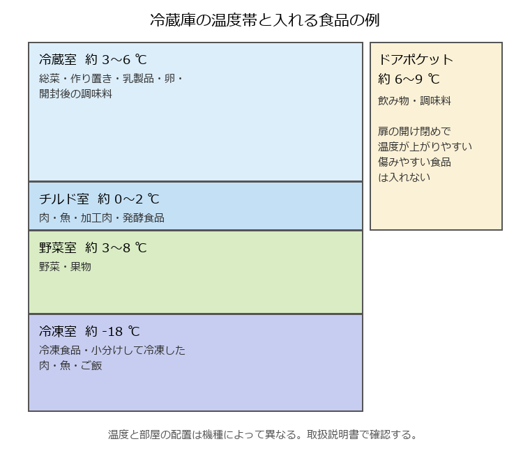

食材の買い方と保存
==================

本章では、一人暮らしに合った食材の買い方と、冷蔵・冷凍・常温での保存方法を説明する。一人暮らしでは、食材を使い切れずに傷ませてしまうことが多い。買い方と保存の工夫で、食費とむだを減らせる。

買い物の計画
------------

計画を立てずに買い物をすると、同じものを買ったり、使い道のないものを買ったりしやすい。次の手順で買い物をするとよい。

#. 冷蔵庫、冷凍室、食品棚の中身を確認する。
#. 数日分の献立を大まかに決める。献立の立て方は「:doc:`meal_planning`」で説明する。
#. 足りない食材を書き出して、買い物リストを作る。
#. リストに沿って買う。

まとめ買いは週 1〜2 回にし、足りない生鮮食品を途中で買い足すと、買い物の時間と回数を減らせる。空腹のときに買い物をすると、予定外のものを買いすぎやすい。

一人分の買い方
--------------

使い切れる量を買う
   量が多いほうが割安でも、使い切れずに捨てれば損になる。野菜はカット野菜やばら売り、肉は少量パックも選択肢になる。

保存のきく食材を使う
   冷凍野菜、冷凍のシーフードミックス、缶詰（ツナ、サバ）、乾物（乾燥わかめ、切り干し大根）は長持ちし、少しずつ使える。

日持ちする野菜を中心にする
   玉ねぎ、じゃがいも、にんじん、キャベツは比較的長持ちし、いろいろな料理に使える。もやしや葉物は傷みやすいので、使う直前に買う。

使い回せる食材を選ぶ
   1 つの食材を複数の料理に使う献立を考えると、使い切りやすい。たとえばキャベツは、炒め物、みそ汁、スープ、浅漬けに使える。

買い物の順番
   常温の食品から先にかごに入れ、冷蔵・冷凍の食品は最後に入れる。冷たい食品が常温にさらされる時間を短くできる。

消費期限と賞味期限
------------------

加工食品には、\ :term:`消費期限`\ か\ :term:`賞味期限`\ のどちらかが表示されている。

.. list-table:: 消費期限と賞味期限の違い
   :header-rows: 1
   :widths: 20 40 40

   * - 項目
     - 消費期限
     - 賞味期限
   * - 意味
     - 安全に食べられる期限
     - おいしく食べられる期限
   * - 対象の食品
     - 弁当、サンドイッチ、生菓子、総菜など、傷みやすい食品
     - スナック菓子、カップ麺、缶詰、ペットボトル飲料など、比較的傷みにくい食品
   * - 期限を過ぎたら
     - 食べないほうがよい
     - すぐに食べられなくなるわけではない。見た目やにおいなどで判断する。

どちらの期限も、袋や容器を開けずに、表示された方法で保存した場合のものである。開封した後は、期限にかかわらず早めに食べきる。

冷蔵庫の使い方
--------------

冷蔵庫は、場所によって温度が異なる（:numref:`fig-refrigerator`）。食品に合った場所に入れることで、長持ちさせられる。

   冷蔵庫の温度帯と入れる食品の例

冷蔵庫を上手に使うための注意点は次のとおりである。

詰め込みすぎない
   冷蔵室に食品を詰め込みすぎると、冷気が循環せず、冷えにくくなる。冷蔵室は 7 割程度を目安にする。一方、冷凍室は凍った食品どうしが冷やし合うので、隙間なく詰めたほうが効率がよい。

熱いものを入れない
   温かい料理は、粗熱が取れてから入れる。ただし、常温で長く放置するのもよくない。浅い容器に移したり、容器の下に保冷剤や冷水を当てたりして、早く冷ます。

扉の開け閉めを減らす
   扉を開けている時間が長いと、庫内の温度が上がる。何がどこにあるか分かるように整理しておく。

古いものを手前に置く
   先に買ったものを手前に置き、先に使う。

冷蔵庫の温度を確認する
   冷蔵室は 10 ℃ 以下、冷凍室は -15 ℃ 以下に保つ。庫内に温度計を置いておくと確認しやすい。

保存期間の目安
--------------

保存期間は、食品の鮮度や状態、冷蔵庫の性能によって異なる。次の表は大まかな目安であり、パッケージの期限表示がある場合はそれを優先する。少しでもにおいや見た目がおかしいと感じたら、食べずに捨てる。

.. list-table:: 冷蔵保存の期間の目安
   :header-rows: 1
   :widths: 35 25 40

   * - 食品
     - 目安
     - 保存のこつ
   * - ひき肉、魚の切り身
     - 1〜2 日
     - チルド室に入れる。すぐ使わない分は購入した日に冷凍する。
   * - 薄切り肉、こま切れ肉
     - 2〜3 日
     - チルド室に入れる。
   * - 刺身
     - 購入した日
     - 当日中に食べる。
   * - 作り置きのおかず
     - 2〜3 日
     - 清潔な容器に入れ、取り分けるときは清潔な箸を使う。
   * - 炊いたご飯
     - 冷蔵には向かない
     - 冷蔵すると硬くなり、味が落ちる。食べきれない分は冷凍する。
   * - 卵
     - パックの賞味期限まで
     - パックのまま冷蔵室に入れると、期限を確認しやすい。
   * - 葉物野菜（ほうれん草など）
     - 2〜3 日
     - ぬらした新聞紙やキッチンペーパーで包み、ポリ袋に入れて野菜室に立てて入れる。
   * - キャベツ、白菜
     - 1〜2 週間
     - 切ったものは切り口をラップで覆い、早めに使う。
   * - にんじん、大根
     - 1〜2 週間
     - 水気を拭き、ポリ袋に入れて野菜室に入れる。

.. list-table:: 常温保存の目安
   :header-rows: 1
   :widths: 35 65

   * - 食品
     - 保存のこつ
   * - 玉ねぎ、じゃがいも
     - 風通しのよい冷暗所で保存する。じゃがいもは日光に当てると芽が出たり、皮が緑色になったりする。夏場は野菜室に入れてもよい。
   * - 米
     - 高温多湿を避け、密閉容器に入れて保存する。夏場は虫が発生しやすいので、ペットボトルなどに入れて冷蔵庫の野菜室に入れるとよい。
   * - 缶詰、乾物、調味料（未開封）
     - 直射日光の当たらない涼しい場所で保存する。開封後は表示に従い、冷蔵が必要なものは冷蔵庫に入れる。

冷凍と解凍のこつ
----------------

冷凍保存をすると、食材を長持ちさせ、使い切れない分のむだを減らせる。家庭の冷凍室で保存する場合は、1 か月程度を目安に使いきる。時間がたつと、乾燥や酸化によって味と食感が落ちる。

冷凍のこつ
   * 1 回に使う分ずつ小分けして、薄く平らにして冷凍する。早く凍り、早く解凍できる。
   * 空気に触れないように、ラップでぴったり包むか、冷凍用の保存袋に入れて空気を抜く。
   * 袋に、中身と冷凍した日付を書く。
   * 炊いたご飯は、温かいうちに 1 食分ずつラップで平らに包み、冷めてから冷凍する。

冷凍に向かない食品
   * 豆腐、こんにゃく（食感が大きく変わる）
   * 生のじゃがいも（食感がぼそぼそになる）
   * レタスなど生で食べる葉物（解凍すると水っぽくしんなりする）
   * ゆで卵（白身がゴムのような食感になる）

解凍のこつ
   * 肉や魚は、冷蔵室に移して時間をかけて解凍すると、品質が落ちにくい。
   * 急ぐ場合は、電子レンジの解凍機能を使う。
   * 常温での解凍は、表面の温度が上がって細菌が増えやすいので避ける。
   * 一度解凍したものを再び冷凍すると、品質が落ち、細菌も増えやすい。使い切れる分だけ解凍する。
   * 冷凍野菜や小分けにした肉は、凍ったまま加熱調理できるものが多い。

食品ロスを減らす工夫
--------------------

まだ食べられるのに捨てられる食品を食品ロスという。家庭から出る食品ロスの主な原因は、食べ残し、期限切れなどによる手付かずの食品の廃棄、野菜の皮を厚くむきすぎるなどの過剰な除去である。

* 買う前に冷蔵庫の中身を確認する。
* 期限の近いものから使う。冷蔵庫の中に「早く食べるもの」の置き場所を作るとよい。
* 使い切れない食材は、傷む前に冷凍する。
* 残った野菜は、みそ汁、スープ、炒め物、カレーなどにまとめて使う。
