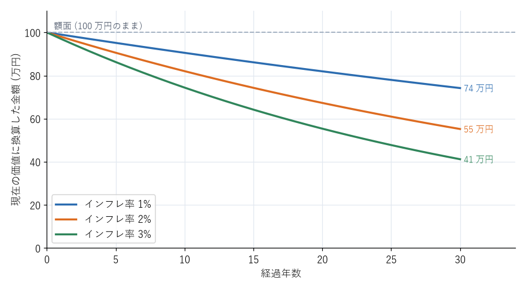

なぜ投資を考えるのか
====================

預貯金は元本が保証され、いつでも引き出せる。それでも投資を考える理由は何か。本章では、物価の上昇、老後の生活資金、時間の効果の 3 つの観点から説明する。同時に、投資には価格が下がるリスクがあることも確認する。

物価が上がるとお金の価値は下がる
--------------------------------

物価が全体として上がり続けることを\ **インフレーション**\ （インフレ）という。インフレが起きると、同じ金額で買えるものが少なくなる。つまり、額面が変わらなくても、お金の実質的な価値は下がる。

日本では長い間、物価がほとんど上がらない時期が続いたが、2022 年以降は消費者物価の上昇率が年 2 % を超える年が続いている。日本銀行も、物価上昇率年 2 % を安定的に実現することを目標に掲げている。

:numref:`fig-inflation` は、100 万円を金利がほぼ付かない預金に置いたままにした場合に、その実質的な価値（現在の物価に換算した価値）がどう変わるかを示す。年 2 % のインフレが 30 年続くと、100 万円の価値は現在の約 55 万円分に下がる。

.. _fig-inflation:

   インフレ率別の預金 100 万円の実質価値の推移（預金金利を 0 % とした場合）

預金の金利がインフレ率より低い状態が続けば、預金だけで資産を持つことは、元本が減らない代わりに実質的な価値が少しずつ減ることを意味する。投資は、この目減りを補い、インフレに負けない資産を持つ手段の 1 つである。

老後の生活資金を考える
----------------------

会社員が老後に受け取る公的年金は、国民年金（基礎年金）と厚生年金の 2 階建てになっている。公的年金は、生きている限り受け取れ、物価や賃金の変動に応じて金額が改定される点で、老後の生活を支える最も重要な収入源である。

一方で、公的年金だけで現役時代と同じ水準の生活を送ることは難しい場合が多い。2019 年に金融庁の金融審議会市場ワーキング・グループがまとめた報告書は、高齢の夫婦の無職世帯の平均的な家計では、年金などの収入に対して支出が毎月約 5 万円多く、30 年間で約 2,000 万円の不足が生じるという試算を示した。これがいわゆる「老後 2,000 万円問題」である。

この試算は、特定の年の統計の平均値に基づくものであり、すべての人に 2,000 万円が必要という意味ではない。必要な額は、年金の受給額、住居（持ち家か賃貸か）、生活水準、退職金の有無などによって大きく異なる。大切なのは、自分の場合はいくら必要かを見積もることである。

自分の年金の見込み額は、次の方法で確認できる。

* 毎年誕生月に届く「ねんきん定期便」を見る。
* 日本年金機構の「ねんきんネット」で、将来の受給見込み額を試算する。
* 厚生労働省の「公的年金シミュレーター」で、働き方や受給開始年齢を変えた場合の金額を試算する。

時間を味方にする
----------------

投資で得た利益を元本に加えて運用を続けると、利益がさらに利益を生む。これを\ **複利**\ という（第 4 章で詳しく説明する）。複利の効果は、運用する期間が長いほど大きくなる。

例えば、毎月 3 万円を年 5 % で運用できたと仮定すると、30 年後の元本 1,080 万円は約 2,456 万円になる。同じ 30 年後に同じ金額を用意したい場合、始めるのが 10 年遅れると、毎月の積立額を大きく増やさなければならない。投資では、早く始めて長く続けることが、金額の大きさと同じくらい重要である。

ただし、「年 5 % で運用できた」というのは仮定であり、実際の運用成果は年によって大きく上下する。年 5 % は、世界中の株式に分散投資した場合の長期的な平均として、控えめに見積もった値の一例である。

投資には価格が下がるリスクがある
--------------------------------

投資する資産の価格は、上がることもあれば下がることもある。株式に投資した場合、1 年で資産が 30〜50 % 減ることも珍しくない。例えば 2008 年のリーマン・ショックでは、世界の株式市場の価格がおよそ半分になった。

投資をするということは、このような価格の下落を受け入れる代わりに、長期的には預貯金よりも高いリターンを期待するということである。価格の下落に耐えられない資金を投資に回すべきではない理由は、ここにある。

「投資しない」こともリスクである
--------------------------------

ここまでの内容をまとめると、預貯金と投資にはそれぞれ次のような特徴がある。

.. list-table:: 預貯金と投資の比較
   :header-rows: 1
   :widths: 20 40 40

   * - 観点
     - 預貯金
     - 投資（株式などに分散投資）
   * - 額面の元本
     - 保証される（預金保険の範囲内）
     - 保証されない。短期的に大きく減ることがある
   * - インフレへの対応
     - 金利がインフレ率より低いと、実質的な価値が減る
     - 長期的にはインフレ率を上回るリターンが期待できる
   * - 引き出しやすさ
     - いつでも額面どおり引き出せる
     - 換金できるが、そのときの価格になる
   * - 向いている用途
     - 生活防衛資金、近いうちに使うお金
     - 10 年以上先に使うお金

預貯金だけで資産を持つことは「価格が下がるリスク」を避ける代わりに、「インフレで価値が目減りするリスク」と「資産が増えないリスク」を負うことになる。どちらか一方だけを選ぶのではなく、用途に応じて両方を組み合わせることが大切である。

まとめ
------

* インフレが続くと、預貯金の実質的な価値は下がる。
* 公的年金は老後の生活の柱であるが、それだけで足りるかは人によって異なる。ねんきん定期便などで見込み額を確認する。
* 複利の効果は期間が長いほど大きい。早く始めて長く続けることが重要である。
* 投資には価格が下がるリスクがある。投資するのは、長期間使う予定のないお金に限る。
