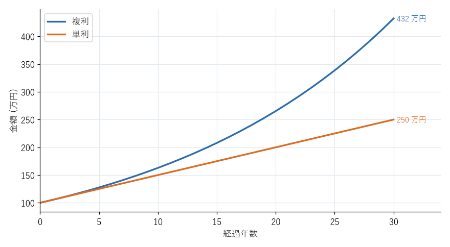
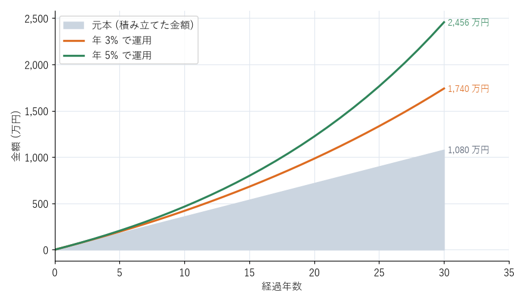
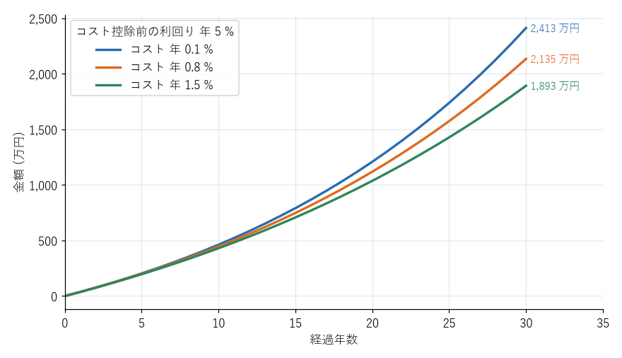

お金の基礎知識
==============

投資の判断には、いくつかの基本的な計算の考え方が必要になる。本章では、単利と複利、72 の法則、名目と実質、リターンとリスク、手数料の影響を説明する。

単利と複利
----------

利息の付き方には、単利と複利の 2 種類がある。

* **単利**：最初の元本にだけ利息が付く。
* **複利**：元本に、それまでに付いた利息を加えた額に利息が付く。

元本を :math:`P`、年利回りを :math:`r`、年数を :math:`n` とすると、:math:`n` 年後の金額は次のようになる。

.. math::

   \text{単利：} \quad P \times (1 + r \times n)

.. math::

   \text{複利：} \quad P \times (1 + r)^n

:numref:`fig-compound` は、100 万円を年 5 % で運用した場合の単利と複利の比較である。30 年後、単利では 250 万円であるのに対し、複利では約 432 万円になる。最初の数年はほとんど差がないが、年数がたつほど差が広がっていく。

.. _fig-compound:

   100 万円を年 5 % で運用した場合の単利と複利の比較

株式や投資信託で得た利益は、売却したり分配金を受け取ったりしない限り、そのまま資産の中で運用が続くため、複利と同じ効果が生じる。分配金を受け取らずに再投資する設定が推奨されるのは、このためである。

72 の法則
---------

資産が 2 倍になるまでのおおよその年数は、次の式で求められる。これを\ **72 の法則**\ という。

.. math::

   \text{2 倍になるまでの年数} \approx \frac{72}{\text{年利回りの数値}}

ここで、年利回りの数値には、% を付けない値を使う（年 6 % なら 6）。例えば、年 6 % なら約 12 年、年 3 % なら約 24 年、年 0.1 % なら約 720 年で 2 倍になる。

この法則は逆向きにも使える。年 2 % のインフレが続くと、約 36 年でお金の価値は半分になる。また、年 15 % の金利で借入れをすると、返済しなければ約 5 年で借入額が 2 倍になる。

名目と実質
----------

金額の表面上の値を\ **名目**\ 、物価の変動を考慮した値を\ **実質**\ という。資産が増えたかどうかは、実質で判断する必要がある。

実質的な利回りは、おおよそ次の式で求められる。

.. math::

   \text{実質利回り} \approx \text{名目利回り} - \text{インフレ率}

例えば、預金の金利が年 0.2 %、インフレ率が年 2 % なら、実質利回りは約 -1.8 % である。額面は増えていても、買えるものは減っている。逆に、投資で年 5 % のリターンを得ても、インフレ率が年 2 % なら、実質的な増え方は約 3 % である。

リターンとリスク
----------------

投資で得られる収益を\ **リターン**\ という。リターンには、資産の価格の値上がり益と、配当金・分配金・利息などの収入がある。

投資の世界でいう\ **リスク**\ は、「危険」や「損失」そのものではなく、\ **リターンのばらつきの大きさ**\ を指す。リターンが大きく上下する資産は「リスクが大きい」、あまり変動しない資産は「リスクが小さい」という。

リスクの大きさは、一般に\ **標準偏差**\ という統計の指標で表す。年間リターンの平均が 5 %、標準偏差が 18 % の資産であれば、おおむね 3 年に 2 年は、その年のリターンが -13 %〜23 % の範囲に収まり、20 年に 1 年程度は -31 % を下回るか 41 % を上回る、という目安になる（リターンが正規分布に従うと仮定した場合）。

リターンとリスクには、次の関係がある。

* 高いリターンが期待できる資産ほど、リスクも大きい。
* リスクが小さく、高いリターンが確実に得られる投資は存在しない。

「元本保証で高利回り」をうたう投資話は、この原則に反する。詐欺を疑うべきである（第 14 章で説明する）。

積立投資の効果
--------------

毎月一定額を積み立てて運用する場合も、複利の効果は働く。:numref:`fig-accumulation` は、毎月 3 万円を 30 年間積み立てた場合の残高を、年利回りごとに示したものである。元本は 1,080 万円であるが、年 3 % で運用できれば約 1,740 万円、年 5 % なら約 2,456 万円になる。

.. _fig-accumulation:

   毎月 3 万円を 30 年間積み立てた場合の残高（毎年一定の利回りで運用できたと仮定）

実際には毎年のリターンは上下するため、残高はこのように滑らかには増えない。積立期間の途中で残高が元本を下回る時期があることも想定しておく必要がある。

この試算は、付録の\ :doc:`examples`\ で紹介するスクリプトで、積立額・利回り・期間を変えて試すことができる。

手数料が成果に与える影響
------------------------

投資信託には、保有している間ずっと差し引かれる\ **信託報酬**\ （運用管理費用）がかかる。年 1 % の違いは小さく見えるが、長期間の運用では大きな差になる。

:numref:`fig-cost` は、コストを引く前の利回りを年 5 % とし、毎月 3 万円を 30 年間積み立てた場合に、年率のコストが最終的な残高にどう影響するかを示したものである。コストが年 0.1 % なら約 2,413 万円であるのに対し、年 1.5 % では約 1,893 万円となり、約 520 万円の差が生じる。

.. _fig-cost:

   年率コストの違いによる最終残高の差（毎月 3 万円、30 年間）

投資の将来のリターンは誰にも分からないが、コストは事前に分かり、確実に差し引かれる。同じような資産に投資する商品であれば、コストの低いものを選ぶことが、成果を高める最も確実な方法である。

まとめ
------

* 複利では、利益がさらに利益を生む。期間が長いほど効果が大きい。
* 72 を年利回り（%）で割ると、資産が 2 倍になるまでのおおよその年数が分かる。
* 資産の増え方は、インフレ率を差し引いた実質で考える。
* 投資のリスクとは、リターンのばらつきの大きさである。高いリターンを期待するほど、リスクも大きくなる。
* 手数料は確実に成果を減らす。長期投資ではコストの低い商品を選ぶ。
