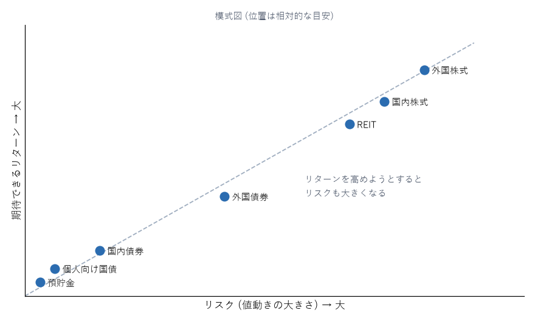

金融商品の種類
==============

本章では、一般の人が利用する主な金融商品の仕組みと特徴を説明する。それぞれの商品が、リターンとリスクの点でどのような位置にあるかを理解することが目的である。

リスクとリターンの位置関係
--------------------------

:numref:`fig-risk-return` は、主な金融商品のリスクとリターンの位置関係を模式的に示したものである。右上にある商品ほど、期待できるリターンが高い代わりに、値動きも大きい。

.. _fig-risk-return:

   主な金融商品のリスクとリターンの位置関係（模式図）

この図の位置は一般的な傾向を示す目安であり、時期や個別の商品によって変わる。例えば外国債券は、債券そのものの値動きは小さくても、為替の変動によって円で見た価格が大きく動くため、国内債券よりリスクが大きくなる。

預貯金
------

銀行などに預けるお金である。普通預金はいつでも引き出せ、定期預金は一定期間預ける代わりに金利がやや高い。

* 元本と利息は、預金保険制度により、1 つの金融機関につき 1 人あたり元本 1,000 万円までとその利息が保護される。
* 金利は低く、インフレ率を下回ることが多い。
* 生活防衛資金や、近いうちに使うお金を置く場所に向いている。

債券
----

**債券**\ は、国や企業がお金を借りるために発行する証書である。債券を買うことは、発行体にお金を貸すことにあたる。満期まで持てば、発行体が破綻しない限り、定期的に利息を受け取り、満期に額面の金額が返ってくる。

満期の前に売却する場合は、そのときの市場価格で売ることになる。一般に、金利が上がると既に発行された債券の価格は下がり、金利が下がると価格は上がる。

**個人向け国債**\ は、日本国が個人向けに発行する債券で、次の特徴がある。

* 1 万円から購入でき、元本と利息の支払いは国が行う。
* 「変動 10 年」「固定 5 年」「固定 3 年」の 3 種類がある。変動 10 年は、市場の金利に合わせて半年ごとに適用金利が見直される。
* 金利には最低保証（年 0.05 %）がある。
* 発行から 1 年たてば、いつでも国に買い取ってもらえる（中途換金）。このとき、直前 2 回分の利息に相当する額（税引き後）が差し引かれるが、元本割れはしない。

価格が変動しない点で預貯金に近く、預貯金と並ぶ\ **無リスク資産**\ （元本が減らない資産）の候補になる。

株式
----

**株式**\ は、企業に出資した証明である。株式を持つと、企業の利益の一部を配当金として受け取ったり、企業の成長によって株価が上がったときに値上がり益を得たりできる。

* 長期的には、債券や預貯金より高いリターンが期待できる。経済が成長し、企業の利益が増えるにつれて、株式の価値も高まる傾向があるためである。
* 一方で、価格の変動は大きい。景気の悪化などで、株価が 1 年で半分近くになることもある。
* 個別の企業の株式は、その企業が経営破綻すれば価値がほぼなくなる。

個別株式への投資は、銘柄選びに知識と時間が必要であり、少数の銘柄に集中するとリスクが大きくなる。一般の人が株式に投資するなら、次に説明する投資信託を使って多数の企業に分散するのが基本である。

投資信託
--------

**投資信託**\ （ファンド）は、多くの投資家から集めたお金をまとめて、専門家が株式や債券などに投資・運用する商品である。少額で多数の銘柄に分散投資できるため、一般の人の資産形成の中心となる。

投資信託には、:numref:`fig-fund-structure` のように、販売会社・運用会社・信託銀行の 3 者が関わる。

.. _fig-fund-structure:

.. graphviz::
   :caption: 投資信託の仕組み
   :align: center

   digraph fund_structure {
       rankdir=LR;
       node [shape=box, style="rounded,filled", fillcolor="#ebf8ff", color="#2b6cb0", fontsize=11];
       edge [color="#4a5568", fontsize=10];

       investor [label="投資家", fillcolor="#fefcbf", color="#b7791f"];
       seller [label="販売会社\n（証券会社・銀行など）\n販売と口座管理"];
       manager [label="運用会社\n（投資信託委託会社）\n何に投資するかを決める"];
       trustee [label="信託銀行\n（受託会社）\n資産を保管・管理する"];
       market [label="市場\n（株式・債券など）", fillcolor="#c6f6d5", color="#2f855a"];

       investor -> seller [label="購入代金"];
       seller -> trustee [label="資金"];
       manager -> trustee [label="運用の指図"];
       trustee -> market [label="売買"];
   }

投資家が払ったお金は信託銀行で分別して保管される。そのため、販売会社や運用会社が経営破綻しても、投資信託の資産そのものは守られる。ただし、投資信託は元本が保証される商品ではなく、投資先の価格が下がれば基準価額（投資信託の 1 口あたりの価格）も下がる。

投資信託にかかる主なコストは次のとおりである。

.. list-table:: 投資信託にかかる主なコスト
   :header-rows: 1
   :widths: 25 25 50

   * - 名称
     - かかる時期
     - 内容
   * - 購入時手数料
     - 購入するとき
     - 販売会社に払う。無料（ノーロード）の商品も多い
   * - 信託報酬（運用管理費用）
     - 保有している間、毎日
     - 運用会社・販売会社・信託銀行に払う。基準価額から自動的に差し引かれる
   * - 信託財産留保額
     - 売却するとき
     - 解約による運用への影響を、売却する人が負担する。かからない商品も多い

投資信託は、運用の方針によって大きく 2 種類に分けられる。指数（インデックス）と同じ値動きを目指す\ **インデックスファンド**\ と、指数を上回る成果を目指す\ **アクティブファンド**\ である。この違いは第 7 章で説明する。

ETF（上場投資信託）
-------------------

**ETF**\ は、証券取引所に上場している投資信託である。株式と同じように、取引時間中に市場の価格でいつでも売買できる。多くの ETF は指数に連動するインデックス型であり、信託報酬が低いものが多い。

一方で、売買のたびに証券会社の売買手数料がかかる場合があること、分配金が自動的に再投資されないこと、少額での定額積立に対応していない場合があることなどから、毎月の積立には一般の投資信託のほうが使いやすいことが多い。

REIT（不動産投資信託）
----------------------

**REIT**\ は、投資家から集めたお金でオフィスビル・商業施設・マンションなどの不動産を購入し、賃料収入や売却益を投資家に分配する商品である。少額で不動産に間接的に投資でき、証券取引所で売買できる。株式に近い値動きをすることが多い。

外貨建て資産
------------

外国の株式・債券や外貨預金など、外国の通貨で運用する資産である。円で見た価値は、資産そのものの値動きに加えて、為替レートの変動によっても変わる。

* 円安になる（外国の通貨の価値が上がる）と、円で見た価値は増える。
* 円高になると、円で見た価値は減る。

投資信託を通じて外国の株式などに投資する場合も、同じように為替の影響を受ける。為替の影響を抑える\ **為替ヘッジ**\ を行う商品もあるが、ヘッジにはコストがかかり、日本と外国の金利差が大きいときにはそのコストも大きくなる。

外貨預金は、為替の手数料が高めに設定されていることが多く、預金保険の対象外である点にも注意が必要である。

金（ゴールド）
--------------

金は、利息や配当を生まないが、通貨の価値が下がるインフレ時や、金融市場が混乱したときに値上がりすることがある。資産の一部として持つ考え方もあるが、それ自体が利益を生む資産ではないため、長期的なリターンは株式に及ばないと考えられている。

貯蓄型の保険
------------

終身保険、学資保険、個人年金保険、外貨建て保険、変額保険など、保障と貯蓄を組み合わせた保険である。

* 保険料の一部は、保障や保険会社の経費に充てられるため、払った保険料のすべてが運用に回るわけではない。
* 早期に解約すると、受け取る解約返戻金が払った保険料を下回ることが多い。
* 手数料の総額や実質的な利回りが分かりにくい。

資産形成の手段としては、保障は掛け捨ての保険で必要な分だけ確保し、資産形成は NISA などで低コストの投資信託を使う方法と比較してから判断する。

投機性の高い取引
----------------

次の取引は、一般の人の長期の資産形成には向かない。

.. list-table:: 投機性の高い取引
   :header-rows: 1
   :widths: 25 75

   * - 取引
     - 主な注意点
   * - FX（外国為替証拠金取引）
     - 預けた証拠金の何倍もの金額を取引でき（レバレッジ）、短期間で証拠金を失うことがある。通貨の売買そのものは、長期的に価値を生む資産ではない
   * - 暗号資産
     - 価格の変動が非常に大きい。発行体の利益や利息のような価値の裏付けがない。交換業者の破綻や不正アクセスによる流出の事例がある
   * - 信用取引・先物・オプション
     - レバレッジにより、預けた金額以上の損失が生じることがある
   * - 個別株式の短期売買
     - 売買のたびに手数料と税金がかかり、多くの個人投資家は市場の平均を下回る成果に終わる

これらに手を出す場合も、失っても生活に影響しない少額に限るべきである。

まとめ
------

* 預貯金と個人向け国債は、元本が減らない無リスク資産である。
* 株式は長期的に高いリターンが期待できるが、価格の変動が大きい。
* 投資信託を使えば、少額で多数の銘柄に分散投資できる。
* 外貨建て資産は為替の影響を受ける。
* 貯蓄型の保険は、保障と資産形成を分けた場合と比較してから判断する。
* FX や暗号資産などの投機性の高い取引は、長期の資産形成には向かない。
