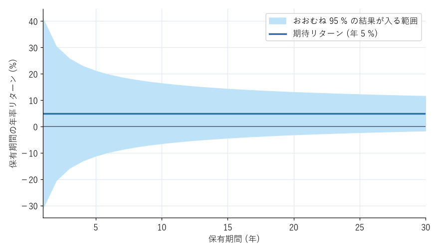

リスクとの付き合い方
====================

投資のリスクは避けられないが、減らしたり、耐えられる大きさに調整したりすることはできる。本章では、リスクの種類と、分散・長期・リスク許容度という考え方を説明する。

リスクの種類
------------

投資の成果に影響する主なリスクには、次のようなものがある。

.. list-table:: 主なリスクの種類
   :header-rows: 1
   :widths: 25 75

   * - 名称
     - 内容
   * - 価格変動リスク
     - 株式や債券などの価格が、景気や企業の業績、金利などによって変動するリスク
   * - 為替変動リスク
     - 外貨建て資産の円で見た価値が、為替レートの変動によって変わるリスク
   * - 信用リスク
     - 債券の発行体や企業が破綻し、元本や利息が支払われなくなるリスク
   * - 金利変動リスク
     - 金利の変動によって債券の価格が変わるリスク
   * - 流動性リスク
     - 売りたいときに、適正な価格で売れないリスク
   * - インフレリスク
     - 物価の上昇によって、資産の実質的な価値が下がるリスク

価格変動リスクや為替変動リスクのように、経済全体の動きによって生じるリスクは、分散しても完全には消せない。一方、特定の企業の破綻のように、個別の事情によって生じるリスクは、分散によって大きく減らせる。

分散する
--------

「卵を 1 つのかごに盛るな」という格言がある。1 つのかごに全部の卵を入れると、かごを落としたときにすべて割れてしまうが、複数のかごに分けておけば被害を抑えられる。投資における分散も同じ考え方であり、次の 3 つの方向がある。

.. list-table:: 分散の方向
   :header-rows: 1
   :widths: 25 75

   * - 分散の方向
     - 内容
   * - 資産の分散
     - 株式・債券・預貯金など、値動きの異なる資産を組み合わせる
   * - 地域・銘柄の分散
     - 日本だけでなく、先進国や新興国など世界中の多数の企業に投資する
   * - 時間の分散
     - 一度にまとめて買うのではなく、時期を分けて少しずつ買う

1 つの国の株式市場が長期間低迷することは実際に起きている。日本の株式市場の代表的な指数である日経平均株価は、1989 年末に 38,915 円の最高値を付けた後、大きく下落し、この最高値を再び上回ったのは 2024 年 2 月であった。この間、日本株式だけに投資していた人は、30 年以上にわたって最高値の水準を取り戻せなかったことになる（配当を含めた投資の成果は、この株価の推移よりは良い）。世界中に分散していれば、特定の国の低迷による影響を抑えられる。

**ドル・コスト平均法**\ （時間の分散の代表的な方法）とは、毎月一定の金額で同じ商品を買い続ける方法である。価格が高いときには少ない口数を、価格が安いときには多くの口数を買うことになる。この方法は、まとまった資金を一度に投資する方法と比べて、必ずしも成果が高くなるわけではない。しかし、「高値で一度に買ってしまう」ことを避けられ、相場を予想する必要がないため、毎月の給与から投資する一般の人にとっては実践しやすい方法である。

長期で保有する
--------------

株式の 1 年ごとのリターンは大きく上下するが、保有期間を長くすると、年率に直したリターンのばらつきは小さくなる。良い年と悪い年が平均されるためである。

:numref:`fig-holding-period` は、年率の期待リターンが 5 %、標準偏差が 18 % の資産を仮定し、保有期間ごとの年率リターンのばらつきを理論的に計算したものである。保有期間が 1 年の場合、結果の範囲はマイナス 30 % 程度からプラス 40 % 程度まで広がるが、保有期間が 20 年になると、多くの場合はプラスの範囲に収まる。

.. _fig-holding-period:

   保有期間と年率リターンのばらつきの関係（理論値による模式図）

ただし、長期で保有すれば必ず利益が出るわけではない。年率のばらつきは小さくなっても、ゼロにはならない。また、先に挙げた日本の株式市場のように、特定の市場が長期間低迷する例もある。長期保有の効果は、世界中への分散と組み合わせてこそ発揮される。

過去の暴落と回復
----------------

株式市場は、過去に何度も大きな下落を経験している。

.. list-table:: 過去の主な暴落（世界の株式市場）
   :header-rows: 1
   :widths: 25 20 55

   * - 出来事
     - 時期
     - 概要
   * - IT バブルの崩壊
     - 2000〜2002 年
     - インターネット関連企業への過度な期待がしぼみ、世界の株価が約半分になった
   * - リーマン・ショック
     - 2007〜2009 年
     - 米国の住宅バブルの崩壊から金融危機に発展し、世界の株価が半分以下になった
   * - 新型コロナウイルス感染症の拡大
     - 2020 年
     - 約 1 か月で世界の株価が 3 割以上下落したが、同じ年のうちに下落前の水準を回復した

これらの暴落の後、世界の株式市場は数か月から数年かけて回復し、その後さらに上昇した。ただし、回復にかかる期間は事前には分からず、将来も同じように回復する保証はない。

投資を続ける上で重要なのは、このような暴落が数年から十数年に一度は起きるものと考え、起きたときに慌てて売らないことである。暴落時に売却すると、損失が確定し、その後の回復の恩恵を受けられない（第 13 章で説明する）。

リスク許容度を知る
------------------

**リスク許容度**\ とは、どの程度の損失までなら、生活や気持ちに大きな影響を受けずに投資を続けられるかを表す。リスク許容度は、主に次の要素で決まる。

.. list-table:: リスク許容度を決める要素
   :header-rows: 1
   :widths: 30 35 35

   * - 要素
     - リスク許容度が高い
     - リスク許容度が低い
   * - 投資できる期間
     - 長い（使う時期が 15 年以上先）
     - 短い（数年以内に使う）
   * - 収入の安定性
     - 安定している
     - 変動しやすい
   * - 生活防衛資金
     - 十分にある
     - 少ない
   * - 投資に回す資金の割合
     - 資産全体の一部
     - 資産のほとんど
   * - 性格・経験
     - 価格の下落を冷静に受け止められる
     - 価格の下落が気になって眠れない

自分のリスク許容度を知るための簡単な方法は、「投資した金額が一時的に半分になったとき、売らずに持ち続けられるか」を考えてみることである。株式に 100 万円投資していれば、暴落時には 50 万円程度に減ることがある。そのときに売ってしまいそうなら、株式に投資する金額を減らし、無リスク資産の割合を増やす（第 8 章で説明する）。

リスク許容度は、年齢や家族構成、収入、資産額の変化によって変わる。数年に一度、あるいは大きな生活の変化があったときに見直すとよい。

まとめ
------

* 投資には、価格変動・為替変動・信用・金利変動・流動性・インフレなどのリスクがある。
* 資産・地域・時間を分散すると、リスクを減らせる。
* 長期で保有すると、年率リターンのばらつきは小さくなる。ただし、利益が保証されるわけではない。
* 暴落は数年から十数年に一度は起きるものと考え、慌てて売らない。
* 自分のリスク許容度に合った金額だけを、価格が変動する資産に投資する。
