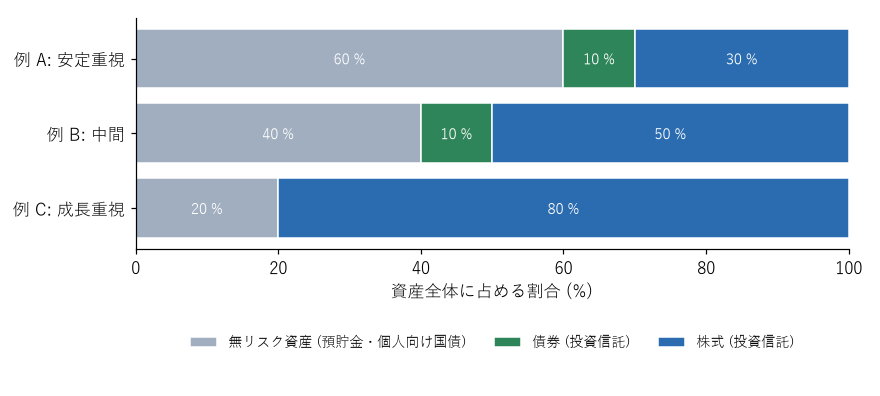

資産配分
========

投資の成果を最も大きく左右するのは、どの銘柄を選ぶかよりも、資産全体をどの種類の資産にどれだけ配分するかである。この配分を\ **資産配分**\ （アセット・アロケーション）という。本章では、一般の人に向いた資産配分の考え方を説明する。

無リスク資産とリスク資産に分ける
--------------------------------

資産配分を考える最も簡単な方法は、資産全体を次の 2 つに分けることである。

.. list-table:: 無リスク資産とリスク資産
   :header-rows: 1
   :widths: 20 40 40

   * - 種類
     - 例
     - 役割
   * - 無リスク資産
     - 預貯金、個人向け国債
     - 価格が下がらない。生活防衛資金や、近いうちに使うお金を置く。リスク資産の下落時に資産全体の目減りを抑える
   * - リスク資産
     - 株式や債券に投資する投資信託
     - 価格は変動するが、長期的に資産を増やす

リスクの大きさは、主に「リスク資産の割合」で調整する。リスク資産として何を持つかは、全世界株式のインデックスファンド 1 本でも十分に分散できる。リスクを下げたいときは、リスク資産の中身を変えるよりも、無リスク資産の割合を増やすほうが分かりやすい。

債券をどう考えるか
------------------

債券のインデックスファンドは、株式より値動きが小さく、株式と異なる値動きをすることが多いため、資産全体の値動きを穏やかにする役割がある。

ただし、日本の個人にとっては、預貯金や個人向け国債が債券に近い役割を果たせる。個人向け国債は価格が下がらず、金利が上がれば適用金利も上がる（変動 10 年の場合）。そのため、リスク資産は株式の投資信託だけにし、安全な部分は預貯金や個人向け国債で持つという考え方もある。

外国債券のファンドは為替の影響を受けるため、資産全体の値動きを穏やかにする効果は、国内の無リスク資産より小さい。債券のファンドを使うかどうかは、自分が管理しやすい方法で決めればよい。

資産配分の例
------------

:numref:`fig-allocation` は、資産配分の例である。これらは考え方を示すための例であり、推奨する配分ではない。

.. _fig-allocation:

   資産配分の例（資産全体に占める割合）

.. list-table:: 資産配分の例と想定する状況
   :header-rows: 1
   :widths: 20 40 40

   * - 例
     - 想定する状況
     - 暴落時（株式が半分になった場合）の資産全体の減り方
   * - 例 A：安定重視
     - 投資を始めたばかりで値動きに慣れていない、数年以内に大きな支出の予定がある、定年が近い
     - 約 15〜20 %
   * - 例 B：中間
     - 収入が安定していて、生活防衛資金も十分にある
     - 約 25〜30 %
   * - 例 C：成長重視
     - 若く、投資できる期間が長い。値動きを冷静に受け止められる
     - 約 40 %

暴落時の減り方は、株式の部分が半分になり、債券の部分が多少下がると仮定した場合の目安である。例えば例 C では、資産の 80 % を占める株式が半分になると、資産全体は約 40 % 減る。自分の資産全体が、この程度減っても投資を続けられるかを考えて、配分を決める。

年齢による目安として、「100 から年齢を引いた数を株式の割合（%）にする」という考え方が紹介されることがある。単純で分かりやすいが、年齢だけでリスク許容度は決まらない。第 6 章で説明したように、収入の安定性、生活防衛資金、投資できる期間、性格なども考慮して決める。

リバランス
----------

資産の価格が変動すると、資産配分は当初決めた比率からずれていく。株式が値上がりすれば株式の割合が増え、値下がりすれば減る。ずれた比率を元に戻すことを\ **リバランス**\ という。

リバランスには、次の方法がある。

* **積立先の調整**：割合が減った資産を、毎月の積立や追加の資金で多めに買う。売却しないため、税金や手数料がかからない。
* **売却と購入**：割合が増えた資産を売り、割合が減った資産を買う。課税口座で利益が出ている資産を売ると、税金がかかる。

リバランスは、年に 1 回など時期を決めて行うか、比率が当初から 5 ポイント以上ずれたときに行うなど、自分なりの規則を決めておくとよい。頻繁に行う必要はない。

リバランスには、値上がりした資産を売り、値下がりした資産を買うことになるため、結果として「高く売って安く買う」行動になるという面もある。ただし、主な目的はリスクの大きさを当初の水準に保つことである。

まとめ
------

* 資産配分は、投資の成果とリスクを最も大きく左右する。
* 資産全体を無リスク資産とリスク資産に分け、リスク資産の割合でリスクを調整する。
* 株式が半分になったときに資産全体がどれだけ減るかを考え、耐えられる配分にする。
* 比率がずれたら、積立先の調整などでリバランスを行う。
