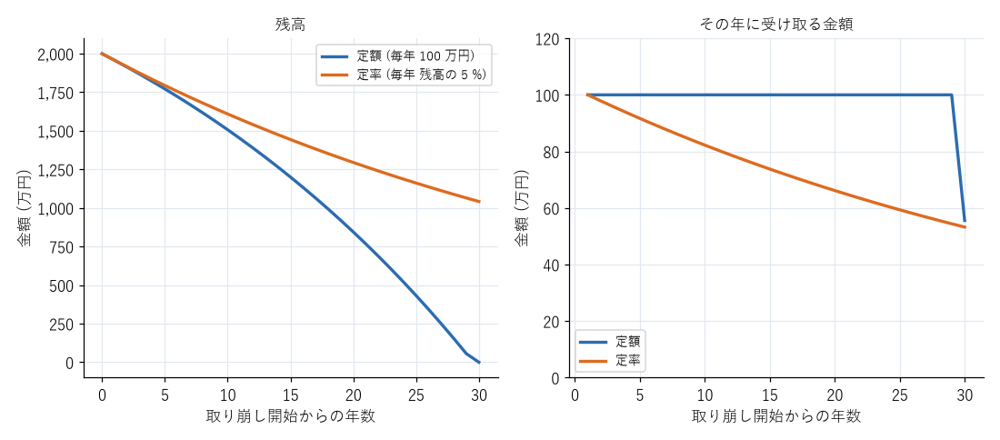

続け方と出口
============

長期投資で最も難しいのは、始めることよりも続けることである。本章では、相場が大きく下がったときの考え方、生活の変化への対応、資産を取り崩す時期の考え方、相続の基礎を説明する。

暴落時の行動
------------

投資を続けていれば、いつか必ず資産が大きく減る時期が来る。そのときに取るべき行動は、原則として「何もしない」ことである。

* **売らない**：下落時に売却すると、損失が確定する。過去の暴落では、その後に市場が回復しており、売ってしまった人は回復の恩恵を受けられなかった。
* **積立を止めない**：積立を続けていれば、価格が安いときに多くの口数を買うことになる。価格が回復したときには、その分の効果が得られる。
* **資産配分を確認する**：株式が大きく下がると、資産全体に占める株式の割合が減る。計画した配分から大きくずれた場合は、リバランスを行う。

暴落時に不安になるのは自然なことである。不安で投資を続けられない場合は、相場が落ち着いた後に、リスク資産の割合を減らすことを検討する。それは、第 6 章で説明したリスク許容度を、実際の経験を通じて知ったということである。

暴落時の不安に備えるには、平常時に次のことをしておくとよい。

* 自分の資産配分で、暴落時にどれだけ資産が減るかを計算しておく（第 8 章）。
* 生活防衛資金を確保しておく。急な出費があっても、下落したリスク資産を売らずに済む。
* 自分がなぜこの方針で投資しているかを、メモに書き残しておく。

見直しのタイミング
------------------

投資の方針は、頻繁に変える必要はない。見直すのは次のような場合である。

.. list-table:: 見直しのタイミングと確認する内容
   :header-rows: 1
   :widths: 30 70

   * - タイミング
     - 確認する内容
   * - 年に 1 回
     - 資産配分のずれ、積立額が家計に合っているか
   * - 結婚・出産
     - 生活防衛資金の額、教育費の準備、保険の見直し
   * - 転職・退職
     - 企業型 DC の資産の移換、iDeCo の掛金の上限、収入の変化に応じた積立額
   * - 住宅の購入
     - 頭金に使う資金の確保、住宅ローンの返済と積立の両立
   * - 定年が近づいたとき
     - 資産配分（リスク資産の割合）、取り崩しの計画、iDeCo の受け取り方

住宅の頭金や教育費のように使う時期が決まっているお金は、使う時期の 5 年ほど前から、少しずつ無リスク資産に移していくと、直前の暴落で予定が狂うことを防げる。

取り崩しの考え方
----------------

老後など、資産を使う時期が来たら、資産を少しずつ取り崩して生活費に充てる。資産を一度にすべて売却する必要はない。残りの資産は運用を続けながら、必要な分だけ売却するのが基本である。

取り崩しの方法には、主に次の 2 つがある。

.. list-table:: 取り崩しの方法
   :header-rows: 1
   :widths: 20 40 40

   * - 方法
     - 長所
     - 短所
   * - 定額方式（毎年同じ金額を引き出す）
     - 受け取る額が一定で、生活の計画を立てやすい
     - 運用成果が悪いと、資産が早く尽きることがある
   * - 定率方式（毎年、残高の一定割合を引き出す）
     - 資産が尽きにくい
     - 受け取る額が年によって変わり、相場が悪いと大きく減る

:numref:`fig-withdrawal` は、2,000 万円の資産を年 3 % で運用しながら、定額方式（毎年 100 万円）と定率方式（毎年残高の 5 %）で取り崩した場合の比較である。定額方式では 29 年目までは毎年 100 万円を受け取れるが、30 年目に資産が尽きる。定率方式では、30 年後も約 1,040 万円の資産が残るが、受け取る額は年々減り、30 年目には約 53 万円になる。

.. _fig-withdrawal:

   定額方式と定率方式の取り崩しの比較（2,000 万円を年 3 % で運用した場合）

実際には、最初は定率方式で資産を長持ちさせ、高齢になってから定額方式に切り替える、といった組み合わせも考えられる。

米国では、引退後に資産の 4 % を毎年取り崩せば、30 年間資産が尽きる可能性は低いという研究（いわゆる「4 % ルール」）が知られている。ただし、これは過去の米国の市場のデータに基づく研究であり、日本で、将来も同じ結果になるとは限らない。目安の 1 つと考える。

取り崩しの計画を立てるときは、公的年金の受給額を土台にし、不足する分を資産の取り崩しで補うと考える。公的年金は、受給開始を 66 歳以降に遅らせる（繰下げ受給）と、1 か月あたり 0.7 % 増額される（75 歳まで遅らせると 84 % 増）。働ける間は働き、その間は資産を取り崩さずに年金の受給開始を遅らせることも、老後の資金を長持ちさせる方法の 1 つである。

取り崩しの試算は、付録の\ :doc:`examples`\ で紹介するスクリプトで、条件を変えて試すことができる。

相続の基礎
----------

投資した資産を持ったまま亡くなった場合、その資産は相続財産になる。

* 課税口座で保有している株式や投資信託は、相続人の口座に移すことができる。
* NISA の口座で保有している資産は、相続人の NISA の口座には移せない。相続時の価格で、相続人の課税口座に移される。
* iDeCo や企業型 DC の資産は、遺族が死亡一時金として受け取る。

家族が、どの金融機関に口座があるかを把握できるように、金融機関名や口座の種類を記録しておくとよい。ネット証券では郵送物がほとんど届かないため、家族が口座の存在に気付かないことがある。

まとめ
------

* 暴落時は、売らず、積立を止めず、資産配分を確認する。
* 生活の大きな変化があったときに、投資の方針を見直す。
* 使う時期が近いお金は、少しずつ無リスク資産に移していく。
* 取り崩しには定額方式と定率方式があり、それぞれ長所と短所がある。公的年金を土台にして計画する。
* 家族のために、金融機関や口座の情報を記録しておく。
