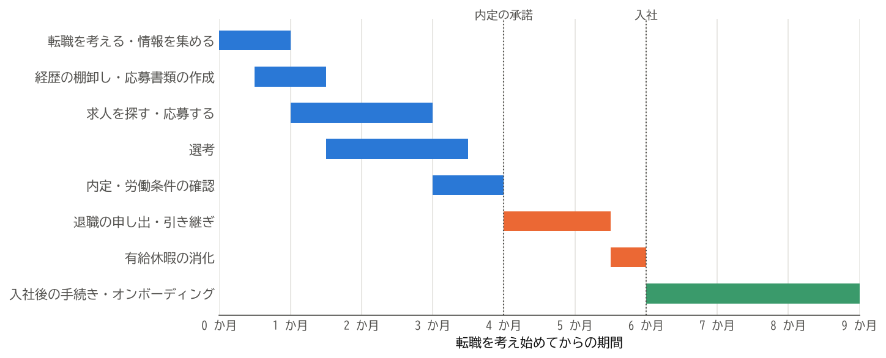

転職の全体像
============

この章では、転職を考え始めてから入社後の数か月までの流れと、各段階のおおよその期間を示す。個々の行動や手続きの詳しい説明は、次の章以降で行う。

転職の流れ
----------

転職の流れは、大きく次の 4 つの段階に分けられる。

.. list-table:: 転職の 4 つの段階
   :header-rows: 1
   :widths: 20 50 30

   * - 段階
     - 主な行動と手続き
     - 詳しい説明
   * - 準備
     - 転職の動機の整理、キャリアの方向性の検討、経歴の棚卸し、応募書類の作成
     - :doc:`03_decision`、:doc:`04_documents`
   * - 転職活動
     - 求人を探す、応募する、選考を受ける、内定を得る、労働条件を確認する
     - :doc:`05_job_search`、:doc:`06_selection`、:doc:`07_offer`
   * - 退職
     - 退職の申し出、引き継ぎ、情報とアカウントの整理、年次有給休暇の消化
     - :doc:`08_resignation`、:doc:`09_information`
   * - 入社
     - 公的な手続き、転職先への書類の提出、入社後の業務への適応
     - :doc:`10_procedures`、:doc:`11_joining`

各段階に必要な期間は、人や状況によって大きく異なる。:numref:`fig-overview` は、在職中に転職活動を行う場合の一例である。

.. _fig-overview:

   転職の流れと各段階の期間の例

この例では、考え始めてから内定を承諾するまでに約 4 か月、内定の承諾から入社までに約 2 か月かかっている。実際には、希望に合う求人がすぐに見つかれば 2〜3 か月で済むこともあれば、なかなか見つからず半年以上かかることもある。

期間を見積もるうえで注意したいのは、次の 2 点である。

* **選考は並行して進む**：複数の会社に応募すると、ある会社の書類選考と別の会社の面接が同時に進む。日程の管理については :numref:`sec-schedule`\ で説明する。
* **内定の承諾から入社までは短くできない**：退職の申し出から退職日までには、引き継ぎと有給休暇の消化の期間が必要になる。転職先には、この期間を考慮した入社日を伝える必要がある（:doc:`07_offer`）。

在職中に活動するか、退職後に活動するか
--------------------------------------

転職活動は、現職で働きながら行う方法と、退職してから行う方法がある。それぞれの特徴は次のとおりである。

.. list-table:: 在職中の活動と退職後の活動の比較
   :header-rows: 1
   :widths: 20 40 40

   * - 観点
     - 在職中に活動する
     - 退職後に活動する
   * - 収入
     - 収入が途切れない。
     - 収入が途切れる。雇用保険の基本手当を受け取れる場合もあるが、自己都合退職では給付制限がある。
   * - 時間
     - 業務と並行するため、活動に使える時間が限られる。面接の日程の調整も難しい。
     - 活動に集中できる。
   * - 心理的な余裕
     - 次が決まらなくても現職を続けられるため、焦らずに選べる。
     - 空白期間が長くなるほど焦りが生じ、条件に妥協しやすくなる。
   * - 選考での見られ方
     - 特に不利になることはない。
     - 空白期間が長いと、その理由を質問されることが多い。
   * - 手続き
     - 退職日の翌日に入社すれば、社会保険の手続きの多くを会社が行う。
     - 健康保険、年金などの切り替えを自分で行う必要がある。

心身の不調などで現職を続けることが難しい場合を除き、本書は\ **在職中に活動する**\ ことを勧める。収入と心理的な余裕を保ったまま、納得できる転職先を選べるからである。本書の説明も、在職中に活動する場合を基本としている。

注意すべき期限
--------------

転職に伴う行動と手続きには、期限が決まっているものがある。主なものを次の表に示す。

.. list-table:: 転職に伴う主な期限
   :name: table-deadlines
   :header-rows: 1
   :widths: 30 40 30

   * - 期限
     - 内容
     - 詳しい説明
   * - 内定の通知から、会社が指定する日まで（数日から 1 週間程度が多い）
     - 内定の承諾または辞退の回答
     - :doc:`07_offer`
   * - 退職日の 2 週間前まで（民法の規定。就業規則で 1 か月前などと定めている場合が多い）
     - 退職の申し出
     - :doc:`08_resignation`
   * - 退職日の翌日（資格喪失日）から 14 日以内（空白期間がある場合）
     - 国民健康保険への加入、国民年金の種別の変更
     - :doc:`10_procedures`
   * - 退職日の翌日（資格喪失日）から 20 日以内（空白期間がある場合）
     - 健康保険の任意継続被保険者の申請
     - :doc:`10_procedures`
   * - 資格喪失日の属する月の翌月から 6 か月以内
     - 企業型 DC（企業型確定拠出年金）の資産の移換（前職で加入していた場合）
     - :doc:`10_procedures`
   * - 入社した年の年末調整まで
     - 前職の源泉徴収票の提出
     - :doc:`10_procedures`、:doc:`11_joining`

まとめ
------

* 転職は「準備」「転職活動」「退職」「入社」の 4 つの段階で進む。
* 考え始めてから入社までは、数か月から半年以上かかることが多い。内定の承諾から入社までにも 1〜2 か月程度を見込む。
* 収入と心理的な余裕を保つため、できるだけ在職中に転職活動を行う。
* 期限のある手続きは、早めに把握しておく。
