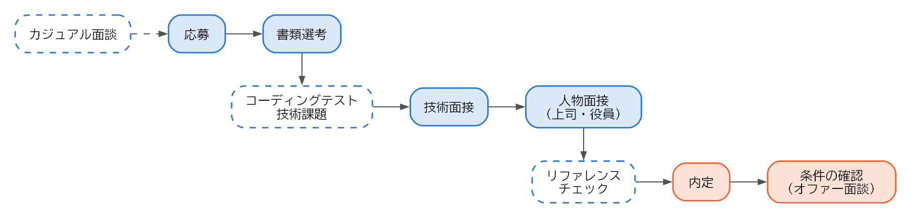

選考
====

この章では、応募してから内定を得るまでの選考の流れと、エンジニアに特有の選考であるコーディングテストや技術面接への準備、選考の期間中に注意すべきことを説明する。

選考の流れ
----------

エンジニアの選考は、:numref:`fig-selection` のような流れで進むことが多い。

.. _fig-selection:

   選考の流れの例

点線の箱は、会社によって行う場合と行わない場合がある段階である。面接の回数は 2〜3 回が多いが、会社によって異なる。応募から内定までの期間は、1 か月程度が一つの目安である。

カジュアル面談
--------------

カジュアル面談は、選考に進む前に、会社と応募を考えている人が互いを知るために話す場である。ダイレクトリクルーティングのスカウトや、技術ブログからの問い合わせをきっかけに行われることが多い。現場のエンジニアや開発チームの責任者が担当することも多く、求人票では分からない実情を聞ける貴重な機会である。

カジュアル面談は、一般に選考ではないとされている。ただし、面談での印象が、その後の選考で参考にされることはある。次の点を意識して臨む。

* 自分の経歴を 1〜2 分で簡潔に話せるようにしておく。
* 会社について事前に調べ（:doc:`05_job_search`）、聞きたいことを用意しておく。
* 志望動機を固めておく必要はない。関心を持った理由を率直に伝えればよい。

書類選考
--------

書類選考では、応募書類（:doc:`04_documents`）をもとに、求人の要件を満たしているかが判断される。書類を読むのは人事の担当者だけでなく、配属先のエンジニアであることも多い。

書類選考で落ちることが続く場合は、職務要約が求人の要件に応えているか、成果が具体的に書かれているかを見直す。応募先ごとに、職務要約や自己 PR で強調する経験を変えることも有効である。

コーディングテスト
------------------

コーディングテストは、制限時間内にプログラムを書いて問題を解く試験である。オンラインの試験用のサービスを使い、自宅で受けることが多い。

出題される問題は、配列や文字列の操作、探索、ソート、動的計画法などのアルゴリズムとデータ構造に関するものが中心である。正しく動くことに加えて、計算量が十分に小さいこと、コードが読みやすいことも評価される。

普段の業務でアルゴリズムの問題を解く機会は少ないため、受ける前に練習しておくとよい。競技プログラミングや、コーディングテストの練習用のサービスで、典型的な問題を時間を計って解いておく。

持ち帰りの技術課題
------------------

持ち帰りの技術課題は、数日から 1 週間程度の期限で、小さなアプリケーションや機能を作って提出する課題である。コーディングテストよりも、実務に近い能力を評価できる。

技術課題では、動くことだけでなく、次のような点も見られる。

* 設計の分かりやすさ（責務の分け方、名前の付け方）
* テストの有無と質
* README の分かりやすさ（動かし方、設計で考えたこと、やり残したこと）
* コミットの単位とメッセージ

課題には、作業時間の目安が示されることが多い。目安を大きく超えて作り込むよりも、時間内に終わらなかった部分や、時間があれば改善したい点を README に書くほうが、優先順位を判断する力が伝わる。

課題に取り組む前に、生成 AI のツールや外部のライブラリーを使ってよいかなどの条件を確認する。条件が示されていなければ会社に質問し、確認できないまま使った場合は、そのことを README に明記する。また、\ **現職のコードを流用してはならない**\ （:doc:`09_information`）。

技術面接
--------

技術面接は、配属先のエンジニアや技術の責任者が担当し、技術的な知識と経験を確かめる面接である。主に次のような形式がある。

.. list-table:: 技術面接の主な形式
   :header-rows: 1
   :widths: 25 45 30

   * - 形式
     - 内容
     - 準備
   * - 経験の深掘り
     - 職務経歴書に書いたプロジェクトについて、設計の判断の理由、他の案との比較、うまくいかなかったことなどを詳しく質問される。
     - 棚卸しの内容を見直し、「なぜそうしたか」を説明できるようにする。
   * - 基礎知識の質問
     - ネットワーク、データベース、OS、セキュリティなどの基礎を質問される。
     - 応募先の業務に関係する分野を復習する。
   * - システム設計
     - 「短縮 URL のサービスを設計してください」のような課題について、構成を考えながら面接官と議論する。
     - 典型的な構成（負荷分散、キャッシュ、データベースの分割など）と、その長所と短所を整理しておく。
   * - ライブコーディング
     - 面接官の前で、画面を共有しながらプログラムを書く。
     - コーディングテストと同様の練習に加え、考えを声に出しながら書く練習をする。

技術面接で大切なのは、正解を答えることよりも、考える過程を伝えることである。特にシステム設計の面接では、すぐに構成を描き始めるのではなく、まず要件（利用者の数、読み込みと書き込みの割合、求められる可用性など）を質問して確認する。そのうえで、選んだ構成の利点と欠点を説明できれば、実務での判断力が伝わる。

分からない質問には、分からないと正直に答える。そのうえで、「経験はないが、このように考える」と推測の過程を話せば、評価につながることもある。知らないことを知っているかのように答えると、深掘りの質問で矛盾が明らかになり、かえって信頼を失う。

人物面接
--------

人物面接は、人事の担当者や上司、役員などが担当し、転職の理由、志望の動機、仕事への姿勢などを確かめる面接である。よく聞かれる質問と、答え方の要点を次に示す。

.. list-table:: 人物面接でよく聞かれる質問
   :header-rows: 1
   :widths: 35 65

   * - 質問
     - 答え方の要点
   * - 転職を考えた理由
     - 現職の不満を並べるのではなく、実現したいこと（:doc:`03_decision`）として前向きに話す。
   * - 志望の動機
     - 会社のどこに関心を持ったか、自分の経験をどう生かせるかを具体的に話す。
   * - 困難を乗り越えた経験
     - 状況、課題、自分の行動、結果の順に話すと伝わりやすい。
   * - チームでの役割
     - 意見が対立したときにどうしたかなど、具体的な場面を挙げる。
   * - 今後のキャリア
     - 数年後にどのような仕事をしていたいかと、その会社で働くことの関係を話す。

逆質問
^^^^^^

面接の最後に「何か質問はありますか」と聞かれることが多い。これを\ **逆質問**\ という。逆質問は、自分が会社を見極めるための機会でもある。次のような質問を用意しておく。

* 配属予定のチームの人数と構成、メンバーの経歴
* 入社後に最初に担当する業務と、期待される役割
* 開発の進め方、コードレビューやテストの運用
* 技術的な課題と、その解消に向けた取り組み
* 評価の仕組みと、エンジニアの評価で重視する点
* 入社後の立ち上がりを支援する仕組み（オンボーディング）

採用ページや求人票を読めば分かることを質問すると、調べていないという印象を与える。また、給与や休暇などの条件は、内定後の条件の確認（:doc:`07_offer`）の場で確認するほうがよい。

リファレンスチェック
--------------------

リファレンスチェックは、応募者の現職や前職の上司・同僚に、応募者の働きぶりを問い合わせることである。外資系企業や、管理職の採用で行われることが多い。

リファレンスチェックは、応募者の同意を得たうえで行われ、問い合わせ先（推薦者）は応募者が選ぶことが多い。現職に転職活動を知られたくない場合は、前職の上司や、すでに退職した元同僚などを推薦者にできないか、会社に相談する。推薦者を依頼するときは、事前に事情を説明し、了承を得ておく。

.. _sec-schedule:

日程と応募先の管理
------------------

複数の会社に応募すると、選考の段階と日程が会社ごとに異なり、混乱しやすい。応募先を一覧にして管理するとよい。:numref:`code-tracking` は、表計算ソフトなどで管理する場合の項目を示したものである。

.. code-block:: text
   :caption: 応募先の管理表の例（CSV 形式）
   :name: code-tracking
   :linenos:

   会社名,応募経路,応募日,選考の段階,次の予定,志望度,メモ
   A 社,転職エージェント X,2026-07-01,二次面接,7/15 19:00 オンライン,高,技術課題の講評を聞く
   B 社,ダイレクトリクルーティング,2026-07-03,カジュアル面談済み,応募するか検討,中,リモート勤務は週 2 日まで
   C 社,採用ページ,2026-07-05,書類選考中,,高,

このように管理しておけば、同じ会社に複数の経路から応募することも防げる（:doc:`05_job_search`）。

選考の進み具合は、会社によって大きく異なる。志望度の高い会社の選考が遅れているうちに、別の会社から内定が出て回答の期限が迫る、ということも起こりやすい。応募の時期を調整し、できるだけ内定の時期が揃うようにすると、内定を比べて選びやすくなる（:doc:`07_offer`）。

在職中の活動で注意すること
--------------------------

在職中に転職活動を行う場合は、次の点に注意する。

.. list-table:: 在職中の転職活動で注意すること
   :header-rows: 1
   :widths: 30 70

   * - 注意すること
     - 理由と対策
   * - 社用の PC、メール、チャットを使わない
     - 会社の設備は業務のためのものであり、通信の内容が会社に記録されていることもある。応募や連絡には、個人の端末とメールアドレスを使う。
   * - 業務時間中に活動しない
     - 業務時間中は業務に専念する義務がある。面接は業務時間外に設定してもらうか、年次有給休暇を取得して受ける。
   * - 面接で現職の秘密を話さない
     - 現職の秘密保持の義務は、転職活動中にも及ぶ。秘密を簡単に話す応募者は、転職先からも信頼されない（:doc:`09_information`）。
   * - 社内で転職活動を話さない
     - 親しい同僚に話した内容でも、社内に広まることがある。退職の意思は、内定を承諾した後、最初に上司に伝える（:doc:`08_resignation`）。
   * - SNS のプロフィールに注意する
     - 転職の意思を示す設定やプロフィールの更新が、社内の人の目に触れることがある。ダイレクトリクルーティングのサービスでは、現職の会社に経歴が表示されないよう設定できることが多い。

まとめ
------

* 選考は、書類選考、コーディングテストや技術課題、技術面接、人物面接の順に進むことが多い。
* コーディングテストは事前に練習し、技術課題では時間の目安を守り、README で考えたことを伝える。
* 技術面接では、正解よりも考える過程を伝える。分からないことは正直に答える。
* 応募先の一覧を作り、選考の段階と日程を管理する。
* 在職中の活動では、会社の設備や業務時間を使わず、現職の秘密を話さない。
