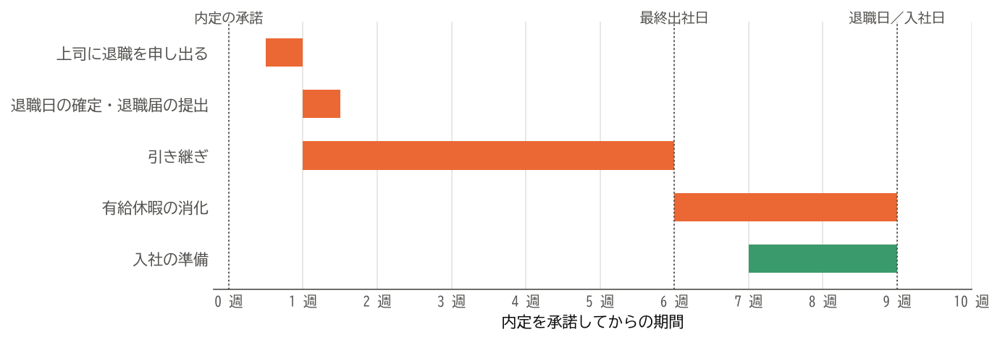

退職の申し出と引き継ぎ
======================

この章では、内定を承諾してから現職を退職するまでに行うべきことを説明する。円満に退職することは、現職の同僚との関係を保つためだけでなく、転職後に前職の人と仕事で関わる可能性を考えても大切である。

退職の日程を逆算する
--------------------

内定を承諾したら、入社日から逆算して退職までの日程を立てる。:numref:`fig-schedule` は、内定の承諾から入社までを 9 週間とした場合の例である。

.. _fig-schedule:

   内定の承諾から入社日までの日程の例

この例で注意したいのは、\ **引き継ぎは退職日ではなく最終出社日までに終える**\ ことである。有給休暇を消化する場合、最終出社日は退職日より前になる。引き継ぎに使える期間は、申し出から最終出社日までの期間である。

退職を申し出る
--------------

退職の申し出に関するルール
^^^^^^^^^^^^^^^^^^^^^^^^^^

期間の定めのない労働契約では、労働者はいつでも退職を申し出ることができ、申し出から 2 週間が経過すると労働契約は終了する（民法第 627 条第 1 項）。会社の承諾は必要ない。

一方、多くの会社は就業規則で「退職の 1 か月前までに申し出ること」のように定めている。法律上は 2 週間で退職できるとしても、引き継ぎの期間を考えると、就業規則の定めに従って申し出るのが現実的である。申し出の前に、就業規則で期限と手続きを確認しておく。

申し出の手順
^^^^^^^^^^^^

退職は、次の手順で申し出る。

1. **直属の上司に面談を申し込む**：「ご相談したいことがあるので、お時間をいただけないでしょうか」のように伝え、他の人に聞かれない場所で話せる時間を設けてもらう。チャットやメールで退職の意思を伝えるのは避ける。
2. **退職の意思を伝える**：「相談」ではなく、退職することを決めたと明確に伝える。迷っているような伝え方をすると、引き留めの話が長引く。
3. **退職日を相談する**：希望する退職日と、引き継ぎと有給休暇の消化の予定を伝え、上司と相談して決める。
4. **退職届を提出する**：退職日が決まったら、会社の定める様式、または書面で退職届を提出する。

最初に伝える相手は、直属の上司である。上司より先に同僚や他の部署の人に話すと、上司が人づてに聞くことになり、関係がこじれる原因になる。

退職の理由は、簡潔に伝えればよい。現職への不満を詳しく話す必要はなく、「新しい分野に挑戦したい」のように前向きな理由で十分である。転職先の会社名を伝える義務もない。

退職届
^^^^^^

退職届は、退職することを会社に届け出る書類である。似た書類に退職願があるが、退職願は会社に退職を願い出るもので、会社が承諾するまでは撤回できる余地がある。退職届は、会社に届いた時点で退職の意思表示として扱われ、原則として撤回できない。会社が指定の様式を用意している場合はそれを使う。指定がない場合は、:numref:`code-resignation-letter` のような書面を作る。この例は、退職日の翌日（平日）に入社する場合を想定している。

.. code-block:: text
   :caption: 退職届の例
   :name: code-resignation-letter
   :linenos:

   退職届

   私儀

   このたび、一身上の都合により、2026 年 11 月 30 日をもって退職いたします。

   2026 年 10 月 16 日
   開発本部　プラットフォーム部
   山田太郎　印

   株式会社〇〇
   代表取締役社長　〇〇〇〇殿

自己都合で退職する場合、理由は「一身上の都合」と書くのが一般的である。

引き留められたとき
------------------

退職を申し出ると、上司から引き留められることがある。給与の引き上げや、希望する部署への異動などの条件を提示されることもある。これを\ **カウンターオファー**\ という。

カウンターオファーを受けて現職に残る選択もあり得る。ただし、受け入れる前に次の点を考える。

* 提示された条件で、転職を考えた動機（:doc:`03_decision`）は本当に解決するか。給与への不満は解決しても、技術や業務内容への不満が残るのであれば、いずれ同じ問題に直面する。
* すでに承諾した内定を辞退することになり、転職先に迷惑をかける。
* 一度退職を申し出たという事実は、社内に残る。

退職の意思が固い場合は、感謝を伝えたうえで、意思が変わらないことをはっきり伝える。退職を認めてもらえない場合の対処は :numref:`sec-cannot-resign`\ で説明する。

エンジニアの引き継ぎ
--------------------

引き継ぎの計画を立てる
^^^^^^^^^^^^^^^^^^^^^^

退職日が決まったら、上司と相談して後任を決め、引き継ぎの計画を立てる。まず、自分が担当している業務を漏れなく書き出す。エンジニアの業務には、日々の開発以外にも見落としやすいものが多い。

.. list-table:: 引き継ぎで書き出す業務
   :header-rows: 1
   :widths: 30 70

   * - 種類
     - 例
   * - 進行中の開発
     - 担当している Issue やチケット、作業中のブランチ、レビュー待ちのプルリクエスト
   * - 定常的な運用
     - デプロイ、バッチの監視、ログの確認、定期的なデータの修正
   * - 不定期の作業
     - SSL/TLS 証明書やドメインの更新、ライセンスの更新、年に一度の棚卸しなど
   * - 障害対応
     - オンコールの当番、アラートの通知先、障害時の手順と連絡先
   * - 問い合わせへの対応
     - 他部署や顧客からの技術的な問い合わせ、社外のベンダーとの窓口
   * - 社内での役割
     - コードレビュー、採用の面接、勉強会の運営など

不定期の作業は、退職した後になって発生し、誰も手順を知らないという事態になりやすい。過去 1 年分の作業の記録やカレンダーを見返して、漏れがないか確認する。

引き継ぎ書を作る
^^^^^^^^^^^^^^^^

引き継ぎの内容は、口頭で説明するだけでなく、文書に残す。後任が一人で読んでも作業できるように書く。リポジトリの README や社内の Wiki など、後任や他のメンバーが今後も参照できる場所に書くとよい。:numref:`code-handover` は、引き継ぎ書の構成の例である。

.. code-block:: markdown
   :caption: 引き継ぎ書の構成の例（Markdown 形式）
   :name: code-handover
   :linenos:

   # 注文管理システムの引き継ぎ

   ## 概要
   - システムの目的と利用者
   - 構成図とリポジトリの一覧へのリンク

   ## 担当業務
   | 業務 | 頻度 | 手順書 | 後任 |
   | --- | --- | --- | --- |
   | 本番環境へのデプロイ | 週 1 回 | docs/deploy.md | 佐藤 |
   | SSL/TLS 証明書の更新 | 年 1 回（3 月） | docs/cert.md | 佐藤 |

   ## 進行中の作業
   - 未完了の Issue と、その状況
   - 未マージのブランチと、その扱い（マージする、破棄する）

   ## 設計の経緯
   - 現在の設計にした理由と、検討して採用しなかった案

   ## 既知の問題と注意点
   - よく起きる障害と、その対処
   - 触るときに注意が必要なコード

   ## 連絡先
   - 関係部署、社外のベンダーの窓口

この中で特に書き残しておきたいのは、「設計の経緯」である。コードを読めば何をしているかは分かるが、なぜそうしたのかはコードからは分からない。後任が設計を変えるときの判断材料になる。

権限と所有者を移す
^^^^^^^^^^^^^^^^^^

退職すると、社内のアカウントは削除または停止される。そのとき、自分のアカウントに結び付いていたものが一緒に止まらないよう、最終出社日までに次のものを後任や共用のアカウントに移す。

* リポジトリ、クラウドのアカウント、各種 SaaS の管理者権限や所有者
* 自分のアカウントで発行した API トークンやアクセスキーで動いている CI/CD、bot、バッチ
* 監視とアラートの通知先、オンコールの当番表
* 外部サービスの契約の担当者や、請求書の送付先として登録されているメールアドレス
* 共有ドライブなどで、自分が所有者になっているファイル

特に、個人のアカウントに結び付いたトークンで動いている自動処理は、アカウントの停止とともに止まり、退職した後に障害として発覚することが多い。棚卸しの段階で洗い出し、共用のアカウントやサービスアカウントに切り替えておく。

属人化した作業をなくす
^^^^^^^^^^^^^^^^^^^^^^

自分しか手順を知らない作業は、引き継ぎで最も時間がかかる。次の順で進めると、後任が確実に作業できるようになる。

1. 手順書を書く。可能であれば、作業そのものを自動化する。
2. 自分が作業するところを、後任に見てもらう。
3. 後任に作業してもらい、自分は横で確認する。
4. 後任が一人で作業し、分からない点があれば質問してもらう。

最終出社日までに 3 と 4 を経験しておけば、退職した後に後任が困る事態を減らせる。

年次有給休暇を消化する
----------------------

年次有給休暇は労働者の権利であり、退職前にまとめて取得することもできる。会社には、事業の正常な運営を妨げる場合に取得の時季を変更させる権利（時季変更権）があるが、退職日までに他の日に変更する余地がなければ、行使することは難しい。

ただし、引き継ぎを終えないまま休暇に入ると、後任や同僚に負担がかかる。退職日を決めるときに、引き継ぎの期間と休暇の期間を上司と相談し、両立できる日程にする。

会社には、使い切れなかった有給休暇を買い取る義務はない。買い取りの制度があるかは、就業規則で確認する。

最終出社日
----------

最終出社日には、お世話になった人に挨拶をし、会社から貸与されていた物を返却する。会社から受け取る書類とあわせて、次の表で確認する。

.. list-table:: 返却する物と受け取る書類
   :header-rows: 1
   :widths: 25 45 30

   * - 区分
     - 主なもの
     - 説明
   * - 返却する物
     - 社員証、入館証、社用の PC とスマートフォン、セキュリティキー、名刺、業務の資料
     - :doc:`09_information`
   * - 受け取る書類
     - 源泉徴収票（退職後に郵送されることが多い）、雇用保険被保険者証、離職票（希望する場合）、会社が預かっていた年金手帳（または基礎年金番号通知書）など
     - :doc:`10_procedures`、:doc:`11_joining`

挨拶は、社内のチャットやメールで行うことも多い。転職先の会社名を書く必要はない。今後も連絡を取りたい人には、個人の連絡先を伝えておくとよい。

まとめ
------

* 退職は、内定を承諾した後、直属の上司に最初に伝える。就業規則の期限を守って申し出る。
* 引き継ぎは最終出社日までに終える。日常の開発だけでなく、不定期の作業や障害対応も書き出す。
* 引き継ぎ書には、設計の経緯も書き残す。
* 自分のアカウントに結び付いた権限、トークン、通知先を、最終出社日までに移す。
* 有給休暇の消化と引き継ぎを両立できる日程を、上司と相談して決める。
