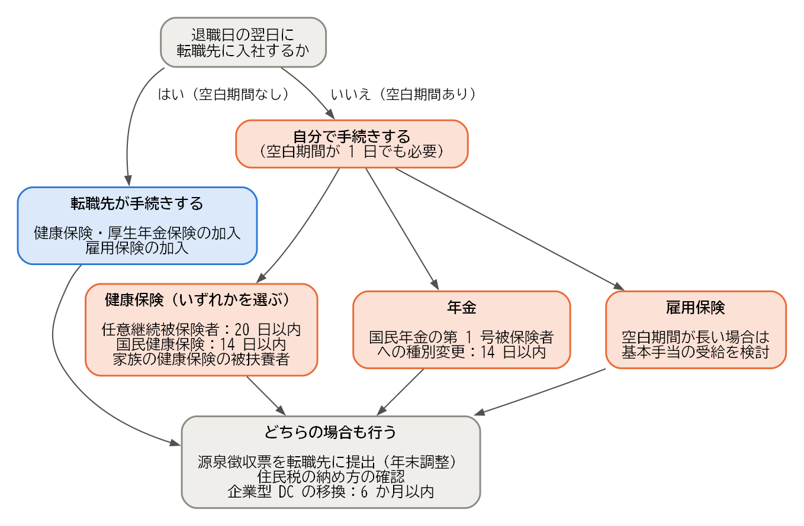

公的な手続き
============

この章では、転職に伴う健康保険、年金、雇用保険、税金、企業年金の手続きを説明する。転職の場合、手続きの内容は「退職日と入社日の間に空白期間があるかどうか」で大きく変わる。

手続きの全体像
--------------

会社員は、勤務先を通じて健康保険、厚生年金保険、雇用保険に加入している。これらの資格は、\ **退職日の翌日**\ に失われる。この日を資格喪失日という。

退職日の翌日に転職先に入社すれば、資格を失った日に転職先で新たに資格を得るため、保険が途切れない。加入の手続きは転職先が行う。一方、退職日と入社日の間に空白期間がある場合は、その期間の健康保険と年金の手続きを自分で行う必要がある。空白期間が 1 日だけであっても同じである。

:numref:`fig-procedures` は、空白期間の有無による手続きの違いを示したものである。

.. _fig-procedures:

   空白期間の有無による公的手続きの違い

空白期間を設けない場合でも、源泉徴収票の提出と住民税の納め方の確認は必要になる。前職で企業型 DC に加入していた場合は、その資産の移換も必要になる。以下、制度ごとに説明する。

健康保険
--------

空白期間がない場合
^^^^^^^^^^^^^^^^^^

転職先が健康保険の加入の手続きを行う。自分で行う手続きは、転職先に必要な書類を提出することだけである（:doc:`11_joining`）。

医療機関では、マイナンバーカードを健康保険証として使う「マイナ保険証」か、マイナ保険証を使えない人に交付される「資格確認書」を提示して受診する。従来の健康保険証は、経過措置の期間が終わり、使えなくなっている。マイナ保険証を使っている場合、転職先の健康保険に加入すると、資格の情報は保険者によって登録されるため、マイナンバーカードについて自分で手続きをする必要はない。ただし、登録が済むまでに時間がかかることがある。入社直後に受診する場合は、転職先の担当者に、加入の手続きの状況や受診の方法を確認するとよい。

前職で資格確認書の交付を受けていた場合は、退職時に前職の健康保険に返却する。

空白期間がある場合
^^^^^^^^^^^^^^^^^^

空白期間の健康保険は、次の 3 つのいずれかを選ぶ。

.. list-table:: 空白期間の健康保険の選択肢
   :header-rows: 1
   :widths: 20 30 25 25

   * - 選択肢
     - 内容
     - 手続きの期限と窓口
     - 保険料
   * - 任意継続被保険者
     - 前職の健康保険に、最長 2 年間、個人として加入を続ける。退職日までに継続して 2 か月以上の被保険者期間があることが条件である。
     - 資格喪失日から 20 日以内に、前職の健康保険（協会けんぽの支部や健康保険組合）に申し出る。
     - 在職中は会社と折半していた保険料を、全額自分で負担する。
   * - 国民健康保険
     - 住所のある市区町村の国民健康保険に加入する。
     - 資格喪失日から 14 日以内に、市区町村の窓口に届け出る。
     - 前年の所得などをもとに、市区町村が計算する。
   * - 家族の健康保険の被扶養者
     - 会社員の家族の健康保険に、被扶養者として加入する。
     - 家族の勤務先を通じて届け出る。
     - 自分の保険料の負担はない。ただし、収入の見込みなどの条件がある。

空白期間が短く、すぐに転職先の健康保険に加入する場合でも、その期間も、いずれかの制度に加入する必要がある（日本では、すべての人が何らかの公的な医療保険に加入する仕組みになっている）。保険料は制度によって計算の方法が異なるため、空白期間が短い場合の保険料の扱いは、前職の健康保険や市区町村の窓口で確認するとよい。

年金
----

空白期間がない場合
^^^^^^^^^^^^^^^^^^

転職先が厚生年金保険の加入の手続きを行う。転職先には、基礎年金番号が分かる書類を提出する（:doc:`11_joining`）。基礎年金番号は、年金手帳（2022 年 4 月以降は、新たに加入した人には年金手帳の代わりに基礎年金番号通知書が交付されている）や、マイナンバーで確認できる。

空白期間がある場合
^^^^^^^^^^^^^^^^^^

空白期間は、国民年金の第 1 号被保険者になる。資格喪失日から 14 日以内に、住所のある市区町村の窓口で、第 2 号被保険者から第 1 号被保険者への種別の変更を届け出て、国民年金保険料を自分で納める。

配偶者を扶養に入れている場合（配偶者が第 3 号被保険者の場合）は、\ **配偶者も第 1 号被保険者への種別の変更が必要**\ になる。忘れやすいので注意する。転職先に入社すれば、本人は第 2 号被保険者に戻り、配偶者は転職先を通じて再び第 3 号被保険者になる手続きを行う。

厚生年金保険と国民年金の保険料は月単位で計算し、月末の時点で加入している制度の保険料を納める。例えば、ある月の途中で退職し、空白期間が月末をまたいで翌月に入社した場合は、退職した月は国民年金の保険料を納める。月末に退職し、翌月の 1 日に入社すれば、国民年金の保険料は発生しない。会社の健康保険の保険料も、同じように月単位で計算する。

雇用保険
--------

空白期間がない場合
^^^^^^^^^^^^^^^^^^

雇用保険の被保険者番号は、転職先でも引き継がれる。転職先が加入の手続きを行うため、被保険者番号が分かる書類（雇用保険被保険者証など）を提出する（:doc:`11_joining`）。

雇用保険の基本手当（いわゆる失業手当）を受け取るための書類である離職票は、空白期間なく転職する場合には使わない。会社は、退職者が希望しない場合は離職票を交付しないことがある（59 歳以上の人については、高年齢雇用継続給付などのために、会社が離職証明書をハローワークに提出することになっており、離職票が交付される）。万が一、入社の予定がなくなった場合に備えて、交付を希望しておく考え方もある。

空白期間がある場合
^^^^^^^^^^^^^^^^^^

基本手当は、働く意思と能力があるにもかかわらず、仕事に就けない状態（失業の状態）にある人が受け取れるものである。そのため、\ **すでに転職先が決まっている場合は、基本手当を受け取れない**\ 。空白期間が短く、入社日が決まっている場合は、基本手当の手続きは不要である。

退職した後に転職活動を行う場合は、次の点を押さえておく。

* 受け取るには、原則として、離職の日以前の 2 年間に、雇用保険の被保険者期間が通算して 12 か月以上あることが必要である。
* 自己都合で退職した場合は、7 日間の待期期間の後、さらに給付制限の期間がある。給付制限の期間は、2025 年 4 月以降に離職した場合は原則 1 か月である（過去 5 年間に正当な理由のない自己都合退職を繰り返している場合などは 3 か月）。
* 基本手当を受け取っている間に就職が決まり、一定の条件を満たすと、再就職手当を受け取れる。

雇用保険の被保険者期間は、前職の退職から 1 年以内に転職先で被保険者となり、その間に基本手当などを受け取っていなければ、前職の期間と通算される。この期間は、教育訓練給付などを受けるための条件になる。基本手当の詳しい条件は、ハローワークの情報で確認してほしい（:doc:`references`）。

住民税
------

住民税は、前年 1 年間の所得に対してかかり、6 月から翌年 5 月までの 12 回に分けて納める。会社員は、毎月の給与から差し引かれて納めている。これを\ **特別徴収**\ という。

転職する場合、退職する月によって、残りの住民税の納め方が次のように変わる。

.. list-table:: 退職する月と住民税の納め方
   :header-rows: 1
   :widths: 25 75

   * - 退職する月
     - 残りの住民税の納め方
   * - 1 月〜4 月
     - 原則として、5 月分までの残りの税額が、最後の給与や退職金から一括して差し引かれる。
   * - 5 月
     - 5 月分が最後の給与から差し引かれ、その年度の納付が終わる。
   * - 6 月〜12 月
     - 次のいずれかになる。

       * 転職先で特別徴収を続ける（前職と転職先の間で必要な書類を引き継ぐ）。
       * 市区町村から届く納付書で、自分で納める（普通徴収）。
       * 本人の申し出により、残りの税額を最後の給与から一括して差し引く。

空白期間なく転職する場合は、前職と転職先の間で書類（給与所得者異動届出書）を引き継ぐことで、転職先の給与から差し引く方法に切り替えられることが多い。その場合は、退職前に前職の担当者に、転職先で特別徴収を続けたいことを伝えておく。手続きが間に合わない場合は、いったん普通徴収で納め、後から転職先で特別徴収に切り替えることもできる。

所得税
------

源泉徴収票と年末調整
^^^^^^^^^^^^^^^^^^^^

会社は、毎月の給与から所得税を差し引き（源泉徴収）、12 月の年末調整で 1 年間の税額を精算している。年の途中で退職すると、前職では年末調整が行われない。前職は、1 月 1 日から退職日までに支払った給与と、差し引いた所得税の額を記載した\ **源泉徴収票**\ を、退職日以後 1 か月以内に交付しなければならない（所得税法第 226 条）。

同じ年のうちに転職先に入社した場合は、前職の源泉徴収票を転職先に提出する。転職先は、前職の給与と転職先の給与を合計して年末調整を行う。源泉徴収票が届かない場合は、前職に交付を依頼する。

確定申告が必要な場合
^^^^^^^^^^^^^^^^^^^^

次のような場合は、確定申告が必要になる、または確定申告をすると納めすぎた所得税の還付を受けられることが多い。確定申告の期間は、原則として翌年の 2 月 16 日から 3 月 15 日までである。ただし、納めすぎた所得税の還付を受けるための申告（還付申告）は、翌年の 1 月 1 日から 5 年間行える。年の途中で退職した人は、所得税を納めすぎていることが多い。

* 退職した年のうちに再就職しなかった場合
* 前職の源泉徴収票を、転職先の年末調整に間に合うように提出できなかった場合
* 医療費控除などの、年末調整では受けられない控除を受ける場合

企業年金と退職金
----------------

企業型 DC
^^^^^^^^^

前職で企業型確定拠出年金（企業型 DC）に加入していた場合は、退職によって加入者の資格を失う。積み立てた資産は、次のいずれかに移す（移換する）手続きを、自分で行う必要がある。

* 転職先の企業型 DC（転職先に制度がある場合）
* iDeCo（個人型確定拠出年金）
* 転職先の確定給付企業年金（転職先の規約で受け入れている場合）など

資格を失った日の属する月の翌月から 6 か月以内に移換の手続きを行わないと、資産は国民年金基金連合会に自動的に移される（自動移換）。自動移換された資産は運用されず、管理のための手数料がかかり続ける。また、自動移換されている期間は、将来、年金を受け取り始められる年齢を判断するための加入期間に数えられないため、受け取りが遅れることもある。

転職先に企業型 DC がある場合は、入社後に転職先の担当者に移換の方法を確認する。転職先に制度がない場合は、iDeCo に移換する。iDeCo では、掛金を拠出せずに、移換した資産の運用だけを続けること（運用指図者になること）もできる。

確定給付企業年金と退職金
^^^^^^^^^^^^^^^^^^^^^^^^

前職の確定給付企業年金（DB）に加入していた場合は、規約に従って、脱退一時金を受け取るか、企業年金連合会や転職先の制度に資産を移すかを選べることがある。前職から届く案内を確認する。

退職金を受け取る場合は、前職に「退職所得の受給に関する申告書」を提出する。提出すると、退職金にかかる税金が適切に計算されて差し引かれ、原則として確定申告は不要になる。提出しないと、一律の税率で差し引かれ、確定申告で精算する必要がある。

まとめ
------

* 退職日の翌日に入社すれば、健康保険、厚生年金保険、雇用保険の手続きは転職先が行う。
* 空白期間がある場合は、1 日であっても健康保険と年金の手続きを自分で行う。期限は 14 日以内（任意継続被保険者は 20 日以内）である。
* 転職先が決まっている場合は、雇用保険の基本手当を受け取れない。
* 住民税は、退職する月によって納め方が変わる。転職先で特別徴収を続けたい場合は、退職前に前職に伝える。
* 同じ年に入社した場合は、前職の源泉徴収票を転職先に提出して年末調整を受ける。
* 企業型 DC の資産は、6 か月以内に自分で移換の手続きを行う。
