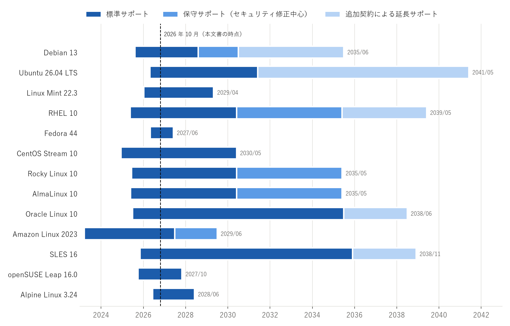

比較
====

本章では、:doc:`distros/index`\ で紹介したディストリビューションを、基本属性、サポート期間、パッケージ管理コマンド、システム管理の観点で比較する。

基本属性
--------

主要ディストリビューションの基本属性を\ :numref:`table-attributes` に示す。

.. _table-attributes:

.. list-table:: 主要ディストリビューションの基本属性
   :header-rows: 1
   :widths: 14 9 14 15 18 10 8 12

   * - 名称
     - 系統
     - パッケージ形式・管理ツール
     - リリースモデル
     - サポート期間
     - init
     - libc
     - 開発元による商用サポート
   * - Debian
     - Debian 系
     - deb / APT
     - 固定（約 2 年ごと）
     - 約 5 年（LTS を含む）
     - systemd
     - glibc
     - なし
   * - Ubuntu LTS
     - Debian 系
     - deb / APT、Snap
     - 固定（LTS は 2 年ごと）
     - 5 年（Ubuntu Pro で最長 10 年、Legacy アドオンで最長 15 年）
     - systemd
     - glibc
     - あり
   * - Linux Mint
     - Debian 系
     - deb / APT
     - 固定（Ubuntu LTS に追従）
     - Ubuntu LTS と同じ
     - systemd
     - glibc
     - なし
   * - RHEL
     - Red Hat 系
     - RPM / DNF
     - 固定（メジャーは約 3 年ごと）
     - 10 年（追加契約で延長可）
     - systemd
     - glibc
     - あり
   * - Fedora
     - Red Hat 系
     - RPM / DNF
     - 固定（約 6 か月ごと）
     - 約 13 か月
     - systemd
     - glibc
     - なし
   * - CentOS Stream
     - Red Hat 系
     - RPM / DNF
     - 継続的に更新
     - 約 5 年
     - systemd
     - glibc
     - なし
   * - Rocky Linux、AlmaLinux
     - Red Hat 系
     - RPM / DNF
     - 固定（RHEL に追従）
     - 10 年
     - systemd
     - glibc
     - なし（第三者が提供）
   * - SLES
     - SUSE 系
     - RPM / zypper
     - 固定（マイナーは毎年）
     - 約 10 年（追加契約で延長可）
     - systemd
     - glibc
     - あり
   * - openSUSE Leap
     - SUSE 系
     - RPM / zypper
     - 固定
     - 約 2 年
     - systemd
     - glibc
     - なし
   * - openSUSE Tumbleweed
     - SUSE 系
     - RPM / zypper
     - ローリング
     - 最新の状態のみ
     - systemd
     - glibc
     - なし
   * - Arch Linux
     - 独立系
     - pkg.tar.zst / pacman
     - ローリング
     - 最新の状態のみ
     - systemd
     - glibc
     - なし
   * - Gentoo
     - 独立系
     - ebuild / Portage
     - ローリング
     - 最新の状態のみ
     - OpenRC（systemd も可）
     - glibc（musl も可）
     - なし
   * - Slackware
     - 独立系
     - txz / pkgtools
     - 不定期の固定
     - 明示なし
     - sysvinit（BSD 風の init スクリプト）
     - glibc
     - なし
   * - Alpine Linux
     - 独立系
     - apk / apk
     - 固定（約 6 か月ごと）
     - 約 2 年
     - OpenRC
     - musl
     - なし

サポート期間
------------

主要ディストリビューションの現行版のサポート期間を\ :numref:`fig-support-periods` に示す。各段階の終了時期は\ :doc:`distros/index`\ の各節に記載した。

.. _fig-support-periods:

   主要ディストリビューションの現行版のサポート期間（2026 年 10 月時点）

図中の「標準サポート」は不具合修正とセキュリティ修正が提供される期間、「保守サポート」はセキュリティ修正など重要な修正に限って提供される期間、「追加契約による延長サポート」は有償の契約により提供される期間を表す。なお、RHEL、SLES、Oracle Linux の技術サポートには、標準サポートの期間であっても契約が必要である。

サポート期間に関して、次の点に注意する。

* ディストリビューションによって、サポート期間の数え方が異なる。RHEL や SLES はメジャーバージョン全体のサポート期間を定めているが、マイナーバージョンごとの更新の提供期間は短い。通常は、最新のマイナーバージョンに更新しながら使う。
* Rocky Linux と AlmaLinux のサポート期間は、RHEL の Full Support と Maintenance Support に対応している。
* Fedora、openSUSE Leap、Alpine Linux はサポート期間が短いため、定期的なメジャーバージョンの更新が前提となる。

パッケージ管理コマンド
----------------------

主なパッケージ管理ツールのコマンドの対応を\ :numref:`table-package-commands` に示す。管理者権限が必要な操作は、``sudo`` を付けるか root で実行する。

.. _table-package-commands:

.. list-table:: パッケージ管理コマンドの対応
   :header-rows: 1
   :widths: 16 18 17 17 16 16

   * - 操作
     - APT（Debian 系）
     - DNF（Red Hat 系）
     - zypper（SUSE 系）
     - pacman（Arch Linux）
     - apk（Alpine Linux）
   * - パッケージ情報の更新
     - ``apt update``
     - ``dnf makecache``
     - ``zypper refresh``
     - ``pacman -Sy`` [#partial]_
     - ``apk update``
   * - システム全体の更新
     - ``apt upgrade``
     - ``dnf upgrade``
     - ``zypper update``
     - ``pacman -Syu``
     - ``apk upgrade``
   * - パッケージの導入
     - ``apt install <名前>``
     - ``dnf install <名前>``
     - ``zypper install <名前>``
     - ``pacman -S <名前>``
     - ``apk add <名前>``
   * - パッケージの削除
     - ``apt remove <名前>``
     - ``dnf remove <名前>``
     - ``zypper remove <名前>``
     - ``pacman -R <名前>``
     - ``apk del <名前>``
   * - パッケージの検索
     - ``apt search <語>``
     - ``dnf search <語>``
     - ``zypper search <語>``
     - ``pacman -Ss <語>``
     - ``apk search <語>``
   * - パッケージの詳細表示
     - ``apt show <名前>``
     - ``dnf info <名前>``
     - ``zypper info <名前>``
     - ``pacman -Si <名前>``
     - ``apk info -a <名前>``
   * - 導入済みパッケージの一覧
     - ``dpkg -l``
     - ``rpm -qa``
     - ``rpm -qa``
     - ``pacman -Q``
     - ``apk info``
   * - ファイルを含むパッケージの特定
     - ``dpkg -S <パス>``
     - ``rpm -qf <パス>``
     - ``rpm -qf <パス>``
     - ``pacman -Qo <パス>``
     - ``apk info --who-owns <パス>``

.. [#partial] Arch Linux では、パッケージ情報だけを更新して個別のパッケージを導入すると部分更新となり、依存関係が壊れるおそれがある。通常は ``pacman -Syu`` でシステム全体を更新する。

DNF は、パッケージの導入や更新の際にパッケージ情報を必要に応じて自動で更新するため、``dnf makecache`` を明示的に実行する必要は少ない。openSUSE Tumbleweed では、システム全体の更新に ``zypper update`` ではなく ``zypper dist-upgrade``\ （短縮形は ``zypper dup``\ ）を使う。

例として、Web サーバの nginx を導入する手順を\ :numref:`code-install-debian` から\ :numref:`code-install-alpine` に示す。

.. _code-install-debian:

.. code-block:: console
   :caption: Debian 系での nginx の導入
   :linenos:

   $ sudo apt update
   $ sudo apt install nginx

.. _code-install-redhat:

.. code-block:: console
   :caption: Red Hat 系での nginx の導入
   :linenos:

   $ sudo dnf install nginx

.. _code-install-suse:

.. code-block:: console
   :caption: SUSE 系での nginx の導入
   :linenos:

   $ sudo zypper install nginx

.. _code-install-arch:

.. code-block:: console
   :caption: Arch Linux での nginx の導入
   :linenos:

   $ sudo pacman -Syu nginx

.. _code-install-alpine:

.. code-block:: console
   :caption: Alpine Linux での nginx の導入
   :linenos:

   # apk update
   # apk add nginx

Alpine Linux は標準では sudo を含まないため、:numref:`code-install-alpine` は root で実行する例としている。

システム管理の違い
------------------

パッケージ管理以外にも、標準で採用しているセキュリティ機構やネットワーク設定の方式はディストリビューションによって異なる。主な違いを\ :numref:`table-system-management` に示す。

.. _table-system-management:

.. list-table:: システム管理の主な違い
   :header-rows: 1
   :widths: 22 26 26 26

   * - ディストリビューション
     - 強制アクセス制御
     - ファイアウォールの管理
     - ネットワーク設定
   * - Debian
     - AppArmor
     - nftables を直接設定（ufw、firewalld も導入可能）
     - ifupdown（/etc/network/interfaces）、デスクトップでは NetworkManager
   * - Ubuntu
     - AppArmor
     - ufw（導入済みだが標準では無効）
     - Netplan（YAML で記述し、systemd-networkd または NetworkManager に設定を渡す）
   * - RHEL 系
     - SELinux（標準で有効）
     - firewalld
     - NetworkManager（nmcli で操作）
   * - SLES 16、openSUSE Leap 16.0
     - SELinux
     - firewalld
     - NetworkManager
   * - SLES 15
     - AppArmor
     - firewalld
     - wicked
   * - Arch Linux
     - なし（利用者が選択）
     - なし（利用者が選択）
     - 利用者が選択（systemd-networkd、NetworkManager など）
   * - Alpine Linux
     - なし
     - なし（利用者が選択）
     - ifupdown-ng（/etc/network/interfaces）

強制アクセス制御（:term:`SELinux`、:term:`AppArmor`）は、ファイルのパーミッションとは別に、プロセスがアクセスできる資源を制限する仕組みである。異なる系統のディストリビューションへ移行する場合、権限の問題がこの仕組みに起因することがあるため、移行先の方式を把握しておく必要がある。

ディストリビューションの識別
----------------------------

現在の Linux ディストリビューションの多くは、ディストリビューションの情報を ``/etc/os-release``\ （または ``/usr/lib/os-release``\ ）に記載している。このファイルは systemd プロジェクトが仕様を定めたもので、シェルの変数代入と同じ形式で記述される。Ubuntu 26.04 LTS での内容の例を\ :numref:`code-os-release` に示す。

.. _code-os-release:

.. code-block:: shell
   :caption: Ubuntu 26.04 LTS の /etc/os-release の例（一部）
   :linenos:

   PRETTY_NAME="Ubuntu 26.04 LTS"
   NAME="Ubuntu"
   VERSION_ID="26.04"
   VERSION="26.04 LTS (Resolute Raccoon)"
   VERSION_CODENAME=resolute
   ID=ubuntu
   ID_LIKE=debian

``ID`` はディストリビューションの識別子、``ID_LIKE`` は互換性のある、または基になったディストリビューションの識別子である。例えば Rocky Linux の ``ID_LIKE`` には ``rhel`` が含まれる。スクリプトでディストリビューションごとに処理を分ける場合、``ID`` だけでなく ``ID_LIKE`` も参照すると、派生ディストリビューションにも対応しやすい。

``/etc/os-release`` を読み取り、ディストリビューションの系統を判定する Python のサンプルコードを\ :numref:`code-os-release-py` に示す。このファイルは :download:`os_release.py <../examples/os_release.py>` からダウンロードできる。

.. _code-os-release-py:

.. literalinclude:: ../examples/os_release.py
   :language: python
   :caption: os_release.py
   :linenos:

実行には Python 3.9 以降が必要である。引数を省略すると ``/etc/os-release`` を読み取り、引数にファイルのパスを指定するとそのファイルを読み取る。Rocky Linux 10.2 で実行した場合の出力の例を\ :numref:`code-os-release-output` に示す。

.. _code-os-release-output:

.. code-block:: text
   :caption: os_release.py の出力の例（Rocky Linux 10.2）
   :linenos:

   名称      : Rocky Linux
   バージョン: 10.2 (Red Quartz)
   ID        : rocky
   ID_LIKE   : rhel centos fedora
   系統      : Red Hat 系

なお、Python 3.10 以降では標準ライブラリの ``platform.freedesktop_os_release()`` でも同じファイルを解析できる。
