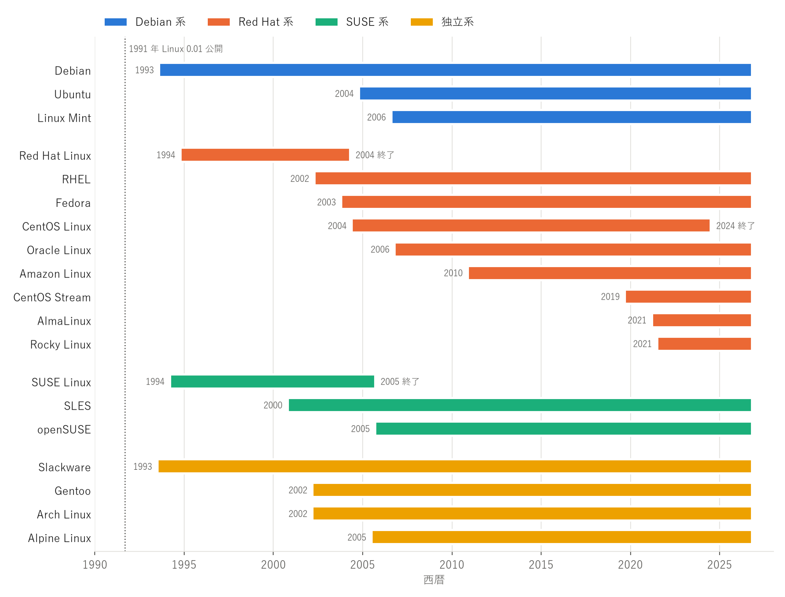

歴史
====

本章では、Linux カーネルの誕生から現在までのディストリビューションの歴史を概観する。主要ディストリビューションの存続期間を\ :numref:`fig-lifespans` に、系譜を\ :numref:`fig-genealogy` に示す。

.. _fig-lifespans:

   主要ディストリビューションの存続期間（2026 年 10 月時点）

Linux カーネルの誕生（1991）
----------------------------

1991 年 8 月、ヘルシンキ大学の学生であった Linus Torvalds は、趣味で開発している OS カーネルについてニュースグループ comp.os.minix に投稿した。同年 9 月にバージョン 0.01 が公開され、翌 1992 年にはライセンスが GNU GPL に変更された。これにより、1980 年代から GNU プロジェクトが開発してきたコンパイラやシェルなどのツール群と組み合わせ、自由に再配布できる OS を構成できるようになった。

当時は、利用者自身がカーネルとツール群を集めてビルドする必要があった。これらをまとめて手軽に導入できるようにしたものが、初期のディストリビューションである。

黎明期（1992〜1993）
--------------------

1992 年には MCC Interim Linux や SLS（Softlanding Linux System）などの初期のディストリビューションが登場した。SLS は広く使われたが不具合が多く、これに不満を持った開発者たちが新しいディストリビューションを作り始めた。

1993 年 7 月、Patrick Volkerding は SLS を基に Slackware を公開した。Slackware は現在も開発が続く最古のディストリビューションである。

同年 8 月には Ian Murdock が Debian を発表した。Debian は特定の企業ではなくコミュニティによって開発されることを掲げ、1997 年にはプロジェクトの理念を示す Debian 社会契約と、収録するソフトウェアの基準となる Debian フリーソフトウェアガイドライン（DFSG）を定めた。

商用化と二大パッケージ形式（1994〜1999）
----------------------------------------

1992 年、ドイツのニュルンベルクで S.u.S.E. 社が設立された。同社は当初 Slackware のドイツ語版を販売していたが、1994 年に S.u.S.E. Linux 1.0 を公開し、1996 年には独自に開発したディストリビューションへ移行した。

1994 年、Marc Ewing は Red Hat Linux の最初のベータ版を公開した。翌 1995 年に Bob Young の会社と合流し、Red Hat 社となった。Red Hat はパッケージ管理のために RPM を開発し、RPM はのちに SUSE などほかのディストリビューションにも採用された。Debian も同時期に dpkg と deb 形式を整備し、1998 年には依存関係を自動で解決する APT を開発した。この時期に確立した deb と RPM は、現在も二大パッケージ形式となっている。

1990 年代後半には Linux の企業利用が広がり、1999 年に Red Hat は米国で株式を公開した。

多様化（2000〜2009）
--------------------

2000 年代には、目的や思想の異なるディストリビューションが数多く登場した。

* 2000 年、SUSE は企業向けの SUSE Linux Enterprise Server（SLES）を IBM のメインフレーム向けに提供した。
* 2002 年、Red Hat は企業向けの Red Hat Linux Advanced Server 2.1 を公開した。これがのちの Red Hat Enterprise Linux（RHEL）である。同年、ソースコードからのビルドを基本とする Gentoo 1.0 と、簡潔さを重視する Arch Linux 0.1 も公開された。
* 2003 年、Red Hat は無償で配布していた Red Hat Linux を終了し、商用の RHEL とコミュニティ主体の Fedora に分けた。Fedora の最初の版である Fedora Core 1 は同年 11 月に公開された。また同年、Novell が SUSE の買収を発表した（2004 年 1 月に完了）。
* 2004 年、RHEL のソースコードからビルドした無償の CentOS が登場した。同年 10 月には、Mark Shuttleworth が設立した Canonical が Debian を基にした Ubuntu 4.10 を公開した。Ubuntu は 6 か月ごとの定期リリースと使いやすさを掲げ、デスクトップとサーバの双方で急速に普及した。
* 2005 年、SUSE のコミュニティ版を開発する openSUSE プロジェクトが発足した。同年、Alpine Linux の開発も始まった。
* 2006 年、Ubuntu を基にした Linux Mint と、RHEL 互換の Oracle Linux（当時の名称は Oracle Enterprise Linux）が登場した。

クラウドとコンテナ（2010〜2019）
--------------------------------

2010 年代には、サーバの主な稼働環境が物理サーバから仮想マシン、クラウド、コンテナへと移っていった。

* 2010 年に開発が始まった init システムの systemd は、Fedora、RHEL 7（2014 年）、Debian 8（2015 年）、Ubuntu 15.04（2015 年）などで順次標準となった。Debian では採用を巡って大きな議論があった。
* 2010 年、AWS は自社のクラウド向けに Amazon Linux を公開した。主要なクラウドでは、Ubuntu や RHEL などの公式イメージも提供されるようになった。
* 2013 年に Docker が登場すると、コンテナのベースイメージとして軽量な Alpine Linux が広く使われるようになった。また、コンテナの実行に特化した CoreOS（のちの Container Linux）も登場した。
* 2014 年、CentOS プロジェクトは Red Hat と協力関係を結び、Red Hat が主要な開発者を雇用する体制になった。
* 2019 年、IBM が Red Hat を買収した。同年、RHEL の開発に先行して更新される CentOS Stream が公開された。

近年の動向（2020〜）
--------------------

* 2020 年 12 月、Red Hat は CentOS の重点を CentOS Stream に移すと発表し、CentOS Linux 8 のサポート終了を当初予定の 2029 年から 2021 年末に早めた。CentOS Linux は RHEL の無償の代替として広く使われていたため、多くの利用者が移行先の検討を迫られた。CentOS Linux 7 のサポートも 2024 年 6 月に終了し、CentOS Linux の提供は終了した。
* これを受けて、RHEL 互換のディストリビューションが新たに立ち上がった。CloudLinux 社が主導した AlmaLinux（2021 年 3 月に最初の正式版）と、CentOS の共同創設者である Gregory Kurtzer が始めた Rocky Linux（2021 年 6 月に最初の正式版）である。
* 2023 年 6 月、Red Hat は RHEL 関連のソースコードの公開先を CentOS Stream に限定すると発表した。RHEL のソースコードを基にしていたリビルドディストリビューションは対応を迫られ、AlmaLinux は RHEL との完全な一致（バグ互換）を目標とする方針から、ABI 互換を目標とする方針に転換した。同年 8 月には、CIQ、Oracle、SUSE が RHEL 互換ディストリビューションのソースコードを共同で提供する団体 OpenELA を設立した。
* 2025 年に RHEL 10、Debian 13、SLES 16 が、2026 年に Ubuntu 26.04 LTS が公開された。
* OS のシステム領域を読み取り専用とし、OS イメージ全体を単位として更新する\ :term:`イミュータブル OS` も広がっている。Fedora CoreOS、Fedora Atomic Desktops、openSUSE の MicroOS などがあり、RHEL でも OS をコンテナイメージとして管理するイメージモードが提供されている。

系譜
----

主要ディストリビューションの派生関係を\ :numref:`fig-genealogy` に示す。実線は派生（基盤としての採用）を、破線は開発の流れを表す。

.. _fig-genealogy:

.. graphviz::
   :caption: 主要ディストリビューションの系譜
   :alt: 主要ディストリビューションの派生関係を示す系譜図

   digraph genealogy {
       rankdir=LR;
       bgcolor="transparent";
       node [shape=box, style="rounded,filled", fontsize=11, color="#52514e", fillcolor="#ffffff"];
       edge [color="#52514e", arrowsize=0.7];

       subgraph cluster_debian {
           label="Debian 系"; fontsize=12; style="rounded,filled"; color="#2a78d6"; fillcolor="#eaf2fc";
           debian [label="Debian\n1993"];
           ubuntu [label="Ubuntu\n2004"];
           mint [label="Linux Mint\n2006"];
           lmde [label="LMDE\n2010"];
       }

       subgraph cluster_redhat {
           label="Red Hat 系"; fontsize=12; style="rounded,filled"; color="#eb6834"; fillcolor="#fdeee8";
           rhl [label="Red Hat Linux\n1994-2004"];
           fedora [label="Fedora\n2003"];
           stream [label="CentOS Stream\n2019"];
           rhel [label="RHEL\n2002"];
           centos [label="CentOS Linux\n2004-2024", style="rounded,dashed"];
           rocky [label="Rocky Linux\n2021"];
           alma [label="AlmaLinux\n2021"];
           oracle [label="Oracle Linux\n2006"];
           amazon [label="Amazon Linux 2023\n2023"];
       }

       subgraph cluster_suse {
           label="SUSE 系"; fontsize=12; style="rounded,filled"; color="#1baf7a"; fillcolor="#e6f6f0";
           suse [label="SUSE Linux\n1994-2005"];
           sles [label="SLES\n2000"];
           opensuse [label="openSUSE\n2005"];
       }

       subgraph cluster_independent {
           label="独立系"; fontsize=12; style="rounded,filled"; color="#eda100"; fillcolor="#fdf4e0";
           sls [label="SLS\n1992", style="rounded,dashed"];
           slackware [label="Slackware\n1993"];
           arch [label="Arch Linux\n2002"];
           gentoo [label="Gentoo\n2002"];
           alpine [label="Alpine Linux\n2005"];
       }

       sls -> slackware;
       slackware -> suse;
       suse -> sles;
       suse -> opensuse;
       debian -> ubuntu;
       ubuntu -> mint;
       debian -> lmde;
       rhl -> rhel;
       rhl -> fedora;
       fedora -> stream [style=dashed];
       stream -> rhel [style=dashed];
       fedora -> amazon;
       rhel -> centos;
       rhel -> rocky;
       rhel -> oracle;
       stream -> alma;
   }

SUSE Linux は Slackware のドイツ語版から始まったが、1996 年以降は独自に開発されており、現在の SUSE 系は Slackware とは別系統である。CentOS Linux は RHEL のソースコードからビルドされていた。Rocky Linux と Oracle Linux は RHEL との互換性を目標としており、AlmaLinux は 2023 年以降、CentOS Stream のソースコードを基に RHEL との ABI 互換を目標としている。
