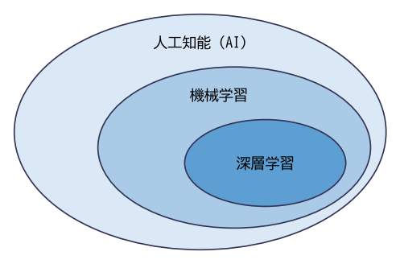

機械学習の全体像
================

この章では、機械学習とは何か、どのような種類があるか、機械学習を使ったシステムをどのような流れで作るかを説明する。以降の章で個々の手法を学ぶ前に、全体の地図を頭に入れておくことが目的である。

人工知能・機械学習・深層学習
----------------------------

人工知能（Artificial Intelligence、AI）、機械学習（Machine Learning）、深層学習（Deep Learning）という 3 つの言葉は混同されやすい。これらの関係を\ :numref:`fig-ch01-ai-ml-dl` に示す。

.. _fig-ch01-ai-ml-dl:

   人工知能・機械学習・深層学習の関係

* **人工知能**\ は、人間が知能を使って行う判断や認識をコンピュータで実現しようとする技術や研究分野の総称である。人間が書いたルールで動くエキスパートシステムなども含む広い概念である。
* **機械学習**\ は、人工知能を実現する方法の 1 つで、データからパターンや規則をコンピュータに学習させる手法の総称である。
* **深層学習**\ は、機械学習の手法の 1 つで、多数の層を重ねたニューラルネットワークを使う。画像認識・音声認識・自然言語処理などで大きな成果を上げ、現在の人工知能ブームの中心となっている。

ルールベースのプログラムとの違い
--------------------------------

通常のプログラムでは、人間が入力から出力を求める規則を考えてコードに書く。たとえば迷惑メールを判定するプログラムなら、「件名に特定の単語が含まれていたら迷惑メールとする」といった規則を列挙する。

機械学習では発想が逆になる。人間は「入力」と「その入力に対する正しい出力」の例を大量に用意し、規則そのものはコンピュータにデータから見つけさせる。迷惑メールの例でいえば、「迷惑メール」または「通常のメール」という正解の付いたメールを多数集め、それらを正しく判定できるような規則を学習させる。

.. graphviz::
   :align: center
   :caption: ルールベースと機械学習の違い

   digraph rule_vs_ml {
       rankdir=LR;
       node [shape=box, style="rounded,filled", fillcolor="#eef4fb", fontsize=11];
       subgraph cluster_rule {
           label="ルールベース"; style=dashed;
           r_in [label="入力"]; r_rule [label="人間が書いた規則", fillcolor="#fdf0e0"]; r_prog [label="プログラム"]; r_out [label="出力"];
           r_in -> r_prog; r_rule -> r_prog; r_prog -> r_out;
       }
       subgraph cluster_ml {
           label="機械学習"; style=dashed;
           m_in [label="入力の例"]; m_out [label="正しい出力の例"]; m_learn [label="学習アルゴリズム"]; m_model [label="モデル\n（データから得た規則）", fillcolor="#fdf0e0"];
           m_in -> m_learn; m_out -> m_learn; m_learn -> m_model;
       }
   }

学習の結果として得られる、入力から出力を計算する仕組みを\ **モデル**\ と呼ぶ。モデルは通常、数値の\ **パラメータ**\ を持つ関数として表され、学習とはデータに合うようにパラメータの値を調整することである。この考え方は本書全体を通じて何度も登場する。

機械学習が力を発揮するのは、規則を人間が書き下すのが難しい問題である。画像に写っている物体の判定のように規則を言葉で説明しにくい問題や、需要予測のように多数の要因が複雑に絡み合う問題がこれにあたる。

学習の種類
----------

機械学習は、どのようなデータから何を学習するかによって、大きく 3 種類に分けられる。

.. list-table:: 機械学習の 3 つの種類
   :header-rows: 1
   :widths: 20 40 40

   * - 種類
     - 学習に使うデータ
     - 代表的なタスク
   * - 教師あり学習
     - 入力と正解（ラベル）の組
     - 回帰（数値の予測）、分類（カテゴリの予測）
   * - 教師なし学習
     - 入力のみ（正解なし）
     - クラスタリング、次元削減、異常検知
   * - 強化学習
     - 環境との相互作用で得られる報酬
     - ゲームの攻略、ロボットの制御

教師あり学習
^^^^^^^^^^^^

:term:`教師あり学習`\ は、入力と正解の組を大量に与え、入力から正解を予測するモデルを学習する方法である。モデルへの入力を\ :term:`特徴量`、正解を\ :term:`ラベル`\ と呼ぶ。たとえば、物件の広さや築年数（特徴量）から家賃（ラベル）を予測する問題や、メールの本文（特徴量）から迷惑メールかどうか（ラベル）を判定する問題が教師あり学習にあたる。

教師あり学習のタスクは、予測する値の種類によって 2 つに分けられる。

* **回帰**: 家賃や気温のような連続的な数値を予測する（第 4 章）。
* **分類**: 「迷惑メール / 通常のメール」や「犬 / 猫 / 鳥」のようなカテゴリを予測する（第 5 章）。

実務で使われる機械学習の多くは教師あり学習である。

教師なし学習
^^^^^^^^^^^^

:term:`教師なし学習`\ は、正解の付いていないデータから、データそのものの構造を見つけ出す方法である。似た顧客をグループに分ける（クラスタリング）、多数の特徴量を少数の特徴量に要約する（次元削減）、普段と異なるデータを見つける（異常検知）などに使われる（第 8 章）。

強化学習
^^^^^^^^

:term:`強化学習`\ は、ある環境の中で行動する主体（エージェント）が、行動の結果として得られる報酬を手がかりに、報酬の合計が最大になるような行動の選び方を学習する方法である。囲碁や将棋のプログラム、ロボットの制御などに使われている。正解の行動が直接与えられるのではなく、試行錯誤を通じて学習する点が教師あり学習と異なる。本書では強化学習の詳細は扱わない。

なお、大量の正解なしデータから、データの一部を隠して残りから予測させるといった方法で学習する\ **自己教師あり学習**\ という方法もある。正解をデータ自身から作るため、人手でラベルを付ける必要がない。第 12 章で触れる大規模言語モデルの事前学習はこの方法による。

機械学習プロジェクトの流れ
--------------------------

機械学習を使ったシステムは、一般に次の流れで作る。

.. graphviz::
   :align: center
   :caption: 機械学習プロジェクトの流れ

   digraph workflow {
       rankdir=LR;
       node [shape=box, style="rounded,filled", fillcolor="#eef4fb", fontsize=11];
       a [label="課題の設定"]; b [label="データの収集"]; c [label="前処理"]; d [label="学習"]; e [label="評価"]; f [label="運用"];
       a -> b -> c -> d -> e -> f;
       e -> c [label="改善", style=dashed, fontsize=10];
       f -> b [label="再学習", style=dashed, fontsize=10];
   }

1. **課題の設定**: 何を予測したいのか、予測できたら業務がどう良くなるのか、どの程度の性能が必要かを決める。機械学習を使わずに解決できないかもこの段階で検討する。
2. **データの収集**: 学習に使うデータを集める。教師あり学習では正解ラベルも必要になる。
3. **前処理**: 欠損値の処理や数値への変換など、データをモデルが扱える形に整える（第 3 章）。
4. **学習**: モデルを選び、データを使ってパラメータを調整する（第 4 章〜第 12 章）。
5. **評価**: 学習に使っていないデータでモデルの性能を測る（第 6 章）。性能が足りなければ前処理やモデルの選択に戻る。
6. **運用**: モデルをシステムに組み込んで使う。データの傾向は時間とともに変わるため、性能を監視し、必要に応じて再学習する（第 13 章）。

教科書ではモデルの学習に注目が集まりがちだが、実務ではデータの収集と前処理、評価の設計に多くの時間がかかる。また、プロジェクトの成否は最初の課題設定に大きく左右される。

機械学習が向いている問題・向いていない問題
------------------------------------------

機械学習はどのような問題にも使える万能の道具ではない。次のような性質を持つ問題が機械学習に向いている。

* 入力と出力の間に何らかの規則性があるが、人間が規則を書き下すのが難しい。
* 学習に使える十分な量と質のデータがある。
* 多少の誤りが許容される、または誤りを人間が確認・修正できる仕組みを作れる。
* 同じ種類の判断を大量に、または繰り返し行う必要がある。

反対に、次のような問題には機械学習は向いていない。

* 規則が明確で、通常のプログラムとして書ける（例: 税額の計算）。
* 誤りが一切許されず、判断の根拠を厳密に説明する必要がある。
* データがほとんどない、または過去のデータと将来の状況が大きく異なる。

機械学習のモデルは、学習に使ったデータに含まれる傾向を再現するだけである。データに偏りがあればモデルの予測にも偏りが生じ、データに存在しない状況での予測は保証されない。この点は第 13 章で改めて取り上げる。

まとめ
------

* 機械学習は、データから規則を学習させる手法の総称であり、深層学習はその一部である。
* 学習の結果として得られる、パラメータを持つ関数をモデルと呼ぶ。
* 機械学習は、教師あり学習・教師なし学習・強化学習に大別される。教師あり学習はさらに回帰と分類に分けられる。
* 機械学習プロジェクトでは、モデルの学習以外に、課題設定・データの準備・評価・運用が重要である。
