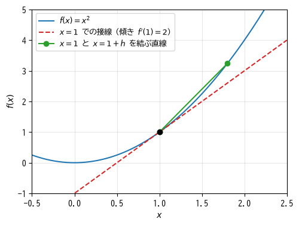
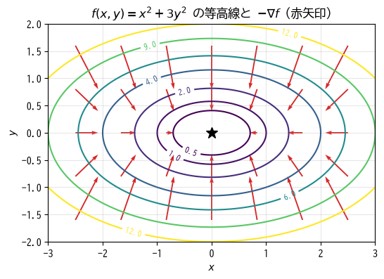
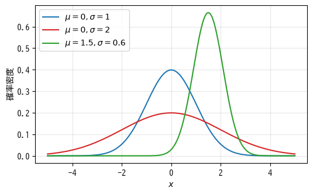

数学の準備
==========

機械学習の手法を理解するには、ベクトルと行列、微分、確率と統計の基本が必要になる。この章では、以降の章で使う範囲に絞ってこれらを復習し、NumPy のコードとの対応を示す。すでに知っている読者は読み飛ばして構わない。

ベクトルと行列
--------------

ベクトル
^^^^^^^^

機械学習では、1 件のデータを数値の並びとして表す。たとえば物件の「広さ（m\ :sup:`2`）」「築年数」「駅からの徒歩分数」を並べた

.. math::

   \boldsymbol{x} = \begin{pmatrix} 45.0 \\ 12 \\ 8 \end{pmatrix}

のような数値の組を\ **ベクトル**\ と呼ぶ。並んでいる数値の個数をベクトルの\ **次元**\ という。この例は 3 次元のベクトルである。本書では、ベクトルを太字の小文字（:math:`\boldsymbol{x}`、:math:`\boldsymbol{w}` など）で表し、その :math:`i` 番目の要素を :math:`x_i` のように書く。

2 つのベクトル :math:`\boldsymbol{w}` と :math:`\boldsymbol{x}` の\ **内積**\ は、対応する要素どうしの積の和である。

.. math::

   \boldsymbol{w}^\top \boldsymbol{x} = w_1 x_1 + w_2 x_2 + \cdots + w_d x_d = \sum_{i=1}^{d} w_i x_i

ここで :math:`\top` は転置を表す。内積は「各特徴量に重みを掛けて足し合わせる」計算であり、第 4 章の線形回帰や第 9 章のニューラルネットワークの基本となる。

行列
^^^^

数値を縦横の表の形に並べたものを\ **行列**\ と呼ぶ。:math:`n` 件のデータがそれぞれ :math:`d` 次元のベクトルで表されるとき、これらを縦に積み重ねた :math:`n` 行 :math:`d` 列の行列 :math:`X` でデータ全体を表す。この形を :math:`n \times d` と書く。

.. math::

   X = \begin{pmatrix}
       x_{11} & x_{12} & \cdots & x_{1d} \\
       x_{21} & x_{22} & \cdots & x_{2d} \\
       \vdots & \vdots & \ddots & \vdots \\
       x_{n1} & x_{n2} & \cdots & x_{nd}
       \end{pmatrix}

本書では行列を大文字（:math:`X`、:math:`W` など）で表す。行列の 1 行が 1 件のデータ（サンプル）、1 列が 1 つの特徴量に対応する。この「行がサンプル、列が特徴量」という配置は、scikit-learn や PyTorch でも共通の約束である。

:math:`n \times d` の行列 :math:`X` と :math:`d` 次元のベクトル :math:`\boldsymbol{w}` の積 :math:`X\boldsymbol{w}` は、:math:`X` の各行と :math:`\boldsymbol{w}` の内積を並べた :math:`n` 次元のベクトルになる。つまり、:math:`n` 件のデータそれぞれについて重み付きの和を一度に計算できる。一般に、:math:`n \times d` の行列と :math:`d \times m` の行列の積は :math:`n \times m` の行列になる。左の行列の列数と右の行列の行数が一致しなければ積は定義されない。

NumPy での計算
^^^^^^^^^^^^^^

NumPy では、ベクトルや行列を ``ndarray`` 型の配列で表し、内積や行列の積を ``@`` 演算子で計算する。

.. literalinclude:: ../examples/ch02_numpy_basics.py
   :language: python
   :linenos:
   :pyobject: show_vector_and_matrix
   :caption: ベクトルと行列の計算（ch02_numpy_basics.py より抜粋）

実行結果は次のとおりである。

.. code-block:: text
   :linenos:

   内積 w・x = 4.5
   行列とベクトルの積 A x = [14. 32.]
   列ごとに平均を引いた行列:
    [[-1.5 -1.5 -1.5]
    [ 1.5  1.5  1.5]]

最後の例では、形状が :math:`2 \times 3` の行列から形状が :math:`(3,)` のベクトルを引いている。NumPy は形状の異なる配列どうしの演算で、小さい方の配列を自動的に繰り返して形状をそろえる。これを\ **ブロードキャスト**\ と呼ぶ。ブロードキャストを使うと、ループを書かずに「各サンプルから平均を引く」といった処理を書ける。機械学習のコードでは頻繁に使われるので、配列の形状（``shape`` 属性）を常に意識するとよい。

微分と勾配
----------

微分
^^^^

機械学習の学習は「予測の誤りを表す関数の値が小さくなる方向にパラメータを少しずつ動かす」ことで行う。この「どちらの方向に動かせば値が小さくなるか」を教えてくれるのが微分である。

関数 :math:`f(x)` の点 :math:`x` における\ **微分**\ （導関数の値）は、:math:`x` をわずかに動かしたときの :math:`f(x)` の変化の割合であり、次のように定義される。

.. math::

   f'(x) = \frac{df}{dx} = \lim_{h \to 0} \frac{f(x + h) - f(x)}{h}

図形的には、:math:`f'(x)` は点 :math:`x` における接線の傾きである（:numref:`fig-ch02-derivative`）。:math:`f'(x) > 0` なら :math:`x` を増やすと :math:`f(x)` は増え、:math:`f'(x) < 0` なら減る。したがって、:math:`f(x)` を小さくしたいときは、微分の符号と逆の方向に :math:`x` を動かせばよい。

.. _fig-ch02-derivative:

   :math:`f(x) = x^2` の :math:`x = 1` における接線。:math:`h` を 0 に近づけると、2 点を結ぶ直線の傾きは接線の傾き 2 に近づく。

本書でよく使う関数の微分を次に示す。

.. list-table:: 主な関数の微分
   :header-rows: 1
   :widths: 50 50

   * - 関数 :math:`f(x)`
     - 微分 :math:`f'(x)`
   * - :math:`c`\ （定数）
     - :math:`0`
   * - :math:`x^n`
     - :math:`n x^{n-1}`
   * - :math:`e^x`
     - :math:`e^x`
   * - :math:`\log x`
     - :math:`1 / x`

本書では :math:`\log` は自然対数（底が :math:`e` の対数）を表す。

連鎖律
^^^^^^

関数を組み合わせた合成関数 :math:`y = f(g(x))` の微分は、:math:`u = g(x)` とおくと、それぞれの微分の積になる。

.. math::

   \frac{dy}{dx} = \frac{dy}{du} \cdot \frac{du}{dx}

これを\ **連鎖律**\ と呼ぶ。たとえば :math:`y = (3x + 1)^2` は :math:`u = 3x + 1`、:math:`y = u^2` の合成であり、:math:`dy/dx = 2u \cdot 3 = 6(3x + 1)` となる。ニューラルネットワークは多数の関数を何段にも合成したものであり、その学習に使う誤差逆伝播法（第 9 章）は連鎖律を効率よく計算する方法にほかならない。

偏微分と勾配
^^^^^^^^^^^^

機械学習のモデルは多数のパラメータを持つため、多変数の関数を扱う必要がある。2 変数の関数 :math:`f(x, y)` について、:math:`y` を固定して :math:`x` だけで微分したものを :math:`x` についての\ **偏微分**\ と呼び、:math:`\partial f / \partial x` と書く。

各変数についての偏微分を並べたベクトルを\ :term:`勾配`\ と呼び、:math:`\nabla f` と書く。

.. math::

   \nabla f(x, y) = \begin{pmatrix} \dfrac{\partial f}{\partial x} \\[2mm] \dfrac{\partial f}{\partial y} \end{pmatrix}

たとえば :math:`f(x, y) = x^2 + 3y^2` の勾配は :math:`\nabla f = (2x, 6y)^\top` である。勾配は、その点で関数の値が最も急激に増加する方向を向いている。したがって、勾配と逆の方向 :math:`-\nabla f` に進めば、関数の値を最も効率よく減らせる（:numref:`fig-ch02-gradient`）。この性質を使って関数の最小値を探す方法が、第 4 章で説明する勾配降下法である。

.. _fig-ch02-gradient:

   等高線と勾配の逆方向。矢印は各点で関数の値が最も急に減る方向を指し、等高線と直交する。

数値微分
^^^^^^^^

微分の定義式で :math:`h` を十分小さな値（たとえば :math:`10^{-5}`）にすれば、微分を数値的に近似できる。これを\ **数値微分**\ と呼ぶ。実用上は、:math:`x` の前後に :math:`h` ずつずらした次の\ **中心差分**\ の方が誤差が小さい。

.. math::

   f'(x) \approx \frac{f(x + h) - f(x - h)}{2h}

数値微分は簡単だが、パラメータ 1 個ごとに関数を 2 回計算する必要があり、パラメータが多いモデルの学習に使うには遅すぎる。実際には、手計算や誤差逆伝播法で求めた勾配が正しいかを確かめる\ **勾配確認**\ に使う。次のコードは、中心差分で勾配を求める関数である。各変数を 1 つずつ :math:`\pm h` だけずらして関数の値の差を取っている。サンプルコードでは、この関数で :math:`f(x, y) = x^2 + 3y^2` の勾配を求め、手計算の結果と比較している。

.. literalinclude:: ../examples/ch02_numpy_basics.py
   :language: python
   :linenos:
   :pyobject: numerical_grad
   :caption: 数値微分による勾配の計算（ch02_numpy_basics.py より抜粋）

点 :math:`(1, 2)` での結果は、手計算の :math:`(2, 12)` と一致する。

.. code-block:: text
   :linenos:

   解析的な勾配: [ 2. 12.]
   数値微分による勾配: [ 2. 12.]

サンプルコードの全体は :download:`ch02_numpy_basics.py <../examples/ch02_numpy_basics.py>` からダウンロードできる。

確率と統計の基本
----------------

平均と分散
^^^^^^^^^^

:math:`n` 個の値 :math:`x_1, \ldots, x_n` の\ **平均** :math:`\bar{x}` と\ **分散** :math:`s^2` は次のように定義される。

.. math::

   \bar{x} = \frac{1}{n} \sum_{i=1}^{n} x_i, \qquad
   s^2 = \frac{1}{n} \sum_{i=1}^{n} (x_i - \bar{x})^2

分散は値のばらつきの大きさを表し、その平方根 :math:`s` を\ **標準偏差**\ と呼ぶ。標準偏差は元のデータと同じ単位を持つため、ばらつきの大きさを直感的に把握しやすい。NumPy では ``np.mean`` と ``np.var``、``np.std`` で計算できる。

確率分布と正規分布
^^^^^^^^^^^^^^^^^^

ある値がどのくらいの確率で現れるかを表したものを\ **確率分布**\ と呼ぶ。連続的な値については、確率の密度を表す\ **確率密度関数**\ で分布を表す。

最も重要な確率分布が\ **正規分布**\ （ガウス分布）である。平均 :math:`\mu`、標準偏差 :math:`\sigma` の正規分布の確率密度関数は次の式で表され、:math:`\mu` を中心とする左右対称な釣り鐘形になる（:numref:`fig-ch02-normal`）。

.. math::

   p(x) = \frac{1}{\sqrt{2\pi\sigma^2}} \exp\left( -\frac{(x - \mu)^2}{2\sigma^2} \right)

.. _fig-ch02-normal:

   正規分布の確率密度関数。:math:`\sigma` が大きいほど広がった形になる。

測定誤差のように多数の小さな要因が積み重なって生じる値は、正規分布に近い分布に従うことが多い。本書のサンプルコードでも、データに加えるノイズを正規分布から生成している（``rng.normal``）。

条件付き確率
^^^^^^^^^^^^

分類のモデルは「入力 :math:`\boldsymbol{x}` が与えられたとき、ラベルが :math:`y` である確率」を出力することが多い。このように、ある条件の下での確率を\ **条件付き確率**\ と呼び、:math:`P(y \mid \boldsymbol{x})` と書く。たとえば :math:`P(\text{迷惑メール} \mid \text{このメール}) = 0.9` は、「このメールが迷惑メールである確率は 0.9」という意味である。

最尤推定の考え方
^^^^^^^^^^^^^^^^

モデルのパラメータを決める基本的な考え方の 1 つに\ **最尤推定**\ がある。最尤推定では、「手元のデータが観測される確率が最も高くなるようにパラメータを選ぶ」。

たとえば、コインを 10 回投げて表が 7 回出たとする。表が出る確率を :math:`p` とすると、この結果が得られる確率は :math:`p^7 (1 - p)^3` に比例する。これを最大にする :math:`p` を求めると :math:`p = 0.7` となり、直感どおりの結果が得られる。

最尤推定は、第 4 章の平均二乗誤差や第 5 章の交差エントロピーといった損失関数の理論的な根拠になっている。ノイズが正規分布に従うと仮定して最尤推定を行うと平均二乗誤差の最小化と同じ問題になり、ラベルがベルヌーイ分布（2 値の確率分布）に従うと仮定すると交差エントロピーの最小化と同じ問題になる。本書では詳しい導出は省略するが、損失関数は場当たり的に決められたものではないことを覚えておいてほしい。

まとめ
------

* データは「行がサンプル、列が特徴量」の行列で表す。行列とベクトルの積で、全サンプルの重み付きの和を一度に計算できる。
* 微分は関数の変化の割合であり、勾配は多変数関数の値が最も急に増える方向を表す。勾配の逆方向に進めば関数の値を減らせる。
* 合成関数の微分は連鎖律で計算できる。
* 数値微分は実装が簡単だが遅いため、主に勾配確認に使う。
* 平均二乗誤差や交差エントロピーといった損失関数は、最尤推定の考え方から導かれる。
