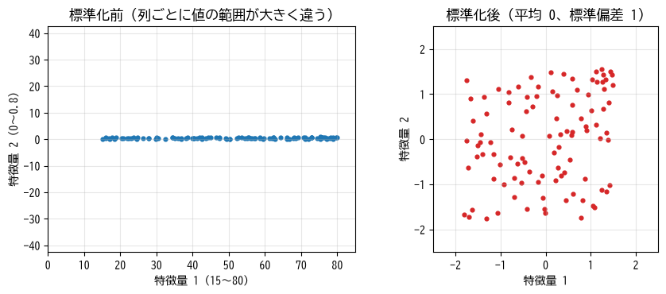

データと前処理
==============

機械学習のモデルの性能は、モデルの選択以上にデータの質と扱い方に左右される。この章では、機械学習で扱うデータの形式と、モデルに入力する前に行う前処理、そしてデータの分割方法を説明する。

特徴量とラベル
--------------

教師あり学習では、1 件のデータ（**サンプル**）は特徴量とラベルの組からなる。家賃の予測であれば、次のような表形式のデータになる。

.. list-table:: 表形式データの例（家賃の予測）
   :header-rows: 1
   :widths: 20 20 20 20 20

   * - 広さ（m\ :sup:`2`）
     - 築年数
     - 最寄り駅
     - 駅徒歩（分）
     - 家賃（万円）
   * - 45.0
     - 12
     - A 駅
     - 8
     - 8.2
   * - 22.5
     - 30
     - C 駅
     - 15
     - 4.1
   * - 60.3
     - （空欄）
     - B 駅
     - 5
     - 11.5

この例では、「家賃」が予測したいラベル、それ以外の列が特徴量である。特徴量には、広さのような\ **数値の特徴量**\ と、最寄り駅のような\ **カテゴリの特徴量**\ がある。また、3 行目の築年数のように値が記録されていない\ **欠損値**\ を含むこともある。

多くの機械学習のモデルは数値の行列しか扱えないため、データをモデルに渡す前に、欠損値を処理し、カテゴリを数値に変換し、数値の範囲をそろえる必要がある。これらの作業を\ **前処理**\ と呼ぶ。

表形式以外のデータ
^^^^^^^^^^^^^^^^^^

画像や文章も、最終的には数値の配列としてモデルに入力する。

* **画像**: 各画素の明るさを数値で表した配列である。グレースケール画像なら「高さ × 幅」、カラー画像なら「チャネル（赤・緑・青）× 高さ × 幅」の形状を持つ（第 11 章）。
* **文章**: 文章を単語などの単位（トークン）に分割し、各トークンに番号を割り当てて整数の列として表す。さらに、各トークンを数値のベクトルに変換して使う（第 12 章）。

深層学習が登場する以前は、画像や文章からどのような数値を取り出すか（**特徴量エンジニアリング**）を人間が工夫する必要があった。深層学習の大きな利点は、生の画素値やトークンの列から有用な特徴を自動的に学習できることにある。

欠損値と外れ値
--------------

欠損値の扱い
^^^^^^^^^^^^

欠損値の扱い方には主に次の方法がある。

* **欠損値を含むサンプルを削除する**: 最も簡単だが、欠損値が多いとデータが大きく減る。また、欠損が特定の条件で起こりやすい場合（例: 古い物件ほど築年数が記録されていない）、削除によってデータに偏りが生じる。
* **代表値で補完する**: その列の平均値や中央値、最頻値で埋める。外れ値の影響を受けにくい中央値がよく使われる。
* **欠損していたことを特徴量として追加する**: 「築年数が欠損しているか」を表す 0 / 1 の列を追加する。欠損そのものが予測の手がかりになる場合に有効である。

なお、第 7 章で説明する勾配ブースティングのライブラリの多くは、欠損値をそのまま扱える。

外れ値の扱い
^^^^^^^^^^^^

他の値から極端に離れた値を\ **外れ値**\ と呼ぶ。外れ値には、入力の誤り（例: 広さが 4500 m\ :sup:`2` と記録されている）のように修正・削除すべきものと、まれだが正しい値のように残すべきものがある。機械的に削除せず、まずはデータを可視化して原因を確認することが重要である。

数値の特徴量のスケーリング
--------------------------

特徴量ごとに値の範囲（スケール）が大きく異なると、多くの手法で問題が生じる。たとえば k 近傍法（第 5 章）のように距離を使う手法では、値の範囲が大きい特徴量が距離をほぼ決めてしまう。また、勾配降下法（第 4 章）では、スケールの違いによって学習が遅くなる。

そこで、特徴量のスケールをそろえる\ **スケーリング**\ を行う。代表的な方法は次の 2 つである。

* :term:`標準化`: 各特徴量から平均 :math:`\mu` を引き、標準偏差 :math:`\sigma` で割る。変換後の平均は 0、標準偏差は 1 になる。

  .. math::

     x' = \frac{x - \mu}{\sigma}

* **正規化**\ （min-max スケーリング）: 各特徴量を最小値が 0、最大値が 1 になるように変換する。

  .. math::

     x' = \frac{x - x_{\min}}{x_{\max} - x_{\min}}

一般には標準化がよく使われる。正規化は外れ値があると、ほとんどの値が狭い範囲に押し込められてしまう。:numref:`fig-ch03-scaling` に標準化の効果を示す。

.. _fig-ch03-scaling:

   標準化の前後。左図では特徴量 2 の値の範囲が特徴量 1 に比べて非常に狭いため、点が横一列に並んで見える。標準化すると両方の特徴量が同じ程度の範囲に収まる。

なお、決定木やそれにもとづく手法（第 7 章）は特徴量の大小関係しか使わないため、スケーリングの影響を受けない。

カテゴリの特徴量の符号化
------------------------

「A 駅」「B 駅」「C 駅」のようなカテゴリを数値に変換することを\ **符号化**\ と呼ぶ。単純に A 駅 = 0、B 駅 = 1、C 駅 = 2 と番号を振ると、モデルは「C 駅は A 駅の 2 倍」「B 駅は A 駅と C 駅の中間」のような、本来存在しない大小関係を読み取ってしまう。

そこで、カテゴリの種類ごとに列を用意し、該当する列だけを 1、それ以外を 0 とする :term:`one-hot 符号化`\ がよく使われる。

.. list-table:: one-hot 符号化の例
   :header-rows: 1
   :widths: 25 25 25 25

   * - 最寄り駅
     - A 駅
     - B 駅
     - C 駅
   * - A 駅
     - 1
     - 0
     - 0
   * - C 駅
     - 0
     - 0
     - 1
   * - B 駅
     - 0
     - 1
     - 0

one-hot 符号化は、カテゴリの種類が数千を超えるような場合には列が多くなりすぎる。その場合は、出現頻度の低いカテゴリを「その他」にまとめる、決定木系の手法でカテゴリを直接扱う、深層学習の埋め込み（第 12 章）を使う、などの方法を取る。

一方、「小・中・大」のように順序に意味があるカテゴリは、0、1、2 のような番号に変換してもよい。

データの分割
------------

モデルの目的は、学習に使ったデータではなく、**将来の未知のデータ**\ に対して正しく予測することである。この能力を\ :term:`汎化性能`\ と呼ぶ。学習に使ったデータで性能を測ると、モデルがデータを丸暗記しているだけでも高い性能が出てしまうため、汎化性能を正しく見積もれない。

そこで、手元のデータを次の 3 つに分割する。

.. list-table:: データの分割
   :header-rows: 1
   :widths: 20 50 30

   * - 名称
     - 用途
     - 割合の目安
   * - 訓練データ
     - モデルのパラメータを学習する。
     - 60〜80 %
   * - 検証データ
     - ハイパーパラメータの調整やモデルの選択に使う。
     - 10〜20 %
   * - テストデータ
     - 最終的な性能の評価に一度だけ使う。
     - 10〜20 %

:term:`訓練データ`\ でモデルのパラメータを学習し、:term:`検証データ`\ でモデルの設定（第 4 章で説明するハイパーパラメータ）を調整する。:term:`テストデータ`\ は、すべての調整が終わった後に、最終的な性能を見積もるためだけに使う。テストデータの結果を見てモデルを調整し直すと、テストデータに合わせ込んだことになり、性能を楽観的に見積もってしまう。

データが少ない場合は、検証データを固定せずに交差検証（第 6 章）を使うことも多い。

分割のときの注意
^^^^^^^^^^^^^^^^

* **ランダムに分割する**: データが何らかの順序（例: ラベルの順）で並んでいることがあるため、シャッフルしてから分割する。
* **クラスの比率を保つ**: 分類問題で特定のクラスが少ない場合、訓練・検証・テストの各データにクラスが同じ比率で含まれるように分割する（**層化抽出**）。scikit-learn の ``train_test_split`` では ``stratify`` 引数で指定できる。
* **時系列データは時間で分割する**: 売上の予測のように過去から未来を予測する問題では、ランダムに分割すると「未来のデータで学習して過去を予測する」ことになってしまう。ある時点より前を訓練データ、後をテストデータとする。
* **関連のあるサンプルを分ける**: 同じ患者から複数のデータを取った場合などは、同じ患者のデータが訓練データとテストデータの両方に入らないようにする（グループ単位で分割する）。

データリーク
------------

本来は予測時に使えないはずの情報が学習に紛れ込んでしまうことを\ :term:`データリーク`\ と呼ぶ。データリークがあると、評価では非常に高い性能が出るのに、運用を始めると性能が出ないという事態が起こる。典型的な例を次に示す。

* **ラベルから作られた特徴量**: たとえば「解約するか」を予測するモデルに「解約手続きの日付」を特徴量として入れてしまう。
* **前処理での情報の漏れ**: 標準化に使う平均と標準偏差を、テストデータを含むデータ全体から計算してしまう。前処理の統計量は訓練データだけから求め、同じ値を使って検証データやテストデータを変換しなければならない。
* **分割の誤り**: 前節で述べた、時系列データのランダムな分割や、関連のあるサンプルの分割の誤り。

データリークは見つけにくい。性能が「良すぎる」と感じたら、まずデータリークを疑うとよい。

scikit-learn による前処理
-------------------------

scikit-learn では、前処理もモデルと同じく「``fit`` で訓練データから統計量を学習し、``transform`` でデータを変換する」という共通の使い方になっている。次のサンプルは、架空の家賃データに対して、数値の列には欠損値の補完と標準化を、カテゴリの列には one-hot 符号化を適用する例である。

.. literalinclude:: ../examples/ch03_preprocessing.py
   :language: python
   :linenos:
   :pyobject: main
   :caption: ColumnTransformer による前処理（ch03_preprocessing.py より抜粋）

* 6〜8 行目で、特徴量とラベルを分けたうえで訓練データとテストデータに分割している。
* 10〜17 行目で、列ごとに適用する前処理を定義している。``Pipeline`` は複数の処理を順に適用し、``ColumnTransformer`` は列ごとに異なる処理を適用する。
* 20〜21 行目が重要である。``fit_transform`` は訓練データだけに適用し、テストデータには ``transform`` だけを適用する。これにより、補完に使う中央値や標準化に使う平均・標準偏差は訓練データだけから計算される。

実行結果の一部を次に示す。one-hot 符号化によって最寄り駅が 3 つの列に展開され、標準化後の訓練データの平均と標準偏差がそれぞれ 0 と 1 になっていることが分かる。

.. code-block:: text
   :linenos:

   前処理後の列名: ['num__area', 'num__age', 'cat__station_A駅', 'cat__station_B駅', 'cat__station_C駅']
   訓練データの形状: (160, 5)  テストデータの形状: (40, 5)
   標準化後の訓練データの平均 (ほぼ 0): [ 0. -0.]
   標準化後の訓練データの標準偏差 (ほぼ 1): [1. 1.]

サンプルコードの全体は :download:`ch03_preprocessing.py <../examples/ch03_preprocessing.py>` からダウンロードできる。

実務では、前処理とモデルを 1 つの ``Pipeline`` にまとめておくとよい。そうすれば、交差検証や本番環境での予測のときにも、前処理が訓練データだけから学習されることが自動的に保証される（第 13 章）。

まとめ
------

* モデルに入力する前に、欠損値の処理、数値のスケーリング、カテゴリの符号化などの前処理を行う。
* カテゴリの特徴量は、順序に意味がなければ one-hot 符号化する。
* データは訓練データ・検証データ・テストデータに分割し、テストデータは最終評価に一度だけ使う。
* 前処理の統計量は訓練データだけから求める。予測時に使えない情報が学習に混入するデータリークに注意する。
