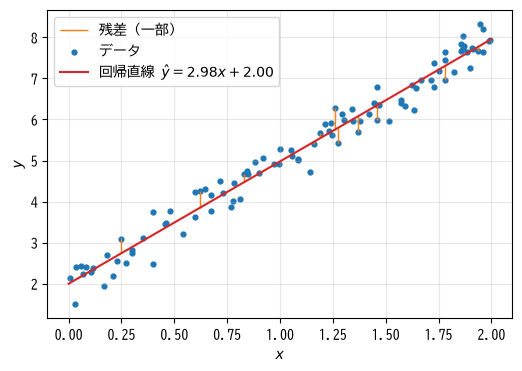
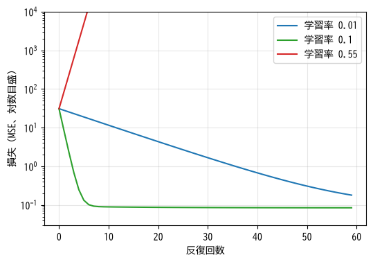
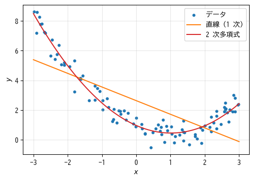

回帰
====

この章では、教師あり学習のうち、数値を予測する\ **回帰**\ を扱う。最も基本的な手法である線形回帰を題材に、「モデルを定義する」「損失関数を定義する」「損失関数を最小化するパラメータを求める」という機械学習の基本的な流れを説明する。この流れは、第 9 章以降の深層学習でもそのまま使われる。

線形回帰のモデル
----------------

まず、特徴量が 1 つだけの場合を考える。:numref:`fig-ch04-linear-fit` の青い点のように、特徴量 :math:`x` とラベル :math:`y` の間におおよそ直線的な関係があるとき、その関係を直線

.. math::

   \hat{y} = w x + b

で表すのが\ **線形回帰**\ である。:math:`\hat{y}`\ （ワイハット）はモデルによる予測値を表し、正解の :math:`y` と区別するためにハット記号を付ける。:math:`w` を\ **重み**、:math:`b` を\ **バイアス**\ （切片）と呼ぶ。:math:`w` と :math:`b` がこのモデルのパラメータであり、データに最もよく当てはまる値を求めることが学習の目的である。

.. _fig-ch04-linear-fit:

   線形回帰。オレンジ色の線は、正解の値と予測値の差（残差）を表す。

特徴量が :math:`d` 個ある場合は、各特徴量に重みを掛けて足し合わせる。

.. math::

   \hat{y} = w_1 x_1 + w_2 x_2 + \cdots + w_d x_d + b = \boldsymbol{w}^\top \boldsymbol{x} + b

たとえば家賃の予測なら、「広さ × :math:`w_1` + 築年数 × :math:`w_2` + 駅徒歩 × :math:`w_3` + :math:`b`」で家賃を予測する。学習後の重みを見れば、各特徴量が予測にどう影響しているかが分かるという利点もある（ただし、特徴量のスケールがそろっていることが前提である）。

:math:`n` 件のデータをまとめて行列 :math:`X`\ （:math:`n \times d`）で表せば、全サンプルの予測値は :math:`\hat{\boldsymbol{y}} = X\boldsymbol{w} + b` という 1 つの式で計算できる。さらに、:math:`X` の先頭に値がすべて 1 の列を追加し、:math:`\boldsymbol{w}` の先頭に :math:`b` を加えれば、バイアスを重みの一部として :math:`\hat{\boldsymbol{y}} = X\boldsymbol{w}` と簡潔に書ける。以降の式ではこの書き方を使う。

損失関数
--------

「データに最もよく当てはまる」ことを数値で表すために、予測値と正解の食い違いの大きさを表す関数を定義する。これを\ :term:`損失関数`\ と呼ぶ。回帰で最もよく使われる損失関数は、予測値と正解の差（**残差**）の 2 乗の平均である\ **平均二乗誤差**\ （Mean Squared Error、MSE）である。

.. math::

   L(\boldsymbol{w}) = \frac{1}{n} \sum_{i=1}^{n} (\hat{y}_i - y_i)^2 = \frac{1}{n} \| X\boldsymbol{w} - \boldsymbol{y} \|^2

ここで :math:`\| \boldsymbol{v} \|^2` はベクトルの各要素の 2 乗の和を表す。差を 2 乗するのは、正の誤差と負の誤差が打ち消し合わないようにするためと、微分しやすくするためである。

損失関数は、パラメータ :math:`\boldsymbol{w}` の関数であることに注意してほしい。データ :math:`X` と :math:`\boldsymbol{y}` は固定されており、:math:`\boldsymbol{w}` を変えると予測値が変わり、損失の値も変わる。学習とは、損失関数 :math:`L(\boldsymbol{w})` を最小にする :math:`\boldsymbol{w}` を探すことである。

正規方程式による解法
--------------------

線形回帰の場合、平均二乗誤差を最小にする :math:`\boldsymbol{w}` は式変形で直接求められる。損失関数の勾配を 0 とおくと、次の\ **正規方程式**\ が得られる。

.. math::

   X^\top X \boldsymbol{w} = X^\top \boldsymbol{y}

これを解けば最適な :math:`\boldsymbol{w}` が得られる。NumPy では ``np.linalg.solve`` で連立方程式として解ける。

.. literalinclude:: ../examples/ch04_linear_regression_scratch.py
   :language: python
   :linenos:
   :pyobject: fit_normal_equation
   :caption: 正規方程式による線形回帰（ch04_linear_regression_scratch.py より抜粋）

このように、式変形によって厳密に求めた解を\ **解析解**\ と呼ぶ。解析解が求められるのは線形回帰のような単純なモデルに限られる。第 5 章のロジスティック回帰や第 9 章のニューラルネットワークでは解析解が得られないため、次に説明する勾配降下法を使う。また、線形回帰でも特徴量の数 :math:`d` が非常に大きい場合は、:math:`d \times d` の行列 :math:`X^\top X` を扱う正規方程式の計算量が問題になる。

勾配降下法
----------

アルゴリズム
^^^^^^^^^^^^

:term:`勾配降下法`\ は、損失関数の勾配（第 2 章）の逆方向にパラメータを少しずつ動かして、損失関数の最小値を探す方法である。

1. パラメータ :math:`\boldsymbol{w}` を適当な値（例: すべて 0）で初期化する。
2. 現在の :math:`\boldsymbol{w}` での損失関数の勾配 :math:`\nabla L(\boldsymbol{w})` を計算する。
3. パラメータを次の式で更新する。

   .. math::

      \boldsymbol{w} \leftarrow \boldsymbol{w} - \eta \nabla L(\boldsymbol{w})

4. 損失が十分小さくなるか、決められた回数に達するまで 2〜3 を繰り返す。

:math:`\eta`\ （イータ）は 1 回の更新でどれだけパラメータを動かすかを決める正の定数で、:term:`学習率`\ と呼ぶ。山の中で目隠しをして谷底を目指すとき、足元の傾きを確かめながら下り坂の方向に一歩ずつ進む様子を想像するとよい。学習率は一歩の大きさにあたる。

平均二乗誤差の勾配は、連鎖律を使って計算すると次のようになる。

.. math::

   \nabla L(\boldsymbol{w}) = \frac{2}{n} X^\top (X\boldsymbol{w} - \boldsymbol{y})

:math:`X\boldsymbol{w} - \boldsymbol{y}` は各サンプルの残差を並べたベクトルである。つまり勾配は、「残差」と「その残差を生んだ特徴量の値」の積をサンプル全体で平均したものになっている。残差が大きいサンプルほど、パラメータの更新に強く影響する。

実装
^^^^

勾配降下法による線形回帰を NumPy で実装すると次のようになる。

.. literalinclude:: ../examples/ch04_linear_regression_scratch.py
   :language: python
   :linenos:
   :pyobject: fit_gradient_descent
   :caption: 勾配降下法による線形回帰（ch04_linear_regression_scratch.py より抜粋）

* 3 行目で、バイアスを扱うために値が 1 の列を追加している。
* 7 行目で現在のパラメータによる予測値を計算し、8 行目で上の式に従って勾配を計算している。
* 9 行目で、学習率を掛けた勾配を引いてパラメータを更新している。

:math:`y = 3x + 2` にノイズを加えて生成したデータで学習した結果を次に示す。勾配降下法で求めたパラメータは、正規方程式による解析解と一致している。

.. code-block:: text
   :linenos:

   正規方程式: 切片 = 1.998, 傾き = 2.980
   epoch    0: loss = 31.0796
   epoch  100: loss = 0.0846
   epoch  200: loss = 0.0846
   epoch  300: loss = 0.0846
   epoch  400: loss = 0.0846
   勾配降下法: 切片 = 1.998, 傾き = 2.980
   訓練データでの MSE = 0.0846

サンプルコードの全体は :download:`ch04_linear_regression_scratch.py <../examples/ch04_linear_regression_scratch.py>` からダウンロードできる。

学習率の選び方
^^^^^^^^^^^^^^

学習率は、学習の成否を大きく左右する。:numref:`fig-ch04-learning-rate` に、学習率を変えたときの損失の推移を示す。

.. _fig-ch04-learning-rate:

   学習率と損失の推移（縦軸は対数目盛）

* 学習率が小さすぎる（0.01）と、損失は確実に減るが、収束までに多くの反復が必要になる。
* 学習率が適切（0.1）だと、少ない反復で損失が最小値付近に達する。
* 学習率が大きすぎる（0.55）と、最小値を飛び越えて反対側に行き、さらに大きく飛び越えることを繰り返すため、損失が発散する。

適切な学習率は、問題やモデルによって異なる。実際には、0.1、0.01、0.001 のように 10 倍刻みでいくつか試し、損失が順調に減るものを選ぶことが多い。特徴量のスケールがそろっていないと、ある方向には学習率が大きすぎ、別の方向には小さすぎるという状況になりやすい。これが、勾配降下法を使う前に標準化（第 3 章）を行う理由の 1 つである。

ハイパーパラメータ
^^^^^^^^^^^^^^^^^^

学習率や反復回数のように、学習によって決まるのではなく、学習を始める前に人間が決めておく値を\ :term:`ハイパーパラメータ`\ と呼ぶ。重み :math:`\boldsymbol{w}` のような、学習によって決まるパラメータとは区別する。ハイパーパラメータは、検証データでの性能を見ながら調整する（第 6 章）。

確率的勾配降下法
^^^^^^^^^^^^^^^^

上の実装では、勾配を計算するたびに全サンプルを使っている。これを\ **バッチ勾配降下法**\ と呼ぶ。データが数百万件に及ぶと、1 回の更新に時間がかかりすぎる。そこで、毎回ランダムに選んだ一部のサンプル（**ミニバッチ**）だけで勾配を近似して更新する方法がよく使われる。これを\ :term:`確率的勾配降下法`\ （Stochastic Gradient Descent、SGD）と呼ぶ。深層学習では SGD とその改良版が標準的に使われる（第 10 章）。

多項式回帰
----------

データの関係が直線的でない場合、線形回帰をそのまま使うと当てはまりが悪い。しかし、特徴量 :math:`x` から :math:`x^2` や :math:`x^3` といった新しい特徴量を作って追加すれば、

.. math::

   \hat{y} = w_1 x + w_2 x^2 + \cdots + w_k x^k + b

のように曲線を表現できる。これを\ **多項式回帰**\ と呼ぶ。この式は :math:`x` については非線形だが、パラメータ :math:`w_1, \ldots, w_k` については線形なので、線形回帰と同じ方法で学習できる。:numref:`fig-ch04-polynomial` に、2 次関数に従うデータに直線と 2 次多項式を当てはめた例を示す。

.. _fig-ch04-polynomial:

   直線と 2 次多項式による当てはめ

このように、元の特徴量を変換・組み合わせて新しい特徴量を作れば、線形なモデルでも複雑な関係を表現できる。ただし、次数を上げすぎると、訓練データのノイズまで再現してしまう過学習が起こる。これは第 6 章で詳しく説明する。

scikit-learn による線形回帰
---------------------------

実務では、線形回帰を自分で実装することはなく、scikit-learn の ``LinearRegression`` を使う。scikit-learn のモデルは、``fit`` メソッドで学習し、``predict`` メソッドで予測するという共通の使い方になっている。

.. literalinclude:: ../examples/ch04_linear_regression_sklearn.py
   :language: python
   :linenos:
   :pyobject: main
   :caption: scikit-learn による線形回帰と多項式回帰（ch04_linear_regression_sklearn.py より抜粋）

* 8〜9 行目で線形回帰を学習し、10 行目で学習結果を表示している。学習後のバイアスは ``intercept_``、重みは ``coef_`` 属性で参照できる。scikit-learn では、学習によって得られた属性の名前の末尾に ``_`` が付く。
* 18 行目の ``make_pipeline`` は、``PolynomialFeatures`` による特徴量の追加と ``LinearRegression`` を連結する。``fit`` を呼ぶと、データが順に各処理を通過する。

実行結果を次に示す。2 次多項式の方が、平均二乗誤差が 1 桁小さくなっている。

.. code-block:: text
   :linenos:

   切片 = 1.998, 傾き = 2.980
   x = 1.5 での予測値: [6.46834888]
   直線での MSE = 2.014
   2 次多項式での MSE = 0.194

サンプルコードの全体は :download:`ch04_linear_regression_sklearn.py <../examples/ch04_linear_regression_sklearn.py>` からダウンロードできる。

回帰の評価指標については、第 6 章でまとめて説明する。

まとめ
------

* 線形回帰は、特徴量の重み付きの和で数値を予測するモデルである。
* 予測と正解の食い違いを損失関数（回帰では平均二乗誤差）で表し、それを最小にするパラメータを求めることが学習である。
* 勾配降下法は、損失関数の勾配の逆方向にパラメータを少しずつ動かして最小値を探す。解析解が得られないモデルでも使える汎用的な方法である。
* 学習率は重要なハイパーパラメータで、小さすぎると学習が遅く、大きすぎると発散する。
* 特徴量を変換・追加すれば、線形なモデルでも曲線的な関係を表現できる。
