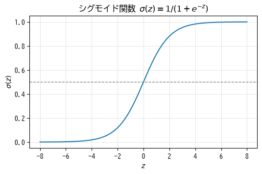
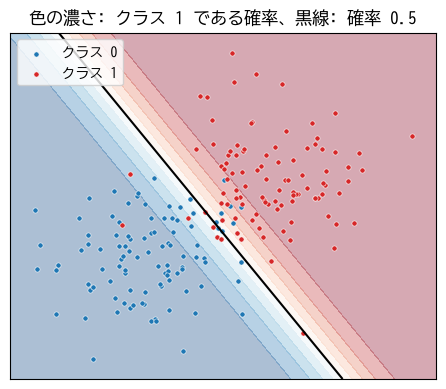
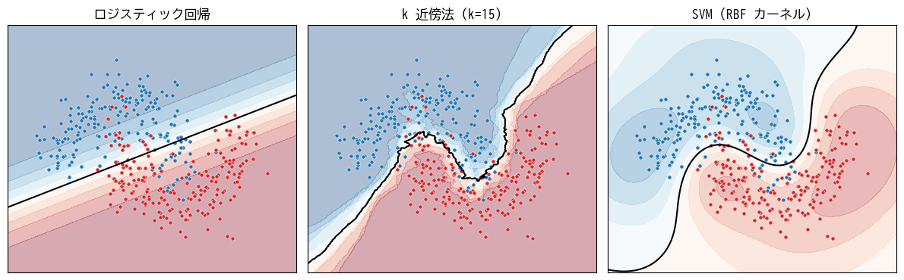

分類
====

この章では、教師あり学習のうち、カテゴリを予測する\ **分類**\ を扱う。まず 2 クラスの分類を行うロジスティック回帰を題材に、分類のための損失関数を説明する。その後、多クラスへの拡張と、k 近傍法、サポートベクターマシンという性質の異なる手法を紹介する。決定木にもとづく手法は第 7 章で扱う。

2 値分類とロジスティック回帰
----------------------------

2 つのクラスのどちらに属するかを予測する問題を **2 値分類**\ と呼ぶ。2 つのクラスを 0 と 1 で表し、たとえば「迷惑メールなら 1、通常のメールなら 0」のようにする。慣習として、検出したい方（迷惑メール、病気あり、不正利用など）をクラス 1（**陽性**）、そうでない方をクラス 0（**陰性**）とすることが多い。

シグモイド関数
^^^^^^^^^^^^^^

分類では、「クラス 1 である確率」を出力するモデルが便利である。確率が分かれば、「確率が 0.5 以上ならクラス 1 と判定する」のように使えるだけでなく、判定の確からしさも分かる。

線形回帰の出力 :math:`z = \boldsymbol{w}^\top \boldsymbol{x} + b` は任意の実数値を取るため、そのままでは確率として使えない。そこで、任意の実数を 0〜1 の範囲に変換する\ :term:`シグモイド関数`\ を使う（:numref:`fig-ch05-sigmoid`）。

.. math::

   \sigma(z) = \frac{1}{1 + e^{-z}}

.. _fig-ch05-sigmoid:

   シグモイド関数。:math:`z = 0` のとき 0.5 となり、:math:`z` が大きいほど 1 に、小さいほど 0 に近づく。

**ロジスティック回帰**\ は、線形回帰の出力をシグモイド関数に通して、クラス 1 である確率を予測するモデルである。

.. math::

   p = P(y = 1 \mid \boldsymbol{x}) = \sigma(\boldsymbol{w}^\top \boldsymbol{x} + b)

名前に「回帰」と付いているが、分類のための手法である。シグモイド関数に入力する前の値 :math:`z` は\ :term:`ロジット`\ と呼ばれる。

決定境界
^^^^^^^^

確率 0.5 をしきい値として判定する場合、:math:`\sigma(z) \geq 0.5` は :math:`z \geq 0` と同じであるから、

.. math::

   \boldsymbol{w}^\top \boldsymbol{x} + b = 0

がクラスを分ける境界になる。このように、特徴量の空間をクラスごとの領域に分ける境界を\ **決定境界**\ と呼ぶ。ロジスティック回帰の決定境界は、特徴量が 2 つなら直線、3 つなら平面になる（:numref:`fig-ch05-logistic-boundary`）。決定境界が直線（平面）になるモデルを\ **線形分類器**\ と呼ぶ。

.. _fig-ch05-logistic-boundary:

   ロジスティック回帰による 2 値分類。決定境界から離れるほど、予測の確率が 0 または 1 に近づく。

交差エントロピー
----------------

ロジスティック回帰の学習に使う損失関数を考える。正解が :math:`y = 1` のときは予測確率 :math:`p` が大きいほど良く、:math:`y = 0` のときは :math:`p` が小さいほど良い。これを 1 つの式で表したものが **2 値交差エントロピー**\ である。

.. math::

   L = -\frac{1}{n} \sum_{i=1}^{n} \left\{ y_i \log p_i + (1 - y_i) \log (1 - p_i) \right\}

:math:`y_i = 1` のサンプルでは第 1 項 :math:`-\log p_i` だけが残り、:math:`y_i = 0` のサンプルでは第 2 項 :math:`-\log(1 - p_i)` だけが残る。たとえば正解が 1 のとき、予測確率が 0.9 なら損失は :math:`-\log 0.9 \approx 0.11` と小さいが、0.01 なら :math:`-\log 0.01 \approx 4.6` と大きくなる。自信を持って間違えるほど、大きな罰が与えられる。

:term:`交差エントロピー`\ は、第 2 章で説明した最尤推定から導かれる損失関数である。分類に平均二乗誤差を使うこともできなくはないが、シグモイド関数と組み合わせると、大きく間違えているときに勾配がかえって小さくなり、学習が進みにくい。

交差エントロピーの勾配は、連鎖律を使って計算すると次のような簡単な形になる。

.. math::

   \frac{\partial L}{\partial \boldsymbol{w}} = \frac{1}{n} \sum_{i=1}^{n} (p_i - y_i) \boldsymbol{x}_i, \qquad
   \frac{\partial L}{\partial b} = \frac{1}{n} \sum_{i=1}^{n} (p_i - y_i)

これは、第 4 章で求めた線形回帰の勾配と（定数倍を除いて）同じ形であり、「予測と正解の差」×「特徴量」の平均になっている。

ロジスティック回帰の実装
------------------------

勾配降下法によるロジスティック回帰を NumPy で実装すると次のようになる。

.. literalinclude:: ../examples/ch05_logistic_regression_scratch.py
   :language: python
   :linenos:
   :pyobject: fit
   :caption: ロジスティック回帰の学習（ch05_logistic_regression_scratch.py より抜粋）

* 7 行目で各サンプルがクラス 1 である確率を計算している。
* 9〜11 行目で、上の式に従って勾配を求め、パラメータを更新している。

2 つの正規分布から生成した 2 次元のデータで学習した結果を次に示す。損失が減少し、訓練データの 92.5 % を正しく分類できている。

.. code-block:: text
   :linenos:

   epoch    0: loss = 0.6931
   epoch  200: loss = 0.1622
   epoch  400: loss = 0.1620
   epoch  600: loss = 0.1620
   epoch  800: loss = 0.1620
   w = [2.48954831 1.67846907], b = -0.555
   訓練データでの正解率 = 0.925
   点 (0.0, 0.5) がクラス 1 である確率: [0.57046278]

最初の損失 0.6931 は :math:`-\log 0.5` に等しい。パラメータがすべて 0 の状態では、どのサンプルに対しても確率 0.5 を出力するためである。

サンプルコードの全体は :download:`ch05_logistic_regression_scratch.py <../examples/ch05_logistic_regression_scratch.py>` からダウンロードできる。

多クラス分類
------------

3 つ以上のクラスから 1 つを選ぶ問題を\ **多クラス分類**\ と呼ぶ。手書き数字の認識（0〜9 の 10 クラス）などが代表例である。

ソフトマックス関数
^^^^^^^^^^^^^^^^^^

:math:`K` クラスの分類では、クラスごとに重みベクトル :math:`\boldsymbol{w}_k` とバイアス :math:`b_k` を用意し、各クラスのスコア（ロジット）\ :math:`z_k = \boldsymbol{w}_k^\top \boldsymbol{x} + b_k` を計算する。そして、:term:`ソフトマックス関数`\ で各クラスの確率に変換する。

.. math::

   p_k = \frac{e^{z_k}}{\sum_{j=1}^{K} e^{z_j}}

ソフトマックス関数の出力はすべて正で、合計は 1 になる。また、スコアの大小関係は保たれるので、スコアが最大のクラスが確率も最大になる。2 クラスの場合、ソフトマックス関数はシグモイド関数と同じ働きをする。

ソフトマックス関数を実装するときは、:math:`e^{z_k}` がオーバーフローしないように、すべての :math:`z_k` から最大値を引いてから計算する。この操作は結果を変えない（第 12 章のサンプルコードを参照）。

多クラスの交差エントロピー
^^^^^^^^^^^^^^^^^^^^^^^^^^

多クラス分類の損失関数には、正解クラスの予測確率の対数にマイナスを付けた\ **交差エントロピー**\ を使う。

.. math::

   L = -\frac{1}{n} \sum_{i=1}^{n} \log p_{i, y_i}

ここで :math:`p_{i, y_i}` は、:math:`i` 番目のサンプルの正解クラス :math:`y_i` に対する予測確率である。正解ラベルを、正解クラスだけが 1 で他が 0 のベクトル（one-hot 符号化した表現）\ :math:`\boldsymbol{t}_i` で表すと、:math:`L = -\frac{1}{n} \sum_i \sum_k t_{ik} \log p_{ik}` とも書ける。この「ソフトマックス関数 + 交差エントロピー」の組み合わせは、深層学習の分類でも標準的に使われる（第 9 章）。

k 近傍法
--------

**k 近傍法**\ （k-Nearest Neighbors、k-NN）は、新しいデータを分類するとき、訓練データの中から距離が近い :math:`k` 個のサンプルを探し、その多数決でクラスを決める手法である。

* 学習時には訓練データを記憶するだけで、パラメータの最適化は行わない。
* :math:`k` が小さいと決定境界が複雑になり、ノイズの影響を受けやすい。:math:`k` が大きいと境界が滑らかになる。
* 距離にもとづくため、特徴量の標準化が必要である。
* 予測のたびに全訓練データとの距離を計算するため、データが多いと予測が遅い。また、特徴量の次元が高いと、どのサンプルも同じくらい遠くなってしまい、うまく機能しない（**次元の呪い**）。

仕組みが単純で直感的に理解しやすいため、他の手法と比較する基準（ベースライン）として使われることが多い。

サポートベクターマシン
----------------------

マージン最大化
^^^^^^^^^^^^^^

**サポートベクターマシン**\ （Support Vector Machine、SVM）は、2 つのクラスを分ける決定境界のうち、境界に最も近いサンプルまでの距離（**マージン**）が最大になるものを選ぶ手法である。マージンが大きいほど、少しずれた位置に新しいデータが来ても正しく分類できると期待できる。境界に最も近く、境界の位置を決めているサンプルを\ **サポートベクター**\ と呼ぶ。

実際のデータは完全には分離できないことが多いため、一部のサンプルがマージンの内側に入ったり誤分類されたりすることを許す。どの程度許すかをハイパーパラメータ :math:`C` で調整する。:math:`C` が大きいほど誤分類を厳しく罰し、訓練データに合わせようとする。

カーネル法
^^^^^^^^^^

SVM の大きな特徴は、**カーネル法**\ によって非線形な決定境界を学習できることである。第 4 章の多項式回帰では、特徴量を変換して増やすことで曲線を表現した。カーネル法は、この「特徴量を高次元の空間に変換してから線形に分離する」ことを、変換後の特徴量を明示的に計算せずに行う技法である。

よく使われる **RBF カーネル**\ （ガウスカーネル）では、サンプル間の類似度を距離にもとづいて測り、複雑な曲線の決定境界を作れる。ハイパーパラメータ :math:`\gamma` は 1 つのサンプルの影響が及ぶ範囲を決め、大きいほど境界が複雑になる。

SVM はデータが数千〜数万件程度までの問題で高い性能を示すが、データ数が多くなると学習に時間がかかる。また、特徴量の標準化が必要である。

手法の比較
----------

三日月形の 2 クラスデータに 3 つの手法を適用したときの決定境界を\ :numref:`fig-ch05-classifiers` に示す。

.. _fig-ch05-classifiers:

   ロジスティック回帰、k 近傍法、SVM（RBF カーネル）の決定境界

ロジスティック回帰は線形分類器なので、決定境界は直線になり、三日月形を分離しきれない。k 近傍法と SVM は曲線の境界を学習できる。

次のサンプルは、scikit-learn で 3 つの手法を学習し、テストデータでの正解率を比較する。

.. literalinclude:: ../examples/ch05_classifiers_sklearn.py
   :language: python
   :linenos:
   :pyobject: main
   :caption: 分類器の比較（ch05_classifiers_sklearn.py より抜粋）

* 6〜10 行目で、各手法を ``StandardScaler`` による標準化と組み合わせたパイプラインを作っている。
* 12〜14 行目で各モデルを学習し、``score`` メソッドでテストデータでの正解率を求めている。
* 17 行目の ``predict_proba`` は、各クラスの確率を返す。

.. code-block:: text
   :linenos:

   ロジスティック回帰: テストデータでの正解率 = 0.900
   k 近傍法 (k=15): テストデータでの正解率 = 0.930
   SVM (RBF カーネル): テストデータでの正解率 = 0.910
   ロジスティック回帰による先頭 3 件のクラス確率:
    [[0.966 0.034]
    [0.106 0.894]
    [0.031 0.969]]

この例では線形分類器のロジスティック回帰でも 90 % の正解率が得られているが、境界付近のサンプルを取りこぼしている。どの手法が最も良いかはデータによって異なるため、実際には複数の手法を検証データで比較して選ぶ。比較のときの注意点は第 6 章で説明する。

サンプルコードの全体は :download:`ch05_classifiers_sklearn.py <../examples/ch05_classifiers_sklearn.py>` からダウンロードできる。

.. list-table:: 分類手法の特徴
   :header-rows: 1
   :widths: 22 26 26 26

   * - 手法
     - 長所
     - 短所
     - 主なハイパーパラメータ
   * - ロジスティック回帰
     - 高速。確率を出力する。重みから特徴量の影響を解釈しやすい。
     - 決定境界が線形に限られる。
     - 正則化の強さ（第 6 章）
   * - k 近傍法
     - 仕組みが単純。学習が不要。
     - 予測が遅い。高次元に弱い。
     - 近傍の数 :math:`k`
   * - SVM
     - カーネル法で複雑な境界を学習できる。中規模のデータで高性能。
     - 大規模データでは学習が遅い。確率を直接は出力しない。
     - :math:`C`、カーネルの種類、:math:`\gamma`

まとめ
------

* ロジスティック回帰は、線形の式をシグモイド関数に通して、クラス 1 である確率を予測する。
* 分類の損失関数には交差エントロピーを使う。自信を持って間違えるほど損失が大きくなる。
* 多クラス分類では、ソフトマックス関数で各クラスの確率を求め、交差エントロピーで学習する。
* k 近傍法は近いサンプルの多数決で分類し、SVM はマージンが最大になる境界を求める。いずれも特徴量の標準化が必要である。
