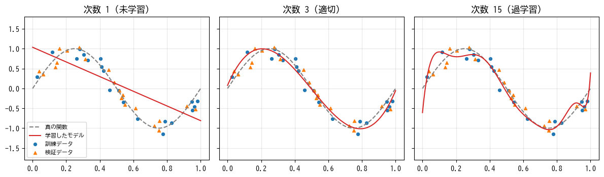
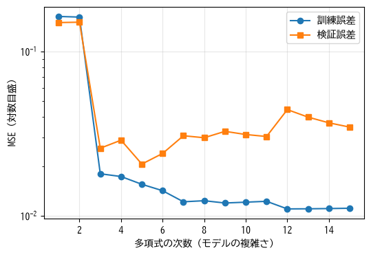
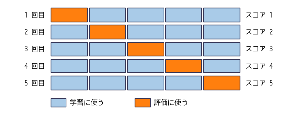
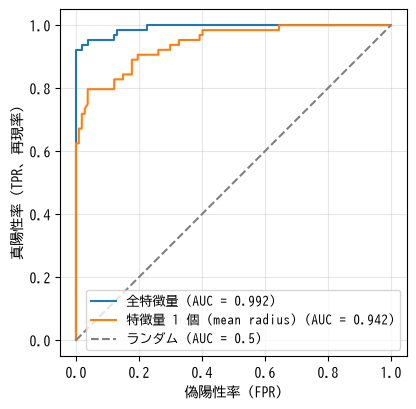

モデルの評価と改善
==================

機械学習で最も重要なのは、モデルが未知のデータに対してどの程度正しく予測できるか、すなわち汎化性能を正しく見積もることである。この章では、汎化性能を損なう過学習とその対策、信頼できる評価の方法、目的に応じた評価指標の選び方を説明する。ここで説明する考え方は、深層学習を含むすべての機械学習の手法に共通する。

過学習と未学習
--------------

第 4 章の多項式回帰で、多項式の次数を変えながら、sin 関数にノイズを加えたデータに当てはめてみる（:numref:`fig-ch06-under-over`）。青い丸が学習に使った訓練データ、オレンジ色の三角が学習に使っていない検証データである。

.. _fig-ch06-under-over:

   多項式の次数による当てはまりの違い

* **次数 1**: 直線では sin 関数の形を表現できず、訓練データにも検証データにも当てはまっていない。このように、モデルの表現力が不足してデータの傾向を捉えられない状態を\ :term:`未学習`\ と呼ぶ。
* **次数 3**: 真の関数に近い曲線が得られており、検証データにもよく当てはまっている。
* **次数 15**: 訓練データの点の近くを通ろうとして曲線が不自然に曲がり、特に両端で真の関数から大きく外れている。このように、訓練データのノイズまで学習してしまい、未知のデータに対する性能が下がる状態を\ :term:`過学習`\ と呼ぶ。

次数を 1 から 15 まで変えたときの、訓練データと検証データでの平均二乗誤差を\ :numref:`fig-ch06-error-vs-complexity` に示す。

.. _fig-ch06-error-vs-complexity:

   モデルの複雑さと誤差

モデルを複雑にするほど、訓練データでの誤差（**訓練誤差**）は単調に減っていく。一方、検証データでの誤差（**検証誤差**）は、ある複雑さまでは減るが、それを超えると増加に転じる。訓練誤差と検証誤差の差が大きく開いている状態が過学習である。

訓練誤差が小さいことは、良いモデルであることを意味しない。モデルの良し悪しは、必ず学習に使っていないデータで判断しなければならない。

バイアスとバリアンス
^^^^^^^^^^^^^^^^^^^^

予測の誤差は、概念的に次の 3 つに分解できる。

* **バイアス**: モデルの表現力が足りないために生じる、系統的なずれ。未学習の原因となる。
* **バリアンス**: 訓練データの選ばれ方によって、学習結果が大きく変わってしまうことによる誤差。過学習の原因となる。
* **ノイズ**: データ自体に含まれる、どのようなモデルでも取り除けない誤差。

単純なモデルはバイアスが大きくバリアンスが小さい。複雑なモデルはバイアスが小さくバリアンスが大きい。両者は一方を下げると他方が上がる関係にあり、これを\ **バイアス・バリアンスのトレードオフ**\ と呼ぶ。良いモデルを作るには、両者の釣り合いが取れた複雑さを選ぶ必要がある。

過学習への対策
^^^^^^^^^^^^^^

過学習を防ぐ主な方法は次のとおりである。

* **訓練データを増やす**: 最も確実な方法である。データが多ければ、ノイズに合わせ込むことが難しくなる。
* **モデルを単純にする**: 多項式の次数を下げる、決定木を浅くする、ニューラルネットワークの層やユニットを減らす、など。
* **正則化を使う**: 次節で説明する。
* **特徴量を減らす**: 予測に役立たない特徴量を除く。
* **早期終了やドロップアウトを使う**: 深層学習でよく使われる方法である（第 10 章）。

一方、未学習の場合は、モデルを複雑にする、有用な特徴量を追加する、などの対策を取る。

正則化
------

:term:`正則化`\ は、パラメータの値が大きくなりすぎないように、損失関数に罰則項を加える方法である。過学習したモデルは、訓練データの点を無理に通ろうとして、極端に大きな重みを持つことが多い。重みの大きさに罰則を与えれば、より滑らかで単純なモデルが選ばれやすくなる。

**L2 正則化**\ では、重みの 2 乗和を損失関数に加える。

.. math::

   L(\boldsymbol{w}) = \frac{1}{n} \sum_{i=1}^{n} (\hat{y}_i - y_i)^2 + \alpha \sum_{j=1}^{d} w_j^2

:math:`\alpha` は正則化の強さを決めるハイパーパラメータである。:math:`\alpha` が大きいほど重みは 0 に近づき、モデルは単純になる。L2 正則化を加えた線形回帰を\ **リッジ回帰**\ と呼ぶ。

**L1 正則化**\ では、重みの絶対値の和を加える。

.. math::

   L(\boldsymbol{w}) = \frac{1}{n} \sum_{i=1}^{n} (\hat{y}_i - y_i)^2 + \alpha \sum_{j=1}^{d} |w_j|

L1 正則化には、多くの重みをちょうど 0 にする性質がある。重みが 0 の特徴量は予測に使われないので、特徴量の選択が自動的に行われる。L1 正則化を加えた線形回帰を **Lasso 回帰**\ と呼ぶ。

バイアス :math:`b` は通常、正則化の対象に含めない。また、正則化は重みの大きさを比べるため、特徴量の標準化と組み合わせて使う。scikit-learn では、``Ridge`` と ``Lasso`` クラスの ``alpha`` 引数で正則化の強さを指定する。ただし、scikit-learn では損失の項の係数の付け方が上の式と異なるため、``alpha`` の値は上の式の :math:`\alpha` とそのままは対応しない。``LogisticRegression`` はデフォルトで L2 正則化が有効になっており、引数 ``C`` で強さを指定する（``C`` は :math:`\alpha` の逆数に相当し、小さいほど正則化が強い）。

次数 15 の多項式回帰に L2 正則化を加えた結果を次に示す。:math:`\alpha` が小さすぎると過学習が残り、大きすぎると未学習になる。適切な値（この例では 0.001）を選ぶと、検証誤差は次数 3 のモデル（0.0257）よりも小さくなる。

.. code-block:: text
   :linenos:

   --- 多項式の次数と誤差 (正則化なし) ---
   次数  1: 訓練 MSE = 0.1629, 検証 MSE = 0.1496
   次数  3: 訓練 MSE = 0.0180, 検証 MSE = 0.0257
   次数  9: 訓練 MSE = 0.0119, 検証 MSE = 0.0326
   次数 15: 訓練 MSE = 0.0111, 検証 MSE = 0.0346
   --- 次数 15 に L2 正則化 (Ridge) を加える ---
   alpha = 1e-06: 検証 MSE = 0.0261
   alpha = 0.001: 検証 MSE = 0.0202
   alpha = 0.1: 検証 MSE = 0.0446
   alpha = 10: 検証 MSE = 0.1247

交差検証
--------

データを訓練データと検証データに一度だけ分割する方法（**ホールドアウト法**）には、データが少ない場合に問題がある。検証データが少ないと、どのサンプルが検証データに選ばれたかによって評価の結果が大きくぶれてしまう。また、検証データの分だけ学習に使えるデータが減る。

そこで使われるのが\ :term:`交差検証`\ である。最もよく使われる **k 分割交差検証**\ では、次の手順で評価する（:numref:`fig-ch06-kfold`）。

1. データを :math:`k` 個のグループ（フォールド）に分ける。
2. 1 つのフォールドを検証用、残りの :math:`k - 1` 個を学習用として、モデルを学習・評価する。
3. 検証用のフォールドを入れ替えながら、2 を :math:`k` 回繰り返す。
4. :math:`k` 回の評価結果の平均を最終的な評価値とする。

.. _fig-ch06-kfold:

   5 分割交差検証。すべてのサンプルが一度ずつ検証に使われる。

:math:`k` には 5 や 10 がよく使われる。すべてのデータが一度ずつ評価に使われるため、ホールドアウト法より安定した評価が得られる。評価値の標準偏差を見れば、評価のばらつきも分かる。代わりに、学習を :math:`k` 回行う必要があるため計算時間がかかる。そのため、データが大量にある場合や、1 回の学習に時間のかかる深層学習では、ホールドアウト法がよく使われる。

分類問題ではクラスの比率を各フォールドで保つ\ **層化 k 分割交差検証**\ （scikit-learn の ``StratifiedKFold``）を、時系列データでは過去のデータで学習して未来のデータで検証する ``TimeSeriesSplit`` を使う。

交差検証を使う場合も、最終評価用のテストデータは別に取り分けておく。交差検証の結果を見てハイパーパラメータを選ぶと、その結果は選択に使ったデータに対して楽観的な値になるためである。

ハイパーパラメータの探索
------------------------

ハイパーパラメータは、交差検証の評価値が最も良くなるものを探して決める。代表的な探索方法は次の 2 つである。

* **グリッドサーチ**: 各ハイパーパラメータの候補値を決め、そのすべての組み合わせを試す。確実だが、ハイパーパラメータの数が増えると組み合わせが爆発的に増える。
* **ランダムサーチ**: 指定した範囲からランダムに組み合わせを選んで、決められた回数だけ試す。重要なハイパーパラメータが少数である場合が多いため、同じ試行回数ならグリッドサーチより良い結果が得られやすい。

学習率や正則化の強さのように、適切な値の桁が分からないハイパーパラメータは、0.001、0.01、0.1 のように対数スケールで候補を選ぶ。過去の試行結果をもとに次に試す組み合わせを賢く選ぶ\ **ベイズ最適化**\ などの方法もあり、Optuna などのライブラリで利用できる。

次のサンプルは、交差検証とグリッドサーチの例である。

.. literalinclude:: ../examples/ch06_overfitting.py
   :language: python
   :linenos:
   :lines: 38-53
   :dedent: 4
   :caption: 交差検証とグリッドサーチ（ch06_overfitting.py より抜粋）

* 2 行目の ``KFold`` で 5 分割の方法を定義し、4 行目の ``cross_val_score`` で交差検証を行っている。scikit-learn の評価は「値が大きいほど良い」に統一されているため、平均二乗誤差は符号を反転した ``neg_mean_squared_error`` として指定する。
* 9〜13 行目でハイパーパラメータの候補を定義し、``GridSearchCV`` で全組み合わせを交差検証で評価している。パイプラインの各段階のハイパーパラメータは「段階名 ``__`` 引数名」で指定する。

.. code-block:: text
   :linenos:

   --- 5 分割交差検証 ---
   各分割の MSE: [0.015  0.0251 0.0317 0.023  0.0239]  平均: 0.0238
   --- グリッドサーチで次数と alpha を同時に選ぶ ---
   最良のハイパーパラメータ: {'polynomialfeatures__degree': 15, 'ridge__alpha': 0.0001}
   そのときの交差検証 MSE = 0.0214

グリッドサーチでは、正則化なしでは過学習していた次数 15 が、弱い正則化と組み合わせることで最良の組み合わせとして選ばれている。表現力の高いモデルを正則化で抑えるという方針は、深層学習でも基本となる考え方である。

サンプルコードの全体は :download:`ch06_overfitting.py <../examples/ch06_overfitting.py>` からダウンロードできる。

評価指標
--------

モデルの性能を測る指標は、問題の性質と、予測を何に使うかによって選ぶ必要がある。

回帰の評価指標
^^^^^^^^^^^^^^

.. list-table:: 回帰の主な評価指標
   :header-rows: 1
   :widths: 25 40 35

   * - 指標
     - 定義
     - 特徴
   * - 平均絶対誤差（MAE）
     - :math:`\dfrac{1}{n} \sum |\hat{y}_i - y_i|`
     - 誤差の平均的な大きさ。単位が元のデータと同じで解釈しやすい。
   * - 平均二乗誤差の平方根（RMSE）
     - :math:`\sqrt{\dfrac{1}{n} \sum (\hat{y}_i - y_i)^2}`
     - 大きな誤差をより重く評価する。単位は元のデータと同じ。
   * - 決定係数（:math:`R^2`）
     - :math:`1 - \dfrac{\sum (\hat{y}_i - y_i)^2}{\sum (y_i - \bar{y})^2}`
     - 常に平均値を予測するモデルより、どれだけ良いかを表す。1 が最良で、0 なら平均値の予測と同等。

MAE と RMSE のどちらを使うかは、大きな外れ方をどの程度避けたいかによる。たとえば在庫の予測で、少しの誤差は問題ないが大きく外れると困るのであれば、RMSE が適している。

分類の評価指標
^^^^^^^^^^^^^^

2 値分類の予測結果は、正解と予測の組み合わせによって 4 種類に分けられる。これを表にしたものを\ :term:`混同行列`\ と呼ぶ。

.. list-table:: 混同行列
   :header-rows: 1
   :stub-columns: 1
   :widths: 30 35 35

   * -
     - 予測が陽性
     - 予測が陰性
   * - 正解が陽性
     - 真陽性（TP: True Positive）
     - 偽陰性（FN: False Negative）
   * - 正解が陰性
     - 偽陽性（FP: False Positive）
     - 真陰性（TN: True Negative）

混同行列から、次の指標が計算される。

.. list-table:: 分類の主な評価指標
   :header-rows: 1
   :widths: 20 30 50

   * - 指標
     - 定義
     - 意味
   * - 正解率（accuracy）
     - :math:`\dfrac{TP + TN}{TP + FP + FN + TN}`
     - 全サンプルのうち正しく予測できた割合。
   * - 適合率（precision）
     - :math:`\dfrac{TP}{TP + FP}`
     - 陽性と予測したもののうち、本当に陽性だった割合。誤検出の少なさを表す。
   * - 再現率（recall）
     - :math:`\dfrac{TP}{TP + FN}`
     - 本当に陽性のもののうち、陽性と予測できた割合。見逃しの少なさを表す。
   * - F1 値
     - :math:`\dfrac{2 \cdot \text{適合率} \cdot \text{再現率}}{\text{適合率} + \text{再現率}}`
     - 適合率と再現率の調和平均。両者の釣り合いを 1 つの値で表す。

:term:`適合率`\ と\ :term:`再現率`\ は、一方を上げると他方が下がる関係にある。陽性と判定するしきい値を下げれば、見逃しが減って再現率は上がるが、誤検出が増えて適合率は下がる。どちらを重視するかは用途によって決まる。

* **再現率を重視する例**: 病気の検査や不正の検出。見逃しの損失が大きいため、誤検出がある程度増えても見逃しを減らしたい。
* **適合率を重視する例**: 迷惑メールのフィルタ。通常のメールを誤って迷惑メールと判定すると、重要なメールを読み逃してしまう。

次のサンプルは、乳がんの診断データで悪性（陽性）を予測するモデルについて、しきい値を 0.5 と 0.2 にした場合の指標を比較する。

.. literalinclude:: ../examples/ch06_metrics.py
   :language: python
   :linenos:
   :lines: 29-37
   :dedent: 4
   :caption: しきい値ごとの評価指標の計算（ch06_metrics.py より抜粋）

.. code-block:: text
   :linenos:

   --- しきい値 0.5 ---
   TP = 60, FP = 4, FN = 4, TN = 103
   正解率 = 0.953
   適合率 = 0.938
   再現率 = 0.938
   F1 値 = 0.938
   --- しきい値 0.2 ---
   TP = 61, FP = 13, FN = 3, TN = 94
   正解率 = 0.906
   適合率 = 0.824
   再現率 = 0.953
   F1 値 = 0.884
   ROC AUC = 0.9917
   陽性 1 % のデータを常に陰性と予測した場合の正解率 = 0.990

しきい値を 0.2 に下げると、見逃し（FN）が 4 件から 3 件に減って再現率が上がる一方、誤検出（FP）が 4 件から 13 件に増えて適合率は下がる。しきい値はモデルの学習とは別に、業務上の要件に合わせて決める必要がある。

サンプルコードの全体は :download:`ch06_metrics.py <../examples/ch06_metrics.py>` からダウンロードできる。

ROC 曲線と AUC
^^^^^^^^^^^^^^

しきい値を 1 つに固定せずにモデルの性能を評価する方法が :term:`ROC 曲線`\ である。しきい値を 1 から 0 まで動かしながら、横軸に偽陽性率（:math:`FP / (FP + TN)`、陰性を誤って陽性と判定した割合）、縦軸に真陽性率（再現率と同じ）を描く（:numref:`fig-ch06-roc`）。

.. _fig-ch06-roc:

   ROC 曲線。左上に近いほど良いモデルである。

完全なモデルの ROC 曲線は左上の角を通り、ランダムに予測するモデルは対角線になる。ROC 曲線の下側の面積を :term:`AUC`\ （Area Under the Curve）と呼ぶ。AUC は 0〜1 の値を取り、ランダムな予測なら 0.5、完全な予測なら 1 になる。AUC は「陽性のサンプルと陰性のサンプルを 1 つずつランダムに選んだとき、陽性のサンプルの方に高い確率を付ける確率」と解釈でき、モデルがサンプルを正しく順位付けできているかを表す。

不均衡データでの注意点
^^^^^^^^^^^^^^^^^^^^^^

不正利用の検出のように、陽性のサンプルが全体のごく一部しかないデータを\ **不均衡データ**\ と呼ぶ。不均衡データでは正解率が役に立たない。陽性が 1 % しかなければ、すべてを陰性と予測するだけで正解率は 99 % になってしまう（前掲の実行結果の最終行を参照）。

不均衡データでは次の点に注意する。

* 正解率ではなく、適合率・再現率・F1 値や、適合率と再現率の関係を描いた **PR 曲線**\ を使って評価する。陽性が非常に少ない場合、ROC 曲線と AUC は楽観的な値になりやすい。
* データの分割には層化抽出を使い、訓練・検証・テストの各データに陽性が含まれるようにする。
* 学習時に少数クラスの損失に大きな重みを付ける（scikit-learn の多くのモデルでは ``class_weight="balanced"`` を指定する）。
* しきい値を調整する。

ベースラインと比較する
----------------------

評価指標の値は、それだけでは良いのか悪いのか判断できない。「常に訓練データの平均値を予測する」「常に最も多いクラスを予測する」「現在のルールベースの仕組み」など、単純な方法（**ベースライン**）の性能と比較することが重要である。高度なモデルがベースラインをわずかしか上回らないなら、運用の手間に見合わないかもしれない。scikit-learn の ``DummyRegressor`` や ``DummyClassifier`` を使うと、簡単にベースラインを作れる。

まとめ
------

* 訓練誤差だけでなく、学習に使っていないデータでの誤差で汎化性能を評価する。訓練誤差は小さいのに検証誤差が大きい状態が過学習である。
* 正則化は、重みの大きさに罰則を加えて過学習を抑える。L2 正則化は重みを小さくし、L1 正則化は多くの重みを 0 にする。
* 交差検証は、データを入れ替えながら複数回評価することで、安定した評価値を得る方法である。
* ハイパーパラメータは交差検証で選び、テストデータは最終評価に一度だけ使う。
* 評価指標は用途に応じて選ぶ。不均衡データでは正解率ではなく適合率・再現率などを使う。
