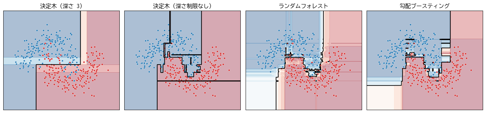
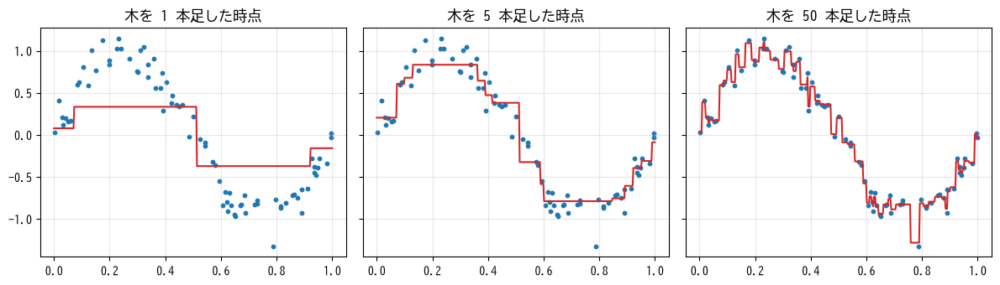

決定木とアンサンブル学習
========================

この章では、質問を繰り返してデータを分けていく\ **決定木**\ と、多数の決定木を組み合わせる\ **アンサンブル学習**\ の手法であるランダムフォレストと勾配ブースティングを説明する。勾配ブースティングは、表形式のデータに対して最も高い性能を示すことが多い手法の 1 つであり、実務で非常に広く使われている。

決定木
------

決定木の構造
^^^^^^^^^^^^

:term:`決定木`\ は、「特徴量 :math:`x_j` はしきい値 :math:`t` 以下か」という質問を繰り返してデータを分割し、最終的にたどり着いた場所で予測を行うモデルである。次の図は、乳がんの診断データ（30 個の特徴量から悪性か良性かを判定する）で学習した深さ 2 の決定木である。

.. graphviz::
   :align: center
   :caption: 乳がんの診断データで学習した深さ 2 の決定木

   digraph tree {
       node [shape=box, style="rounded,filled", fillcolor="#eef4fb", fontsize=11];
       edge [fontsize=10];
       root [label="worst radius <= 16.80 ?"];
       n1 [label="worst concave points <= 0.14 ?"];
       n2 [label="worst texture <= 19.91 ?"];
       l1 [label="良性", fillcolor="#dbeedb"];
       l2 [label="悪性", fillcolor="#f6dcdc"];
       l3 [label="良性", fillcolor="#dbeedb"];
       l4 [label="悪性", fillcolor="#f6dcdc"];
       root -> n1 [label="はい"];
       root -> n2 [label="いいえ"];
       n1 -> l1 [label="はい"];
       n1 -> l2 [label="いいえ"];
       n2 -> l3 [label="はい"];
       n2 -> l4 [label="いいえ"];
   }

一番上の分岐を\ **根ノード**、末端を\ **葉ノード**\ と呼ぶ。新しいデータを予測するときは、根ノードから質問に答えながら下にたどり、行き着いた葉ノードの値を予測とする。分類では葉ノードに含まれる訓練データの多数決のクラス（またはクラスの割合）を、回帰では葉ノードに含まれる訓練データのラベルの平均値を予測とする。

決定木の最大の利点は、学習結果を「if-then ルール」として人間が読めることである。上の図からは、「腫瘍の大きさ（worst radius）が小さく、くぼみ（worst concave points）も少なければ良性」といった判断の根拠を読み取れる。

分割の選び方
^^^^^^^^^^^^

決定木の学習では、各ノードで「どの特徴量の、どのしきい値で分割するか」を決める。良い分割とは、分割後の各グループに同じクラスのサンプルばかりが集まるような分割である。グループ内のクラスの混ざり具合を\ **不純度**\ と呼び、分類では\ **ジニ不純度**\ がよく使われる。

.. math::

   G = 1 - \sum_{k=1}^{K} p_k^2

:math:`p_k` はノード内でクラス :math:`k` が占める割合である。すべてのサンプルが同じクラスなら :math:`G = 0`、2 クラスが半々なら :math:`G = 0.5` となる。

学習では、すべての特徴量とすべてのしきい値の候補について、分割後の不純度（サンプル数で重み付けした平均）を計算し、分割前からの不純度の減少量が最大になる分割を選ぶ。これを分割後の各ノードで再帰的に繰り返す。次のコードは、1 回分の分割の探索を実装したものである。

.. literalinclude:: ../examples/ch07_tree_split_scratch.py
   :language: python
   :linenos:
   :pyobject: best_split
   :caption: 最良の分割の探索（ch07_tree_split_scratch.py より抜粋）

年齢と年収から商品を購入したかを予測する 8 件のデータに適用すると、「年収 5.75 百万円以下か」で分割すれば、購入しなかった人と購入した人が完全に分かれることが見つかる。

.. code-block:: text
   :linenos:

   分割前のジニ不純度 = 0.500
   最良の分割: 年収 <= 5.75 (不純度の減少量 = 0.500)
   左の子ノードのラベル: [0 0 0 0]  右の子ノードのラベル: [1 1 1 1]

サンプルコードの全体は :download:`ch07_tree_split_scratch.py <../examples/ch07_tree_split_scratch.py>` からダウンロードできる。

回帰の決定木では、不純度の代わりにノード内のラベルの分散（平均二乗誤差）を使う。

決定木の長所と短所
^^^^^^^^^^^^^^^^^^

決定木には次の長所がある。

* 学習結果を人間が解釈しやすい。
* 特徴量の大小関係しか使わないため、標準化などのスケーリングが不要である。
* 数値とカテゴリの特徴量が混在していても扱いやすい。
* 特徴量の間の相互作用（「広さが大きく、かつ駅に近い」など）を自然に表現できる。

一方、大きな短所として、過学習しやすいことがある。深さを制限しなければ、すべての葉ノードに 1 種類のクラスしか含まれなくなるまで分割を続け、訓練データを丸暗記してしまう。また、訓練データが少し変わるだけで木の形が大きく変わる、つまりバリアンスが大きい。

過学習を防ぐには、木の最大の深さ（``max_depth``）や、葉ノードに含まれるサンプル数の最小値（``min_samples_leaf``）などのハイパーパラメータで木の成長を制限する。

決定境界の形
^^^^^^^^^^^^

決定木は各特徴量の軸に沿って空間を分割するため、決定境界は軸に平行な線分を組み合わせた階段状になる。:numref:`fig-ch07-tree-boundary` の左の 2 つの図は、第 5 章の三日月形のデータで学習した決定木の決定境界である。深さを制限しない決定木は、少数のノイズのサンプルを囲い込むような複雑な境界を作っており、過学習していることが分かる。

.. _fig-ch07-tree-boundary:

   決定木、ランダムフォレスト、勾配ブースティングの決定境界

アンサンブル学習
----------------

複数のモデルを組み合わせて 1 つのモデルより良い予測を得る方法を\ :term:`アンサンブル学習`\ と呼ぶ。決定木は単体では過学習しやすいが、学習が速く、組み合わせの部品として非常に優れている。決定木を組み合わせる代表的な方法に、**バギング**\ と\ **ブースティング**\ がある。

.. graphviz::
   :align: center
   :caption: バギングとブースティングの違い

   digraph ensemble {
       rankdir=LR;
       node [shape=box, style="rounded,filled", fillcolor="#eef4fb", fontsize=11];
       subgraph cluster_bag {
           label="バギング（並列に学習して平均する）"; style=dashed;
           bd [label="訓練データ"];
           b1 [label="木 1"]; b2 [label="木 2"]; b3 [label="木 3"];
           bavg [label="平均・多数決", fillcolor="#fdf0e0"];
           bd -> b1 [label="復元抽出", fontsize=9]; bd -> b2; bd -> b3;
           b1 -> bavg; b2 -> bavg; b3 -> bavg;
       }
       subgraph cluster_boost {
           label="ブースティング（前の木の誤りを順に修正する）"; style=dashed;
           g1 [label="木 1"]; g2 [label="木 2"]; g3 [label="木 3"];
           gsum [label="和", fillcolor="#fdf0e0"];
           g1 -> g2 [label="残った誤差", fontsize=9];
           g2 -> g3 [label="残った誤差", fontsize=9];
           g1 -> gsum; g2 -> gsum; g3 -> gsum;
       }
   }

バギングとランダムフォレスト
----------------------------

バギング
^^^^^^^^

:term:`バギング`\ （bagging、bootstrap aggregating の略）は、訓練データから\ **復元抽出**\ （同じサンプルを重複して選ぶことを許す抽出）でデータを作り直し、それぞれで別々のモデルを学習して、予測を平均（分類では多数決）する方法である。復元抽出で作ったデータをブートストラップ標本と呼ぶ。

個々の決定木はデータの選ばれ方によって大きく異なる予測をするが、多数の木の予測を平均すると、ばらつきが打ち消し合う。つまりバギングは、バイアスをほぼ保ったままバリアンスを下げる効果がある。

ランダムフォレスト
^^^^^^^^^^^^^^^^^^

:term:`ランダムフォレスト` [Breiman2001]_ は、バギングに加えて、各ノードの分割で候補とする特徴量をランダムに一部だけに絞る手法である。これにより、どの木も同じ強い特徴量で分割するということがなくなり、木どうしの相関が下がって、平均したときのバリアンスの低減効果が大きくなる。

ランダムフォレストには次の特徴がある。

* ハイパーパラメータの調整をあまりしなくても、安定して良い性能が得られる。
* 木の本数（``n_estimators``）を増やしても過学習はしにくい。本数を増やすと性能は頭打ちになり、計算時間だけが増える。
* 各木は独立に学習できるため、並列化しやすい。
* 各木の学習に使われなかったサンプル（OOB: out-of-bag）で評価すれば、検証データを別に用意しなくても汎化性能を見積もれる。

ブースティングと勾配ブースティング
----------------------------------

ブースティング
^^^^^^^^^^^^^^

**ブースティング**\ は、モデルを 1 つずつ順番に学習し、後のモデルが前のモデルの誤りを修正するように組み合わせる方法である。個々のモデルには、単体では性能の低い浅い決定木（**弱学習器**）を使う。バギングが主にバリアンスを下げるのに対し、ブースティングは弱学習器を積み重ねることでバイアスを下げる。

勾配ブースティング
^^^^^^^^^^^^^^^^^^

:term:`勾配ブースティング` [Friedman2001]_ は、ブースティングの代表的な手法である。回帰で平均二乗誤差を使う場合、手順は次のようになる。

1. 最初の予測 :math:`F_0(\boldsymbol{x})` を、全サンプルのラベルの平均値とする。
2. :math:`m = 1, 2, \ldots, M` について、次を繰り返す。

   a. 各サンプルの残差 :math:`r_i = y_i - F_{m-1}(\boldsymbol{x}_i)` を計算する。
   b. 残差 :math:`r_i` を予測する浅い決定木 :math:`h_m` を学習する。
   c. 予測を :math:`F_m(\boldsymbol{x}) = F_{m-1}(\boldsymbol{x}) + \eta \, h_m(\boldsymbol{x})` と更新する。

つまり、「今の予測で残っている誤差」を次の木に学習させ、それを少しずつ足し込んでいく。:numref:`fig-ch07-boosting-steps` に、木を足していくにつれて予測が真の関数に近づく様子を示す。

.. _fig-ch07-boosting-steps:

   勾配ブースティングの予測の変化（深さ 2 の決定木、学習率 0.5）

平均二乗誤差の場合、残差 :math:`y_i - F(\boldsymbol{x}_i)` は損失関数を予測値 :math:`F(\boldsymbol{x}_i)` で微分したものの符号を反転した値（負の勾配）に比例する。勾配ブースティングという名前は、一般の損失関数について、この「負の勾配」を次の木に学習させることに由来する。これは、パラメータではなく予測値そのものを勾配降下法で更新していると見ることもできる。損失関数を交差エントロピーにすれば、同じ枠組みで分類にも使える。

:math:`\eta` は学習率で、第 4 章の勾配降下法と同じ役割を持つ。学習率を小さくして木の本数を増やすと、一般に汎化性能が上がるが、学習に時間がかかる。ランダムフォレストと異なり、木の本数を増やしすぎると過学習するため、検証データの損失が改善しなくなった時点で学習を打ち切る\ **早期終了**\ を使うのが一般的である。

主なハイパーパラメータは、学習率、木の本数、木の深さ（または葉ノードの数）、葉ノードに含まれるサンプル数の最小値などである。

勾配ブースティングのライブラリ
^^^^^^^^^^^^^^^^^^^^^^^^^^^^^^

勾配ブースティングには、高速化や性能向上の工夫を加えた実装が複数ある。

* **XGBoost** [Chen2016]_: 正則化を取り入れ、高速な実装で広く普及した。
* **LightGBM** [Ke2017]_: 特徴量の値を少数の区間（ビン）にまとめるヒストグラムベースの手法などにより、大規模データでも高速に学習できる。
* **CatBoost** [Prokhorenkova2018]_: カテゴリの特徴量の扱いに工夫がある。
* scikit-learn の ``HistGradientBoostingClassifier`` / ``HistGradientBoostingRegressor``: LightGBM と同様のヒストグラムベースの実装で、欠損値をそのまま扱え、早期終了にも対応している。

いずれも、欠損値を含む表形式のデータをほとんど前処理なしで扱え、高い性能を示す。

手法の比較
----------

:numref:`fig-ch07-tree-boundary` の右の 2 つの図を見ると、ランダムフォレストと勾配ブースティングは、単体の決定木よりも滑らかで妥当な決定境界を学習していることが分かる。

次のサンプルは、乳がんの診断データで 4 つのモデルを 5 分割交差検証で比較し、浅い決定木のルールと、ランダムフォレストの特徴量重要度を表示する。

.. literalinclude:: ../examples/ch07_tree_ensemble_sklearn.py
   :language: python
   :linenos:
   :pyobject: main
   :caption: 決定木とアンサンブル学習の比較（ch07_tree_ensemble_sklearn.py より抜粋）

.. code-block:: text
   :linenos:

   決定木 (深さ制限なし): 正解率 = 0.926 (標準偏差 0.022)
   決定木 (深さ 3): 正解率 = 0.930 (標準偏差 0.024)
   ランダムフォレスト: 正解率 = 0.958 (標準偏差 0.017)
   勾配ブースティング: 正解率 = 0.968 (標準偏差 0.015)
   |--- worst radius <= 16.80
   |   |--- worst concave points <= 0.14
   |   |   |--- class: 1
   |   |--- worst concave points >  0.14
   |   |   |--- class: 0
   |--- worst radius >  16.80
   |   |--- worst texture <= 19.91
   |   |   |--- class: 1
   |   |--- worst texture >  19.91
   |   |   |--- class: 0

   worst radius: 0.125
   worst concave points: 0.125
   worst perimeter: 0.120
   worst area: 0.110
   mean concave points: 0.102

アンサンブル学習の 2 手法は、単体の決定木より正解率が高く、ばらつき（標準偏差）も小さい。``export_text`` の出力は、本章の最初に示した決定木の図と同じ内容である（このデータセットではクラス 0 が悪性、クラス 1 が良性）。

サンプルコードの全体は :download:`ch07_tree_ensemble_sklearn.py <../examples/ch07_tree_ensemble_sklearn.py>` からダウンロードできる。

特徴量重要度の注意点
^^^^^^^^^^^^^^^^^^^^

ランダムフォレストや勾配ブースティングでは、各特徴量が分割によって不純度をどれだけ減らしたかを集計した\ **特徴量重要度**\ を得られる。どの特徴量が予測に効いているかの目安になるが、次の点に注意が必要である。

* 値の種類が多い特徴量（連続値や ID のような列）の重要度が過大に評価されやすい。
* 互いに強く相関する特徴量があると、重要度がそれらの間で分散する。上の例では worst radius、worst perimeter、worst area はいずれも腫瘍の大きさを表しており、強く相関している。
* 重要度は「予測に使われた度合い」であり、因果関係を表すものではない。

より信頼性の高い方法として、第 13 章で紹介する順列重要度がある。

どの手法を使うべきか
--------------------

表形式のデータの教師あり学習では、次のように進めるのが実務的である。

1. まずロジスティック回帰や線形回帰などの単純なモデルでベースラインを作る。
2. 次に勾配ブースティング（LightGBM、XGBoost、scikit-learn の ``HistGradientBoosting`` など）を試す。多くの場合、これが最も高い性能を示す。
3. 調整の手間をかけずに安定した性能がほしい場合は、ランダムフォレストも有力な選択肢である。
4. 解釈性が最も重要な場合は、浅い決定木や線形モデルを使う。

画像・音声・文章のようなデータでは、第 9 章以降で説明する深層学習が圧倒的に優れている。一方、表形式のデータでは、深層学習よりも勾配ブースティングの方が性能が高いことが多い。

まとめ
------

* 決定木は質問を繰り返してデータを分割するモデルで、解釈しやすく前処理も少なくて済むが、単体では過学習しやすい。
* 分割は、不純度（ジニ不純度など）の減少量が最大になるように選ぶ。
* バギングは、復元抽出したデータで学習した多数のモデルを平均してバリアンスを下げる。ランダムフォレストはこれに特徴量のランダムな選択を加えたものである。
* 勾配ブースティングは、前のモデルの誤差（負の勾配）を次の木に学習させて積み重ねる。表形式データで非常に高い性能を示す。
